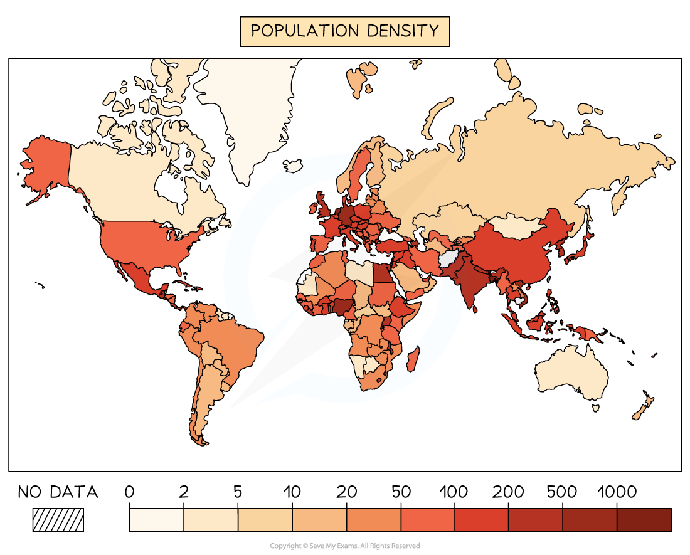

# Factors Affecting Population Density & Distribution

## Population Density & Distribution

> **Spec point** — `spcpt_WZPWF8gXGC2s842D` · Describe the factors influencing the density & distribution of population

## Population Density & Distribution

- ***Population density*** varies across the world
- The way in which the global population is spread across the world is the **population distribution**
- **Population density** is calculated by dividing the total population by the total area

  - The total area can be on different scales (region, country, continent)

*Figure 1 - world population density*

- Monaco has the highest population density in the world—26,337 people per km2  (2022)
- Greenland has the lowest population density in the world—lower than 0.2 people per km2 (2022)
- In 2022, the world population density was approximately 59.27 people per km2
- Population is not evenly spread, and some areas are **densely populated** whilst others are **sparsely populated**

  - The population density is affected by a range of factors, both physical and human

#### Physical factors

- **Climate**

  - Population density tends to be lower in colder regions and tropical deserts
  - The extremes of temperature create a harsh living environment where growing crops and accessing water are difficult
- **Water supply**

  - Settlements are usually located near a water supply for drinking, washing, etc.
  - If water is scarce or difficult to obtain, then population density tends to be lower
- **Natural resources **

  - These include minerals such as coal and oil
  - Areas with large amounts of natural resources tend to have higher population density
  - This depends on how easily the minerals can be obtained
- **Relief **

  - Mountainous areas tend to have lower population density due to difficulties in building and growing crops
  - Population densities are higher where the land is flat or gently sloping
- **Soil quality **

  - Population densities are highest where the soil fertility and quality are best
  - This makes it easier to grow crops

#### Human factors

- **Economic**

  - More people live where there are more jobs
  - The number of jobs is often affected by the infrastructure (transport/communication) and capital (the money available)
- **Political**

  - Government investment in an area can improve the infrastructure, which increases industry/business and attracts more people
- **Social **

  - The better the housing, education and services the more people are likely to be attracted to an area, increasing the population density
  - The birth and death rates also affect the population density
- **Cultural **

  - In some cultures, larger families are valued highly or religious beliefs dictate larger families
  - This can increase the population density within a country

> **Exam Hint**
> In the exam, you may be asked to describe the distribution of population in a region, country or world. When describing distribution, ask yourself the following questions:
> 
> - What is the general pattern?
> - Does the pattern relate to anything else? e.g. coastal areas, inland areas or water supply?
> - Can you name examples of countries that have the highest density and examples of those with the lowest density?
> 
> Use map features to help with your description—place names, compass points, latitude and longitude.

> **Worked Example**
> **Figure 2.1 gives information about the population density of Bangladesh. Use fig 2.1 to answer the question below**
> 
> 
> 
> **Fig 2.1**
> 
> **Using fig 2.1, describe the distribution of areas with more than 1300 people per km2 in Bangladesh**
> 
> **[2 marks]**
> 
> **Final answer:** **Answer**
> 
> - Any two of the following:
> 
>   - in the north** [1]**
>   - central **[1]**
>   - inland **[1]**

## Case Study: Singapore

> **Spec point** — `spcpt_6vRDryMR7STFdw8f` · A densely populated country or area

## Case Study: Singapore

> **Case Study**
> - Singapore has a** population density **of 8,383 people per km2 (2024)
> - As a city-state, it is not the most densely populated city in the world, but it is the third most densely populated country
> 
> 
> 
> *Population Density in Singapore*
> 
> ### Causes of high-density population
> 
> - Singapore is only 716 km², which means the population is living in a limited amount of space
> - Singapore has a tropical climate with uniformly high temperatures between 25ºC and 27ºC
> - Almost all the land is habitable and either flat or gently sloping, with the highest point at only 165 m above sea level
> - Access to water supplies
> - Excellent infrastructure and communication
> - Low crime rates
> - Stable government
> - High immigration rates
> - World's busiest port in shipping tonnage
> 
> ### Effects of high-density population
> 
> - Housing shortages
> - High rents and house prices
> - Only 1% of the land is used for agriculture, which means most of the food is imported
> - Increased pressure on infrastructure such as public transport and services such as schools
> - Increased waste
> - Increased air and water pollution

## Case Study: Mongolia

> **Spec point** — `spcpt_yKvKQMJDnJ9hhrm2` · A Sparsely populated country or area

## Case Study: Mongolia

> **Case Study**
> - Mongolia has an area of 1,564,000 km²
> - The population density is 2 people per km² 
> 
> 
> 
> *Population density of Mongolia*
> 
> ### Causes of the low population density
> 
> - The **harsh climate** in many areas with very cold winters, which can reach -30°C
> - **High altitudes** mostly between 900 and 1500 m above sea level
> - Vast areas of desert and semi-desert
> - A **short growing season** of only about 90 days
> 
>   - The climate and relief make agriculture very difficult
> - Mongolia is a** landlocked** country, which makes trade difficult
> - **Poor infrastructure** and communication; only about 20% of the few roads are tarmac
> - Many people in rural areas are reliant on livestock herding for their livelihood
> 
>   - Severe winters and hot summers can lead to a lack of pastures for grazing
> - Low birth rates
> 
> ### Impacts of low population density
> 
> - Difficulties in accessing services such as healthcare and education, **particularly** in rural areas
> - Poor access to markets and trade
> - A lack of economic activities
> - Increased rural-urban migration

> **Worked Example**
> **For a named country or area you have studied, explain why it is sparsely populated.**
> 
> **[7 marks]**
> 
> **Final answer:** **Answer**
> 
> - Examples of paragraphs that could be included in an answer to achieve Level 3:
> 
>   - Mongolia has a harsh climate, which means that it is a challenging environment. The winter temperatures can reach lows of -30 ºC, which means it is difficult for people to survive. As a result of the climate, the growing season is only about 90 days long. This means that growing crops is challenging and restricts food supplies
>   - A lack of infrastructure means that many places are inaccessible. In Mongolia, only about 20% of the roads are tarmac, which makes access to employment and resources difficult. Many people are reliant on livestock herding for their income but severe winters and hot summers can lead to a lack of grazing which reduces the population in those areas
