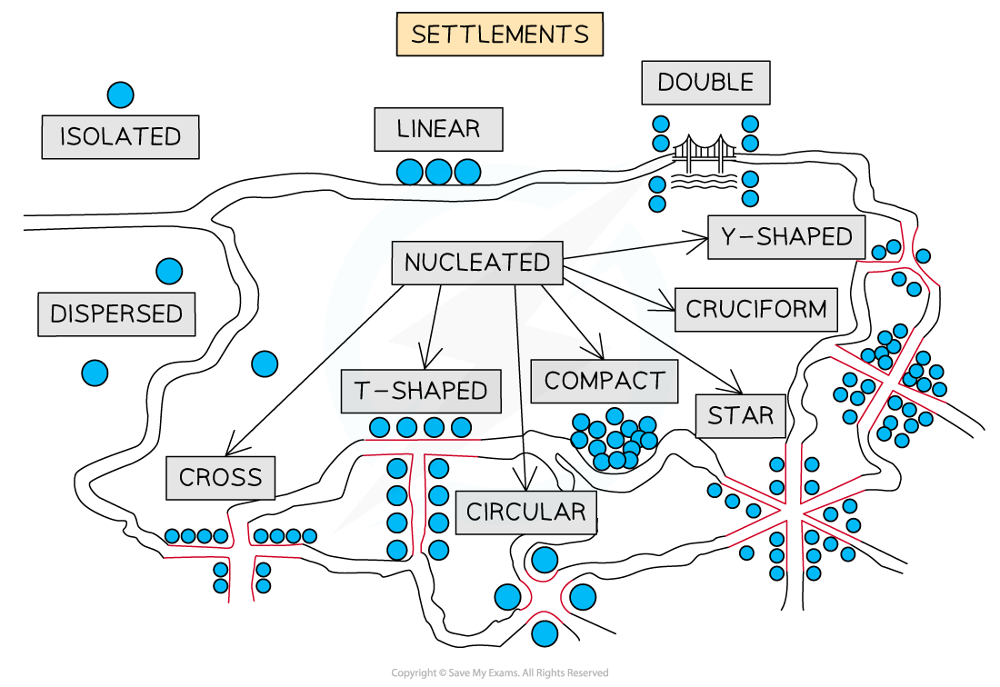

# Patterns of Settlement

## Patterns of Settlements

> **Spec point** — `spcpt_yn6mnSZCqPx37jTS` · Explain the patterns of settlement

## Patterns of Settlements

### Categorising settlements

- A settlement is a place where people live and carry out a range of activities—trade, manufacturing, agriculture, etc.
- They can be categorised through their **pattern**
- However, there are other factors that influence settlements, such as their:

  - shape or form
  - site and situation
  - function and hierarchy
  - change and growth: modern-day settlement patterns are changing due to population change, technological developments, changing lifestyles and expanding urban limits (rise of the megacities and urban sprawl)

### Pattern

- Settlements come in different shapes and sizes called **patterns **and the physical geography of an area dictates these patterns
- These patterns range from **isolated buildings** in ***rural***** **regions to ***urban***** megacities **of over 10 million people
- **Urban towns, cities, conurbations and megacities** are usually densely populated over a **smaller **area
- **Rural towns and fringe areas** are usually densely populated over a **larger **area
- **Villages and hamlets** usually have a **lower population **density and **smaller settled** areas

### Settlement Patterns

#### Form or shape?

- When it comes to describing the pattern, both mean the same thing—it is how the settlement is laid out
- A river, railway, or major road, for example, would support **linear **growth along this route to bring in trade

  - A linear settlement will also form because of poor drainage or the position of a mountain
- Circular shapes** **grow around a central feature, like a village green or lake, and are set up so that the middle is still easy to get to
- When several roads meet and homes are built along those roads, they make a **star-**shaped settlement
- **T-form **settlements happen where two roads meet
- **Y-form** towns happen where two roads meet, and homes are built along these roads
- **Cruciform **shapes happen at** **cross-roads, where homes group together (nucleate) and spread out in all four directions
- **Cross-shaped** is like a cruciform, but the houses will line up along the road instead of being clustered around it

*Diagram showing various settlement patterns*

- **Dispersed **

  - Where** isolated **houses or farms are spread out in fields or along roads instead of all being in one place
  - Found in rural areas with few people, like the Sahel region of Africa, the outback of Australia, or the mountainous parts of Scotland and Wales
  - In England in the 1600s and 1700s, settlements were dispersed because big rural estates were broken up
  - Extreme weather—too hot, wet, cold, or dry—also leads to dispersed villages because it makes settlement growth less likely
- **Linear**

  - Because of the way the land is shaped, villages tend to line up along a river or trade and transport route
- **Nucleated**

  - These form when a lot of towns are close together around a central feature like a church, a village green, a crossroads, or something else
  - Further out, there are fewer buildings. These small towns are called hamlets or villages, based on their size and purpose
  - There are many reasons for the development of nucleated settlements, such as:
  
    - defence
    - trade
    - co-operative community: agriculture, water, work
    - floodplain: safer to group on a hilltop

> **Exam Hint**
> Make sure you can define the terms urban and rural. You might think it is easy, but as settlements change, so does their position in the hierarchy.
> 
> - Rural: an area with less than 10,000 people living within its boundaries
> - Urban: an area with more than 10,000 people living within its boundaries
> 
> This use of a figure helps to keep the definition clearer and it is easier to discuss the types of settlements found within.
> 
> - Rural: dispersed, hamlet, village and small market town
> - Urban: large towns, cities, conurbations and megacities
