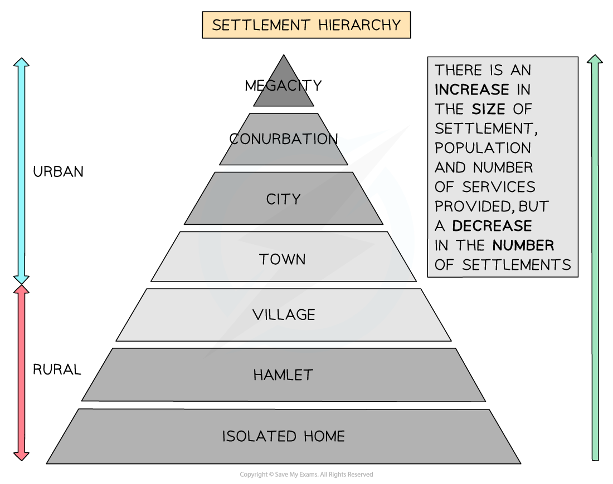
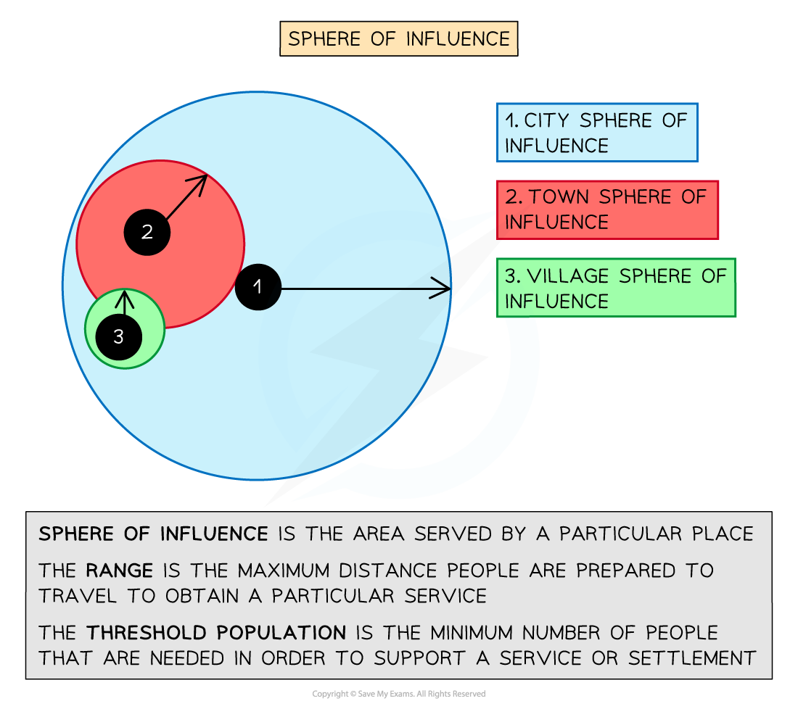

# Settlement & Services Hierarchy

## Settlement & Services Hierarchy

> **Spec point** — `spcpt_2S2WDngWHnWc2frP` · Give reasons for the hierarchy of settlements & services

## Settlement & Services Hierarchy

### Settlement hierarchy

- A **hierarchy** is when settlements are ordered and classified based on three principles:

  - Population size
  - Number of services provided
  - Number of settlements
- Higher up the hierarchy, fewer settlements are found
- However, the population, number and types of services provided increase
- The hierarchy follows a path:

  - Dispersed ⇒ Hamlets ⇒ Villages ⇒ Market towns ⇒ Large towns ⇒ Cities ⇒ Conurbations ⇒ Megacities
- The result is a pyramid-shaped model, where there are more cities than megacities and more villages than towns

### Services hierarchy

- All settlements offer certain **functions** and **services**, such as the basics of life like bread, milk, eggs, etc.
- A settlement's physical and population size will determine the **number **of **services **it offers
- The minimum number of people necessary before a particular good or service will be provided in the area is called the **threshold population**

  - A small village or hamlet with a small populace will only provide **low-order** **services** such as a post office, general store, pub and possibly a doctor
  - Towns will provide **low- and high-order** **services** such as a church, medical centre, garages, schools and restaurants
  - Cities and conurbations will focus on **high-order services** such as leisure centres, schools, churches, chain stores and hospitals
- There are exceptions to this:

  - Some places may have more services than average, such as a small seaside resort
  - Others have fewer, such as a commuter or dormitory town

### Sphere of influence

- This is the area that a settlement serves, also known as a **catchment area**
- It is the **range** (distance) that people will travel to obtain a particular service or product
- The larger the settlement, the greater the influence (usually)

  - A hamlet or village would normally have a **low sphere of influence** and, therefore, a small field of services
  - But if that village is a tourist spot, then its sphere of influence could be greater than a town
- **Low-order goods **

  - Things that are bought regularly, such as milk or bread
  - People are not prepared to travel far to buy a **convenience **good and there is no real saving in shopping around
  - The extra cost of ‘shopping around’ outweighs any savings that may be made
- **High-order goods**

  - **Comparison **goods such as electrical goods and furniture that the shopper will buy only after making a comparison between various models and different shops
  - A high threshold population is needed to sustain a shop selling comparison goods
  - People are prepared to travel some distance to obtain the goods

## Settlement & Service Provision Case Study: Lozère, France

> **Spec point** — `spcpt_GqNnjdjNrxCQ455f` · Settlement & service provision in an area

## Settlement & Service Provision Case Study: Lozère, France

> **Case Study**
> - **Lozère** is a **landlocked** department in southeast France
> - Cattle rearing and tourism make up most of its economy due to its poor soil quality and mountainous relief
> - Unemployment is low due to the **out-migration** of young people, which has left an ageing population behind
> - However, due to improved communications, easier travel and tourism, the population has increased slightly and with it, some services
> - While tourism offers some form of employment, it is limited to:
> 
>   - seasonal work
>   - low skilled
>   - low paid
>   - part-time
> - These factors affect the services available and the town's sphere of influence:
> 
>   - St-André-Capcèze and Mende have a population of 176 (2015) and 12, 370, respectively, with services ranging from railways to dentists to hotels to a cinema to horse riding, but people have to travel 14–25 miles to go skiing, as they are not high enough in the mountains to ski, but their sphere of influence is greater than Badaroux, which situated by a lake and mostly attracts fishing, swimming and relaxation
>   - Villefort with a population of 639 is positioned in the right place to enable all services to be available to them
>   - Yet Cubières and Altier are too remote to provide many services, despite their population being greater than St-André-Capcèze

> **Exam Hint**
> - Have** **a wide range of case studies and choose them with care to fit the questions selected
> - Make sure you include relevant, place-specific information
> - Don't just write everything you know about the case study; write concisely, making sure that you are answering the question set
