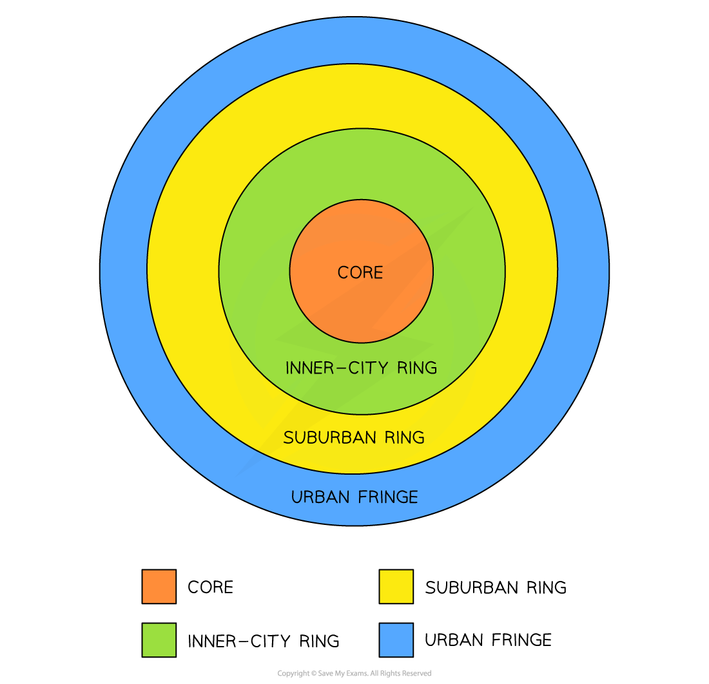
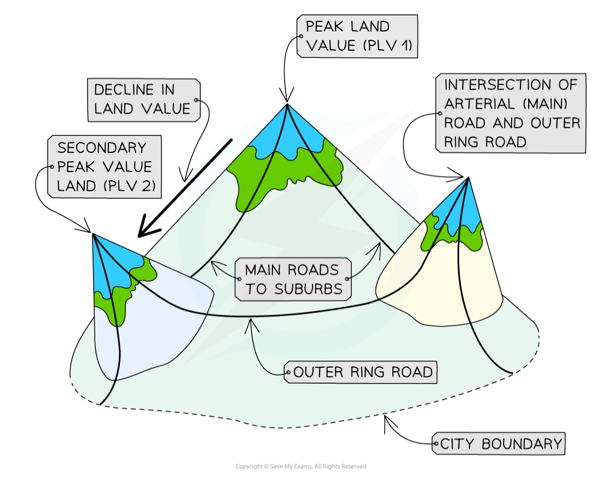
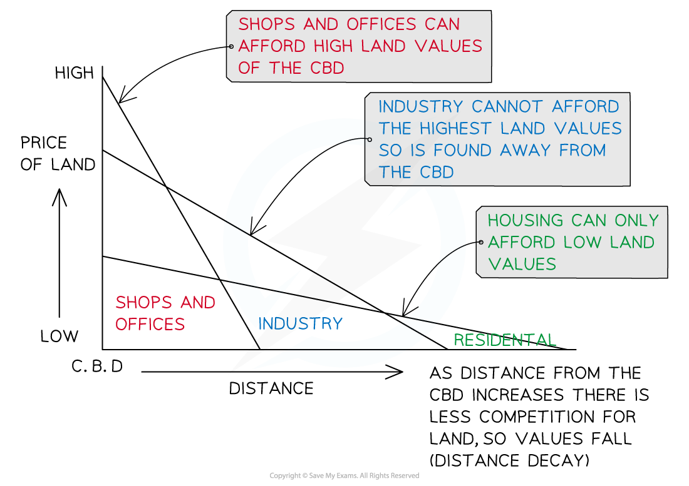
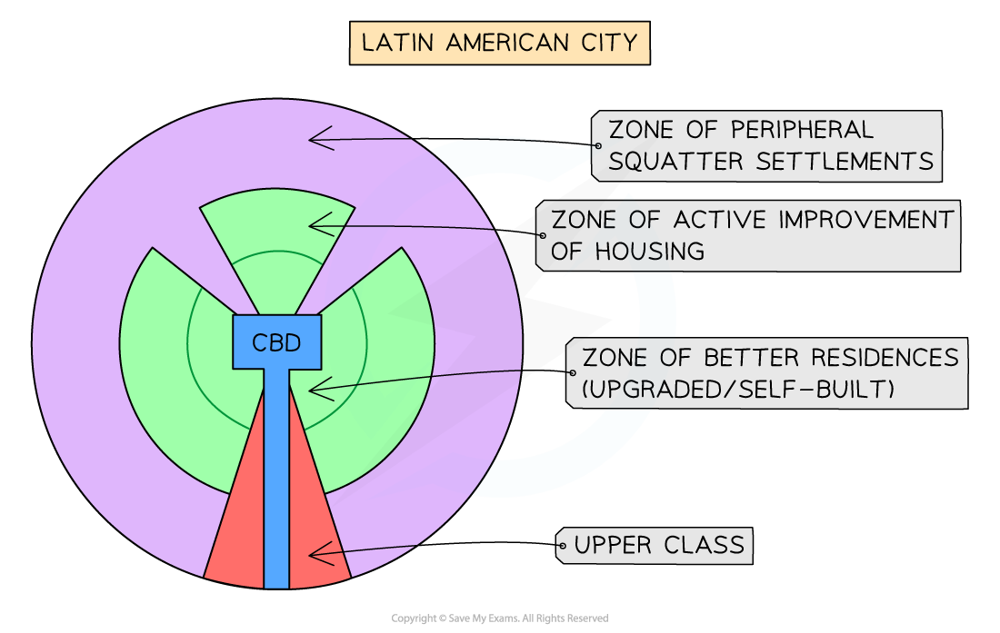

# Characteristics of Urban Land Use

## Land Use in Urban Areas

> **Spec point** — `spcpt_JJHKP3Xr3FhB9648` · Describe the characteristics of land use in urban areas

## Land Use in Urban Areas

### Urban land use

- Urban land use refers to activities that are found in towns and cities
- All urban settlements have recurring features:

  - A central core or **central business district (CBD)**
  - Industrial areas—**inner-city ring**
  - Different residential districts—**suburban ring**
  - Outer zones of suburban expansion—**urban fringe**

- All towns and cities tend to grow outward from a historic centre or **core **to an **urban fringe**
- Each zone grows due to the needs of the city during its development over time
- As a general rule, **all towns and cities,** regardless of place or level of development, **show the same four features**:

  - **A central core**
  - **An inner-city zone**
  - **A suburban zone**
  - **An urban fringe **

### Central core

- The oldest part of a city with features such as:

  - the central business district (**CBD),** e.g. banks, retail and commercial offices
  - multi-storey development, with vertical growth rather than horizontal due to lack of space
  - land of high-value
  - concentrated retail and office space
  - pedestrianisation for high footfall
  - convergence of public transport
  - traffic restrictions for private vehicles
  - low residential population

### Inner-city zone

- A 'frame' to the inner core, which developed as the core developed
- Older, compact, **terraced** '**worker**' housing to support a growing population density
- Surrounded by older industrial areas
- Areas are centred around transport links and access to manufacturing
- Available land increases with distance, so costs are reduced
- Residential land is in direct competition with commercial usage

### Suburban zone

- **Residential areas **
- Emergence of **segregated residential zones** based on wealth, ethnicity, choice or government policy (e.g. social housing)
- **Semi- **and **detached** housing with gardens
- Tree-lined avenues and cul-de-sac
- Smaller retail premises
- The cost of land decreases but the size of the property increases with the distance

### Urban fringe

- These are the outer edges of the city where:

  - the countryside is eroded through the urban spread/sprawl
  - housing is clustered into estates, which increases 'spot' density
  - some industrial land uses
  - accessibility is best

### Other similar characteristics

- Other characteristics of modern urban settlements include:

  - From the core to the fringe, the age and density of the buildings decrease
  - Different zones have different levels of grandeur, purpose, design, and style
  - Land use and population density change over time

*The four zones of cities based on Burgess's Concentric Ring theory*

- Although the model above is simplified, it shows that the majority of business activity is concentrated in a core
- Usually with the highest land value, the **CBD** is also the **most easily accessible **due to public transport
- Because of the **high demand** for property, **high-rise buildings** are seen here; for example, Singapore, New York, and Hong Kong are well known for their 'skyscrapers', and land prices are among the highest in the world

> **Exam Hint**
> - Every model is a simple representation and applies to virtually all urban areas across the globe, **but **each zone varies in character, use and people depending on circumstances and where they are found.
> - In **LEDC** cities, the urban fringe has illegal **squatter settlements** or shanty towns as its 'housing estates'.
> - But, in MEDC cities, the poorer zones are the inner city with industry at the fringes, for easy access to motorways.
> - Gentrification and redevelopment in inner cities are more common in MEDC cities
> - Same features but different characteristics/uses.

### Peak land value

- Any land that has '**purpose**' will be **valuable **and cost more to buy or rent
- Usually, retail shops can make money and look for **prime **positions
- Therefore, land uses of similar activities will come together, creating '**peaks**' and '**troughs**' of land values across the urban landscape
- There are two points to consider:

  - The **value** of the land:
  
    - Varies across the urban areas
    - Usually decreases from the centre, outwards
    - Higher land prices are also found along main roads, urban hubs and around ring roads
  - The **location **of the land:
  
    - Is important to value
    - The closer to key functions, the higher the value
    - Accessibility and desirability increase land value

*Diagram illustrating urban land value peaks*

### Bid-rent theory

- Also known as '**distance decay theory**', where the price and demand for land change as the distance from the CBD increases
- Different land uses will compete for desirable plots to maximise their profits
- **Accessibility** increases the potential for more customers
- There is a trade-off between accessibility and the cost of the land

  - The closer to the CBD the more desirable land is to retail and the higher the price charged/paid
- Industry cannot compete with high prices so moves further away from CBD
- Residential land is outpriced across the zones, but competition is less so value decreases as more space becomes available

** **

*Bid-rent graph shows land prices decrease further from the CBD *

### Urban land use in LEDCs

- The **Latin American city model** shows that the CBD has developed around a colonial core, with a commercial corridor extending from it

  - This has become the main avenue and contains open spaces and homes for medium- and higher-income earners
  - These areas will have quality streets, schools and public services
- Newer suburbs are found further out with random housing and fewer services
- Squatter housing is found at the edge of the city; however, the more established **squatter settlements** can be found along the zones that extend into the city centre

  - Conditions here are usually better than in the more recent housing at the edge, most likely due to employment opportunities found closer to the core
- Industrial areas are scattered along the major transport routes, with the newest developments at the edge

*Latin American city model*

### Land zoning in LEDCs

- Manufacturing is found throughout the city
- Segregation is seen through wealth, ethnicity and race
- The wealthy are found closer to the central core of the city on wealthy land
- The poor are pushed to the peripheral areas

> **Worked Example**
> **Study Fig. 2.1, which is a transect across a city in Belgium, an MEDC in Europe.**
> 
> 
> 
> (i) What is the distance from the CBD to the boundary of the city?
> 
> ........................km
> 
> **[1 Marks]**
> 
> **Answer:**** **
> 
> **Final answer:** **Approximately 13 km from CBD to fringe **
> 
> > *Use a ruler and measure the distance key, which tells you that so many cm = 1 or 2 km; in this instance, it is 0.5 cm = 1 km and 2 km = 1 cm *
> 
> *Measure the length from A to boundary between D and E = 6.5 cm (approx.)*
> 
> *6 x 2 = 12km plus 1km for the 0.5 cm = 13km from CBD to fringe approximately*
> 
> (ii) Identify from Fig. 2.1 the letter which represents:
> 
> - an area of traditional industry where redevelopment is taking place **= ****B**
> - an area where a ring road and business park have recently been built on greenfield sites **= ****E**
> 
> **[2 Marks]**
> 
> (iii) State **three** likely differences between residential areas **C** and **D** in the MEDC city shown in Fig. 2.1.
> 
> **[3 Marks]**
> 
> **Final answer:** **Answer **
> 
> ** **D is likely to:
> 
> - Be newer
> - Have a lower density
> - Be higher in cost
> - Have detached/semi-detached houses rather than terraced/semi-detached
> - Rather than detached
> - Have gardens/drives/garages, etc.
> 
> (iv) Give **two** examples of low-order services that are likely to be located close to residential areas, such as in area X in Fig. 2.1.
> 
> Explain why many of the services in this area are likely to be low-order services.
> 
> **[4 Marks]**
> 
> **Final answer:** **Possible answers:**
> 
> - **Services **such as:
> 
>   - newsagent
>   - general store
>   - grocers
>   - primary school
>   - church etc.
> - **Reasons** such as:
> 
>   - a small sphere of influence
>   - people will not travel far to use them
>   - threshold population will be small
>   - lots of similar services
>   - will be used frequently
>   - sell convenience goods, etc.
> 
> **NB: **2 Marks **max **for each of the examples and reasons
