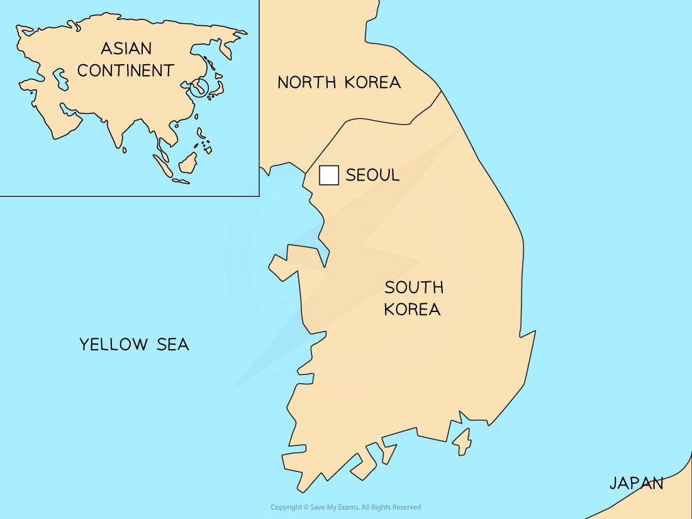

# Issues & Solutions to Problems of Urban Areas

## Issues & Solutions Within Urban Areas

> **Spec point** — `spcpt_SMpc3jtDCrYJgtdD` · Explain the problems of urban areas & their possible solutions

## Issues & Solutions Within Urban Areas

### Problems within urban areas

- There are many problems throughout the urban area
- Some are specific to particular zones, whilst others are more general:

  - The CBD for instance, has a particular problem with the lack of space for development, the high cost of land and meeting strict planning and government policies
  - Congestion and pollution are concentrated in the CBD but are also a general urban issue
- Other problems include:

  - Pollution
  - Inequality
  - Housing
  - Congestion
  - Crime
  - Land-use change

### Congestion

- Congestion can delay journeys and make people late to their destinations
- It increases fuel consumption
- Adds to emissions of greenhouse gases and other pollutants
- Has a negative impact on people's health due to stress and poor air quality; diesel fumes are carcinogenic

### Pollution

- Pollution can be divided into air, noise, light, visual and water

### Air

- Poor air quality affects half of the world's urban population
- Thousands of people die each year from air pollution-related conditions (asthma, lung cancer, etc)
- With the growth of industrial development and population, there is a rise in the number of vehicles
- This increases the demand for energy, heating, etc and with rapid urbanisation in LEDCs, the rate of pollution is worse
- Few LEDCs have the resources to cope with this
- India has some of the most polluted cities in the world and the causes include:

  - burning fuelwood indoors
  - using paraffin for cooking and heating
  - weak or no government pollution controls
  - use of cheap or poor-grade coal
  - burning of rubbish and plastics
- Having gone through deindustrialisation, MEDCs have the financial, political, and technological tools to handle air pollution
- Vehicle emissions are a main cause of air pollution; many LEDCs lack modern, fuel-efficient cars
- Also, crowded and poorly organised road systems add to the problem of congestion but also air and noise pollution

### Noise

- Noise pollution arises from several things:

  - Road traffic
  - People
  - Music
  - Weather
  - Road surfaces
  - Barriers
  - Doors and shutters, etc.
- Mental stress, anger issues, sleep deprivation, ***hypertension*** and heart disease have been linked to noise pollution

### Light

- Light pollution is common where any form of human habitation is found
- Light pollution arises from street lighting, homes, shops, factories, and offices
- The 'bright city lights' have always been a discussion point for the 'pull' factor of cities
- Light pollution is linked to headaches, loss of sleep, disruption of nocturnal animals and wasted energy
- Cities can be seen from space due to their lighting

### Visual

- This is where the 'look' of the area becomes offensive
- It can be different for each person but can include:

  - run-down, derelict buildings, streets or neighbourhoods
  - ***graffiti*** and ***tagging***
  - new architecture or roadways

### Water

- Water pollution causes a variety of diseases, such as diarrhoea and dysentery, which can lead to death
- Water pollution is widespread as rivers are used to dump large amounts of pollutants from a variety of sources, including:

  - industrial discharge
  - vehicles
  - residential/commercial wastewater
  - rubbish
  - chemicals and other toxic wastes
  - polluted stormwater and runoff from urban landscapes

### Inequality

- Inequality exists in every city when it comes to everything from property to jobs
- The rich can afford to live in 'nice' neighbourhoods, while the poor live on the edges of the city, in edge-of-town estates or high-rise flats
- In LEDCs, as poor rural migrants arrive, there is a lack of affordable housing and demand is high

  - As more temporary or ***informal settlements*** arise, they add to the overcrowding and poor living conditions around the fringes that are already crowded
- Many people are unable to find formal, regulated, regular employment and this leads to high levels of unemployment, *underemployment*, or informal, unregulated employment

  - Many people in LEDCs get their main jobs in the informal economy
  - When there are new companies with regular jobs, they are often too far away from places where newcomers live
- There is inequality in terms of how much knowledge people have and what they can do

  - Wealthy people give their children and family support when they are young and beyond, giving them access to healthcare and other chances
  - Poorer families need their children to work to help support the family and this leads to a lack of general education and skills
- Literacy and numeracy rates are lowest in LEDC countries

### Housing

- Housing is expensive in relation to general wages, with many families sharing one house or just a room

  - This creates opportunities for landlords to set high rents and no building maintenance (slum landlord)
- Poor transport links make inner city housing the most desirable and expensive
- There is a division in the quality of housing available, with many houses in LEDCs without adequate space, running water or sanitation
- Waste removal is inadequate or non-existent, leading to the spread of diseases
- Lack of access to electricity leads to people burning fuelwood, coal or paraffin

### Crime

- Crime is concentrated in areas of high population densities: congested areas
- Crime is partly due to a lack of job opportunities and large-scale unemployment
- Main criminal activities include drug and human trafficking, drug abuse, violence (domestic and social), rape, and robbery
- Gangs and intimidation frequently rule the poorest areas of the city (slums)
- The wealthier areas see car theft, kidnapping, and property damage

## Urban Sprawl

> **Spec point** — `spcpt_8tkZYYY6QqN3z5cd`

## Urban Sprawl

- **Urban sprawl** is a common problem around the world and is the **outward spread** of a city
- Noticeable in areas which have **low-density suburbs** (e.g. detached houses with large gardens)
- Issues include:

  - higher emissions due to car dependency (people have to commute further and increased traffic)
  - lost time due to commuting can lead to lower productivity
  - loss of rural way of life and character of the countryside
  - higher costs for public transport and social facilities (local governments have to spread out their budgets further), which further impacts health care, fire and policing facilities
- Planning regulations can reduce urban sprawl
- The UK has ***greenbelts*** around many cities to restrict development into the countryside and force the development of ***brownfield*** sites

  - However, developers have overcome these 'greenbelts' by jumping over into rural villages and turning them into **dormitory villages** for longer commutes

#### Land-use change

- Urban growth involves building on the land, which is in short supply in the urban centres
- This makes the open land around the urban fringe desirable for housing, industry, shopping, recreation, hospitals and public utilities such as recycling centres, reservoirs and sewerage facilities

  - Some people feel too much countryside is being lost through this outward growth of towns and cities, but urban areas still need to grow
  - This means two choices: either build on a ***greenfield site*** or a brownfield site
  - With all land uses, there are arguments for and against each type of site

### Brownfields vs greenfields

#### Brownfield advantages

- Helps revive old and disused urban areas
- Reduces the loss of countryside for agricultural or recreational use
- Services such as water, electricity, and sewage are already in place
- Located near the main areas of employment.
- Reduces the risk of squatter settlements developing

#### Brownfield disadvantages

- Often more expensive because old buildings must be cleared and land made free of pollution
- It does not appeal to more affluent people because rundown areas are frequently around it
- Higher levels of pollution

#### Greenfield advantages

- Healthier environment
- Close to the countryside, leisure, and recreation
- The existing layout of the settlement does not impose restrictions on future plans and layouts
- Relatively cheap and the rate of house building is faster
- Access and infrastructure easier to build

#### Greenfield disadvantages

- Valuable farmland lost
- Encourages further suburban sprawl
- Wildlife and habitats lost or disturbed
- Recreational space and attractive scenery lost
- Lacks access to public transport
- Development causes noise and light pollution in the surrounding countryside
- Cost of installing services such as water, electricity, sewage, etc.

## Some Solutions to Urban Challenges

> **Spec point** — `spcpt_G9VQ6YzJdMGNnfZY`

## Some Solutions to Urban Challenges

- **Sustainability** is a need for social, economic and environmental factors to be managed so that people can have a better quality of life
- In the past, city planners did not take into account the impact of future growth on the health and stability of their towns and cities
- Any inner-city regeneration/rebranding or urban fringe development needs to consider ***sustainable urban living***
- The challenge is for towns and cities to reduce their ecological footprint whilst also tackling social inequalities
- There are several activities that any urban region can attempt:

  - Reduce the reliance on fossil fuels through the use of renewable
  - Energy-efficient goods in public buildings, homes, offices and shops
  - Use public rather than private transport to reduce pollution
  - Provide green spaces (greening the city) for families to use
  - Recycle water to conserve supplies
  - Conserve cultural/historical buildings and environmental sites for future generations
  - Minimise the use of greenfield sites and use brownfield sites instead
  - Involve local communities and provide a range of employment

### Corporate sustainability

- Many companies are starting to adopt **corporate sustainability **and attempt to reduce their carbon footprint by focusing on how their business affects the environment
- Some methods include:

  - Reducing the amount of packaging
  - Recyclable packaging
  - Trading locally
  - Using renewable energy and other low-energy devices (lights, monitors, etc.)

### Economic sustainability

- Cities also need to be economically sustainable, or they can become bankrupt

  - Detroit, Michigan, became the largest city in US history (2013) to file for bankruptcy after its revenue fell due to a declining population, rising unemployment and a lack of property and income taxes

### Environmental sustainability

- **Urban environmental sustainability** is looking at the whole of the city, from food to energy to waste management to green spaces and transport and infrastructure
- Cities can invest in public transport; not only does it improve the efficiency and safety of buses and trains, but also reduces pollution and congestion
- Encourage the use of bicycles

  - Bristol was the UK's first city to promote cycling, investing in cycle lanes and supporting bike projects
- Promote car sharing to reduce congestion and improve air quality

  - Many cities have dedicated carpool lanes, which makes getting around the city easier and quicker
- Investment in ***Park and Ride*** to reduce car usage within the city centre and therefore, improve the overall environment
- Many cities have congestion charges for people who decide to drive into the city centre

  - London has a strict congestion charge and has reduced its levels of pollution by approximately 25% and stopped 13,500 cars a day entering the city centre
- ***Ecotown*** developments are another sustainable measure

  - Designed to reduce its overall footprint and encourage strong community ties
  - All homes have energy-saving measures, such as a community biomass boiler, free wi-fi to encourage home working, and less commuting
  - All homes have triple-glazed homes, extra insulation, solar panels, low-energy lighting and kitchen appliances
  - Green spaces to protect and enhance wildlife

> **Worked Example**
> **Study Fig. 2.2, which is information about traffic congestion in Gauteng, a province in South Africa.**
> 
> | According to Ismail Vadi, a member of the Executive Council for Roads and Transport in Gauteng, traffic congestion is likely to increase in the next 25 years. The number of vehicles is expected to double and cause average speed in urban areas during peak hours to drop from the current 48 km/h to 10 km/h. He recently released the Integrated Transport Master Plan (ITMP25), which shows that the province’s population will increase from 12.4 million to 18.7 million and its working population will grow to 8.6 million, increasing rush hour passenger journeys to 25 million a day. ITMP25 plans to prioritise the use of public transport, particularly the rail network, which has lacked investment in the last 20 years. If nothing is done, there will be a severe impact on the built and natural environment, and the quality of lives of residents will deteriorate. |
> |---|
> 
> **Fig 2.2**
> 
> 1. Using Fig. 2.2 only, give three reasons why urban areas in Gauteng will experience increased traffic congestion. **[3 Marks]**
> 2. Using Fig. 2.2 and your own knowledge, suggest how traffic problems could be reduced in urban areas in Gauteng. **[5 Marks]**
> 
> - Suggested ideas for **A **include:
> 
>   - number of vehicles will increase/double
>   - population will increase
>   - more people working/more journeys to work/more rush hour journeys/traffic
>   - not enough/lack of investment in/neglected/poor public transport/railways, etc.
> 
> - Suggested ideas for **B **include:
> 
>   - reduce costs of public transport
>   - park and ride
>   - build new/upgrade railway lines/stations/systems, including metro/underground and monorail
>   - more/bigger/double decker trains/buses/trams/more bus routes and bus only lanes
>   - build new roads/dual carriageways/ring roads/by-passes/underground road/tunnel
>   - widen roads and build flyovers/tidal flow/barriers to alter flow of cars in lanes
>   - congestion charging/car number plate scheme/traffic lights/police controlling traffic/roundabouts
>   - car-pooling/sharing
>   - pedestrianised/car-free zones/ban diesel cars
>   - cycle lanes/cycle hire/encourage use of bikes, cars, trains, etc.

## Case Study: Seoul, South Korea

> **Spec point** — `spcpt_ghyrwhWxdwwV34vv` · Changing Land Use & Urban Sprawl

## Case Study: Seoul, South Korea

- Seoul has been the capital of South Korea for over 600 years
- It is a global megacity:

  - Population of 10 million
  - One of the densest municipalities (central city) in the world, with an area of 605 km² and 16 thousand people per km² (that's more than Tokyo!)
- It has between 26 million and 36 million people within the Metropolitan Region, including the major cities of Gwangju and Incheon
- It has developed quickly over the last 50 years, with GDP growing by over 400 times from \$84 to \$34,000 per capita in 2021
- The Hangang River flows through the city, and mountains surround it
- Due to the mountainous terrain around Seoul, less than 45% of land is available for development

*Map of South Korea*

- The side effects of Seoul's rapid growth include:

  - ** Housing shortage **due inward-migration and changes in family dynamics (two rather than three generations in one house)
  
    - Building apartment blocks has helped ease the shortage. Many of these blocks have been built in the poorer areas north of the river
    - They have, however, destroyed neighbourhoods with these apartment blocks
    - Wealthy people have also built **satellite towns** south of the river to live in, but this has made things even more divided
    - The uniform construction of office and apartment blocks is damaging the city's natural environment
    - The historical and cultural sites that made Seoul a cultural hub for over 2,000 years have been damaged by developments
  - **Congestion and pollution**: despite improvements to traffic networks, the number of cars has increased, and the older, central roads are small and unable to handle large volumes of traffic
  
    - Sewage and chemicals polluted the Cheong Gye Cheon River in central Seoul, needing  an elevated road. Increased traffic caused air pollution and congestion. After the road was removed and the river restored, the canal became a green space for visitors and residents
  - **Inequality:** youth unemployment and an ageing population with the gap between rich and poor increasing
  
    - The high-tech industrial area south of the city has good schools, accessibility and high-income residents
    - The poorer areas, with traditional manufacturing, are found north and west of the river Han
    - Many of the developments are at the fringe of the city and further, creating the urban sprawl that Seoul is now suffering, with new town developments being up to 45 km from central Seoul (Dongtan New Town is an hour south of Seoul, approx. 40 km)
