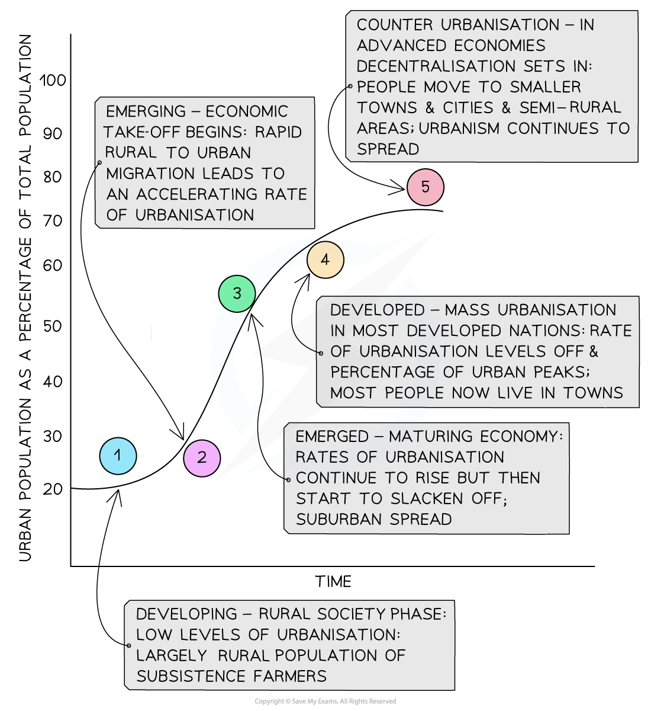
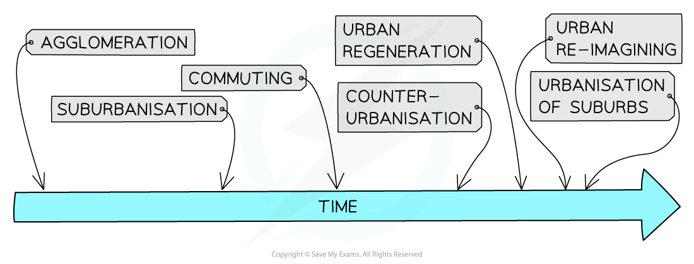
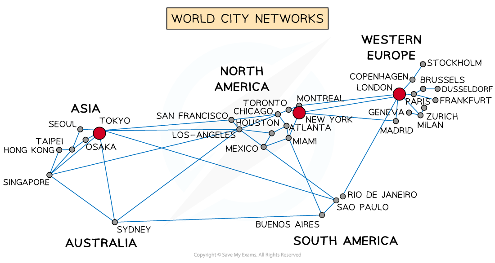

# Urban Growth

## Reasons for Rapid Urban Growth

> **Spec point** — `spcpt_4gkcqwXssjsyfnXh`

## Reasons for Rapid Urban Growth

### Urbanisation

- More people now live in towns and cities than in rural areas
- Urbanisation varies across the globe and is defined as the **increase **in the **percentage **of a **population living **in **urban areas**
- Urban settlements differ from rural ones in terms of:

  - **Way of life:** faster-paced
  - **Size:** larger
  - **Density of buildings and people:** compact and high
  - **Economy and employment:** finance, service, and manufacturing
- MEDCs show the highest levels of urbanisation, with the lowest levels in Africa and SE Asia
- The world population doubled between 1950 and 2015, but the urban population more than tripled due to:

  - The decline of industry in developed countries as the industry moved overseas to emerging countries (cheaper workforce, incentives, tax breaks, etc)
  - This led to industrial growth in emerging countries and 'pulled' people from rural regions to urban areas, with the hope of a better life and employment
- High rates of urbanisation occur in LEDCs because:

  - Most new **economic development **is concentrated in the big cities
  - ***Push-pull factors*** lead to high rates of rural-to-urban migration
  - Cities are experiencing higher levels of ***natural increase***** **in population

> **Exam Hint**
> Natural increase does not include inward migration of people to a place, just the number of births vs number of deaths. E.g. In one street there were 5 new migrants, 10 births and 2 deaths. The natural increase is 8 people because the migrants chose to move there. If they then had children, then those children would be included in the natural increase rate.

### Factors affecting the rate of urbanisation

- The main factors affecting the rate of urbanisation are:

  - **Speed of economic development**
  
    - Economic growth drives urbanisation
    - The faster the growth of ***secondary*** and ***tertiary*** employment sectors, the faster the growth of urbanisation
  - **Rate of population growth**
  
    - Economic growth needs a supply of labour
    - This demand can be met in two ways:
- Rates of urbanisation are lower in MEDCs as a higher percentage of the population already lives in towns and ***cities***
- In 1900, there were just 2 ***'millionaire'***' cities (London and Paris); by 2018, this had grown to 512
- As the growth of cities continues, the term **mega city** is used to describe cities with more than 10 million people:

  - In 1970, there were only 4
  - By 2000, there were 15
  - In 2018, that rose to 33, with Tokyo having close to 37.3 million people
- Due to modern transport and communication, urban areas are sprawling into rural regions to create ***conurbations***, further adding to the growth of urban areas

### Causes of rapid urban growth

- **Natural increase**

  - Accounts for roughly 60% of urban population growth
  - Due to decreased death rates and higher birth rates
- **Urban pull factors**

  - Higher wages
  - Pace and excitement
  - Improved education and healthcare
  - Better job opportunities
  - Public utilities: water, gas, electricity, etc.
  - Government support
- **Rural-urban migration**

  - Accounts for 40% of urban growth
  - Due to rural push factors along with urban pull factors
  - Natural hazards
  - Poor basic services health, water, education
- **Rural push factors**

  - Limited healthcare and education
  - Mechanisation of farming
  - Lack of opportunities
  - Lack of government support or investment
  - Hard and monotonous lifestyle
  - Unreliable food supplies/famine
- **Rural reclassification**

  - Due to urban sprawl, some rural regions are being reclassified as urban
  - Rural villages becoming dormitory settlements

### Urbanisation pathway

- The differences between LEDCs and MEDCs can be shown as a pathway over time
- Countries become more urban as they develop economically
- As they move through the stages, the pace begins to slow and begins to flatten out or decline as counter-urbanisation gains speed

*Urbanisation pathway*

### Urban process timeline

*Urban process timeline*

- Urban settlements first appear as a result of ***agglomeration***

  - People gather together in one area to sell goods and live
  - Small trading posts and villages began to develop
- As towns grow, they expand outwards through a process known as **suburbanisation**

  - This adds to the built-up area, but the building densities are generally lower than in the older parts of the town
  - The new suburbs are made up of mostly houses but also include places of employment and services
- Urban settlements continue to prosper and grow,** **and people move out of the town or city altogether and commute to work

  - These are called **dormitory settlements** because many residents only sleep there.
  - They continue to have links with the town or city they have left
  - They still make use of urban services, shops, education, and healthcare

### Counter-urbanisation

- This is the movement of people ***from ***an urban area ***into ***the surrounding rural region
- **Causes** include:

  - **Mobility and accessibility:** higher personal car ownership, increase in public transport and road development making easier access to rural areas
  - **Increased wealth:** making housing and travel more affordable
  - **Agricultural decline** (mechanisation and merger of farms) creates the availability of more land for housing, forcing agricultural workers to leave the area
  - **Green belt:** people need to go further out to get the rural life they are looking for
  - **Second homes and early retirement** have increased the movement of people from the city to the countryside

### Urban regeneration and reimagining

- Urban regeneration and urban reimaging **are different**

- **Urban regeneration** is the investment of capital in the revival of old, urban areas by either improving what is there or clearing it away and rebuilding

  - Over time, older parts of urban areas would begin to suffer a decline
  - Factories would move elsewhere, resulting in job loss
  - Quality of life and housing become poorer, people move away
  - ***Urban blight***** **sets in
  - The area needs to be 'brought back to life' = urban regeneration
- **Urban reimaging **is changing the image and reputation of an urban area and the way people view it

  - Focusing on a new identity/function
  - Changing the quality and appearance of the built-up area
  - Good opportunity for ***brownfield site*** development
  - London Docklands was completely redeveloped and regenerated
  - London Docklands had new industries, more executive services, homes, entertainment, and leisure, making it the new 'cool' place to be
- Together, urban regeneration and urban re-imaging =** *****rebranding***
- These processes add to the continued growth of urban regions

### Megacities

- These are urban regions with **over 10 million** residents
- In 2007, more people lived in an urban environment than a rural one
- By **2050,** it is thought that more than **two-thirds (7 billion)** of the world population will **live **in **urban areas**
- This scaling up of the urban environment is the **fastest **in human history
- The **largest growth **of megacities is seen in **Asia**

### Reasons for growth

- **Four main factors**:
- **Economic development**

  - Encourages population growth, which leads to the desirability of goods and services
  - All megacities act as **service centres** within the **formal economic sector**
  - However, megacities in LEDCs are also important manufacturing centres (Mumbai in India or Dhaka in Bangladesh), with thousands working in the **informal economy**
- **Population growth**

  - Young people are drawn to live in megacities with their vibrancy, fast pace and opportunities
  - There is also ‘**internal growth**’ where people who have moved into the cities have children, so sustaining population growth (Mexico City, Mumbai, Pearl River Delta in China)
- **Economies of scale**

  - It's cheaper to provide goods and services in one place than spread across several cities
  - Financial savings for local governments in respect of infrastructure provision
  - Communication and transport are centralised, making savings in time and money
- **Multiplier effect**

  - As a city prospers, it acts as a beacon to people and businesses
  - This encourages inward investment
  - This leads to yet more development and growth
  - Generating further need for skills and labour and job growth
  - This cycle multiplies the positive effects and growth continues (San Francisco and the digital development)

### World cities

- **Megacities **have a **powerful attraction **for people and businesses
- They are **influential *****cores*** with large ***peripheries***
- **World** or **global cities** can be **any size** but **exert** particular **influences **around the globe
- They are considered prestigious, with status and power
- They are **critical hubs** in the global economy
- The three top **(alpha)** world **cities **are** London, New York, and Tokyo **
- These are the **financial centres of the world**, each with smaller networks of world cities feeding into them
- There are **only four** world cities in the **Southern Hemisphere**:

  - Sydney
  - Rio de Janeiro
  - Sao Paulo
  - Buenos Aires

*Diagram showing the world city network*

> **Worked Example**
> **Identify the meaning of the term counter-urbanisation.**
> 
> **[1 Mark]**
> 
> | ** ** | **A** | Increasing proportion of people living in urban areas |
> |---|---|---|
> | ** ** | **B** | Population movement from one country to another |
> | ** ** | **C** | Increasing population growth on the edge of urban areas |
> | ** ** | **D** | Population movement from urban areas to the countryside |
> 
> - **Answer** is D: population movement from urban areas to the countryside
