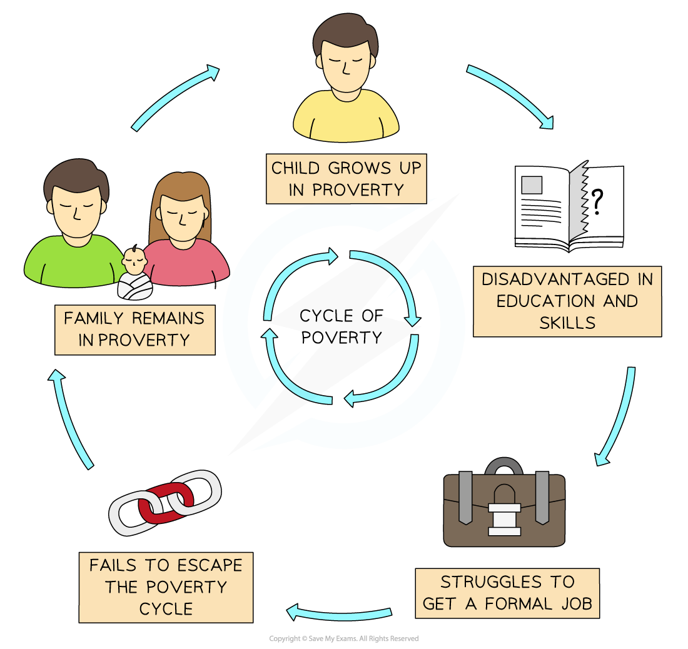

# Impacts of Urban Growth

## Impacts of Urban Growth

> **Spec point** — `spcpt_m6brKwBGRGkqWZCJ` · Identify & suggest reasons for rapid urban growth

## Impacts of Urban Growth

- Urban areas **offer **a variety of **opportunities** to people and businesses
- However,** rapid **and **unplanned **urbanisation creates a range of **problems**, including

  - **Poor housing**
  - **Deprivation/inequality**
  - **Unemployment**
  - Along with congestion, transport, crime, and poor environmental quality issues
- The speed of development is greatest in LEDCs, e.g. Sao Paulo in Brazil, which grew from 7 million people to over 20 million in 40 years and is now the second-largest urban area in the Americas

### Transport

- The provision of roads and public transport tends to be poor in quality, size, and reliability
- Rapid development leads to transport systems becoming easily overloaded and overcrowded
- Urban congestion varies over the week, time of day, the weather, and the season
- High numbers of vehicles create high levels of atmospheric pollution, such as smog
- As poor rural migrants arrive, there is a lack of affordable housing, and demand is high
- Transportation issues mean people will have to live closer to their employment
- Temporary or ***informal settlements*** arise, adding to overcrowding and poor living conditions, so adding to already cramped/congested conditions around the city

> **Exam Hint**
> It is important that you use examples to support your answers. In this instance, noting that Dharavi in Mumbai, India, has a slum settlement of over 1 million people in a 2 km2 area shows the examiner that you understand the concept of human congestion and increase the spread of diseases. This congestion was one reason why COVID-19 spread so rapidly within the megacities, particularly in emerging countries.

### Housing

- Availability and affordability of housing cannot keep up with the rate at which the urban population is increasing in LEDCs
- This leads to people building their own homes on any vacant land using scrap materials like cardboard, corrugated iron and plastic
- They are unplanned and unregulated housing **(informal settlements) **with little sanitary facilities, freshwater or reliable energy supply
- Usually on land not owned by them and found:

  - In areas of no economic value
  - On the urban edges or fringes
  - Along main roads or railways
  - Clinging onto the side of steep slopes
- Depending on the country, these **informal settlements **are also called:

  - **Favelas **in Brazil
  - **Shanty towns** in the West Indies and Canada
  - **Bustees** on the Indian subcontinent
  - **Skid row **in the USA
  - **Townships** in South Africa
- In LEDCs, about a quarter of urban inhabitants (1.6 billion) live in these impoverished ***slums*** and squatter settlements and by 2030, the UN estimates that 1 in 4 people on the planet will live in some form of informal settlement
- Some cities have** 'mega-slums'**; these are very large, overcrowded areas usually within megacities

  - The largest are found:
  
    - Nairobi, Kenya, with a population of 1.5 million, is crowded into 3 sprawling slums of mud huts and tin shacks—Kibera being the largest of the 3
    - Neza, Mexico City, Mexico, with a population of 1.1 million people
    - Dharavi, Mumbai, India, with 1 million people in a warren of narrow lanes, interconnected shacks and single-room living spaces that double as factories
    - Orangi Town, Karachi, Pakistan, with an estimated population of 2.4 million people across 8,000 acres of concrete block homes with 8-10 people sharing two or three rooms
    - Khayelitsha in Cape Town, South Africa, with a population of 400,000 in iron and wooden shacks
- These unregulated housing presents serious risks such as fire, flooding and landslides
- These informal settlements typically suffer from:

  - Poor, overcrowded, small housing, built very close together using inadequate material and with uncertain electricity supplies
  - They have restricted access to water supplies
  - Little to no sanitation facilities and no solid waste disposal, which leads to a polluted and degraded local environment
  - There are inadequate health facilities, which, along with poor living conditions, increase sickness and death rates
  - The population of the squatter settlements lives in an insecure situation because landowners or other authorities might forcibly remove them

### Issues of the informal economy

- **Megacities** have rapidly growing populations and job creation cannot match the pace of growth
- As a result, unemployment and ***underemployment*** are not unusual
- People will often work on street corners doing ***informal*** work like shining shoes, giving haircuts, taxing, selling water or food
- These jobs are often unskilled and labour-intensive and require little money to set up
- The informal economy leaves cities without revenue to provide adequate services as workers pay no taxes
- It also makes wages and working conditions difficult to regulate

### Deprivation and inequality

- ***Deprivation*** is connected with poverty and occurs when a person’s well-being falls below an acceptable minimum standard
- The minimum standard varies from country to country and applies to several different aspects of daily life
- It is more than just not having enough money

### Cycle of poverty

- All cities have levels of inequality, but LEDCs are amongst the worst affected
- Many low-income families are 'pulled' to informal settlements around towns and cities looking for a sense of 'belonging' with others in the same situation
- For others without a strong social network or cities with recently arrived large populations, high levels of crime, begging and petty theft are more common
- Overall, this creates urban poverty that degrades both the physical and social environment around that area
- This makes it difficult for people to escape from poverty and they fall victim to the vicious '**cycle of poverty,**’ and urban poverty becomes ingrained within the city
- Combined with a lack of suitable work, housing, water supply, sewerage, solid waste disposal and pollution, the quality of life for people in cities is low

*Infographic showing the cycle of poverty*

- Poverty and deprivation are passed on from one generation to the next
- Children will tend to get less parental support and usually have to attend inadequate schools
- They also tend to leave school early with few qualifications
- Lack of qualifications means they cannot find well-paid employment and rely on social handouts
- Children they have will be born into this cycle and so families remain ‘trapped’ and unable to improve their circumstances
- This feeds into a lower **quality of life**

> **Worked Example**
> **State two social problems facing cities in MEDCs**
> 
> **[2 Marks]**
> 
> **Final answer:** **Possible Answer:**
> 
> - Two from the following:
> - Poverty, crime, poor health, lack of housing, etc.
> 
> - Remember that although LEDCs appear to have all the issues, MEDC cities also suffer similar problems
> - Crime, poverty, poor housing, lack of safe water, and poor health are all seen in established, wealthy cities
> - Hong Kong, for instance, has a housing crisis, and many people live in cramped conditions and have no access to health care or social support
> - Homelessness is common in developed cities and many people cannot afford the cost of rent

### Impacts of urban growth on rural areas

- Rise of the **suburbanised village**
- Originally, these were quiet, independent places with basic services and located near large urban areas
- Also known as '**dormitory or commuter towns**' and had a residential population that commuted to work
- As people have moved out of the city for retirement, family or work reasons, these areas have changed
- New, large, expensive housing estates with detached or semi-detached homes; some are gated communities
- Urban style services increased—hence the change in name to 'suburbanised' village
- The **commuter belt** means new roads and public transport links
- New businesses such as pubs, restaurants, supermarkets and hotels have opened
- Dilution of traditional country life
