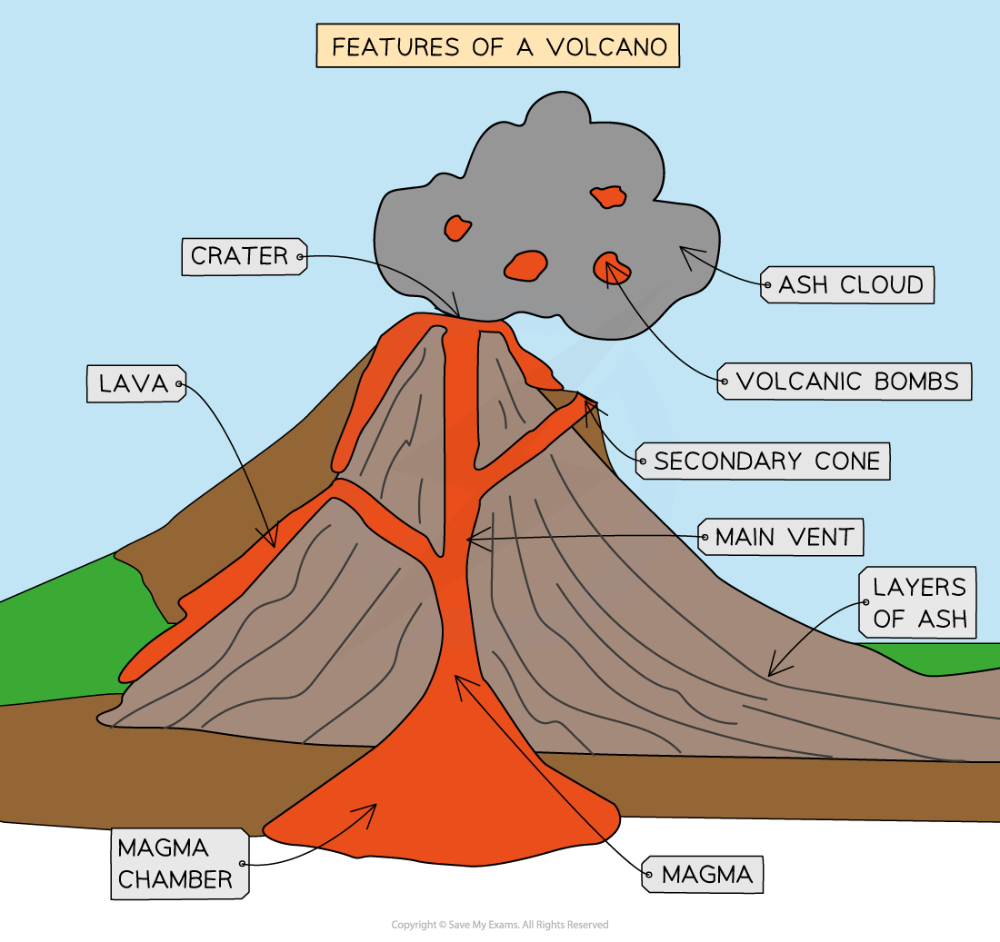
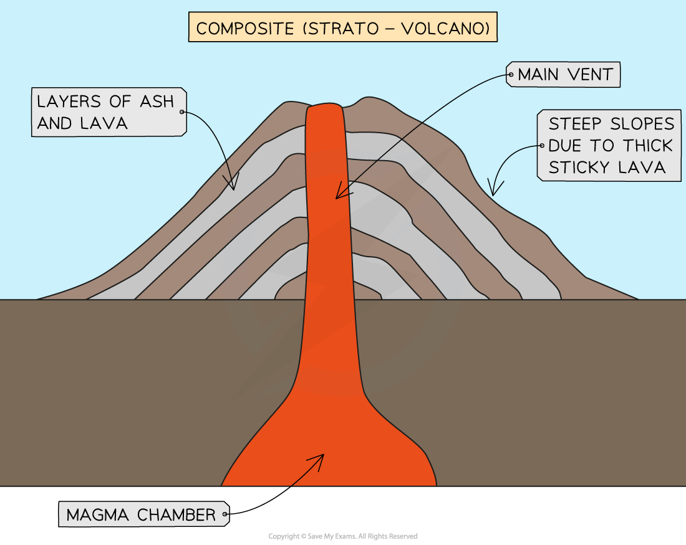
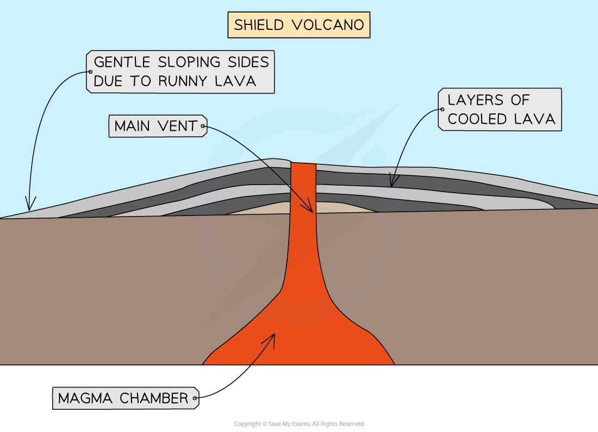

# Main Features of Earthquakes & Volcanoes

## Main Features of Volcanoes

> **Spec point** — `spcpt_6rHVNmr36fyXPMVZ` · Describe the main types & features of volcanoes 

## Main Features of Volcanoes

- A volcano forms when **magma** erupts onto the Earth's surface as** lava **through a vent in the Earth's crust

  - When magma erupts onto the surface, it is called lava
- The magnitude of a volcanic eruption is measured on the **Volcanic Explosivity Index (VEI)**

  - The scale is open-ended but the highest in recorded human history was an 7 (Tambora 1815)
- All volcanoes have common features, as shown in the diagram below:

*Common features of a volcano*

- The type of volcano which forms depends on the type of lava which erupts
- Composite and shield volcanoes are two of the most common forms of volcanoes

#### Composite (strato-volcano)

- Composite volcanoes, also known as strato-volcano, have:

  - steep-sides
  - sticky **(viscous)** lava
  - more explosive eruptions
  - alternating layers of ash and lava
- They tend to form on convergent (destructive) plate boundaries

*Composite (strato) volcano*

#### Shield volcanoes

- **Shield **volcanoes have:

  - gently sloping sides
  - runny/thin lava
  - less explosive—gentle eruptions
  - frequent eruptions
- They tend to form on divergent (constructive) plate boundaries or hot spots

*Shield volcano*

- Volcanoes may be active, dormant or extinct

  - **Active**
  
    - The volcano has recently erupted and is likely to erupt again
  - **Dormant**
  
    - Has not erupted for many years but there is evidence of a magma reservoir
  - **Extinct**
  
    - Shows no evidence of eruption in historic times and there is no evidence of a magma reservoir

#### Volcanic eruption features

- Eruptions may include a range of features
- **Lava: **when magma erupts to the surface, it is known as lava

  - The lava can be thin and runny or thick and slow-moving
  - This depends on the composition of the magma
- **Ash** is pulverised solid lava which measures less than 2 mm in diameter

  - Ash is ejected into the atmosphere and can travel thousands of kilometres
- **Pyroclastic flow** is fast-moving, very hot clouds of poisonous gases mixed with ash

  - Average speeds of about 100 km/h but can move at up to 700 km/h
- **Lahars **occur when volcanoes erupt and snow and ice on the peak melt

  - The meltwater combines with the ash
  - This creates fast-moving mudflows or lahars
- **Earthquakes** are caused by magma rising to the surface through the vents in the volcano

  - This increases pressure on the Earth's crust, leading to earth tremors
- **Volcanic bombs** are fragments of molten rock which are ejected from the volcano

  - These are between 60 mm and 5 m in diameter

> **Worked Example**
> **Shield volcanoes are often formed on constructive (divergent) plate boundaries.**
> 
> **Describe two characteristics of a shield volcano.**
> 
> **[2 marks]**
> 
> **Final answer:** **Answer**
> 
> Any two of the following:
> 
> - Fluid/thin/runny lava **[1]**
> - Low (height to width ratio)** [1]**
> - Gentle slopes** [1]**
> - Gentle eruption** [1]**
> - Frequent eruption**[1]**

## Main Features of Earthquakes

> **Spec point** — `spcpt_VGpTV4pGbdVW8xf4` · Describe the main types & features of earthquakes 

## Main Features of Earthquakes

- An earthquake is the **sudden, violent shaking** of the ground
- Earthquakes are the result of pressure building when **tectonic plates** move
- The **epicentre** is the point on the Earth's surface directly above the focus
- The **focus** is the point at which the earthquake starts below the Earth's surface
- The **magnitude** (amount of energy released) by earthquakes is measured on the **Moment Magnitude Scale, **which replaced the **Richter scale**
- The damage caused by earthquakes is measured on the **Mercalli Scale**

#### Where do earthquakes happen?

- Earthquakes can occur anywhere but mostly occur at or near **plate boundaries**
- Earthquakes happen at all plate boundaries:

  - **constructive (divergent)**
  - **destructive (convergent)**
  - **collision**
  - **conservative (transform)**
- At a constructive (divergent) plate boundary, earthquakes tend to be weaker as the plates are moving apart
- At destructive (convergent), collision and conservative (transform) plate boundaries, earthquakes tend to be stronger

#### Earthquake sequence

- The sequence of an earthquake is the same regardless of the boundary at which it happens:

  - As the tectonic plates move, they can get stuck
  - **Pressure builds** as the plates continue to try to move
  - Eventually, the **plates jolt free**, and the **pressure is released** as energy
  - The point at which the earthquake starts is the **focus**
  - The **epicentre** is the point directly above the focus on the earth's surface
  - The energy passes through the Earth's crust as **waves,** which is the earthquake

*Features of an earthquake*

- Earthquakes can also happen as a result of human activity such as drilling into the crust or mining

> **Worked Example**
> **Tick the one statement in the table below that is the correct definition of an earthquake.**
> 
> **[1 mark]**
> 
> | A crack in the earth's crust caused by a volcano |   |
> |---|---|
> | A vent between two plates of the earth's crust through which molten magma escapes |   |
> | Movement of large slabs of rock in the mantle |   |
> | The shaking of the ground caused by plate movement |   |
> 
> **Final answer:** **Answer**
> 
> - The shaking of the ground caused by plate movement** [1]**

> **Exam Hint**
> When describing the processes that lead to an earthquake or volcanic eruption, it is helpful to write the formation down as a sequence of steps. This will make the process easier to remember.
