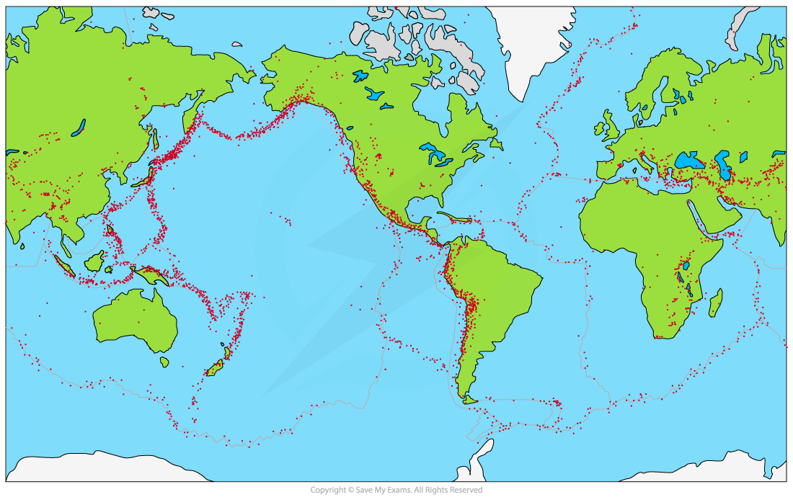
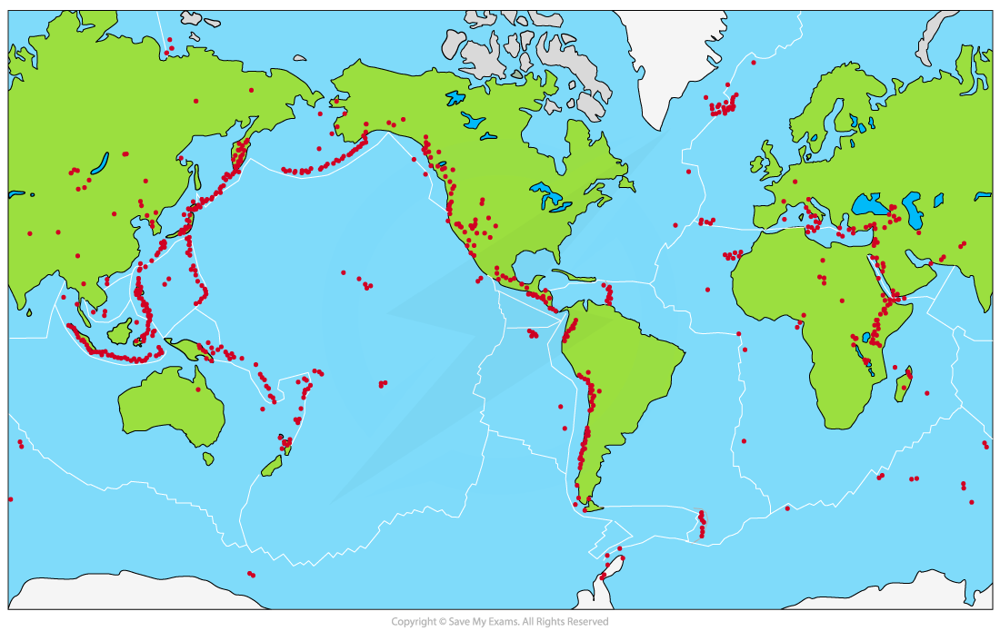

# Distribution of Earthquakes & Volcanoes

## Earthquake & Volcano Distribution

> **Spec point** — `spcpt_mgdhKX6Cjwcp2V6J` · Describe and explain the distribution of earthquakes & volcanoes 

## Earthquake & Volcano Distribution

#### Earthquake distribution

- Earthquakes occur at all types of ***plate boundaries***

  - Most (approximately 90%) occur around the rim of the Pacific Ocean
  - This zone is called the **'Ring of Fire' **

*Earthquake distribution*

#### Volcano distribution

- Most volcanoes occur at ***divergent (constructive)*** and ***convergent (destructive)*** plate boundaries
- Like earthquakes, the majority of active volcanoes (approximately 75%) are located around the **Pacific 'Ring of Fire'**
- Volcanoes also occur at** hotspots **away from plate boundaries and are plumes/columns of magma which escape through the Earth's crust

*Active volcano distribution*

> **Exam Hint**
> When describing the distribution of hazards from a map, ask yourself the following questions:
> 
> - What is the general pattern?
> - Does the pattern relate to anything else for example, the location of plate boundaries?
> - Are they close to the equator or further away?
> - Are they inland or coastal?
> 
> Use map features to help with your description - place names, compass rose, latitude and longitude.
