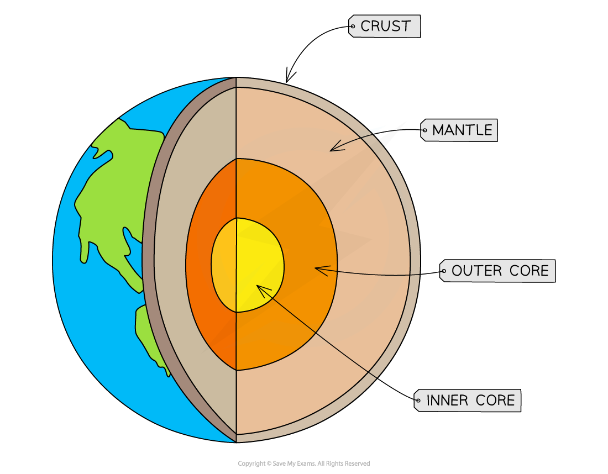
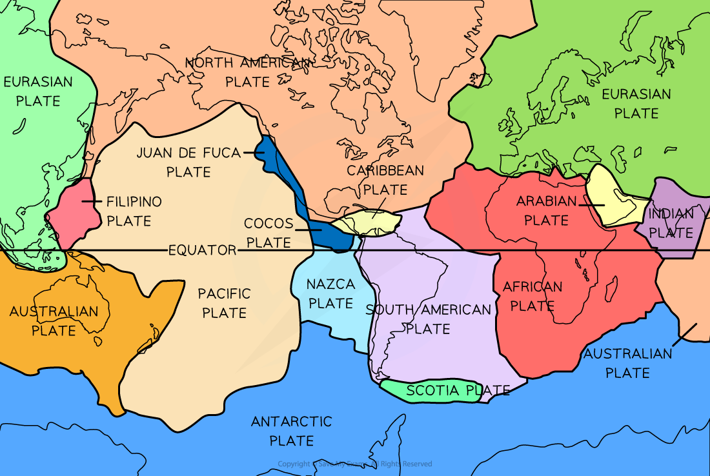
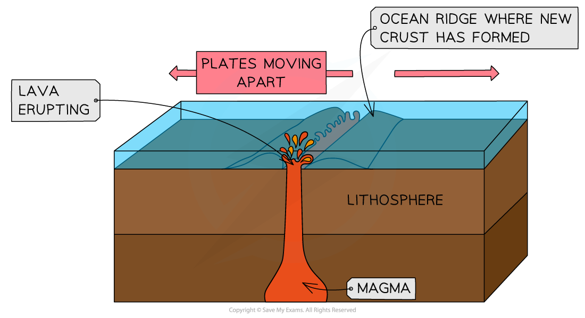
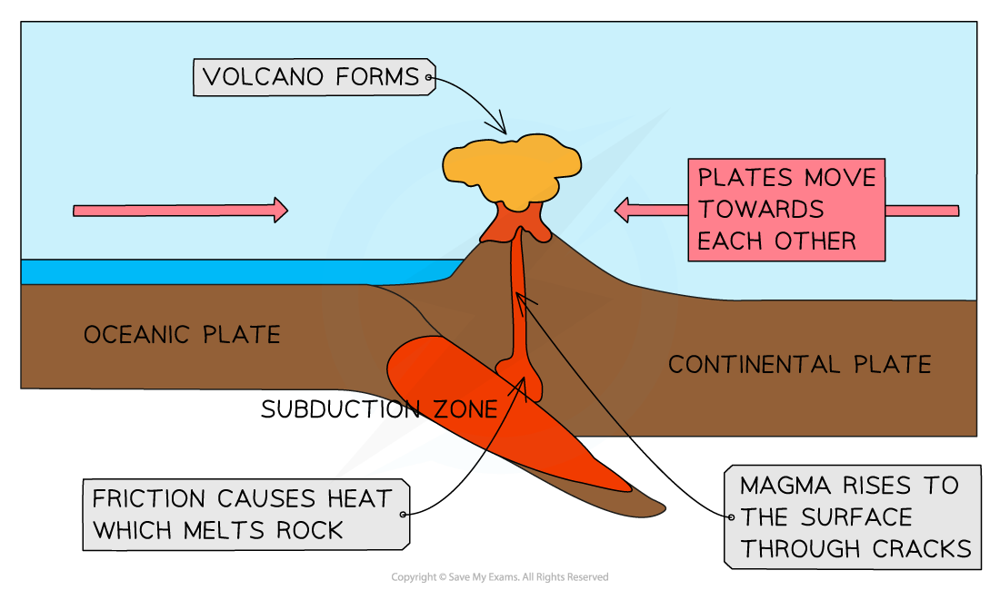
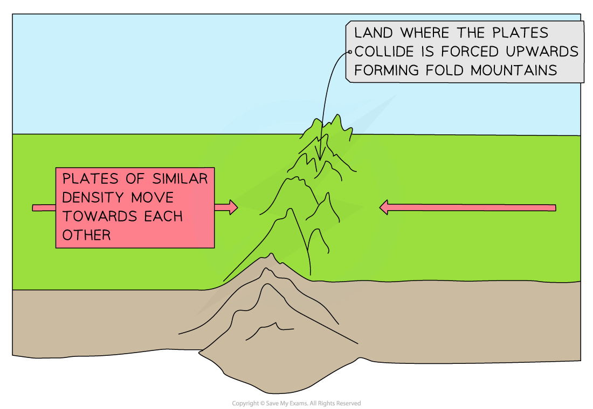
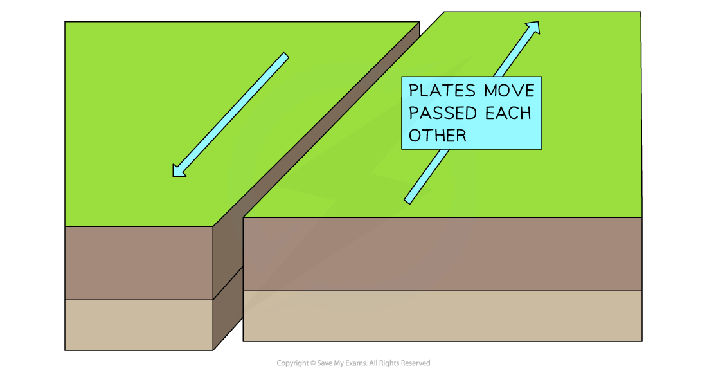
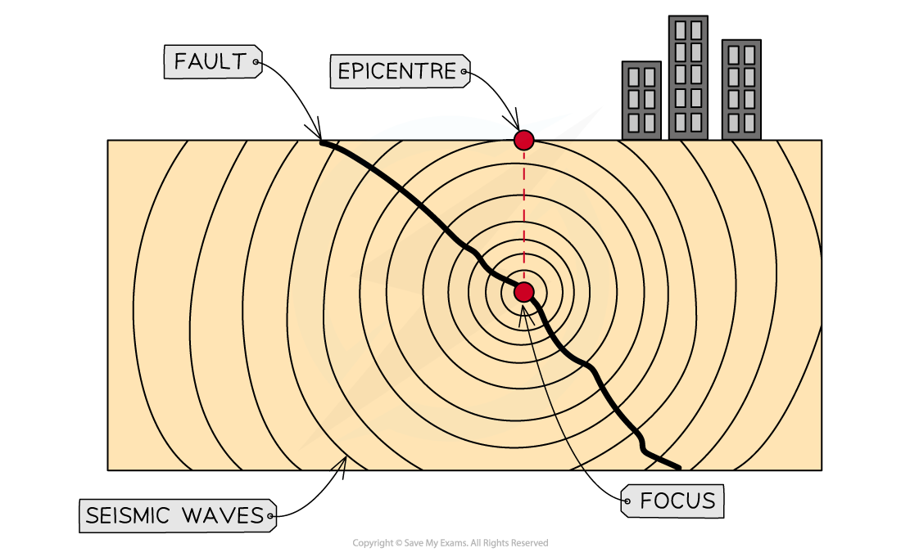

# Causes of Earthquakes & Volcanoes

## Causes of Earthquakes and Volcanic Eruptions

> **Spec point** — `spcpt_NxB7tYYnsN3nrNPp` · Describe the causes of earthquakes & volcanic eruptions 

## Causes of Earthquakes & Volcanic Eruptions

#### The structure of the Earth

- The Earth is composed of four main layers

  - **Inner core: **about 1400 km in diameter, a solid and dense layer composed of iron and nickel with temperatures of about 5500 ºC
  - **Outer core: **about 2100 km thick, a semi-molten metal layer with temperatures between about 5000 and 5500 ºC
  - **Mantle: **about 2900 km thick, a semi-molten layer which is less dense than the outer core
  - **Crust: **the thickness varies and it is made up of two types of crust

*Earth's structure*

#### The Earth's crust

- There are two types of crust

  - **Continental crust** is thick (25–90 km), old and not as dense as oceanic crust
  - **Oceanic crust** is thinner (5-10 km) and heavier and denser than the continental crust
- Oceanic crust is continually being created and destroyed as a result of plate movement where it is denser and so subducts under the continental crust

#### Plate tectonics

- The crust is broken into many **tectonic plates**

*The various tectonic plates*

- These plates move on top of the **semi-molten mantle** below.
- The movement of the plates is in part due to the **convection currents** within the mantle
- A **plate boundary or margin** is where two plates meet

#### Types of plate boundary

- Volcanic eruptions and earthquakes most commonly occur at or near plate boundaries
- There are four main types of plate boundaries:

  - **Divergent (constructive)**
  - **Convergent (destructive)**
  - **Collision**
  - **Transform (conservative)**

#### Divergent (constructive) plate boundary

- At a divergent boundary, the plates are moving apart
- The **Mid-Atlantic Ridge** is an example of a divergent plate boundary
- Both volcanic eruptions and earthquakes can occur at this type of plate boundary

*Divergent (constructive) plate boundary*

#### Convergent (destructive) plate boundary

- At a convergent (destructive) plate boundary, the plates are moving towards each other
- The denser, heavier **oceanic plate** ***subducts*** under the lighter, **less dense continental plate**
- The boundary between the Nazca plate and the South American plate is an example
- Both volcanic eruptions and earthquakes occur at this type of plate boundary

*Convergent (destructive) plate boundary*

#### Collision boundary

- At a collision boundary, two plates of similar density move towards each other
- Neither is dense enough to subduct, so the land is pushed upwards
- This forms **fold mountains** such as the** Himalayas**
- Earthquakes are the main hazard at this type of plate boundary

*Collision boundary*

#### Transform (conservative) boundary

- At a transform (conservative) boundary, the plates move past each other in opposite directions or in the same direction at different speeds
- Earthquakes are the only hazard at this type of boundary

*Conservative (transform) boundary*

> **Worked Example**
> **Study Fig. 1, which is a cross-section through a volcano**.
> 
> **[1 mark]**
> 
> 
> 
> **Fig 1**
> 
> (i) What type of plate boundary is shown in Fig 1?
> 
> **Final answer:** **Answer**
> 
> - Constructive/divergent** [1]**
> 
> (ii) Choose the correct labels for features X and Y shown in Fig 1.
> 
> Choose from the list below:
> 
> - convection currents
> - direction of plate movement
> - lava escaping from the volcano
> - new crust created
> - subduction
> 
> **Final answer:** **Answer**
> 
> - X = convection currents
> - Y = direction of plate movement

> **Exam Hint**
> Draw each of the plate boundaries and add annotations to outline the processes. This will help you to remember what happens at each one.

## Causes of  Volcanic Eruptions

> **Spec point** — `spcpt_BTN2Wc5zh63HGW8D`

## Causes of Volcanic Eruptions

- Volcanoes occur at **divergent (constructive)**, **convergent (destructive)** plate boundaries and **hot spots**
- Volcanoes do not occur at **collision** boundaries or **transform (conservative)** boundaries

#### Volcanoes at constructive boundaries

- At a divergent (constructive) boundary, the tectonic plates are moving away from each other

  - Divergent plate boundaries often occur **under the sea/ocean**
  - The lava escapes through the gap left as the plates move apart
  - The lava cools and hardens, forming a new crust
- At divergent plate boundaries, the lava tends to be runny, and eruptions are less explosive
- These types of eruption often form **shield volcanoes,** which have gently sloping sides

#### Volcanoes at destructive boundaries

- At a destructive (convergent) boundary, the tectonic plates are moving towards each other:

  - The heavier, denser oceanic plate **subducts** under the lighter continental plate
  - In the **subduction zone**, the two plates come together, causing **friction**
  - Friction causes heat and the plate material melts, forming magma
  - The magma rises to the surface through cracks in the crust
  - The cooling lava and ash build up, forming a volcano
- At destructive plate boundaries, the lava tends to be sticky and produces explosive eruptions
- These eruptions tend to form **composite or stratovolcanoes **

#### Volcanoes at hot spots

- At a **hot spot,** the tectonic plate passes over a **plume of magma:**

  - The magma rises to the surface through cracks in the crust
  - As the tectonic plate moves slowly over the magma plume, a line of islands can form, e.g. Hawaii

*Diagram illustrating the formation of hotspot  islands*

## Causes of Earthquake Hazards

> **Spec point** — `spcpt_RkdcwvHCd7bGNvzf`

## Causes of Earthquake Hazards

#### Earthquakes and plate boundaries

- Earthquakes can occur anywhere but mostly occur at or near **plate boundaries**
- Earthquakes happen at all plate boundaries: divergent** (constructive), convergent (destructive), collision** and **transform (conservative)**

- At a divergent (constructive) plate boundary, earthquakes tend to be weaker as the plates are moving apart
- At convergent (destructive), collision and conservative (transform) plate boundaries, earthquakes tend to be stronger

*Diagram showing the main features of an earthquake*
