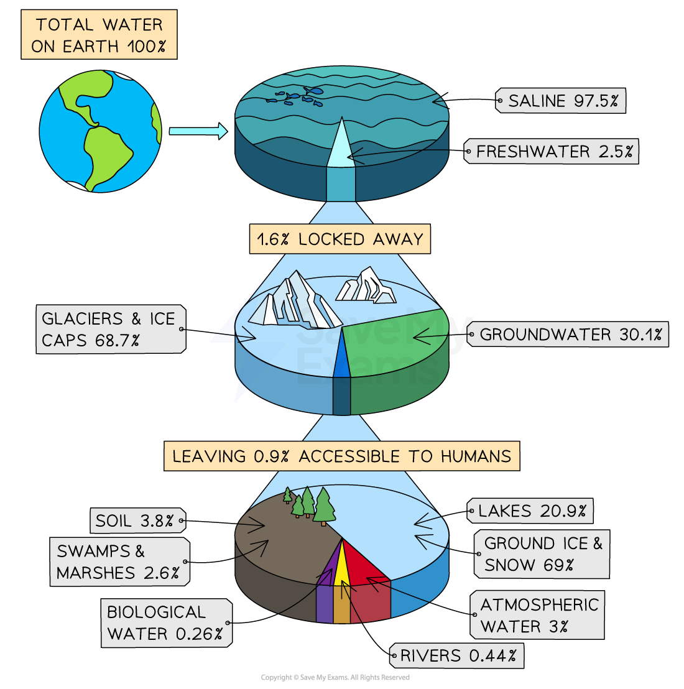
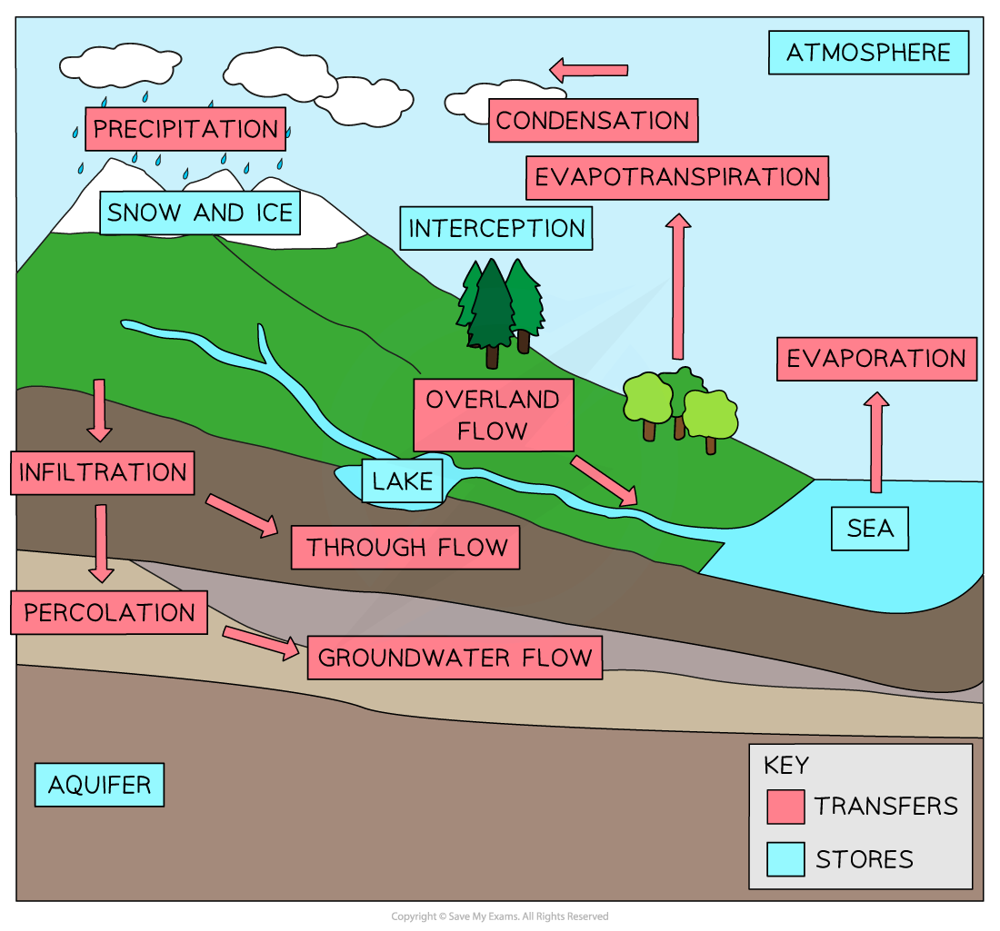

# Hydrological Characteristics

## The Characteristics & Processes of Rivers

> **Spec point** — `spcpt_pmgTySnnz7V8R8hp` · Explain the main hydrological characteristics and processes which operate in rivers and drainage basins 

## The Characteristics & Processes of Rivers

### Water on Earth

- Only **2.5%** of the water on Earth is ***freshwater***
- **68.7%** of freshwater is stored in glaciers and ice sheets and **30%** is groundwater
- The remaining **1.3%** of freshwater is in rivers, soil moisture, lakes and the atmosphere
- All water is part of the hydrological cycle

*Global water stores*

### Hydrological cycle

- The hydrological cycle is a ***closed*** system
- Water is constantly recycled through the system
- Within the hydrological cycle, there are **stores** and** transfers (flows)**

*The Hydrological Cycle*

#### Stores

- Stores are those places where water is held for some time. These include:

  - water in the **atmosphere** in the form of water vapour or water droplets in clouds
  - **surface stores** such as puddles, lakes, rivers and reservoirs
  - **interception** is how precipitation is prevented from reaching the ground, usually by being caught on leaves or branches
  - **aquifers** are permeable rocks such as limestone and sandstone which can hold water
  - ice and snow
  - seas and oceans

#### Flows (or transfers)

- Flows are how water is moved around the hydrological cycle. They include:

  - **Evaporation **
  
    - The change of water from a liquid to a gas (water vapour) due to heat from the sun
  - **Condensation **
  
    - When water cools and changes from water vapour into a liquid (water droplets), forming clouds
  - **Transpiration **
  
    - When plants release water vapour from their leaves
  - **Evapotranspiration **
  
    - The combined transfer of water vapour from the Earth's surface and plants
  - **Precipitation **
  
    - The transfer of water from the atmosphere to the Earth's surface in the form of hail, sleet, snow or rain
  - **Overland flow **
  
    - Any water flowing across the Earth's surface
  - **Infiltration  **
  
    - When water moves down from the surface into the soil
  - **Percolation **
  
    - The transfer of water down into rocks and aquifers
  - **Through flow **
  
    - The movement of water through the soil between the groundwater store (water table) and the surface
  - **Groundwater flow **
  
    - The flow of water through rock

> **Exam Hint**
> Remember that percolation and infiltration are not the same. Percolation happens after the water has infiltrated the soil.

> **Worked Example**
> **Which of the following statements are correct?**
> 
> **Tick two statements in the table below:**
> 
> **[2 marks]**
> 
> |   | Tick |
> |---|---|
> | Overland flow occurs under the surface of the land |   |
> | Water percolates from the surface into the soil |   |
> | Groundwater flow moves water through the rocks |   |
> | Water flows to the river on the surface through flow |   |
> | Interception occurs when water vapour is evaporated |   |
> | Infiltration occurs when water soaks into the soil |   |
> 
> **Final answer:** **Answer**
> 
> - Groundwater flow moves water through the rocks **[1 mark]**
> - Infiltration occurs when water soaks into the soil **[1 mark]**
