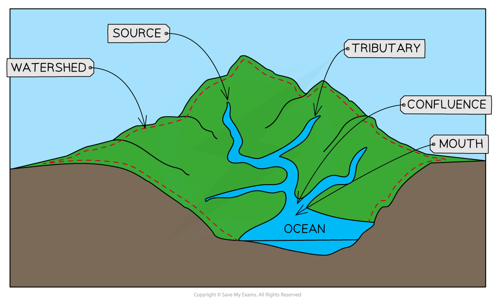

# Drainage Basin

## The Drainage Basin Process

> **Spec point** — `spcpt_2jyvH2mhGccVkf8P`

## The Drainage Basin Processes

### Drainage basin

- A major part of the hydrological system, drainage basins drain all the water which lands on the Earth's surface
- A ***drainage basin*** is an ***open system***
- Every drainage basin is unique and is different in shape and size, with different rock types, ***relief*** and land use

#### Drainage basin features

- All drainage basins have some features in common:

  - **Watershed **
  
    - This is the boundary between drainage basins
  - **Source **
  
    - The furthest point from the mouth where the river starts can be an upland lake, spring or glacier
  - **Confluence **
  
    - The place where two or more streams/rivers meet
  - **Tributary **
  
    - A stream or river flowing into a larger stream or river
  - **Mouth **
  
    - Where the rivers enter the sea/ocean or sometimes a lake

*Drainage Basin Features*

#### Channel network

- Every drainage basin is covered by a network of tributaries that connect to the main river channel. The number of tributaries in a drainage basin is referred to as the ***drainage density***:

  - Drainage basins with lots of tributaries have a **high drainage density**
  - Drainage basins with few tributaries have a **low drainage density**

#### 

> **Worked Example**
> **Study Fig. 1, which shows information about flows through the drainage basin**
> 
> 
> 
> (i) What is meant by transpiration?
> 
> **[1 mark]**
> 
> **Final answer:** **Answer**
> 
> - The changing of water to water vapour by plants/evaporation of water by plants/trees/vegetation** [1]**
> 
> (ii) Identify the processes that take place at X , Y and Z in Fig 1.
> 
> **[3 marks]**
> 
> **Final answer:** **Answer**
> 
> - X = Overland flow/surface runoff **[1]**
> - Y = Through flow **[1]**
> - Z = Ground (water) flow **[1]**
