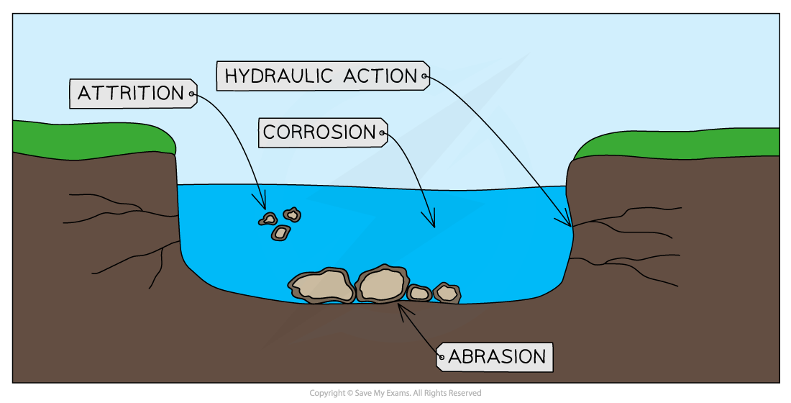
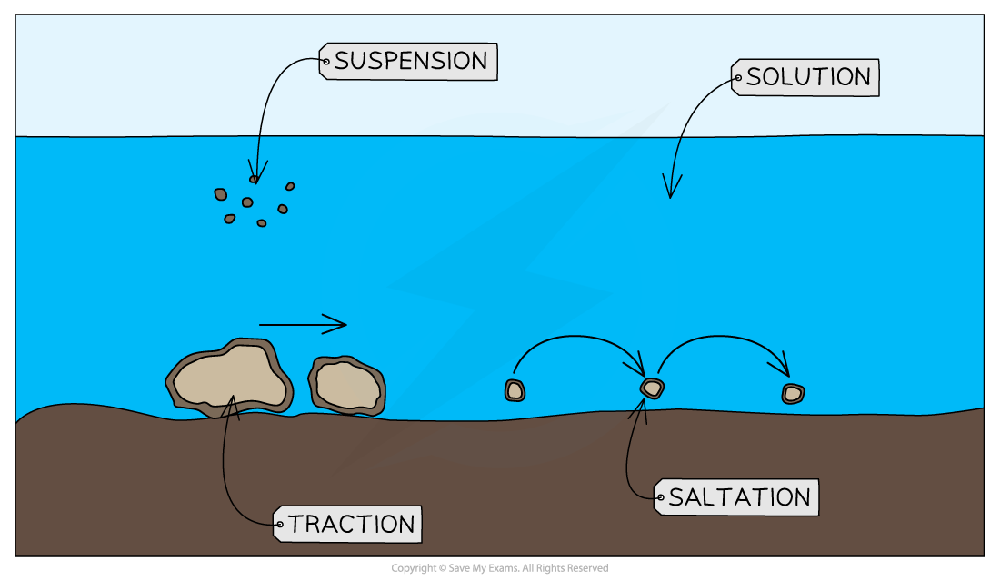
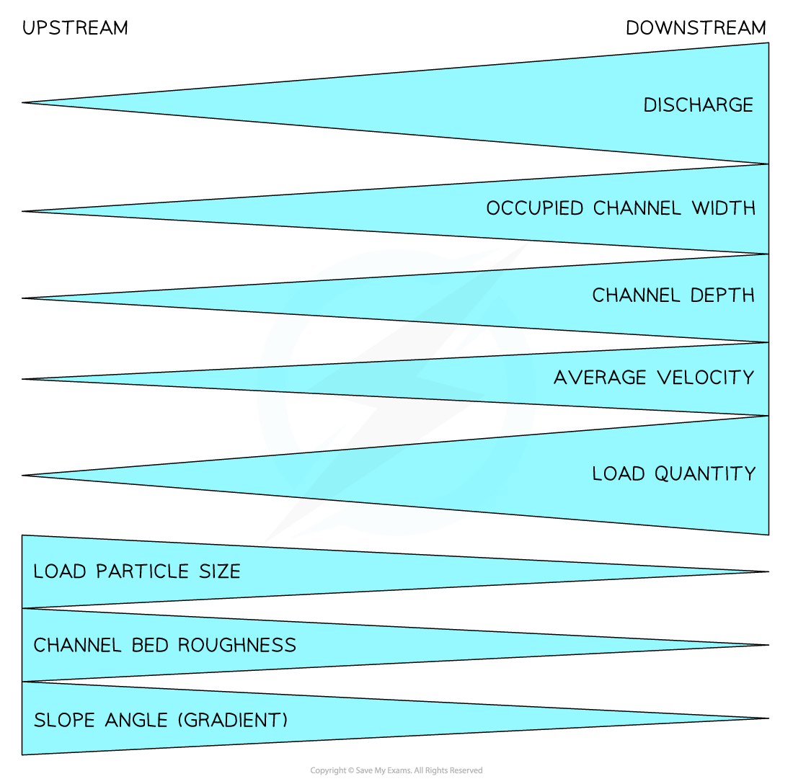
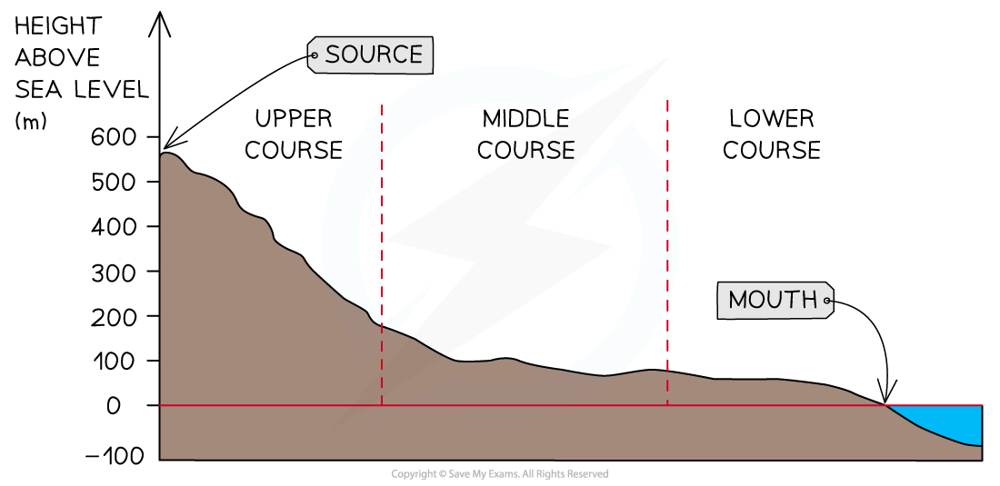
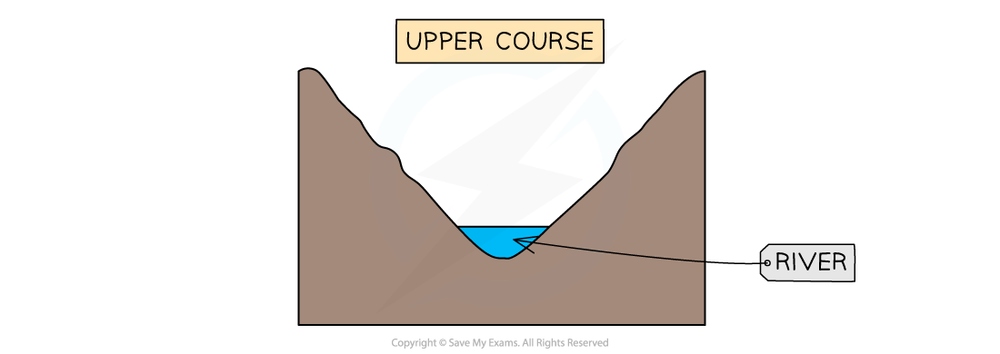
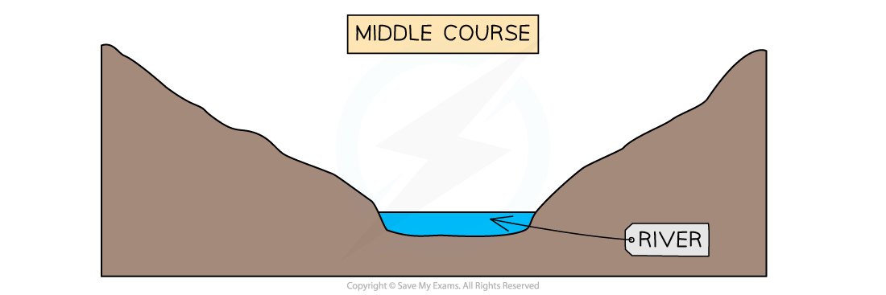
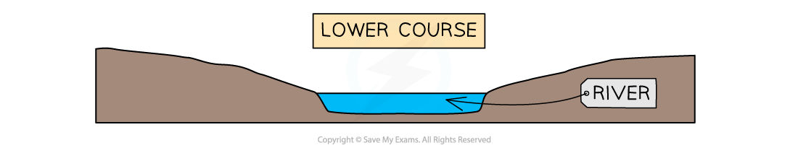

# River Processes

## River Processes

> **Spec point** — `spcpt_zZXj3p6kGzKpfp4x` · Demonstrate an understanding of the work of a river in eroding, transporting and depositing

## River Processes

#### Erosion

- **Erosion **is the wearing down of surfaces
- There are four erosion processes that change the shape of the river channel:

  - **Hydraulic action **
  
    - The force of the water, which removes material from the bed and banks of the river
  - **Abrasion **
  
    - When the materials carried by the river scrape away the banks and bed
  - **Attrition **
  
    - When the material being carried by the river hits each other, the pieces become rounder and smaller
  - **Corrosion (solution) **
  
    - When rocks are dissolved in slightly acidic water

*Types of erosion*

- Erosion can be mainly vertical or lateral:

  - **Vertical erosion** is dominant in the upper course of rivers. It increases the depth of the river and valley as the river erodes downwards
  - **Lateral erosion** is dominant in the middle and lower courses of rivers. It increases the width of the river and valley as it erodes sideways

#### Transportation

- There are four processes of** transportation**:

  - **Traction **
  
    - Occurs when larger rocks and materials are rolled along the riverbed
  - **Saltation **
  
    - Smaller material, which can be lifted by the water, bounces along the riverbed
  - **Suspension **
  
    - Lighter material carried within the river flow
  - **Solution **
  
    - When materials are dissolved in the river water

> **Exam Hint**
> It can sometimes help to remember a word and the process it refers to if you know what the word means.
> 
> Traction: the action of pulling something over a surface
> 
> Saltation: leaping or jumping

#### Deposition

- When a river does not have enough energy to carry materials, it drops them

  - This is **deposition**
- The causes of reduced energy include:

  - **Reduced discharge** due to a lack of precipitation or ***abstraction*** upstream
  - **Decreased** ***gradient***
  - Slower flow on the inside of a river bend or where the river is shallower
  - When the river enters a sea, ocean or lake
- The heaviest material is deposited first; this is known as the **bedload**
- The lighter materials, gravel, sand and silt, are known as** alluvium** and they are carried further downstream
- The dissolved materials are carried out to sea

- As a result of **erosion, transportation** and **deposition** the character of a river changes as it moves downstream
- These changes are summarised in the **Bradshaw model**

*The Bradshaw Model*

> **Worked Example**
> **Study Fig. 1, which is a photography of a river in an upland area.**
> 
> 
> 
> **Explain how the river in Fig 1 is likely to carry out erosion.**
> 
> **[5 marks]**
> 
> **Final answer:** **Answer**
> 
> - Hydraulic action **[1] **The power of water wears away bed and banks, releasing air compressed in cracks **[1] **
> Abrasion **[1] **Material carried by river grinds bed and banks/sandpaper action **[1] **
> Corrosion / solution **[1]  **Rocks dissolved by chemical reactions **[1] **
> Attrition **[1] **Load reduced in size as particles hit each other when being carried by
> water **[1] **
> Vertical erosion **[1] **
> 
> - **Remember,** you will receive 1 mark for the type of erosion and the second mark for explaining how the erosion process works.

#### River characteristics

- All rivers have **long **and **cross-profiles**
- Each river's long and cross profiles are unique but they do have some characteristics in common
- These profiles show changes in river characteristics from the source to the mouth

#### Long profile

- The long profile of a river shows the changes in the river ***gradient*** from the source to the mouth
- Most long profiles have a **concave shape **with similar characteristics:

  - The **source** is usually in an **upland area**
  - The upper course of the river includes steep areas with uneven surfaces
  - In the middle course, the gradient decreases
  - In the lower section, the gradient decreases further until it becomes almost flat

*Long Profile*

#### Cross profiles

- The cross profiles of a river are cross-sections from one bank to another
- Cross profiles of the upper, middle and lower courses show the changes in the river channel
- Upper course characteristics include:

  - Shallow
  - Steep valley sides
  - Narrow
  - Low ***velocity***
  - Large bedload
  - Rough channel bed
  - High levels of friction
  - Vertical erosion

- Middle course characteristics:

  - Deeper than upper course channel
  - Gentle valley sides
  - Wider than upper course channel
  - Greater velocity than upper course channel
  - Material in river decreases in size
  - Smoother channel bed
  - Lower levels of friction than upper course channel
  - Lateral erosion

- Lower course characteristics:

  - Deeper than middle course channel
  - Flat floodplains
  - Wider than middle course channel
  - Greater velocity than the middle course channel (apart from as the river enters the mouth)
  - Material carried mainly sediment and alluvium
  - Smooth channel bed
  - Lowest friction
  - Deposition is dominant

> **Exam Hint**
> Remember, valley shape and river shape are not the same thing. If you are asked to describe a valley shape, you should focus on the gradient and shape of the land on either side of the river channel.
