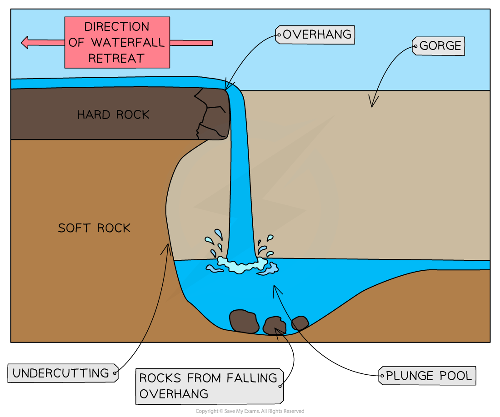
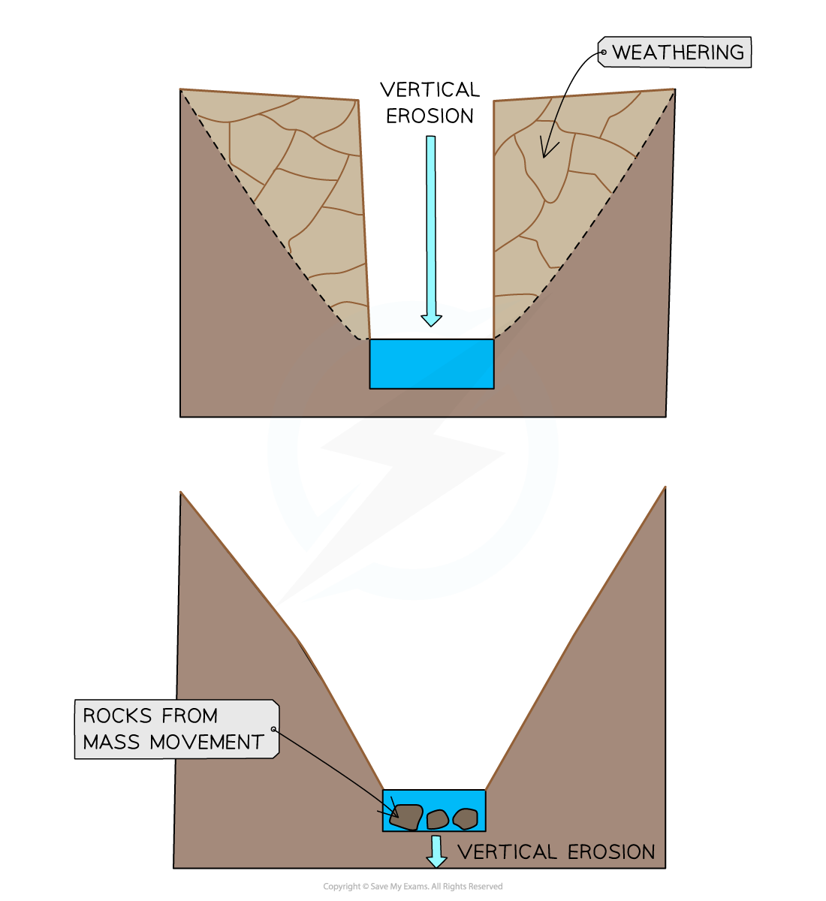
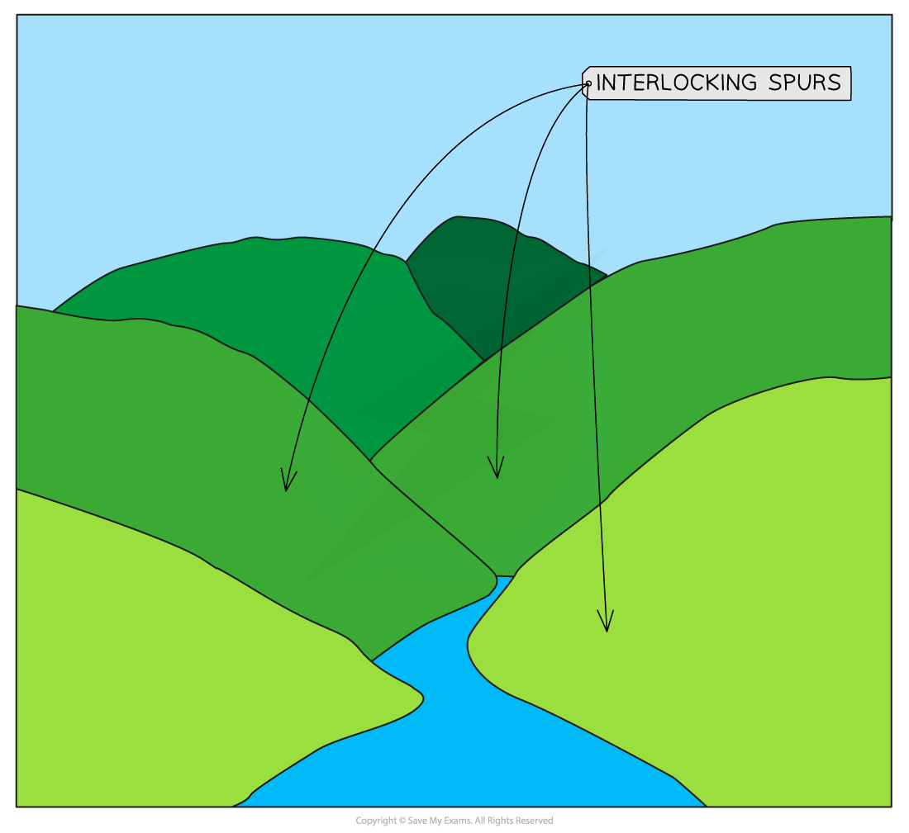
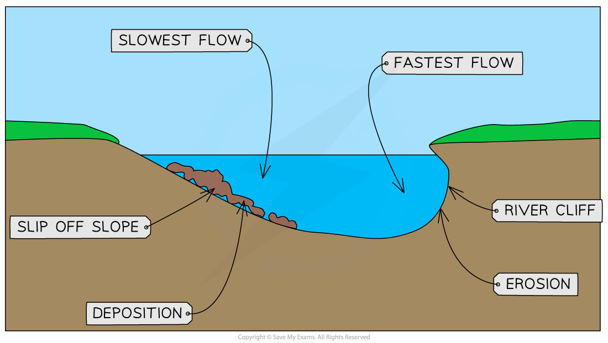
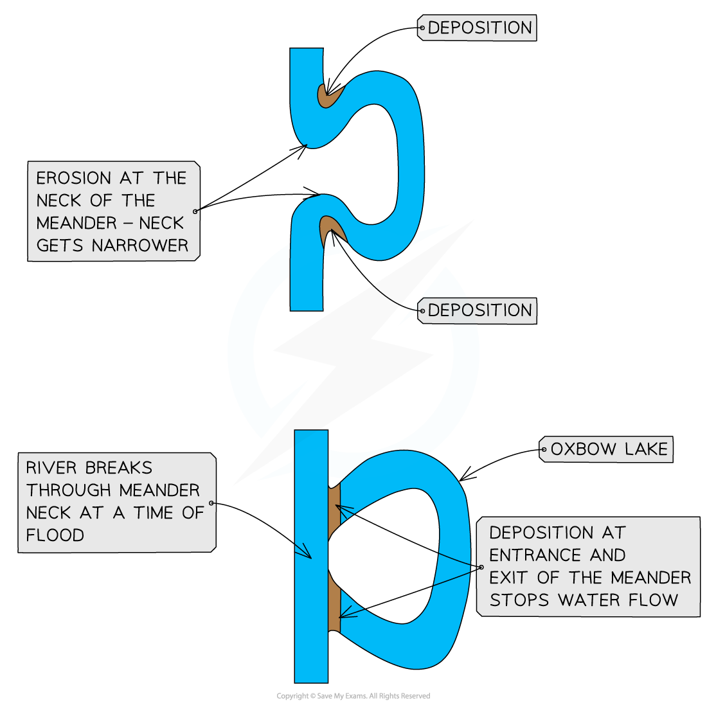
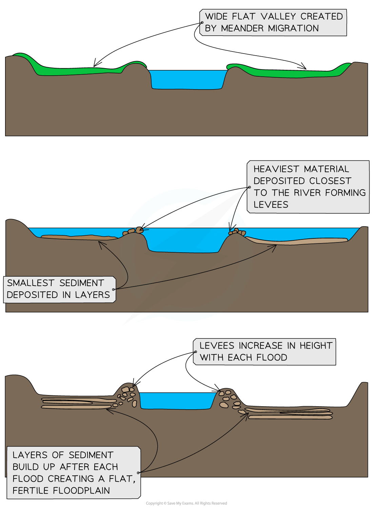
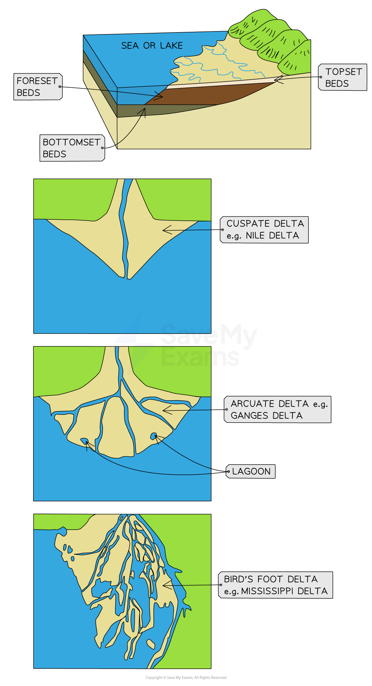

# River Landforms

## River Landforms

> **Spec point** — `spcpt_BcWT97ThjZGDRV6N` · Describe & explain the formation of landforms associated with these processes

## River Landforms

### River landscape characteristics

- The changes in river channel characteristics, lead to changes in the river landscape
- The upland and lowland areas of rivers have distinctive landforms
- Upland:

  - Waterfalls
  - Gorges
  - V-shaped valleys
  - Interlocking spurs

#### Waterfalls and gorges

- Waterfalls form when there is a drop in the river bed from one level to another
- This drop is often due to changes in the hardness of the rock, where hard rock overlies soft rock
- **Hydraulic action** and **abrasion** are the main erosional processes:
- The soft rock erodes quicker, **undercutting** the hard rock and creating a** plunge pool**
- This leads to the development of an **overhang** of hard rock which eventually over time, collapses
- The overhang falls into the plunge pool increasing **abrasion** and making the plunge pool deeper
- The process then begins again and the waterfall retreats upstream leaving a **steep-sided gorge**

*Waterfall formation*

#### V-shaped valleys

- **Vertical erosion** is dominant in the upper course of the river

  - This cuts down into the river bed and deepens the river channel
- **Weathering** and **mass movement** lead to material from the valley sides collapsing into the river, forming a steep v-shaped valley

#### Interlocking spurs

- In the upper course of the river, the channel starts to meander
- Erosion happens on the outside of the bend
- In the upland areas this forms interlocking spurs

*Interlocking Spurs*

#### Potholes

- Potholes are round depressions in the riverbed
- They are formed by **abrasion**
- Where there are dips in the riverbed, the river flow can cause the sediment to spin

  - This erodes the dip, forming a circular hollow (**pothole**)
- As the size of the hollow increases, larger material becomes trapped in the pothole

  - This further increases the erosion of the pothole

#### Lowland features:

- Meanders
- Ox-bow lakes
- Floodplains
- Levees

#### Meanders

- In lowland areas, **lateral erosion** is dominant
- Meanders increase in size
- The fastest water flow **(thalweg)** is on the outside of the river bends, leading to erosion:

  - The erosion undercuts the riverbank, forming a **river cliff**
  - The riverbank collapses and the edge of the meander moves further out
- The slowest flow is on the inside of the river bends, leading to deposition:

  - The deposits form a **slip-off slope**
- Deposition on one side and erosion on the other leads to the meander **migrating** across the valley

*Cross-section of a Meander*

#### Oxbow lakes

- With distance downstream, the size of the meanders increases
- The erosion on outside bends can eventually lead to the formation of a meander neck
- At a time of the flood, the river may cut through the neck of the meander, forming a straighter course for the water
- The flow of water at entry and exit from the meander will be slower, leading to **deposition**
- The meander becomes cut off from the main river channel, forming an **oxbow lake**

*Oxbow Lake Formation*

> **Exam Hint**
> Remember when describing the formation of oxbow lakes, it is important to state that the river will break through the neck of the meander during a flood. At other times, the river does not have enough power to break through.

#### Floodplains and levees

- **Floodplains** are flat expanses of land on either side of the river
- The migration of meanders leads to the formation of the floodplain
- High discharge may cause the river to overflow the banks
- More of the water is in contact with the land surface as the water spreads across the floodplain
- Increased friction reduces velocity and material is deposited across the floodplain, gradually increasing the floodplain height
- The heaviest material is deposited first, nearest to the river channel, forming natural embankments called **levees**

*Levee and Floodplain Formation*

#### Deltas

- Deltas are formed when streams flow into standing bodies of water
- Rivers must carry a large amount of sediment for deltas to form
- Delta formation requires a rapid drop in river velocity

  - **Flocculation, when **salt particles stick together, increases deposition
  - **Bioconstruction,** when vegetation slows the river, increases deposition
- There are a variety of delta formations, such as arcuate and bird’s foot

#### Types of delta

