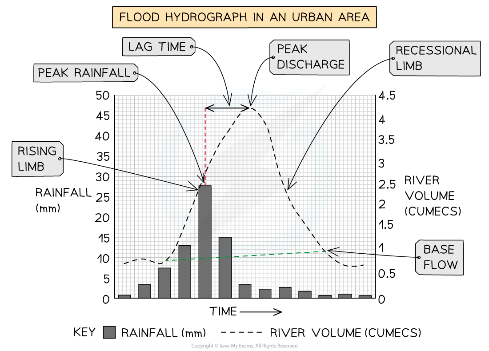

# River Management

## Managing the Impacts of River Flooding

> **Spec point** — `spcpt_MVH27VfhHwp5D5QT` · Explain what can be done to manage the impacts of river flooding

## Managing the Impacts of River Flooding

### Flood prediction

- Prediction of flooding means that steps can be taken to manage flooding
- Flood hydrographs are used to predict the reaction of a river's discharge to a rainfall event
- A flood ***hydrograph*** shows the changes in river discharge after a storm event
- The graph shows a short period of time, usually 24 hours
- The flood hydrograph has a number of features:

  - ***Base flow***
  - ***Peak rainfall***
  - ***Rising limb***
  - ***Peak discharge***
  - ***Lag time***
  - ***Recessional limb***

*Flood hydrograph in an urban area*

- The key factor in assessing the flood risk is time taken for the precipitation to reach the river from where it falls—the** lag time**
- Rivers with a short lag time and steep rising limbs have a much greater risk of flooding

  - The water reaches the river rapidly and the river may not have the capacity to cope with the influx of water
- Rivers with a long lag time and gentle rising limbs have a lower flood risk

  - The water reaches the river more slowly, causing a gradual increase in discharge
- The lag time depends on some human and physical factors
- These lead to increased overland flow, which shortens the lag time

#### Human factors which increase the risk of flooding

- **Deforestation**

  - Lack of trees reduces interception and infiltration, increasing overland flow
- **Urbanisation**

  - Impermeable concrete and tarmac increase the overland flow
  - Water flows into the drains, reaching the river rapidly
- **Agriculture**

  - Bare soil and ploughing increase overland flow
- **Climate change**

  - Rising global temperatures may increase storm frequency and intensity

#### Physical factors which increase the risk of flooding

- **Relief**

  - Steep slopes** reduce infiltration** and increase overland flow
- **Rock type**

  - **Impermeable** rocks **reduce percolation** and increase overland flow
- **Soil**

  - Frozen, saturated or compacted soil **reduces** **infiltration** and increases overland flow
  - Some soil types, such as clay, **reduce infiltration** and increase overland flow
- **Weather**

  - Heavy or prolonged rainfall means that the rate at which water reaches the surface **exceeds the infiltration rate**, leading to increased overland flow
  - After a period of snow, rising temperatures can cause rapid melting, which increases overland flow
- **Seasonal variations**

  - Flooding in Northern Europe tends to occur in the autumn and winter when rainfall is more frequent
  - In areas affected by monsoons, much of the annual rainfall occurs in a few weeks, saturating the ground and increasing overland flow
  - Higher temperatures in spring lead to snow melt in mountainous areas, increasing overland flow
- **Drainage density**

  - Where drainage density is high, there are many tributaries taking water to the main channel, causing a rapid increase in discharge
- **Vegetation**

  - Where there is little natural vegetation, there is reduced interception leading to increased overland flow

> **Worked Example**
> **Study Fig 1, which is a hydrograph of a river after a storm.**
> 
> 
> 
> **How long after the start of the rainstorm is the peak flow?**
> 
> ..................................................... **hours     **                                                           **      [1 mark]**
> 
> **Answer**
> 
> - Between 26-28 hours

> **Exam Hint**
> In the exam, you may be asked to explain the causes of flooding. Remember, this means that you need to make connections between factors such as deforestation and the increased flood risk. Rather than simply stating that deforestation increases flood risk, you need to explain the reasons: decreased interception and infiltration, leading to increased overland flow and shorter lag time.

### Flood management

- The key cause of flooding is the amount and duration of precipitation; this cannot be altered
- There are a number of methods of managing floods and reducing the severity and/or impact
- The two main categories of flood management are **hard** and **soft engineering:**

  - Hard engineering involves building structures or changing the river channel
  - Soft engineering works with natural processes of the river and surrounding environment
- Soft engineering is increasingly popular
- Soft engineering is an example of ***mitigation*** where schemes aim to minimise damage rather than trying to prevent the flooding

#### Types of hard engineering

- **Dams and reservoirs** which enable the amount of discharge downstream to be controlled
- **Embankments or levées **increase the capacity of the river
- **Straightened channels **mean that the river flows more quickly past vulnerable areas, reducing the risk of flooding
- **Flood relief channels **allow some water to flow out of the main channel, reducing the discharge
- **Spillways or overflow channels: **these take excess water away from the main channel

#### Types of soft engineering

- **River restoration** supports the river by restoring it to its original regime—putting meanders back in, stabilising banks and connecting to flood plains
- **Wetland conservation **these areas provide somewhere for excess water to go and slow the flow of floodwater
- **Catchment management plans **assess the risk of flooding in an area and outline how this will be managed
- **Floodplain zoning **means that only certain land uses are allowed on the floodplain, reducing the risk
- **Afforestation **involves the planting of vegetation and trees to increase interception and infiltration

#### Additional flood control methods

- Other methods that can be used to decrease the risk of flooding are:

  - Leaving the stubble on the fields after the crop is harvested helps to stabilise the soil and increase infiltration
  - **Contour ploughing** involves ploughing fields across the slope rather than up and down. This gives the water more time to infiltrate and stops the ploughed furrows becoming channels for water
  - Improved **forecasting **and **flood warnings**
  - **Dredging** the rivers to increase capacity, however, often leads to the need for concrete reinforcement of the banks

## Case Study: Ganges/Brahmaputra

> **Spec point** — `spcpt_czKJVC6KZRvRB7kX` · The opportunities presented by a river or rivers, the associated hazards  & their management

## Case Study: Ganges/Brahmaputra

> **Case Study**
> - The **Ganges** is 2,510 km long
> 
>   - It flows through India and Bangladesh, where it becomes the River Padma and joins with the Brahmaputra River
>   - The drainage basin covers 1.2 million km2
>   - The population living within the area drained by the Ganges is over 650 million people
> - The **Brahmaputra** River is 3,969 km long
> 
>   1. It flows through Tibet, India and Bangladesh, where it joins with the River Padma
>   2. The drainage basin covers 651,334 km2
> - Both rivers;
> 
>   - Have their source in the Himalayan Mountains
>   - Waters enter the sea in the Bay of Bengal
> 
> 
> 
> *The Ganges and Brahmaputra Basin*
> 
> ### Opportunities
> 
> - **Water supply**
> 
>   - There are many cities, including New Delhi and Kolkata, along the Ganges/Brahmaputra drainage basins which take their water supplies from the river
> - **Agriculture and fishing**
> 
>   - The regular flooding in the drainage basin leaves deposits of alluvium, which are rich in nutrients and ideal for growing crops such as rice and jute
>   - The rivers provide water for irrigation and for the flooding of rice fields
>   - Fish from the river provide food and jobs for local people
> - **Culture **
> 
>   - The Ganges is sacred to Hindus and is worshipped as the goddess Ganga
> - **Tourism**
> 
>   - Three sites which are holy to Hindus lie on the banks of the Ganges (Haridwar, Allahabad and Varansi). This leads millions of pilgrims to visit each year
>   - Rafting and river cruises are also increasingly popular
> - **Flat land**
> 
>   - The flat floodplains mean that construction is easy, and the floodplains have one of the highest density populations in the world
> - **Energy **
> 
>   - There are a number of dams along both rivers, including the Tehri Dam on the Ganges, which is the biggest hydroelectric power plant in India
> 
> ### Hazards
> 
> - The Ganges/Brahmaputra drainage basin regularly experiences floods, including most recently in May 2022
> 
>   - In 1998, 75% of Bangladesh was flooded over 30 million people were made homeless
>   - Over 1000 people died
>   - 700,000 hectares of crops were destroyed
> - 'Normal' floods are vital to provide fertile soil and irrigation, but increasingly flooding is becoming more unpredictable and extensive
> 
> #### Human causes of flooding
> 
> - **Deforestation **particularly in the upland areas
> 
>   - This leads to less interception and infiltration, increasing overland flow
> - **Human-induced climate change** has led to increased melting of Himalayan snow and ice, which increases discharge
> 
>   - It may also have affected climate patterns, leading to increased frequency and severity of tropical cyclones
> - **Urbanisation,** as the population increases and there is more rural-urban migration, leads to increased overland flow due to impermeable surfaces
> - **Agriculture** increases overland flow and soil erosion, which reduces the capacity of the rivers
> 
> #### Natural causes of flooding
> 
> - **Low-lying land** in the Ganges delta in Bangladesh which is at or just above sea level, meaning that it floods more easily
> - **Monsoon climate **which means that there are heavy and prolonged rains for some months
> - **Tropical cyclones** bring heavy rainfall
> - **Melting snow and ice **from the Himalayas in spring leads to a rapid increase in river discharge
> 
> ### Management of flooding
> 
> - Bangladesh is an **LEDC**
> 
>   - The country lacks the money for large schemes to reduce the impact of flooding
> - **Flood Action Plan (**FAP) was funded by the World Bank and a number of MEDCs. Measures that were proposed include:
> 
>   - Monitoring of flood levels
>   - Construction of levées/embankments
>   - Building 5000 flood shelters
>   - Creating floodwater storage systems
>   - A more effective flood warning system
>   - Building of dams to store water
>   - Reducing deforestation
> - The FAP was not considered a success because;
> 
>   - Many parts of the project were never completed, including the dams and floodwater storage areas, due to inadequate funding and corruption
>   - There was later a recognition that some flooding was necessary to maintain agriculture in many areas
>   - 8 million people were forced to move to accommodate the FAP construction
>   - Changing the channel upstream meant that areas downstream suffered more
>   - The government cannot afford the maintenance costs
> - New management suggestions include;
> 
>   - Better flood forecasting and warning systems
>   - More well-stocked flood shelters
> - These are less damaging to the environment and cheaper to maintain than hard engineering such as embankments, dams and floodwater storage areas
