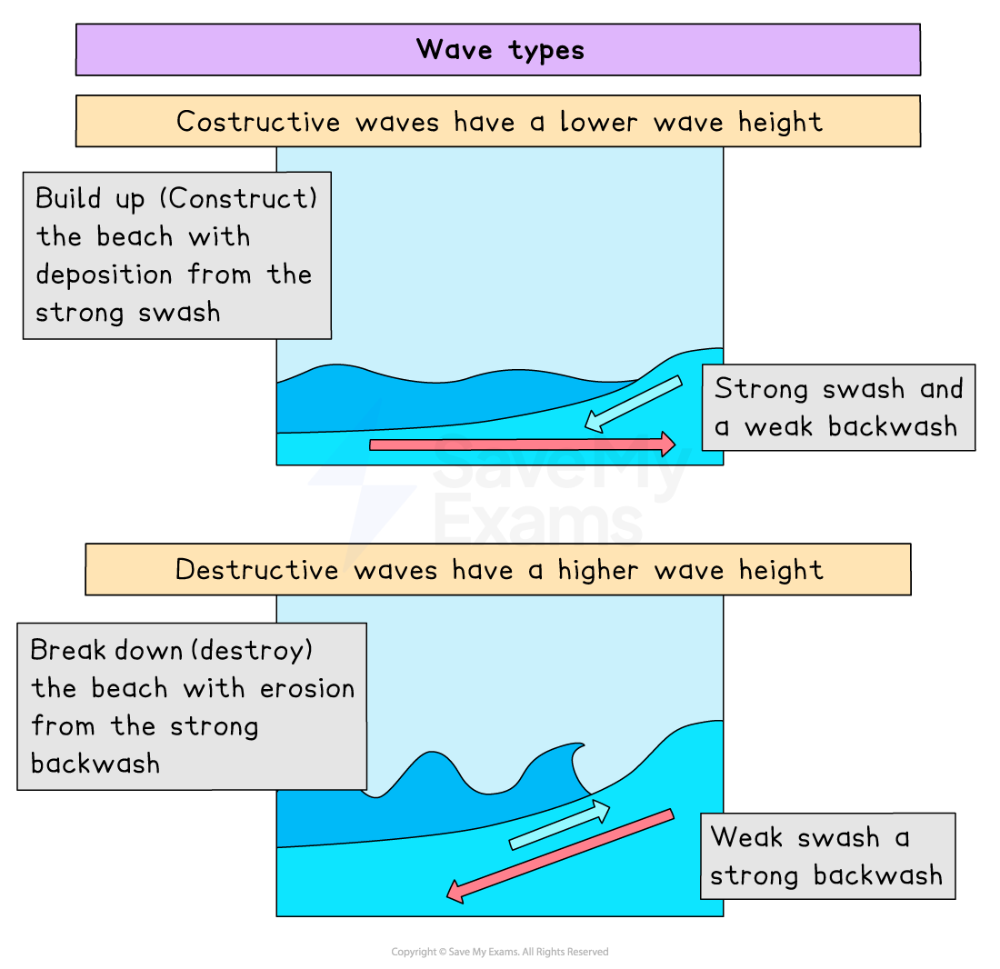

# Coastal Processes

## Coastal Processes

> **Spec point** — `spcpt_jkYkfyRxhsbVVqft` · Demonstrate an understanding of the work of the sea in eroding, transporting & depositing

## Coastal Processes

### Coastal regions

- The **coast **is the area where land and sea meet
- The **shoreline **is the boundary of the land defined by the high water mark on a low-lying coast or the base of a steeply sloping coast
- The **shore **is the area between the highest and lowest tide points
- **Tides **are usually twice a day but vary from coast to coast and with the time of the year
- The difference between low and high tide is known as the **tidal range**
- The tide determines the waves' height and depth
- The movement of waves and currents affects coastal features

### Waves

- Winds blowing across the sea's surface create waves, which are marine processes that erode, move, and deposit material
- The **size **of a **wave **depends on:

  - The **speed **of the wind
  - The **fetch **(distance the wind travels)
  - The amount of **time **the wind blows (in the same direction)
- The wave size increases with wind speed, strength, and fetch
- Friction from the seabed pushes a wave forward as it gets closer to the coast and into shallower water, where it will finally crest and crash onto the beach
- The movement of water up the beach is called the **swash**, and the return movement is the **backwash**

- There are two types of waves:

  - **Destructive** waves erode the beach and have:
  
    - a steep wave gradient
    - a short wavelength with high height
    - a high-frequency wave rate of 10-12 per minute
    - high energy
    - a strong, abrasive backwash that drags material out to sea and forms shingle beaches
  - **Constructive** waves are beach builders and have:
  
    - a long wavelength with low height
    - a low-frequency wave rate of 6-8  per minute
    - a shallow wave gradient
    - low energy
    - a stronger swash that carries material up onto the beach and deposits a sandy beach

*Illustration showing constructive and destructive waves*

> **Exam Hint**
> Make sure you are familiar with the way waves are formed and their different characteristics. Don't be surprised if you are asked to identify the type of wave.

> **Worked Example**
> **Circle the statement below that best describes the characteristics of a destructive wave? **
> 
> **[1 mark]**
> 
> **A:** long wavelength and weak backwash
> 
> **B:** short wavelength and weak backwash
> 
> **C:** short wavelength and strong backwash
> 
> **D:** long wavelength and strong backwash
> 
> **Solution**
> 
> - **C is the correct answer**** [1 mark]**
> - A destructive wave has a short wavelength, high-frequency rate, steep wave gradient and a strong backwash

### Marine erosion

- Destructive waves are responsible for the majority of erosion that happens along a coast
- They cut into the coastline in four ways:

  - ***Hydraulic Action***
  - ***Attrition***
  - ***Corrosion***
  - ***Abrasion***
- A large, rough boulder is gradually reduced into round sand grains (quartz) the longer it remains in the ocean and the farther it travels along the shore
- The effects of attrition are amplified when the waves carry material farther and longer
- Rounded pebbles on a beach are known as **shingle**

> **Exam Hint**
> Make sure you know the difference between the four types of erosion, particularly between abrasion (corrasion) and attrition. So many students confuse these two terms. A tip for you is to think of abrasion as rubbing with sandpaper or maybe you have grazed your knees or elbows when you fell off your bike/skateboard.  Those grazes were abrasions on your knees, elbows, etc.

## Marine Transportation

> **Spec point** — `spcpt_YSXgQnWY9Nw6ySXz`

## Marine Transportation

- The sea transports sediment that it gets from erosion in the same way rivers do
- Material in the sea arrives from many sources:

  - eroded from cliffs
  - transported by longshore drift along the coastline
  - brought inland from offshore by constructive waves
  - carried to the coastline by a river
- Once in the water, the material is moved in different ways:

  - ***Traction***
  - ***Saltation***
  - ***Suspension***
  - ***Solution***

### Longshore drift (LSD)

- Longshore drift (LSD) is the main process of transportation along the coast
- Waves approach the beach at an angle due to the prevailing wind
- As the waves break, the swash carries material up the beach at the same angle
- As the ***swash*** dies away, the ***backwash*** carries the material down the beach at right angles (90°)
- The process repeats, transporting material along the beach in a zig-zag movement

*Illustration of the process of longshore drift*

- Beach sediment is carried farther down the coast on coasts where longshore drift is one way; if it is blocked, sediment cannot move and the area farther down the coast is deprived of sediment. This results in two problems:

  - Smaller beaches are less attractive to tourists, causing a loss of income
  - Removes natural coastal protection

> **Worked Example**
> **Describe and explain the process of longshore drift**
> 
> **[4 Marks]**
> 
> #### Solution
> 
> - Longshore drift is the process where the waves transport material, such as sand, along the beach in the direction of the prevailing wind **[1 mark]**. The swash moves material up the beach at an angle **[1 mark]**** **as the waves approach in a similar direction to the wind. The backwash moves material back down the beach at 90° due to gravity **[1 mark]**. This movement continues along the beach in a zigzag motion in the direction of the prevailing wind **[1 mark].**
> 
> ### Marking guidance
> 
> - The answer above is just one example of a response to this question
> - The commands are to **describe and explain **and answers should detail the steps and reasons for longshore drift
> - The focus must be on the process of 'longshore drift' and what it does

> **Exam Hint**
> - You can gain full marks using well-annotated diagrams to support your answer. Just as you like having a visual prompt, it helps the examiner to see that you do know the answer. Sometimes a diagram is easier than actually writing it all out.
> - Longshore drift does **not **produce landforms; it is the process of transportation that supplies the sediment for the process of deposition (which does form features).

## Marine Deposition

> **Spec point** — `spcpt_cFVZjqRh4tkQ4z4G`

## Marine Deposition

- The waves carry sand or shingle as they travel

  - Backwash carries it away, while swash carries it onto a shore
- The largest material is deposited along the upper reach of the swash when a constructive wave carries sediment up the beach
- The backwash loses water and energy as it travels because of the sand's porosity, resulting in smaller and smaller deposits.
- When a constructive wave carries sediment up the beach, the largest material is deposited along the upper reach of the swash
- During a storm, large **shingle** is thrown above the usual high tide level to form a ridge at the top of the beach called a **berm**

*Sediment deposition*
