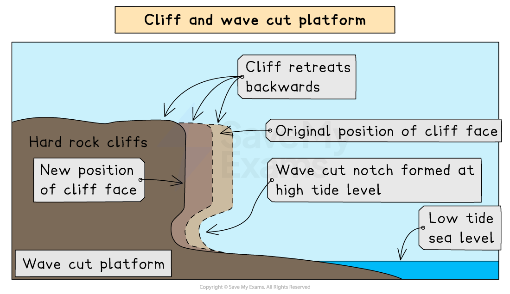
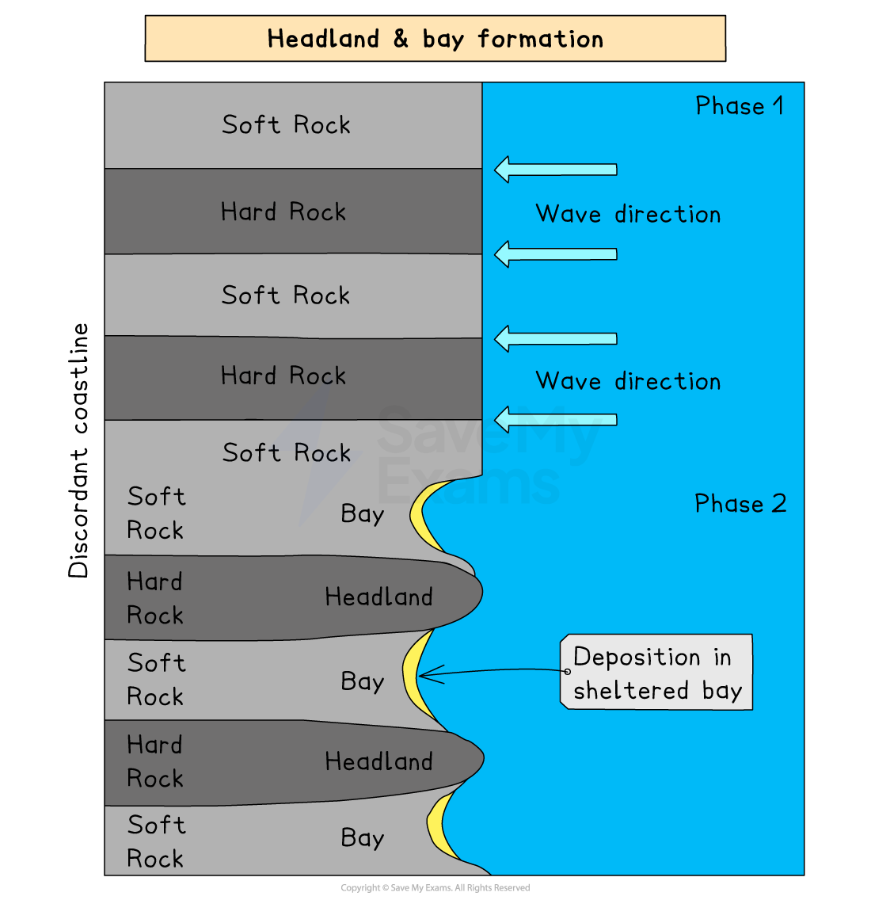
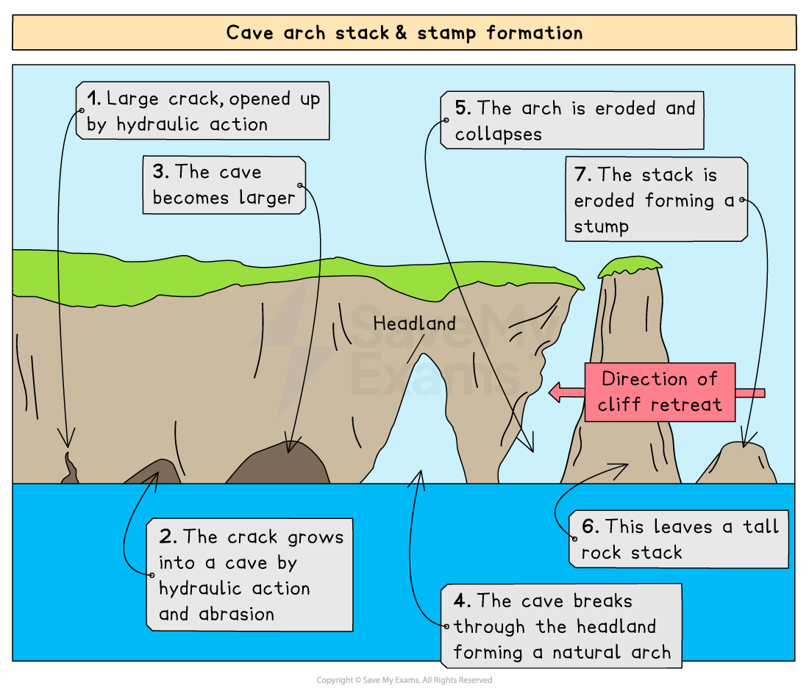
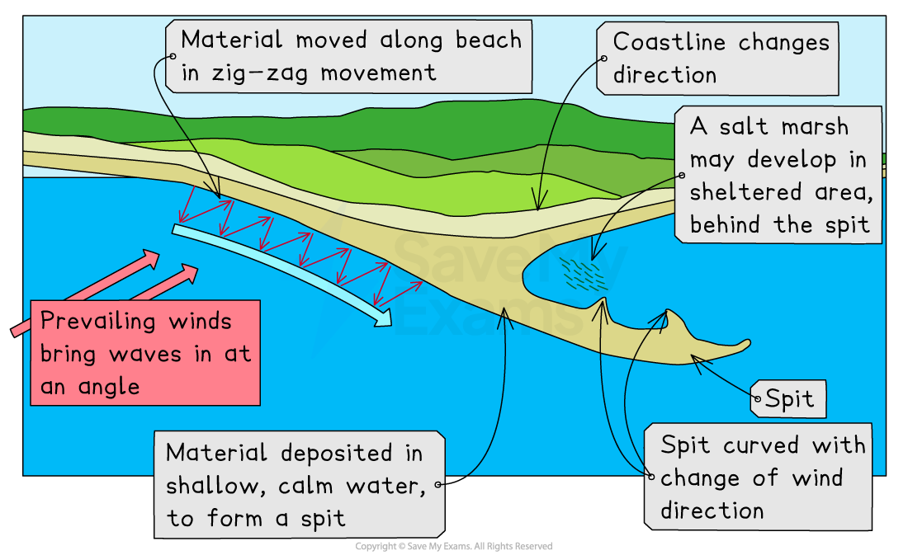
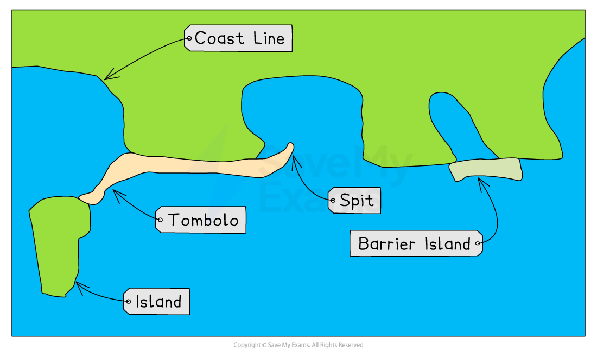

# Coastal Landforms

## Erosional Landforms

> **Spec point** — `spcpt_x7WWtB969gPkqd2c`

## Erosional Landforms

### Cliffs and wave-cut platforms

- Cliffs are sloping or steep rocks with different profiles depending on the topography and geology
- Geology and wave attack at the base of the cliff also affect the angle of the cliff face; low-energy waves cause less damage than high-energy ones
- Many cliffs have a '**knick-point**' around the high-water mark called the '**wave-cut notch**', which is where the wave has undercut the rock
- **Abrasion**, **corrosion** and **hydraulic action** further extend the notch back into the cliff
- As **undercutting** continues, the cliff above becomes unsupported and unstable and eventually collapses
- The backwash of the waves carries away the eroded material, leaving behind a **wave-cut platform**
- The process repeats and the cliff continues to retreat, leading to a coastal retreat

*The process of cliff retreat and wave-cut platform formation*

### Headlands and bays

- Found in areas of alternating bands of resistant (hard) and less resistant (soft) rocks running **perpendicular **to oncoming waves (*discordant**** ***coastline)
- Initially, **less resistant rock** (e.g. clay) is eroded back, forming a *bay*
- The **more resistant rock** (e.g. limestone) is left protruding out to sea as a **headland**

*The formation of headlands and bays*

- A **headland**:

  - projects out to sea
  - has cliffs along its sides
  - is usually longer than it is wide
  - has a geology of resistant rock
- A** bay** usually has:

  - a wide, open entrance from the sea
  - a roughly semi-circular shape extending into the coastline
  - land that is lower than the headlands surrounding it
  - a bay may or may not have a beach

### Caves, arches and stacks

- Wave speed reduces as they near the shoreline
- The angle of the waves changes and the crest becomes parallel to the coast, known as **wave refraction**
- Because of this refraction, the headland's erosive effect is concentrated on all sides of the headland
- Hydraulic action, abrasion, and corrosion take advantage of any weaknesses in the headland
- As a **crack **begins to widen, erosion will act to form a **cave**
- The cave will become larger and eventually break through the headland to form an **arch**
- Due to weathering from above and erosion below, the arch's foundation continues getting thinner and wider
- Eventually, the roof of the arch collapses, leaving behind an isolated column of rock called a **stack**
- The stack is **undercut **at the base by wave action and sub-aerial weathering above, until it collapses to form a **stump**

#### Formation of a cave, arch, stack and stump

*Illustration showing the formation of a cave, arch, stack and stump*

> **Exam Hint**
> Make sure that you can draw and annotate the formation of this feature, as it is a popular question in the exams.
> 
> Remember that attrition is **not **part of the formation of this feature; attrition is the knocking together of rocks to smooth and round them.
> 
> Corrosion is an active part of the formation of these features, as all salt water is slightly acidic and most rock contains some soluble minerals that will react with the salt water.
> 
> Sub-aerial weathering (from above) also contributes to the collapse of the arch and stack.

## Depositional Landforms

> **Spec point** — `spcpt_xpNMC3ysNqyVGbsT`

## Depositional Landforms

### Beach

- Beaches form in sheltered places like bays
- **Constructive wave** action causes **deposition**, with the swash being stronger than the backwash
- Typically, beach formation takes place during the calmer summer months
- Strong winds can occasionally carry sand from offshore bars onto the shore
- Blown sand near a beach's  ***backshore*** can form sand dunes

### Spit

- A spit is an expanse of sand or shingle that stretches from the shore out to sea
- Spits occur when:

  - There is a change in the shape of the coastline
  - A river mouth stops a spit forming across the estuary
- A spit may or may not have a 'hooked' end, depending on the winds and currents
- Spurn Point, which stretches three and a half miles over the Humber Estuary in northeastern England, is a good example

### Stages of formation:

- The process that moves sediment is longshore drift
- Where the coastline changes direction, a shallow, sheltered area allows sediment to be deposited
- More deposition happens as a result of higher friction
- Eventually, a spit slowly builds up to sea level and extends in length
- If the wind changes direction, then the wave pattern alters and results in a hooked end
- The area behind the spit becomes sheltered
- ***Silts*** are deposited here to form salt marshes or mud flats

*Formation of a spit*

### Bar

- A bar is when a spit grows across a bay and joins two headlands together
- A **bar **of sand is formed (**sandbar**)
- Sandbars can also form **offshore **due to the action of breaking waves from a beach

*Illustration of bar formation*

### Lagoon

- A lagoon is where a small body of water is cut off from the sea
- A lagoon may form behind a bar or tombolo
- Lagoons do not last forever and may fill with sediment and form new land

### Tombolo

- A **tombolo **is formed when a spit joins the mainland to an island
- Chesil Beach in Dorset is a tombolo, as the mainland is joined to the Isle of Portland

### Barrier island

- Barrier islands form parallel to the coast
- The main difference between a bar and a barrier island is that a bar joins two headlands, whereas a barrier island is open at one or both ends

#### Types of coastal landforms

*Depositional landforms along the coastline*

> **Exam Hint**
> You may be asked to draw and label a diagram showing how depositional landforms (beaches, spits, etc.) are formed. You need to be able to show how waves move sediment along the coast. Practice drawing and labelling these diagrams so you can reproduce any of them in the exam. Marks will be awarded for the accuracy and completeness of your labelling and drawing.

### Sand dunes

- Sand dunes are a ***dynamic*** environment with changes occurring quickly
- Sandy beaches are usually backed by sand dunes due to strong onshore winds, which transport dried-out, exposed sand
- Sand grains are trapped and deposited against an obstacle (rubbish, rocks, driftwood, etc) to form dunes
- Dune ridges move inland due to onshore winds pushing the seaward side to the leeward side
- It is the interaction of winds and vegetation that help form sand dunes

### Formation of a sand dune

- Windblown sand is deposited against an obstruction, such as a pebble or driftwood
- As more sand particles are caught, the dunes grow in size, forming rows at right angles to the prevailing wind
- In a process known as ***succession,*** vegetation will eventually colonise and fix the ridges of the dunes
- The first plants (**pioneer species)** have to cope with:

  - salinity
  - lack of moisture as sand drains quickly (highly permeable)
  - wind
  - temporary submergence by wind-blown sand
  - rising sea levels

#### Formation of a coastal sand dune by succession

*Illustration of coastal dune succession*

> **Worked Example**
> **Figs. 3.1, 3.2 and 3.3, show three coastlines.**
> 
> 
> 
> Identify each of the following landforms:
> (i) landform **W** in Fig. 3.1
> 
> **[1]**
> 
> (ii) landform **X** in Fig. 3.2
> 
> **[1]**
> 
> (iii) landform **Y** in Fig. 3.2
> 
> **[1]**
> 
> (iv) landform **Z** in Fig. 3.3.
> 
> **[1]**
> 
> ### Solution
> 
> - **W:** **Wave-cut platform**
> - **X**: **Beach**
> - **Y:** **Sand dunes**
> - **Z:** **Cliff**
