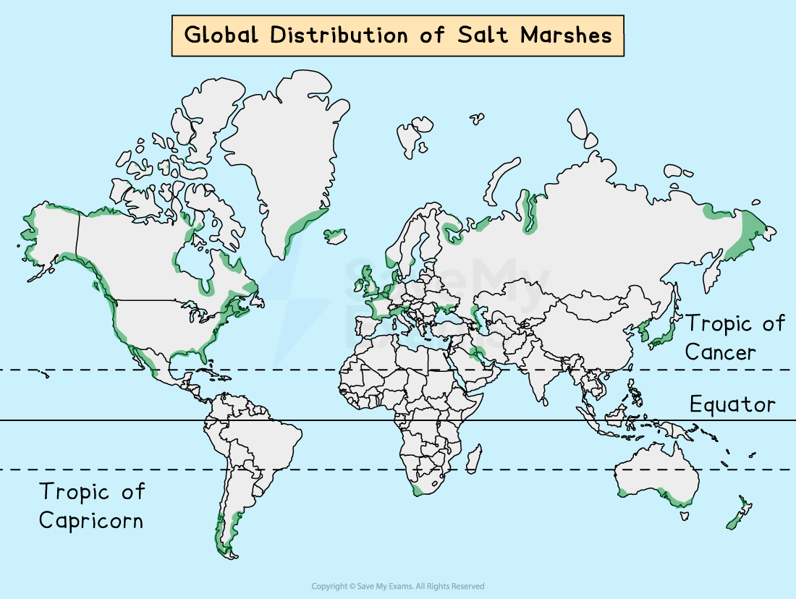

# Coastal Ecosystems

## Coral Reefs

> **Spec point** — `spcpt_TmH5c2SSXnK7wNqB` · Describe coral reefs & the conditions required for their development

## Coral Reefs

- Coral reefs and atolls form through the build-up and compression of lime-secreting **polyp **skeletons
- **Only **the upper and outer parts of the coral reef contain living coral polyps
- When one generation dies, the next grows on top; their hard, ***calcareous*** skeletons form an upward and outward reef
- For corals to start growing, there needs to be a solid surface, which could be from a shipwreck or other debris
- Coral reefs run parallel to the coast, with breaks where river mouths exit
- Their extreme sensitivity means that coral reefs cannot grow anywhere

*Global distribution of coral reefs*

- Corals are found in the tropical and subtropical Western Atlantic and Indo-Pacific oceans between 30°N and 30°S
- Coral grows on rocky outcrops in some areas of the Gulf of California
- The Great Barrier Reef in northern Australia is famous for its richness and size and can be viewed from space
- Four factors affect their distribution:

  - **Temperature**
  - **Light**
  - **Water depth**
  - ***Salinity***

### Global features of coral reefs

#### Temperature

- Corals cannot tolerate water temperatures below 18°C but grow best at 22°C – 25°C
- Some can stand temperatures as high as 40° C for short periods
- This is why coral reefs normally grow between 30° north and south of the equator within the Tropic of Capricorn and the Tropic of Cancer

#### Light

- Corals need light for photosynthesis due to the algae, called zooxanthellae, that live in their tissue

#### Water

- Corals are generally found at depths of less than 25 m where sunlight can penetrate
- The water must also be clear and clean to allow for photosynthesis to occur

#### Salinity

- Since corals are marine animals, they need salty water to survive, ranging from 32-42 parts per thousand

### Local features of coral reefs

#### Wave action

- Corals need well-oxygenated, clean water and wave action provides this

#### Exposure to air

- Although corals need oxygenated water, they cannot be exposed to air for too long or they will die

#### Sediment

- All corals need clear, clean water
- By decreasing the amount of light available, sediment in the water will block regular feeding habits and interfere with the photosynthesis of the microscopic algae known as  'zooxanthellae' that live in polyp tissue
- The corals provide algae with a home and materials for photosynthesis
- In return, the algae produce food, oxygen and help with waste removal

### Types of coral reefs

#### Fringing reef

- These are low, narrow bands of coral running parallel to the coast and form around a land mass
- At high tide, narrow, shallow lagoons cover them
- Their outer edges slope steeply down into the sea beyond
- The landward side of the reef has a higher outer edge that rises to the high tide level
- **Example**: Coral Coast of Fiji

#### Barrier reef

- Wide, deep lagoons below at depths at which polyps can live separate these, which are between 500 m and several kilometres from the coast
- **Example: **The Great Barrier Reef has almost 3,000 reefs, separated by channels stretching more than 2,300 km

#### Atolls

- These are narrow, ring-shaped reefs, consisting of a coral rim that encircles a deep lagoon. ** **Sometimes, they may circle and protect an island. Channels between islets connect a lagoon to the open ocean or sea.
- **Example: **Maldives Suvadiva Atoll

> **Exam Hint**
> The Great Barrier Reef in the Coral Sea, off the coast of Queensland, Australia, is a good example of a barrier reef.
> 
> It is the world's largest coral reef system with over 2,900 individual reefs and 600 islands that stretches for over 2,300 kilometres and can be seen from space.

## Salt Marshes

> **Spec point** — `spcpt_9DGgZ8RyNHZJYKyf` · Describe salt marshes & the conditions required for their development

## Salt Marshes

### Distribution of salt marshes

- Salt marshes are found all over the world and are not temperature-dependent
- Like mangroves, they are an ecosystem of the *intertidal zone *
- They are typically very flat, with numerous channels running through them
- They form in:

  - Coastal areas that are well sheltered, such as inlets and estuaries where fine sediments can be deposited
  - Areas behind spits and artificial sea defences where tidal waters can flow gently and deposit fine sediments
  - They form in ***brackish*** water

*Global distribution of salt marshes*

#### Features of salt marshes

- Salt marshes are communities of nonwoody, salt-tolerant plants
- They begin as tidal mud flats, gaining height as more sediment is deposited
- This builds up to and above the level and frequency of tidal flooding, ensuring that the soil never dries out and remains muddy and sticky
- Pioneer species of ***halophytes plant*** begin to colonise
- As these plants die and add nutrients to the soil, sediment builds up. This makes the conditions more favourable and other species start to develop.
- The process of the development of vegetation over time is known as **succession**. In a salt marsh, this is known as a ***halophyte***
- The daily rising tide floods the lower marshes
- They are good coastal defences in some areas, acting as a natural buffer against coastal erosion and flooding
- However, human activity has destroyed them in many places for agriculture or development, putting them at risk

## Mangrove Swamps

> **Spec point** — `spcpt_sQ43j9NGcCC2DSTD` · Describe mangrove swamps & the conditions required for their development

## Mangrove Swamps

### Distribution of mangroves

- Both mangroves and coral reefs are found in warm tropical waters; however, unlike the sensitive coral reefs, mangroves are highly adapted to changing conditions
- This has made them one of the most successful ecosystems on Earth

*Global Distribution of Mangroves*

- Mangroves originate from south-east Asia and have spread across the globe
- Mainly found in sheltered warm tropical waters and coastal swamps within 30° N and S of the equator, where the ideal temperature is around 27° C
- Some have adapted to cooler conditions and have colonised as far south as New Zealand's North Island
- They grow in the ***intertidal zone*** of the coast
- They need high levels of humidity (75–80%) and rainfall per year (1,500–3,000 mm) this can be gained from rainfall or moisture in the air, making tropical climates ideal
- South-East Asia's mangroves have the highest biodiversity in the world

### Characteristics of mangroves

- Mangroves are trees that live on the coastline
- They sit in water between 0.5 and 2.5 metres high
- They range in size from small shrubs to trees over 60 m high
- They have numerous tangled roots that grow above ground and form dense ***thickets***
- Mangrove root systems are complex, with a filtration system to keep salt out
- Some have snorkel-like roots that stick out of the mud to help them take in air
- Others use 'prop' roots or 'buttresses' to keep their trunks upright in the soft sediment at the tidal edge

*Prop Roots-Mangrove Root Systems-Snorkel Roots*

- It is the roots that trap mud, sand and silt, which eventually builds up the intertidal zone into the new land
- At the same time, the mangrove colonises new intertidal areas
- The fruits and seedlings of mangroves can float and travel many kilometres on ocean currents
- As they drift with the incoming tide, they become lodged in the mud and begin to grow, colonising new areas

> **Worked Example**
> **Explain one physical factor that influences the distribution of mangrove ecosystems**
> 
> **[3 marks]**
> 
> ### Solution
> 
> **Mangroves need high levels of humidity (75–80%) and rainfall per year (1,500–3,000 mm); this can be gained from rainfall or moisture in the air, making tropical climates the ideal areas for mangroves to grow ****[3 marks]****.**
> 
> ### Marking guidance
> 
> - 1 mark for identifying a way
> - 2 marks for development and further explanation
> 
> **Alternative content**
> 
> - The answer above is just one example of a response to this question. Other information that could be used in the answer includes:
> 
>   - temperature
>   - light
>   - water depth
>   - salinity
>   - wind direction
>   - level of shelter
