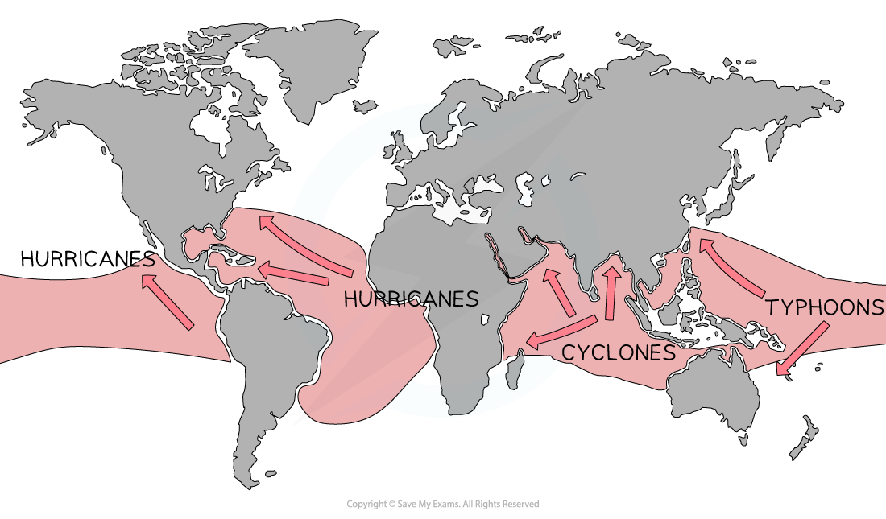

# Coastal Opportunities & Hazards

## Coastal Opportunities

> **Spec point** — `spcpt_KHczVk8kF9Spvkvp` · Demonstrate an understanding that coasts offer opportunities for people

## Coastal Opportunities

- There are many opportunities that the coast can bring:
- **Development **including:

  - Homes
  - Shops
  - Hotels
  - Roads
  - Schools
  - Restaurants etc.
- **Nature reserves**
- **Swimming and sports**
- **Industry**
- **Fishing and aquaculture**
- **Tourism**
- **Agriculture**
- **Ports and harbours**

## Coastal Hazards

> **Spec point** — `spcpt_TdMTrJFZ9N6h74hd` · Demonstrate an understanding that coasts present hazards

## Coastal Hazards

- Coastal hazards can be either **natural **or **human-induced**
- Natural hazards include storms, flooding and tsunamis
- **Human **actions create consequences and impacts

#### Urbanisation and transport

- **Consequences**

  - Changing how land is used (for ports, harbours, and airports); traffic on roads, trains, and the air; and taking water from the ground.
  - Getting rid of pollution and waste
- **Impacts**

  - Damage to the environment and loss of species, visual and water pollution, saltwater ingress, health risks, and introduction of invasive species

#### Agriculture

- **Consequences**

  - Reclaiming land, overuse of fertilisers and pesticides, animal numbers, water abstraction
- **Impacts**

  - Loss of ecosystems and species, coastal squeeze, water pollution, eutrophication and river channelisation

#### Fisheries and aquaculture

- **Consequences**

  - Ports and harbours construction, fish processing, fishing tackle, fish farm waste, shrimp farming
- **Impacts**

  - Overfishing, knock-on effects on other species, water and beach pollution, invasive alien species, habitat damage and changes in marine communities

#### Industry

- **Consequences**

  - Land use changes, power stations, of natural resource extraction, waste processing, cooling water; windmills; river dams, weirs and barriers; tidal barrages
- **Impacts**

  - Loss of habitats and species diversity; water pollution; eutrophication; heat and visual pollution; decreased input of fresh water and sediment to coastal zones; coastal erosion

#### Tourism and recreation

- **Consequences**

  - Development and land use changes, such as: golf courses; road, rail and air congestion; ports, harbours and marinas; water abstraction; wastewater and waste disposal; boat tours and water activities (snorkelling, skiing, surfing, etc.)
- **Impacts**

  - Loss of habitats and species diversity; disturbance of habitats, migration patterns, and landforms; visual pollution; lowering of water table; saltwater ingress in aquifers; water pollution; eutrophication; human health risks

> **Exam Hint**
> Remember that if you are asked to draw on a case study, you **must **name and locate the place and also use place names to locate specific features.

### Natural coastal hazards

- Coastal hazards arise from several factors:

  - **Storm surges** are extremely low-pressure storms (like tropical storms), which cause a rapid rise in sea level
  - **Storm tides** occur when there is a combination of high tide and low-pressure storm
  - **Tsunamis **are large sea waves due to underwater earthquakes. The closer to the coast, the bigger the impact
  - ***King tides***
  - **Sea level rise** due to global warming
  - **High river discharge** after a storm: when combined with a ***spring tide***, water in the estuary cannot discharge into the sea, causing a backflow of water and flooding
- Any number of these hazards can bring coastal flooding
- Although MEDCs have the largest costs, emerging countries experience the greatest effects

### Tropical storms

- **Hurricanes**, **typhoons** and **cyclones** are all types of tropical storms; the only difference is where they form

  - Hurricanes form in the tropical North Atlantic Ocean and Northeast Pacific
  - Typhoons form in the Northwest Pacific Ocean
  - Cyclones form in the South Pacific and Indian Ocean

*Global distribution of tropical storms*

- In the northern hemisphere, they form between May and November
- Between October and May in the southern hemisphere
- A tropical storm can destroy coastal areas and kill people and the effects are worse in LEDCs due to a lack of economic funds
- Other impacts are:

  - Destruction of buildings and infrastructure
  - Heavy rainfall and storm surges
  - Loss of ecosystems, trees, land, crops and animals
  - Ships are wrecked at sea and sunk
  - Power and communications are lost
  - Costs can run into the millions, and the effects are greatest in heavily populated areas
- Managing tropical storms is difficult but some of the ways to reduce the risks are:

  - Sea walls and artificial levees to prevent flooding
  - Evacuation plans for the population
  - Satellite tracking and early warning systems
  - Build homes and buildings to withstand strong winds
  - Raise homes above storm surge levels and have strong shutters on windows
  - Emergency supplies and shelters
  - Have storm insurance

### Changing sea levels

- **Rising sea levels** produce **submergent coastlines**, with **rias **and **fjords**
- **Falling sea levels** produce **emergent coastlines** with relic features such as raised beaches, cliffs with caves, arches, etc.
- Sea levels have risen and fallen many times in the past
- During the last Ice Age, sea levels fell as the water was locked up in glaciers and ice sheets, rising again as the ice melted
- Sea levels are linked to global warming and will have a significant effect on many low-lying coasts and islands
- Rising sea levels put many Pacific Ocean islands, including Kiribati and Tuvalu, in danger of total submersion
- This issue is made worse as many of the world's densely populated areas are located on coastal lowlands
- New York and Miami in the US are major cities vulnerable to sea-level rise as the cities are built at sea level

### Influence of geology

- Geology shapes the coastline over time, place and space
- Sands and clays, which are softer rocks, will easily erode by destructive waves to create low, flat landscapes like bays and beaches
- Coastlines of more resistant, harder rock will take longer to erode and produce rugged landscapes such as headlands
- The differences between hard and soft rocks will also impact the shape and characteristics of cliffs

#### Shape of cliff

- Hard rock cliffs are high and steep
- Soft rock cliffs are generally lower and less steep

#### Cliff face

- Hard rock cliff faces are bare and rugged
- Soft rock cliff faces are smoother with evidence of slumping

#### Foot of cliff

- Boulders and rocks are found along hard rock cliff bases
- The base of soft rock cliffs have few rocks and some sand and mud

### Erosion

- Coastal erosion is global, but geology has the greatest impact locally
- Limestone, sandstone, and boulder clay beaches erode faster than granite coastlines
- Waves and longshore drift remove sand from beaches and expose cliff bases to high-energy destructive processes
- Using groynes to limit longshore drift depletes material elsewhere and creates shallow beaches, which increases coastal erosion
- Coastal erosion is a threat to many islands, endangering residents and visitors
- Tourist and coastal developments accelerate erosion and damage mangroves, coral reefs, sand dunes, and salt marshes

> **Worked Example**
> **Study Fig. 2a. Suggest two ways changes in sea level have created coastal landforms**
> 
> **[4 marks] **
> 
> 
> 
> ### Solution
> 
> - The figure shows that sea level has decreased, which has created an emergent coastline with a relic cliff and raised beach. Over time, the raised beach has become vegetated **[2 marks]**.
> - Wave action** **from previous sea levels has eroded the relic cliff to expose a wave-cut notch, showing that sea levels used to be higher than the present. This has led to a relic cliff and sea cave, which is shown further back than the current cliff face in the figure **[2 marks]**.
> 
> ### Marking guidance
> 
> - The answer above is just one example of a response to this question.
> 
> **Mark allocation**
> 
> - 2 marks for identifying each feature.
> - 2 marks for the development of the feature due to changes in sea levels.
> - 2 marks max if answers do not refer to the figure.
> - The command is 'suggest' and answers should show how changes in sea level have created coastal landforms.
