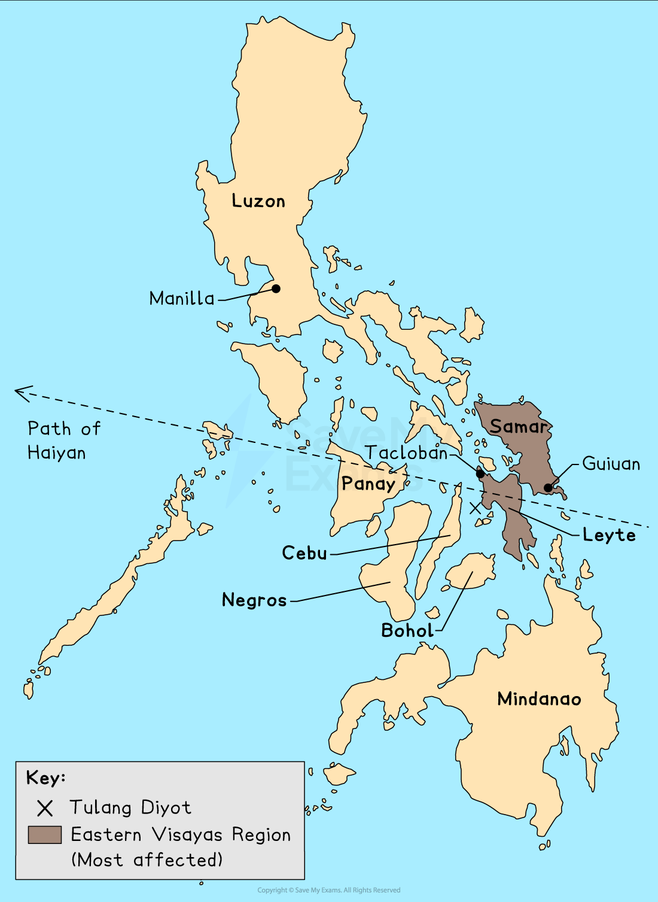

# Coastal Management

## Managing the Impacts of Coastal Erosion

> **Spec point** — `spcpt_3GjmS6NWcy9DdtGr` · Explain what can be done to manage the impacts of coastal erosion

## Managing the Impacts of Coastal Erosion

- There are conflicting views about what type of engineering to use for coastal defence
- Most coastal managers aim to use a range of methods depending on the value of what is being protected
- This method is known as** Integrated Coastal Zone Management (ICZM)**
- ICMZ aims to use a combination of methods to best reflect all ***stakeholder's*** needs

### Soft engineering methods

- Soft engineering works with natural processes rather than against them
- Usually cheaper and do not damage the appearance of the coast
- Considered a more sustainable approach to coastal protection
- However, they are not as effective as hard engineering methods

### Soft-engineered defences

#### Beach replenishment

- This is the pumping or dumping of sand and shingle back onto a beach to replace eroded material
- **Advantages**

  - Beaches absorb wave energy
  - Widens beachfront
- **Disadvantages**

  - Has to be repeated regularly, which is expensive
  - Can impact sediment transportation down the coast

#### Fencing, hedging, and replacing vegetation

- Helps to stabilise sand dunes or beaches
- Reduces wind erosion
- **Advantages**

  - Cheap method to protect against flooding and erosion
- **Disadvantages**

  - Hard to protect larger areas of coastal cliffs

#### Cliff re-grading

- This is when the angle of a cliff is softened to reduce mass movement
- **Advantages**

  - Prevents the sudden loss of large sections of cliff
  - As wave energy is slowed,  wave-cut notching is reduced at the base of the cliff
- **Disadvantages**

  - It does not stop cliff erosion; it only slows it down

#### Beach re-profiling

- Beach reprofiling is the artificial re-shaping of a beach using existing beach material
- **Advantages**

  - Replaces shingle after winter storms
  - Increasing the profile reduces wave energy before the base of the cliffs
- **Disadvantages**

  - Reprofiling may have a negative effect on beach habitats

#### Managed retreat

- The existing coastal defences are abandoned, allowing the sea to flood inland until it reaches higher land or a new line of defences
- **Advantages**

  - There are no expensive construction costs
  - Creates new habitats such as salt marshes
- **Disadvantages**

  - Disruptive to people where land and homes are lost
  - The cost of relocation can be expensive
  - Full compensation to people and businesses may not be paid

### Hard engineering methods

- Hard engineering involves building concrete, wood, or rock sea defences
- Building and maintaining structures is costly
- Defences work against the power of the waves
- Each defence has pros and cons
- Protection in one place can increase erosion and flooding along the coast
- When settlements and expensive installations (power stations, etc) are under risk, hard engineering is used because the economic gain outweighs the costs

### Hard-engineered defences

#### Sea wall

- A sea wall is usually concrete and curved outwards to deflect the power of the waves
- **Advantages**

  - Most effective at preventing both erosion and flooding (if the wall is high enough)
- **Disadvantages**

  - Very expensive to build and maintain
  - It can be damaged if the material in front of the wall is not maintained
  - Restricts access to the beach
  - Unsightly to look at

#### Groynes

- These are wood, rock or steel pilings that are built at right angles to the shore
- Longshore drift moves beach material into groynes
- **Advantages**

  - Most effective at preventing both erosion and flooding (if the wall is high enough)
- **Disadvantages**

  - Keeps material from moving down the coast and protects cliff bases elsewhere
  - Starves other beaches of sand
  - Wooden groynes need maintenance to prevent wood rot
  - Makes walking along the shoreline difficult

#### Rip-rap or rock armour

- Large boulders are piled up to protect a stretch of coast
- Works to absorb wave energy from the base of cliffs and sea walls
- **Advantages**

  - Cheaper method of construction
- **Disadvantages**

  - Boulders can be eroded or dislodged during heavy storms

#### Gabions

- Wire cages are filled with stone, concrete, sand, etc.
- Cages absorb wave energy
- **Advantages**

  - Cheapest form of coastal defence
  - Can be stacked at the base of a sea wall or cliffs
- **Disadvantages**

  - Wire cages can break, and they need to be securely tied down
  - Not as efficient as other coastal defences

#### Revetments

- Sloping wooden or concrete fence with an open plank structure
- Revetments work to break the force of the waves
- **Advantages**

  - Traps beach material behind them
  - Set at the base of cliffs or in front of the sea wall
  - Cheaper than sea walls but not as effective
- **Disadvantages**

  - Not effective in stormy conditions
  - Can make beach inaccessible for people
  - Regular maintenance is necessary
  - Visually unattractive

#### Off-shore barriers

- Large concrete blocks, rocks and boulders are sunk offshore to alter wave direction and weaken wave energy
- **Advantages**

  - Beach material is built up
  - Low maintenance
  - Maintains natural beach appearance
- **Disadvantages**

  - Expensive to build
  - Can be removed in heavy storms
  - Can be unattractive
  - Prevents surfing and sailing

### Prediction

- Early warning systems allow communities to prepare (evacuate or take shelter) before flooding occurs
- Two methods are used to help ***forecast*** coastal flooding

  - **Past records:** diaries, newspapers, government/council records, etc.
  - These identify areas that are at high risk of flooding and their frequency
  - **Modern technology**: GIS, satellite and computer monitoring, weather stations (local and national), etc.
  - These forecast and track potential hazardous events such as:
  
    - Tropical storms: track the storm's path and associated storm surge
    - Earthquakes: the size and position of underwater tremors and possible tsunami outcome
- Both forecasting methods help officials determine when and where the event will occur
- They shows the risk of damage and fatalities as well as the potential intensity and scope of the flooding

### Prevention

- **Prevention **is about taking action that **reduces **or **removes **the **risk **of coastal flooding
- Actions include:

#### Flood defences

- These are built along high-risk stretches of coast

#### Emergency centres

- Centrally placed on higher ground where people can be safe from flooding

#### Early warning systems

- Allows for preparation or evacuation of an area

#### Education

- Informing local people on what to do if and when a flood occurs

#### Planning

- Any new development should be planned away from high-risk-areas
- Design buildings to deal with low levels of flooding

  - Raise buildings to allow floodwaters to flow underneath
  - Strengthen barriers
  - Sealing a property to prevent floodwater intrusion is known as dry floodproofing
  - Wet floodproofing allows some flooding of the building

#### Buffer zones

- Areas of land are allowed to flood before reaching settlements

  - This slows down the floodwater's journey by allowing the surge's energy to dissipate
  - It can mean moving people away from the coast, which could be controversial

### Coastal strategies

- Management of coastal regions is performed by identifying ***coastal cells***
- This breaks a long coastline into manageable sections and helps identify **two related risks**:

  - The risk of erosion and land retreat
  - The risk of flooding
- Identifying risks allows resources to be used efficiently to limit their impacts
- The '***cost to benefit***' is easier to calculate using coastal cells

### Shoreline management plans

- Shoreline management plans (**SMPs**) outline strategies to prevent flooding and erosion along a coastline
- The strategies try to limit the risk to people, settlements, agricultural land, and natural habitats (such as salt marshes)
- There are **four** ways to manage coastal areas, each with different costs and consequences

#### Hold the line

- This is a long-term approach and the most costly
- It involves building and maintaining coastal defences to keep the current position of the shoreline
- Dominated with hard engineering with soft engineering supporting it

#### Advance the line

- New defences are built to extend the existing shoreline
- Involves reclaiming land
- Hard and soft engineering is used

#### Managed realignment

- The coastline is allowed to move naturally
- Processes are monitored and directed when and where necessary
- The most natural approach to coastal defence
- Mostly soft engineering with some hard engineering to support

#### Do nothing

- The cheapest method, but also the most controversial of the options
- The coast is allowed to erode and retreat inland
- No investment is made in protecting the coastline or defending against flooding, regardless of any previous intervention

- Decisions about which approach to use are complex and depend on:

  - Economic value of the resources that would be protected, e.g. land, homes, etc
  - Engineering solutions: it might not be possible to 'hold the line' for moving landforms such as spits or unstable cliffs
  - Cultural and ecological value of land: historic sites and areas of unusual diversity
  - Community pressure:  are there any local campaigns to protect the region?
  - The social value of communities: long-standing, historic communities

> **Worked Example**
> **Explain how gabions protect the coast**
> 
> **[2 marks]**
> 
> ### Solution
> 
> **Gabions absorb/dissipate/reduce the wave's energy/power** **[1 mark].** **This reduces the impact of the waves at the foot of cliffs and seawalls, which reduces/prevents coastal erosion** **[1 mark].**
> 
> ### Marking guidance
> 
> The command word here is 'explain,' and answers need to be developed for full marks.
> 
> - 1 mark for identifying the purpose
> - 1 mark for development

## Case Study - Super Typhoon Haiyan

> **Spec point** — `spcpt_KMWn6PjDc5ZmcDFr` · The opportunities presented by an area, or areas of coastline, the associated hazards and their management

## Case Study: Super Typhoon Haiyan

- Managing tropical storms is difficult due to the unpredictability of their paths
- The distribution of the population along a coast increases the risk associated with tropical storms
- The strength of the storm does not always cause the most damage; developing countries are usually the worst affected
- Preparedness is an effective way of managing tropical storms
- Hazard mitigation relies on effective response to natural events

### Background

- Typhoon Haiyan (Yolanda) was one of the strongest  tropical storms to hit  the Philippines
- It made landfall on November 8, 2013, as a Category 5 with sustained winds above 195 mph
- The Philippines are a group of South China Sea islands located east of Vietnam and north of Indonesia
- Southwest typhoons regularly sweep in every tropical storm season
- Even though the islands sit in warm ocean water, the storm's sea temperature at the time was 30 °C
- Since 1900, sea levels have risen 20 cm around the world. Higher seas are known to contribute to stronger storm surges
- Over-abstraction of groundwater has caused parts of the country to sink
- Tacloban stands at the end of a bay that is funnel-shaped and this squeezes water into destructive storm surges

### Formation of tropical storms

- All tropical storms need:

  - **warm, deep water (>27°C and >70 m depth)**
  - sufficient **spin **from the earth’s rotation (**Coriolis force**)
- This is why they form between 5-20° N and S of the equator
- Warm water encourages sea surface evaporation, while rising air cools, condenses, releases latent heat, and produces large thunderclouds
- The heat from below produces vertical growth and **intense low-pressure**
- Tropical storms form when several storms merge at the eastern side of an ocean
- A **major low-pressure cell** develops and as winds are drawn in, the whole system begins to **spin anticlockwise** and **westward**
- **Winds** **rotate **around a **central eye**, where **cold air descends,** creating an area of calm
- The **strongest winds** are within the **eyewall **

### Typhoon Haiyan's timeline

*Path of Typhoon Haiyan November 2013*

#### Nov 2013

- **2nd: **an area of low pressure develops several hundred kilometres east of Micronesia
- **3rd: **Haiyan begins to track westward, deepening into a tropical depression
- **5th: **The Philippines Atmospheric, Geophysical, and Astronomical Services Administration (PAGASA) classified it as a typhoon and issued a low-level public storm warning
- **6th: **declared a Category 5 super typhoon by the Joint Typhoon Warning Centre. PAGASA raises storm warning to highest level, indicating expected wind speeds in excess of 115 mph
- **7th: **Haiyan's winds continue to intensify up to 195 mph. Haiyan makes first landfall at Guiuan, Eastern Samar, without losing any intensity
- **8th: **Haiyan makes five more landfalls within the Philippines before passing into the South China Seas
- **10th: **Haiyan turns to the NW and makes landfall in Northern Vietnam as a Category 1 typhoon
- **11th: **Haiyan finally weakens into a tropical depression

### Typhoon Haiyan's characteristics

- Lowest pressure: 895 mb
- Peak strength: category 5
- Strength at landfall: Category 5 with 195 mph winds
- Highest sustained wind speed: 196 mph
- Radius of typhoon strength winds: 53 miles
- Rainfall: 400 mm
- Storm surge height: 15 m

### Preparation for Typhoon Haiyan

- Despite being an LEDC, the Philippines take disaster preparedness seriously, as they are usually the first Pacific landmass to experience a typhoon
- For decades, the Philippines have practiced risk reduction and resilience, publishing risk maps and providing evacuation shelters
- The International Charter on Space and Major Disasters was triggered when Haiyan made landfall, allowing relief agencies to get satellite data from space agencies to aid recovery
- The military deployed planes and helicopters in advance to areas expected to be worst hit
- Community structures like conference centres were designated storm shelters, but there were concerns they would not withstand the wind
- After years of community preparation and education, entire islands like Tulang Diyot were evacuated, with all 1000 residents evacuating before Haiyan
- The local mayor won an award in 2011 for community work based on the 'Purok system', in which community members agree to deposit their own money into a community fund regularly for post-disaster help rather than waiting for government relief

### Impacts of Haiyan

### Short- and long-term impacts

#### Social

- **Short-term**

  - 6201 people died
  - 1.1 million homes lost
  - more than 4 million displaced
  - Casualties: 28,626 from lack of aid
  - 16 million people affected
  - UN admitted its response was too slow amid reports of hunger/thirst among survivors
- **Long-term**

  - UN feared the possibility of the spread of disease, lack of food, water, shelter and medication
  - Areas less affected; an influx of refugees into the area
  - 21,000 families were still in 380 evacuation centres two months later, waiting for the government to build bunkhouses to house them in

#### Economic

- **Short-term**

  - Estimated at \$13 billion
  - Major sugar/rice-producing areas were destroyed
  - Between 50,000 and 120,000 tonnes of sugar were lost
  - Over 130,000 tonnes of rice were lost
  - government estimated that 175,000 acres of farmland was damaged (worth \$85 million)
- **Long-term**

  - The Philippines declared 'a state of national calamity.’
  - Asked for international help the next day
  - President Aquino was under growing pressure to speed up the distribution of food, water, and medicine
  - Tacloban city was destroyed
  - Debt is a major obstacle for the Philippines; the country is locked in a debt cycle, with more than 20% of government revenue spent on foreign debt repayments

#### Environmental

- **Short-term**

  - Loss of forests and trees, and widespread flooding
  - Oil and sewage leak into local ecosystems
  - Lack of sanitation in the days following led to a higher level of pollution
  - Coconut plantations were said to be 'completely flattened' (coconut equated to nearly half of the Philippine's agricultural exports and is the world's biggest producer of coconut oil)
  - Fishing communities were severely affected
- **Long-term**

  - Small-scale farmers make up 90% of typhoon-affected rural populations
  - After 33 million coconut trees were cut, international help was sought to mill the 15 million tonnes of rotting lumber that attracted pests that threatened healthy trees
  - Families lack funding for local marketplaces without crops

### Immediate relief

- The survivors immediately searched flattened buildings for bodies
- People began looting to find food supplies when the government was slow to respond
- Roads were undamaged, but debris slowed rescue vehicles
- Emergency teams were slowed as airports and harbours were closed, which hampered aid distribution
- Diggers, land rovers, and heavy lifting gear from the UK and USA were sent to Tacloban airport by international charities
- The European Commission released \$4m in emergency funds and the UK Rapid Response Facility provided \$8m in aid
- Twelve IFRC (International Federation of the Red Cross) Emergency Response Units worldwide were deployed
- The Philippines had already experienced a 7.3-magnitude earthquake in October 2013 and Typhoon Bopha in 2012.  These tragedies left the Philippines short on financial, material, and human resources
