# Collecting Weather Data

## Weather Instruments

> **Spec point** — `spcpt_6GNGzTWH5HsYCBNN` · Describe how weather data are collected

## Weather Instruments

### Stevenson screen

- This wooden box stands on four legs at a height of 121 cm to avoid ground heat affecting the thermometer bulbs at 125 cm
- They are painted white to reflect the sun's rays
- Made of wood to prevent heat transfer
- The sides are slatted (louvred) to allow free movement of air
- The wood is double-layered with airspace for insulation
- The screen is placed on grass to reduce ground heat
- Daily readings are taken at the same time
- Today, meteorological stations send data to the Met Office's computers using automated digital recording equipment
- The instruments inside include:

  - Maximum-minimum thermometer (Six's thermometer)
  - Hygrometer with wet and dry bulb
- Instruments found outside include

  - Rain gauge
  - Wind vane
  - Anemometer
- The weather station layout is:

  - Barometers and barographs are protected from severe winds, direct sunshine, and heat
  - Heat-radiating buildings are avoided for thermometers
  - Wind vanes and anemometers should be placed outside, away from trees and buildings, and at least three times the height of the nearest obstacle
  - The rain gauge must be in an open space twice its height from the nearest object

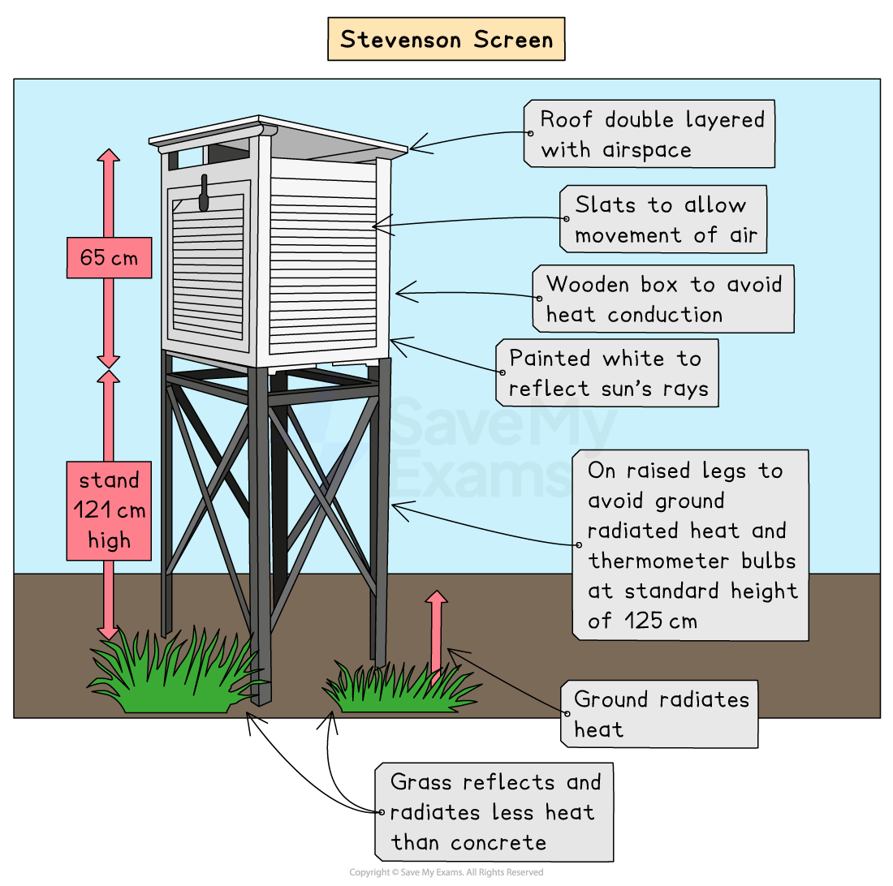

*Diagram of a Stevenson Screen*

> **Exam Hint**
> You must know the difference between weather and climate.
> 
> Weather is what you get on a day-to-day basis—rain, sun, snow, etc.—and is measured over days.
> 
> Climate is what you expect—warm summers and cold winters if you are in the northern hemisphere. We measure climate over a longer period of time—30 years.

> **Worked Example**
> **Describe and explain the ideal location of a Stevenson Screen.**
> 
> **[5 Marks]**
> 
> - Ideas such as:
> - In the open/away from buildings [1] so that it is not affected by heat from buildings [1]
> - Away from trees [1], so that it is not sheltered/to avoid being in the shade/shadow [1]
> - On grass [1] which does not absorb heat [1]
> - Away from the general public [1] to avoid tampering/vandalism, etc. [1]
> - 5 @ 1 mark or development

### Wind direction

- Wind **direction **is measured with a **wind vane**
- Direction is the compass point **from **where the **wind** is blowing—south, north, north-east, etc.
- The **unit **of **measurement **for wind direction is **compass direction**

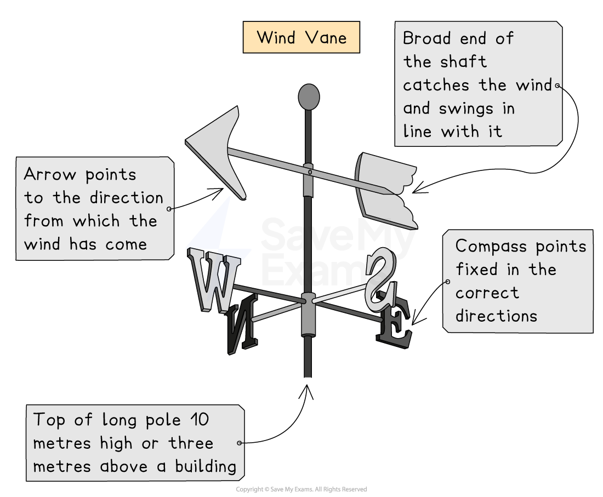

*Illustration of a wind vane*

### Wind speed

- **Anemometers **measure wind speed
- Wind speed is measured in **m/s **or **km/hr**
- The anemometer has 3 or 4 cups on metal arms that spin freely on a 10 m vertical shaft
- The cups rotate quicker and the counter records more rotations with stronger winds
- Hold digital portable anemometers into the wind, and the fan revolves to display the number on the screen
- Many digital anemometers send data directly to apps and computers for readings
- Wind vanes and anemometers are far from buildings and trees that could block airflow
- Buildings can form wind tunnels or delay airflow, affecting reading accuracy 

*Illustration of digital and manual anemometers*

### Precipitation

- Precipitation is **any water** that falls to earth—hail,** mist, rain, sleet, or snow**
- The unit of measure is millimetres (mm)
- A rain gauge is used to measure precipitation
- At the same time each day, any water that has collected is poured into a tapered measuring cylinder on a flat surface
- The water level is then read with the eye at the same level as the lowest part of the ***meniscus*** of the water
- Measurements are then recorded; too small a reading and it is recorded as 'trace'

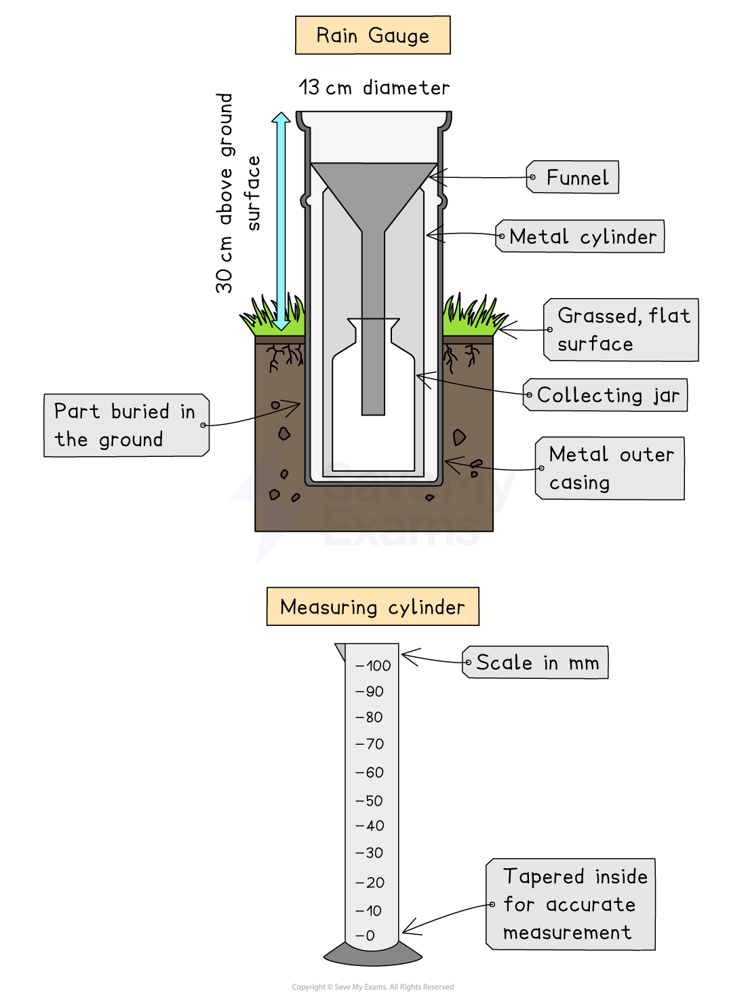

*Illustration of a rain gauge*

### Temperature

- Measurements are in Celsius (°C) or Fahrenheit (°F), depending on location
- Temperature is measured using a thermometer or thermograph
- Shade temperature is measured, as air temperature is variable due to direct ***insolation*** and cloud cover
- Several types of thermometers can be used, but the most traditional is a Six's thermometer, which houses a maximum and minimum thermometer in a U shape
- The following measurements can be taken:

  - Daily minimum temperature
  - Daily maximum temperature
  - Average temperature calculations for one day $\frac{\mathrm{maximum}+\mathrm{minimum}}{2}=\mathrm{mean} \mathrm{daily} \mathrm{temperature}$
  - Temperature range for 24 hrs—called the ***diurnal*** temperature range
  - Recording the daily mean temperature for a month and dividing it by the number of days in that month provides the mean monthly temperature
  - The sum of the mean monthly temperatures divided by 12, which gives the mean annual temperature
- A thermograph has an exposed bimetallic strip which deforms with a change in temperature
- This change is transmitted to amplifying levers which trace a curve on a roll of graph paper
- A vertical movement of 1 mm is equivalent to about 1°C

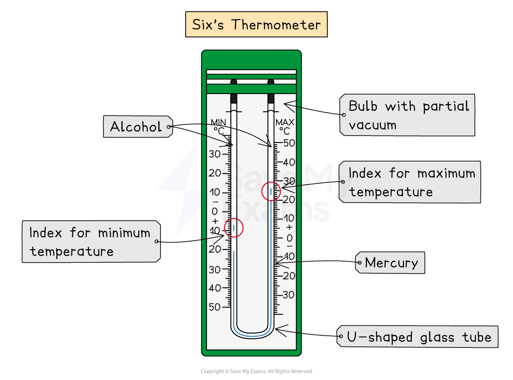

*Illustration of a maximum-minimum thermometer*

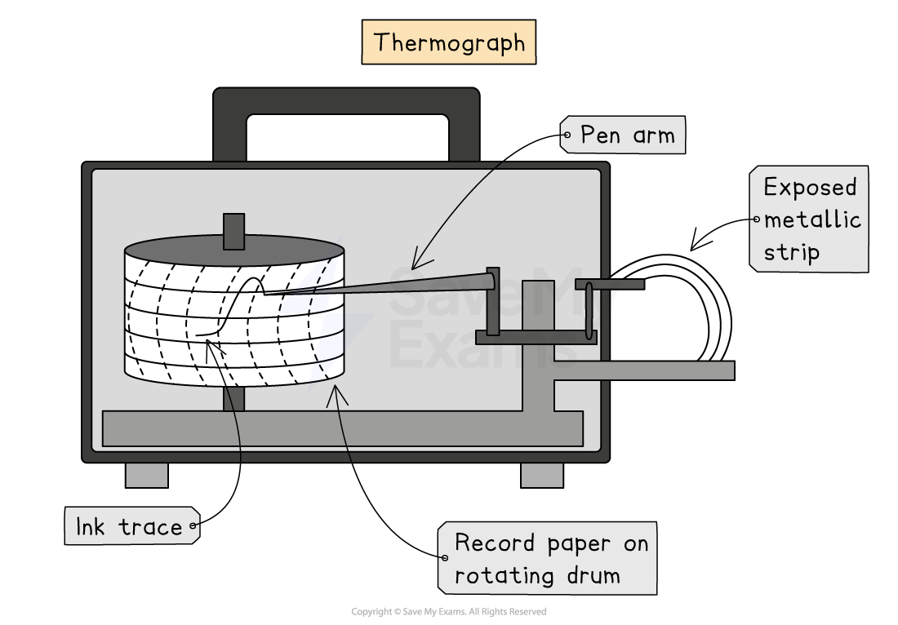

*Illustration of a thermograph*

> **Exam Hint**
> You may be asked to calculate temperatures for a range of events for example:
> 
> - Lagos has a minimum temperature of 25°C and a maximum temperature of 35°C for one day
> - Calculate the diurnal temperature range
> - Subtract the minimum temperature from the maximum temperature (35-25 = 10 °C range for one day)
> - Dhaka has a mean maximum temperature of 25.5°C (March) and a mean minimum temperature of 22.5°C (August)
> - Calculate the mean annual temperature range
> - Subtract the lowest mean monthly temperature from the highest monthly temperature (27.5 - 24.5 = 3°C)
> - 3°C is the mean annual temperature range, so it stays a fairly constant temperature all year round
> 
> Always add the unit to your answer as a habit, or you could lose marks.

### Humidity

- **Humidity **is the amount of **water vapour in a given volume of air**
- Hygrometers measure relative humidity with wet and dry bulb thermometers
- **Relative humidity** measures the amount of water vapour in the air compared to its maximum capacity at a given temperature
- Warm air holds more water vapour than cold air
- When the air is holding as much moisture as it can, it’s said to be **saturated**
- If the air is not saturated, water vapour evaporates from wet bulb muslin, cooling the bulb and lowering the mercury temperature
- If the air is saturated with vapour, evaporation is impossible, so both thermometers show the same temperature

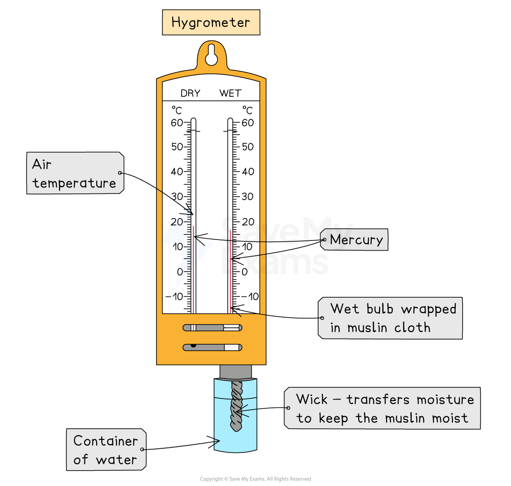

*Illustration of a hygrometer*

### Pressure

- Air has weight and exerts pressure on the Earth's surface
- Sea level pressure is approximately 1.03 kg/cm²
- Pressure varies with altitude and temperature
- The unit of measurement is millibars (mb)
- Lines of pressure on a map are called** isobars**
- A barometer measures air pressure, of which there are 3 types:

  - Mercury barometer
  - Aneroid barometer
  - A barograph
- **A mercury barometer **is a hollow tube with all the air extracted
- The open end is then placed in a bath of mercury
- The atmospheric pressure on the mercury in the bath forces it up the tube
- When the two pressures equalise, the mercury will stop rising in the tube
- The height of the column of mercury will change with air pressure

  - It rises as air pressure increases
  - It drops as air pressure falls
- **An aneroid barometer **has a partly vacuumed, corrugated metal chamber inside
- There is a strong metal spring within the chamber that prevents it from collapsing
- The spring will expand and contract with changes in atmospheric pressure
- Levers magnify these changes, and a pointer moves across a calibrated scale to show atmospheric pressure at that time
- **A barograph** is a continuous reading of atmospheric pressure for one week
- A flexible arm tracks changes in pressure on a rotating cylinder
- Paper with 2-hour vertical lines divided across it covers the cylinder

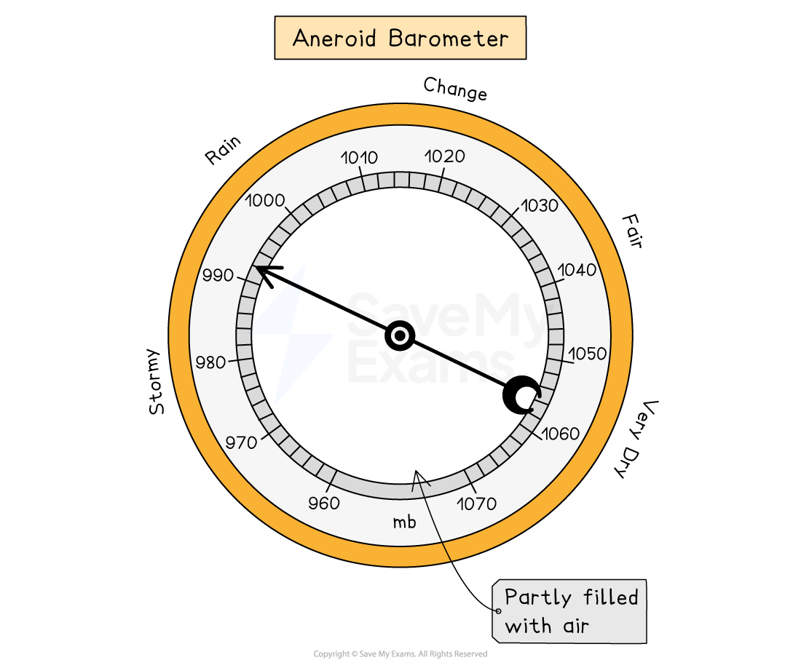

*Aneroid barometer*

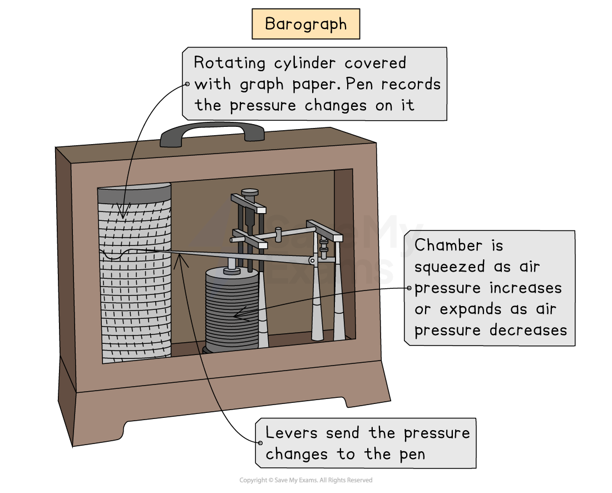

*Illustration of a barograph*

> **Worked Example**
> **Name the weather recording instruments with each of the following features:**
> 
> **[6 Marks] **
> 
> | **Feature** | **Instrument** |
> |---|---|
> | Cups |   |
> | Funnel |   |
> | Levers |   |
> | Arrow |   |
> | Corrugated metal chamber |   |
> | Wick |   |
> 
> **Final answer:** **Answer**
> 
> - Anemometer
> - Rain gauge
> - Barograph or thermograph
> - Weather or wind vane
> - Aneroid barometer
> - Wet and dry bulb thermometer or hygrometer

### Sunshine hours

- A **Campbell-Stokes** sphere calculates the hours and minutes of sunshine that a location receives
- The recorder is a metal-framed glass sphere
- The sphere focuses sunlight on a recording card below the focal point
- The rays leave a trace on the card, indicating the length of the sunshine at that point
- At day's end, the card is replaced

#### How it is used

- Sunshine recorder is placed in an open space, **south-facing in northern hemisphere** **or** **north-facing in southern hemisphere**
- Make sure the recorder is outside, unaffected by shade and has direct exposure to sun’s rays

  - On the roof of a building
  - On a pedestal or stand
  - Where the sun shines all day
- Make sure the paper (card or sheet) is inside
- The sun’s rays will scorch/burn the card (paper or sheet)
- At the end of the day, measure the length of the burn line, then convert to hours and finally calculate the time it was sunny
- Record every 24 hours at the same time every day and stop at sunset to record for the day
- Remove and replace the card (paper or sheet) each day into sunshine recorder

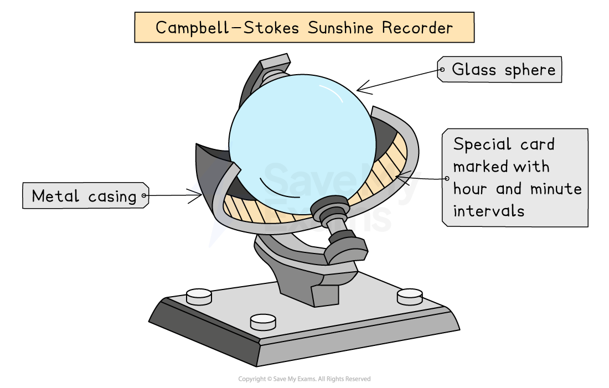

*Illustration of a Campbell-Stokes sunshine recorder*

### Clouds

- Cloud cover is measured in units of **oktas**
- Each okta represents **an eighth **of the sky that is cloud-covered
- 0 oktas = clear sky, 8 oktas = total coverage
- Clouds are categorised according to shape and height using Latin terms

  - Stratus means layers
  - Nimbus means rainy cloud, etc.
- **Clouds** consist of tiny **water droplets or ice particles** that are too light to fall to Earth
- Clouds will **form** when **air rises, cools and condenses** into water droplets or ice crystals if cold enough
- The **tallest clouds** form in the **tropical regions**, as the ***tropopause*** is at its highest and clouds **do not **form beyond it
- Clouds **only** produce **precipitation **if they have enough water or ice particles that can **collide and join together**
- As the particles grow too big and heavy to be supported in the air, they will fall through the rising air currents
- **Cumulonimbus and stratus are the only clouds capable of producing precipitation**

  - Stratus clouds are just thick enough to produce drizzle
  - Cumulonimbus clouds have strong rising air currents, vertical height and thickness

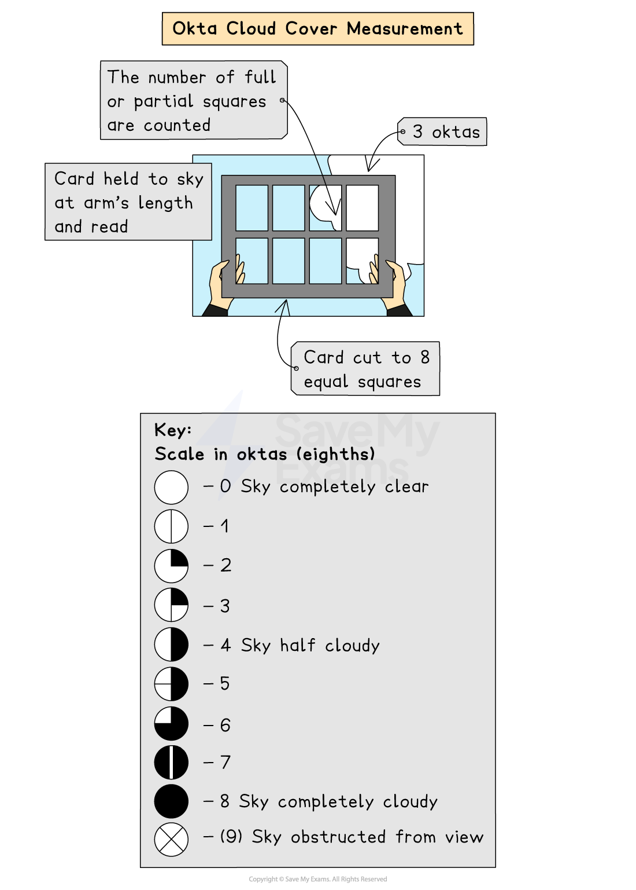

*Illustration of how to measure cloud cover in oktas*

#### Cirrus

- **Level: **high, above 6 km
- **Description: **narrow wisps, white and made of ice crystals
- **Weather: **fine

#### Cirrostratus

- **Level: **high, above 6 km
- **Description: **thin, white layers made of ice crystals with a wide horizontal spread often covers whole sky
- **Weather: **fine

#### Cirrocumulus

- **Level: **high, above 6 km
- **Description: **thin, white, heaped cloud with ice crystals
- **Weather: **fine

#### Altostratus

- **Level: **medium, 2-6 km
- **Description: **can be thin and white or grey and thick with layer of water droplets
- **Weather: **fine

#### Altocumulus

- **Level: **medium, 2-6 km
- **Description: **thick white, or grey-looking, heaped cloud of water droplets
- **Weather: **fine

#### Stratus

- **Level: **low, 0-2 km
- **Description: **thin, uniform, grey sheet of small water droplets with a fairly flat base
- **Weather: **fine drizzle

#### Cumulus

- **Level: **low, 0-2 km
- **Description: **white with a darker, flat base and a billowy/globular upper surface. Made of water droplets and can be compact or have height
- **Weather: **sunny by day, fine weather

#### Stratocumulus

- **Level: **low, 0-2 km
- **Description: **white and grey, partly heaped cloud made of water droplets
- **Weather: **fine

#### Nimbostratus

- **Level: **base can be low or above 2 km
- **Description: **thick, dark grey layers of water droplets
- **Weather: **steady rain or drizzle

#### Cumulonimbus

- **Level: **low base, but cloud usually extends to high levels
- **Description: **dense, dark grey with vertical height and storm clouds. Form from cumulus clouds and have a billowy head. The head flattens as it reaches the tropopause and will then spread out in an anvil shape. Composed of ice crystals at the higher levels and water droplets at the lower levels
- **Weather: **very heavy rain, snow showers or hail with thunder and lightning

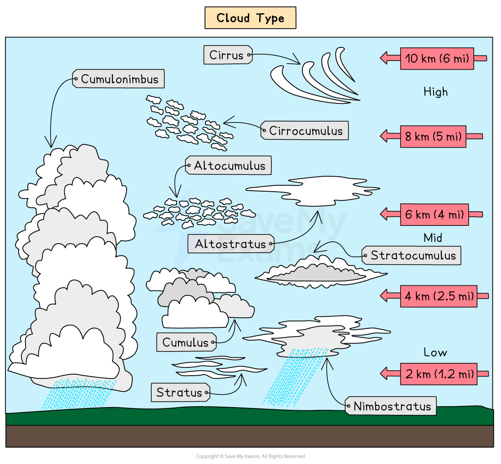

*Illustration showing cloud types*

### Tropical storms

- Tropical storm is the collective name for deep, low-pressure systems with spirals of strong air
- They are known as:

  - Typhoons in the South China Sea and west Pacific Ocean
  - Hurricanes in the Gulf of Mexico, Caribbean Sea and west coast of Mexico
  - Cyclones in the Bay of Bengal, Indian Ocean and northern Australia
- High winds, floods, and storm surges all cause damage
- Tropical storms are rated on the five-point ***Saffir-Simpson scale*** based on wind speeds
- Tropical storms are considered **major **when they reach **category 3** and have wind speeds between 111 and 129 miles (178 and 208 kilometres) per hour
- A category 5 storm can deliver wind speeds of more than 157 miles (252 km) an hour
- The path of a hurricane can be erratic, so landfall is not easy to predict, and this makes evacuation times short
- Tropical storms develop as intense low-pressure systems over the warm tropical oceans
- Winds spiral rapidly around a calm central area known as the eye
- Tropical storms can be as much as 800 km in diameter, but winds are not constant across that; they vary, with the **strongest and most destructive winds** being found within the **eyewall **

| **Category** | **Wind Speeds** | **Damage** |
|---|---|---|
| **1** | 74-95 mph  119-153 km/h | Some |
| **2** | 96-100 mph  154-177 km/h | Extensive |
| **3** | 111-129 mph  178-208 km/h | Devastating |
| **4** | 130-156 mph  209-251 km/h | Catastrophic |
| **5** | 157 mph or higher  252 km/h | Catastrophic |

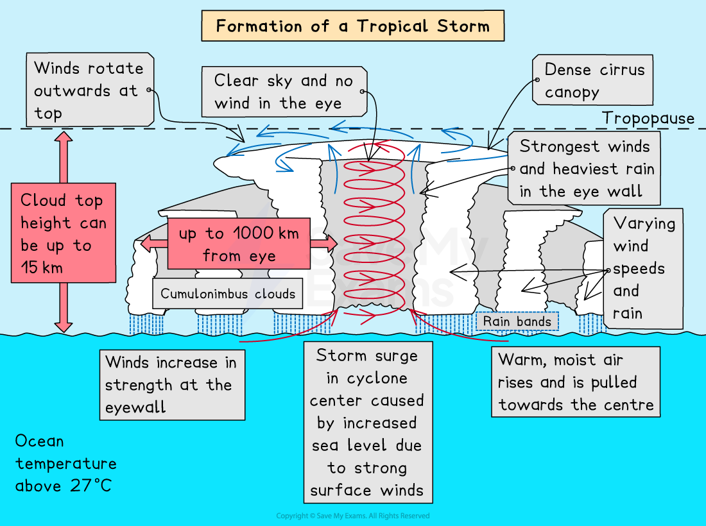

*Illustration of the processes in tropical storm formation*
