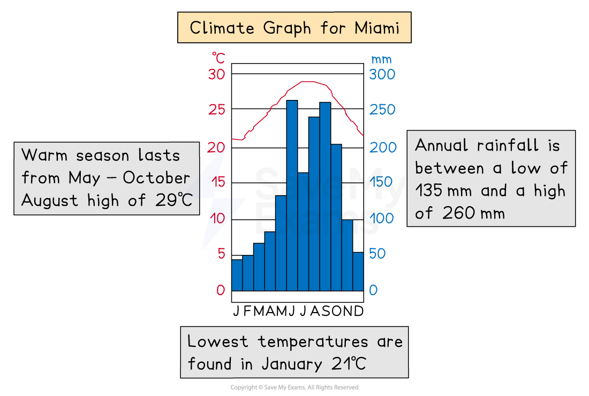
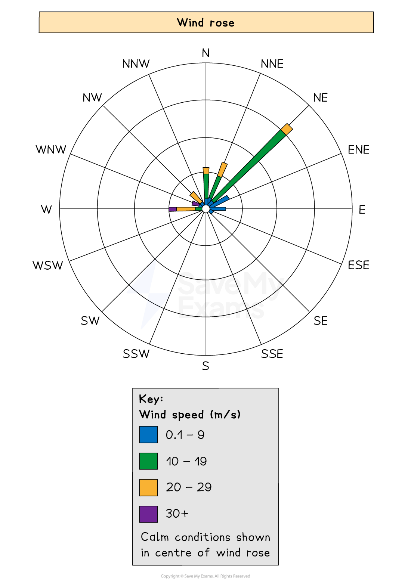
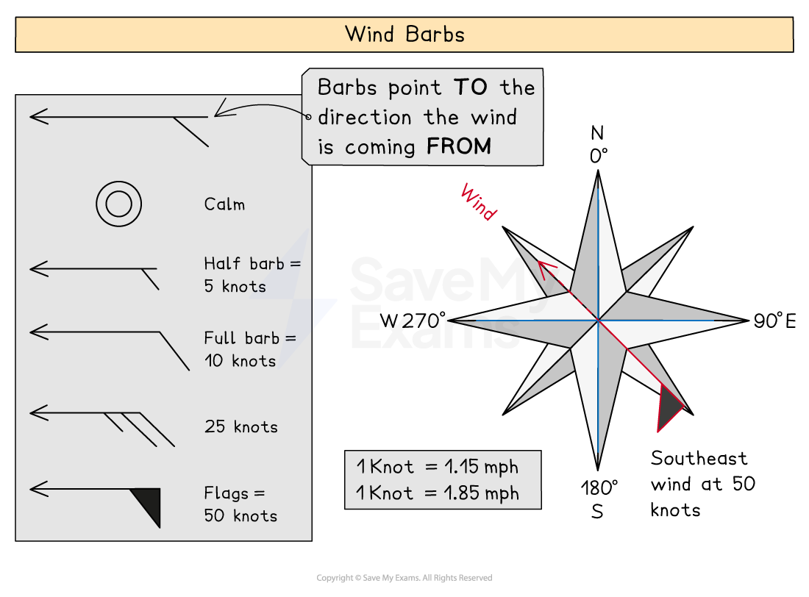
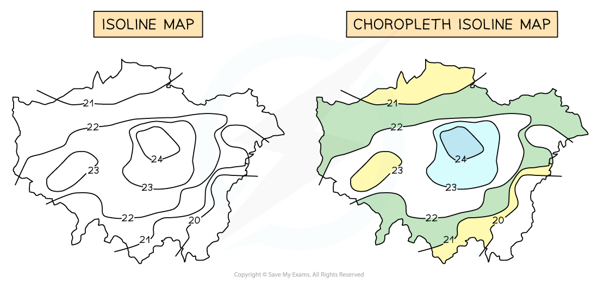
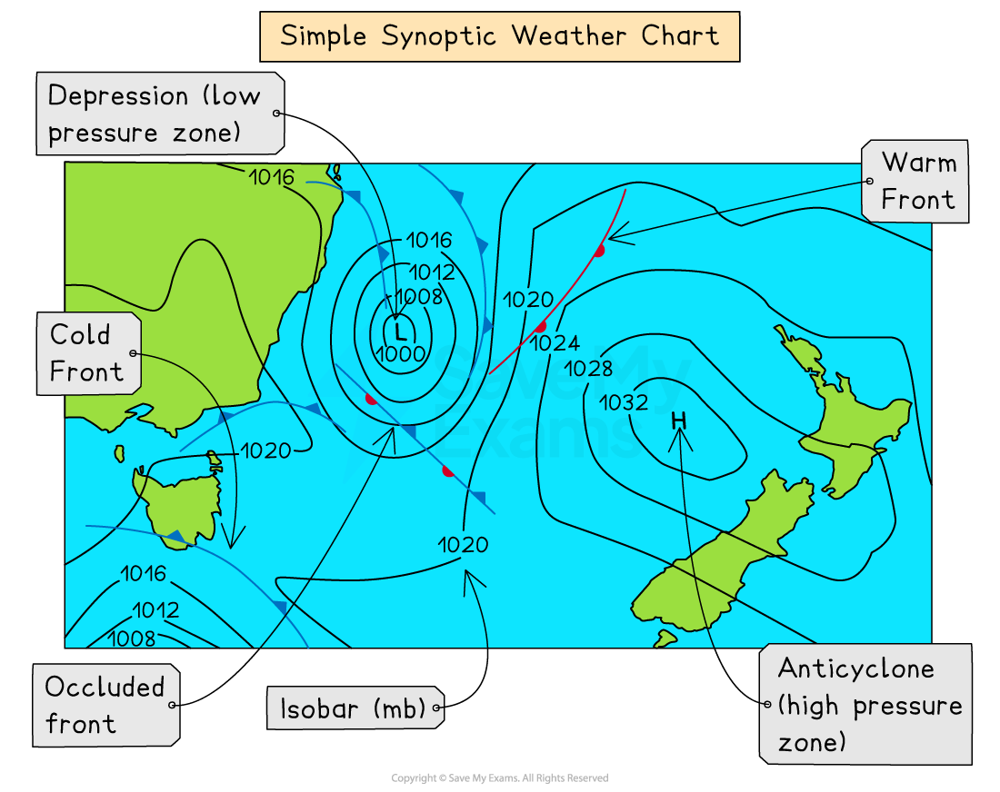

# Weather Data Interpretation

## Interpreting Weather & Climate Data

> **Spec point** — `spcpt_P6YdqfyZnxJ2Mwkq` · Use & interpret graphs & other diagrans showing weather & climate data

## Interpreting Weather & Climate Data

### Climate graphs

- A climate graph shows mean monthly temperatures and precipitation rates over 30 years
- They can be local, national, or global
- Precipitation is always shown as a bar graph and temperature as a line graph

#### How to read a climate graph

- Describe the overall **shape** of the graph:

  - Is the temperature line steep or gentle?
  - Are there changes throughout the year?
  - Always mention the months but do not give a month-by-month account

- Look for **extremes:**

  - Note **anomalies**—something that isn't following a trend
  - Summer has the hottest months and winter the coolest (Spring and Autumn are not usually discussed)
  - Note the highest and lowest temperature and rainfall, plus the month in which they occur
  - Remember to quote units, like Celsius or millimetres
- Name the **season** with the most and least rainfall

  - **Equatorial climate** regions have **no seasons** but refer to seasons in other locations
  - Remember that the southern hemisphere's seasons are opposite to the northern hemisphere
  
    - Summer in Australia is from November to March
    - Summer in Europe is from June to September
- Calculate the **temperature range** by subtracting the lowest number from the highest
- Add monthly rainfall totals to calculate **annual rainfall**

  - Divide this by 12 to find the **average monthly **rainfall

*Climate graph*

#### Dispersion graphs

- Useful for comparing sets of data
- Also illustrates whether the data forms groups or is dispersed (spread)
- Values are shown on the vertical axis
- Can also be used to present the upper and lower values along with the mean, median, mode and extreme values

#### Reading a dispersion graph

- Read the **title **to see what the graph is showing
- Read and understand what each **axis **represents
- Describe the overall **pattern **of the graph
- Identify **anomalies **in the data
- Complete any **statistical analysis **such as the mean, median and range

*Illustration of dispersal graph*

### Wind rose

- The direction of wind for a specific place is shown on a wind rose
- Made of circles that radiate rectangles representing points of a compass
- The rectangles' lengths show how many days or times the wind blew in that direction
- The centre of the rose displays the number of days or hours with no wind

*Wind rose diagram*

### Wind barbs

- Wind barbs on a weather map indicate the direction and strength of the wind.
- Barbs point **to **the direction the wind is travelling **from**
- The tip of the arrow shows the wind's direction
- Half barbs represent 5 knots, full barbs = 10 knots and flags = 50 knots
- A combination of these symbols shows the overall speed of the wind and from where it originates from

  - A double flag = 100 knots
  - A double flag and 3 full barbs with a half barb = 135 knots

*Illustration to show wind barbs*

### Isoline and choropleth maps

- **Isohyets **are lines joining places with the same amount of rainfall
- **Isotherms **join places with the same temperature
- **Isobars **join places with the same pressure
- Isoline maps become **choropleth isoline **maps when shaded between the isolines

  - Shading is progressive from light to dark
  - The heaviest (darkest) shading is for the largest value

### Synoptic charts

- Meteorological station readings are plotted on ***synoptic*** charts
- They can show some or all of the following:

  - wind speed
  - wind direction
  - pressure patterns
  - weather fronts
  - cloud cover
  - temperatures

*Synoptic weather chart*

> **Worked Example**
> **Fig. 1.3 shows a student's record of cloud cover over two days. The student recorded the amounts in oktas (eighths).**
> 
> 
> 
> *Diagram showing cloud cover*
> 
> **Choose from the values below and fill in the correct number of oktas for each example.**
> 
> **[2 marks]**
> 
> Choose from the following:
> 
> 1. 1 okta
> 2. 3 oktas
> 3. 7 oktas
> 4. 8 oktas
> 
> ### Solution
> 
> **The correct answer for example 1 is 7 oktas ****[1 mark]**
> 
> **The correct answer for example** **2 is 3 oktas ****[1 mark]**
