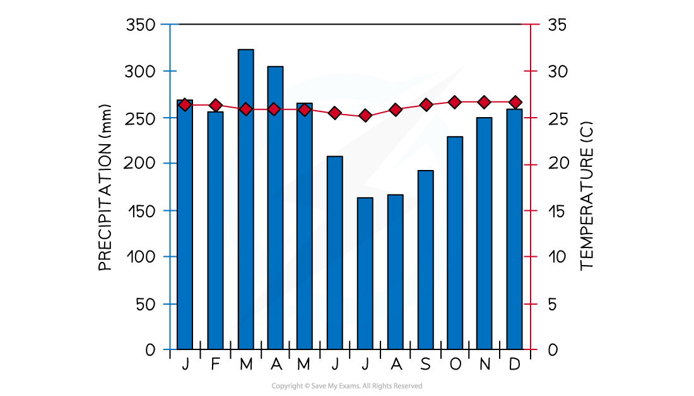
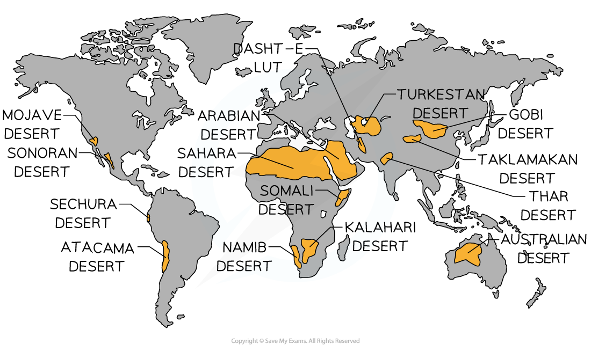
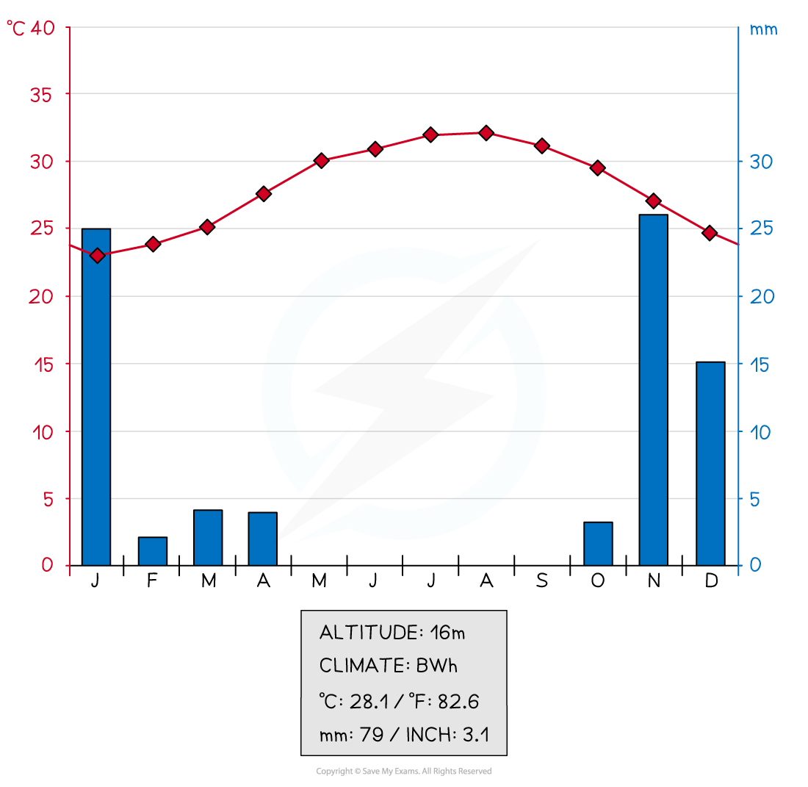
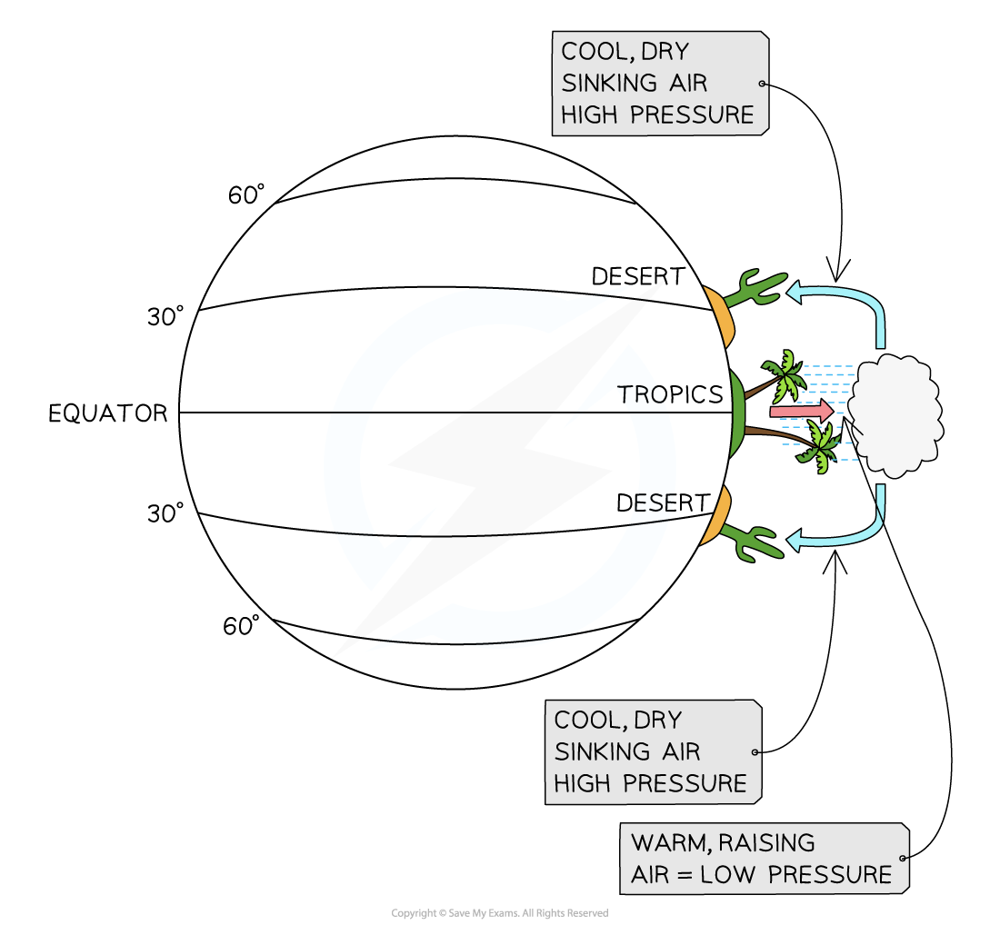

# Climate Characteristics

## Equatorial Climate Characteristics

> **Spec point** — `spcpt_wKm5Qt7rt7nBD75R` · Describe & explain the characteristics of the equitorial climate

## Equatorial Climate Characteristics

### World climate distribution

- Climates vary across the world
- The reasons for these climate types include:

  - **Latitude**
  
    - Temperatures and sunshine hours decrease with distance from the equator because solar radiation is more dispersed at the poles and has to pass through more of the atmosphere
  - **Altitude**
  
    - Increases in altitude lead to decreases in temperature
  - **Continentality**
  
    - Locations further inland heat up more quickly in the summer and cool more quickly in the winter
  - **Ocean currents**
  
    - Warm and cold currents circulate in the oceans, either warming or cooling the adjacent land
  - **Aspect**
  
    - In the northern hemisphere, slopes facing south are warmer
  - **Prevailing winds**
  
    - Winds coming from warmer areas bring warmer air, increasing temperatures
  - **Pressure systems**
  
    - Low-pressure areas, like the tropics, have rising air, condensation, and cloud formation, which creates more precipitation
    - With high pressure, the air sinks, forming dry conditions

### Equatorial climate distribution

*Distribution of the equatorial climate*

### Equatorial climate characteristics

#### Location

- Low latitudes
- Within the Tropics, 23.5° north and south of the equator
- Amazon in South America, New Guinea, South-east Asia, and the Zaire Basin

#### Annual precipitation

- Over 2,000 mm

#### Temperature range

- Low range of mean monthly temperatures: 26-28 °C
- Constant high temperatures
- ***Diurnal*** range is about 7 ºC.

#### Seasons

- No seasons—hot and wet all year round

#### Humidity

- High, usually over 75-80%

#### Prevailing winds

- Winds blow into the equatorial region from high-pressure areas to the north and south.
- The winds from the north blow from the north-east and the winds from the south blow from the south-east.
- The winds are known as the** trade winds**

*Climate graph for Iquitos, Peru*

#### Factors influencing the equatorial climate

- There are a range of factors that influence the climate, including:

  - The midday sun is almost directly overhead all year, meaning there is maximum ***insolation***
  - Low pressure all year leads to rising air, condensation, cloud formation, and high precipitation levels
  - Dense vegetation cover leads to high levels of evaporation and transpiration
  - The warm air stores large amounts of water vapour until the temperatures start to cool in the late afternoon, which then leads to heavy, daily convectional rainfall

## Hot Desert Climate Characteristics

> **Spec point** — `spcpt_sZjY828KpCNKgdbs` · Describe & explain the characteristics of the hot desert climate

## Hot Desert Climate Characteristics

### Hot desert climate distribution

*Distribution of the hot desert climate*

### Hot desert climate characteristics

#### Location

- 15° - 30° north and south of the equator (tropical and sub-tropical)
- North Africa - Sahara, Southern Africa - Kalahari and Namib, Australia. Middle East

#### Annual precipitation

- Below 250mm

#### Temperature range

- Daytime temperatures can reach 50°C but average around 25°C
- Night-time temperatures below 0°C
- The diurnal range is large up to 45°C
- The annual range is around 15°C

#### Seasons

- Summer and winter

#### Humidity

- Low often between 10-30%

#### Prevailing winds

- The winds are offshore blowing from the east across the land, so they do not collect any moisture

*Climate graph for Jeddah, Saudi Arabia*

### Factors influencing the hot desert climate

- High pressure all year means the air is descending and warming

  - Precipitation does not occur because the air is not rising
- Prevailing winds are often from over land masses, which means they contain little moisture
- Some deserts are in a ***rain shadow*** so there is little rainfall
- Cold ocean currents on the west side of continents may reduce summer temperatures due to the cooling effect of the ocean

#### Influence of pressure systems

- Hot deserts form between 15° and 30° north and south of the equator as a result of the atmospheric pressure systems

  - Air rises at the equator and when it reaches the upper atmosphere, it moves north and south
  - The air cools and starts to sink
  - This creates a zone of high pressure at about 30° north and south of the equator
  - Due to the sinking air, warm air cannot rise, condense, and form clouds. This results in high aridity

*Atmospheric pressure systems*

> **Worked Example**
> **Explain how high atmospheric pressure influences the climate of hot deserts. **
> 
> **[3 marks]**
> 
> **Final answer:** **Answer**
> 
> - Air is descending **[1]**
> - It heats up/does not cool  **[1]**
> - Condensation does not occur/clouds do not form  **[1]**
> - Precipitation is low/does not occur/drier/only has e.g. 250 mm per annum, etc  **[1]**
