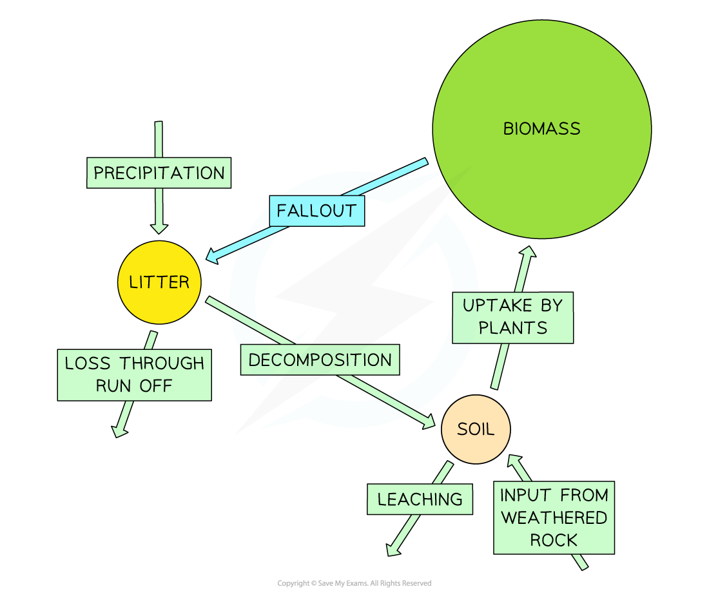
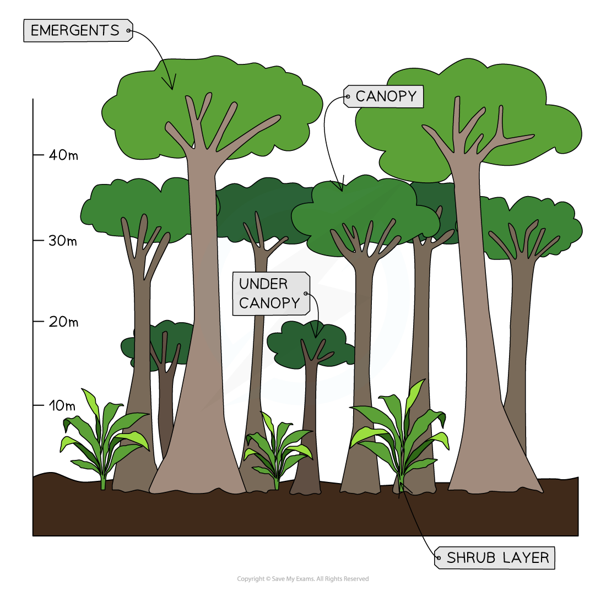
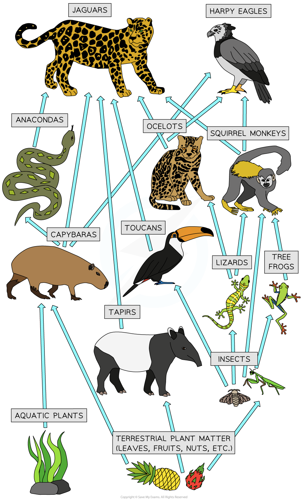
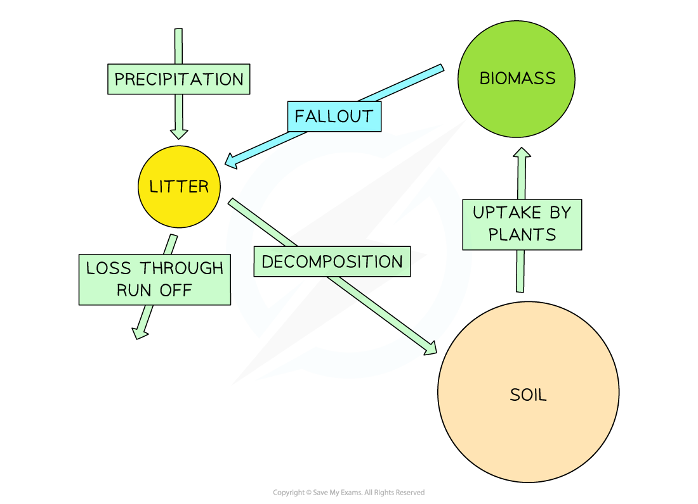
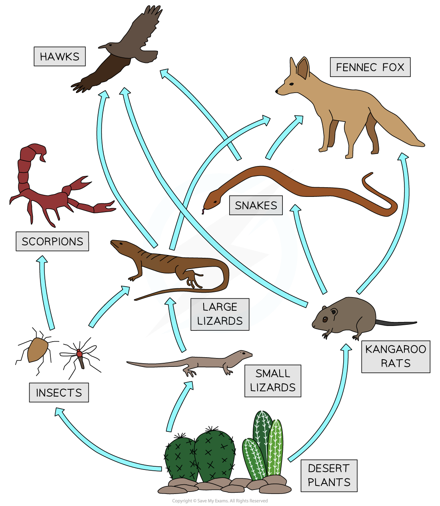

# Ecosystem Characteristics

## Tropical Rainforest Ecosystem Characteristics

> **Spec point** — `spcpt_8KHhskyjRGSVpqfH` · Describe & explain the characteristics of tropical rainforest ecosystem

## Tropical Rainforest Ecosystem Characteristics

- The** Tropical rainforest (TRF) **biome is mainly found in a band between 15° north and 15° south of the equator within the **equatorial climate zone**
- Covering only 6% of the Earth's surface, the main areas of tropical rainforest ecosystem are in the following countries:

  - **Amazon**
  
    - The largest remaining rainforest on Earth is usually associated with Brazil but covers parts of seven other countries
  - **Central America**
  
    - Including** **parts of Belize, Costa Rica, El Salvador, Guatemala, Honduras, Nicaragua, and Panama
  - **Central Africa **
  
    - Including Cameroon, the Central African Republic, the Republic of Congo, the Democratic Republic of Congo (DRC), Equatorial Guinea and Gabon
  - **Indo-Malaysia**
  
    - Including Malaysia, Indonesia and several other countries in South-East Asia

### Biodiversity

- TRFs contain the **highest biodiversity **of plants and animals on Earth

  - Estimates range from over 50% to 80% of the world's plant and animal species
  - One 10 km2 area can contain up to 1,500 flowering plants, 750 species of trees, 400 species of birds and 150 species of butterflies

### Nutrient cycle

- The TRFs have a continual growing season with **high rainfall **and **high temperatures **all year round
- The nutrient cycle in the TRF is rapid

  - Trees and plants lose their leaves all year round
  - The high level of moisture and high temperatures lead to **rapid decomposition**
  - Plants grow quickly, which leads to the rapid uptake of nutrients from the soil

*Tropical rainforest nutrient cycle*

- The result of this rapid nutrient cycle is that the soil in the TRF is not very fertile
- This is because the nutrients are quickly used by the plants

### Structure of the tropical rainforest

- The TRF has five distinct layers:

  - ground layer (0 m)
  - shrub layer (3-4 m)
  - under canopy (15 m)
  - canopy (30 m)
  - emergents (45-55 m)

*Tropical rainforest structure*

### Adaptations

- The plants and animals within the TRF are very well adapted to the climate conditions

#### Plant adaptations

- **Waxy leaves with drip tips**

  - These ensure that rainwater runs off the leaf and does not remain, which would encourage mould growth or break the leaf
- **Buttress roots**

  - These large roots above the ground help to support the very tall trees because the roots below the surface are shallow
- **Lianas**

  - Vines which use the tall trees as support to reach the sunlight
- **Epiphytes**

  - Plants which grow on trunks and branches of trees and get nutrients from air, rain or debris accumulating around the plant
- **Straight, smooth trunks**

  - To reduce the number of epiphytes using the tree

#### Animal adaptations

- **Sloth **

  - Algae grow in the fur of the sloth, helping to camouflage it
- **Toucan**

  - Has a large bill to reach and cut fruit from the branches of trees
- **Primates**

  - Have prehensile tails to help them climb trees
- **Gecko**

  - Have large, flattened toe pads with sticky scales which allow them to grip the smooth tree trunks
- **Stick insects**

  - Their stick and leaf shapes help them to be camouflaged

> **Exam Hint**
> You may be asked to describe the rainforest vegetation characteristics. As well as adaptation features, remember to include information about the different layers and heights of each layer.

### Food web

- As in all ecosystems, the TRF has a complex food web, which includes

  - Producers
  - Primary consumers
  - Secondary consumers
  - Tertiary consumers

*Tropical rainforest food web*

> **Worked Example**
> **Study Fig. 1, which is a diagram showing information about a tropical rainforest ecosystem in an area of equatorial climate**
> 
> 
> 
> **Suggest reasons why some animals live in the canopy but others live in the ground cover in a tropical rainforest.**
> 
> **[3 marks]**
> 
> - You need to consider the adaptations and diets of the animals, which may lead them to live in a specific layer
> 
> **Final answer:** **Answer**
> 
> - Some are able to climb/fly, whereas others are not** [1]**
> - Some need shelter/protection **[1]**
> - Food supplies available (in canopy/at ground level) **[1]**
> - Different habitats/nesting areas, etc **[1]**

## Hot Desert Ecosystem Characteristics

> **Spec point** — `spcpt_WWZjh7hW49qDvRh8` · Describe & explain the characteristics of hot desert ecosystems

## Hot Desert Ecosystem Characteristics

- Hot desert biomes are mostly found in a band around the Tropic of Cancer and Tropic of Capricorn
- Approximately 20% of the Earth's surface is covered by hot desert ecosystems, including in the following areas:

  - **North America: **the Mojave and Sonoran Deserts of the USA and Mexico
  - **South America: **the Sechura Desert in Peru and the Atacama Desert in Chile
  - **Africa: **the Sahara, Kalahari, Namib and Somali Deserts
  - **Middle East: **the Arabian Desert
  - **Asia: **the Dasht-e Lut in Iran, the Gobi, Turkestan, Thar and Taklamakan Deserts
  - **Oceania—**the Australian Desert

### Biodiversity

- Hot deserts have one of the** lowest biodiversity** of plants and animals on Earth
- The hot desert biome supports approximately 5,000–6,000 plant species, many invertebrates and up to 20 species of bird

### Nutrient cycle

- The growth of plants is limited due to the extremes of temperature and lack of water
- The nutrient cycle is very slow
- Most nutrients are stored in the soil

*Hot desert nutrient cycle*

- Due to a lack of organic matter, the soils are coarse, sandy and low in nutrients

### Adaptations

- To be able to survive the extreme temperatures and lack of rainfall plants and animals are extremely well-adapted

#### Plant adaptations

- **Low growing**

  - This helps to avoid water loss due to strong winds
- **Thick stems**

  - Used to store water
- **Shallow roots**

  - These spread out near the surface to catch whatever rain falls
- **Long roots**

  - Some plants have long tap roots instead of shallow roots to reach water deep underground
- **Small leaves or needles**

  - The smaller surface area reduces water loss

#### Animal adaptations

- **Camels**

  - Have a range of adaptations, including two sets of eyelashes and nostrils that close to keep sand out of their ears and noses. They also store fat in their humps so they can survive for long periods without food or water
- **Fennec fox**

  - Large ears, which help them to lose heat
- **Burrowing**

  - Many animals burrow to avoid the intense day time heat
- **Nocturnal**

  - Some animals hunt at night to avoid the daytime heat

### Food web

- As in all ecosystems, hot deserts have a complex food web, which includes:

  - producers
  - primary consumers
  - secondary consumers
  - tertiary consumers

*Hot desert food web*
