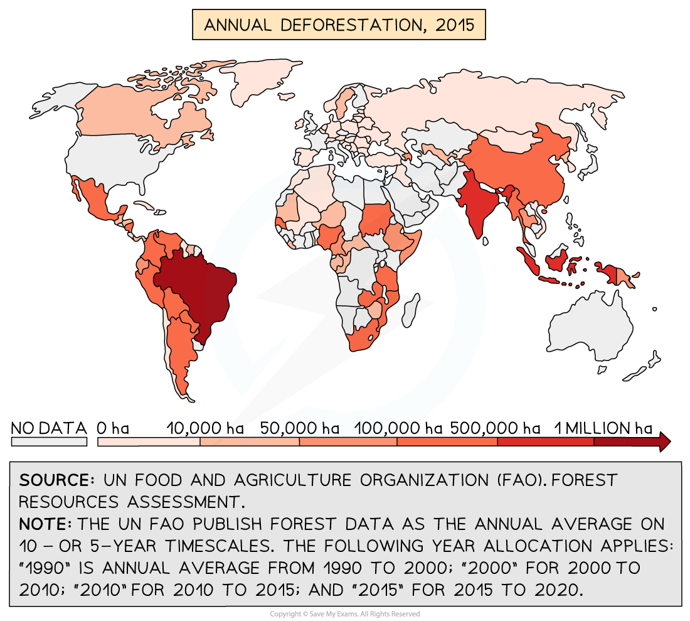
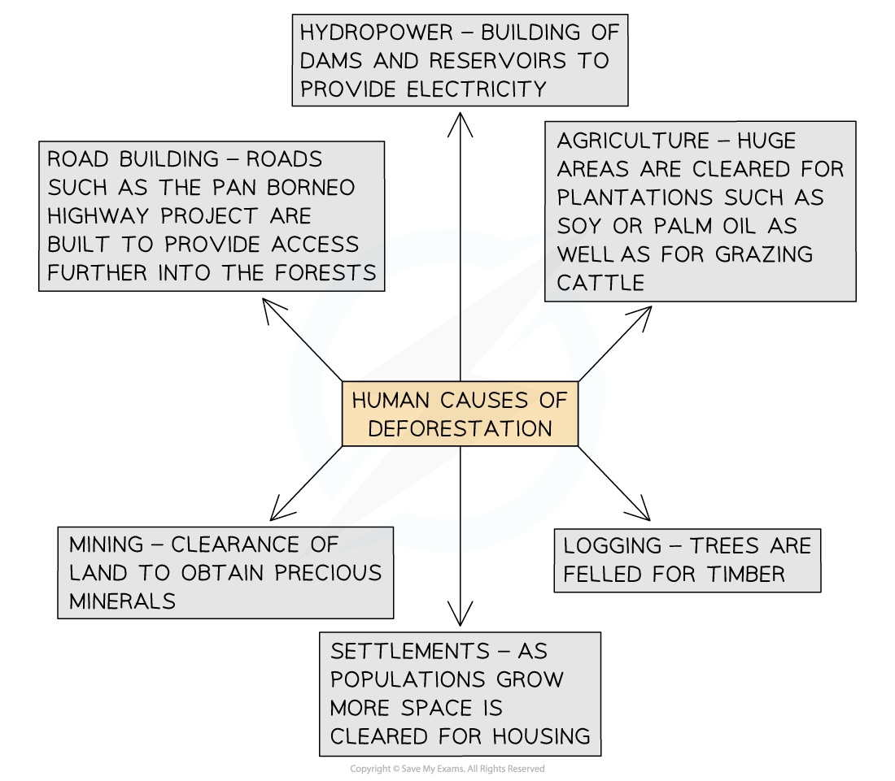
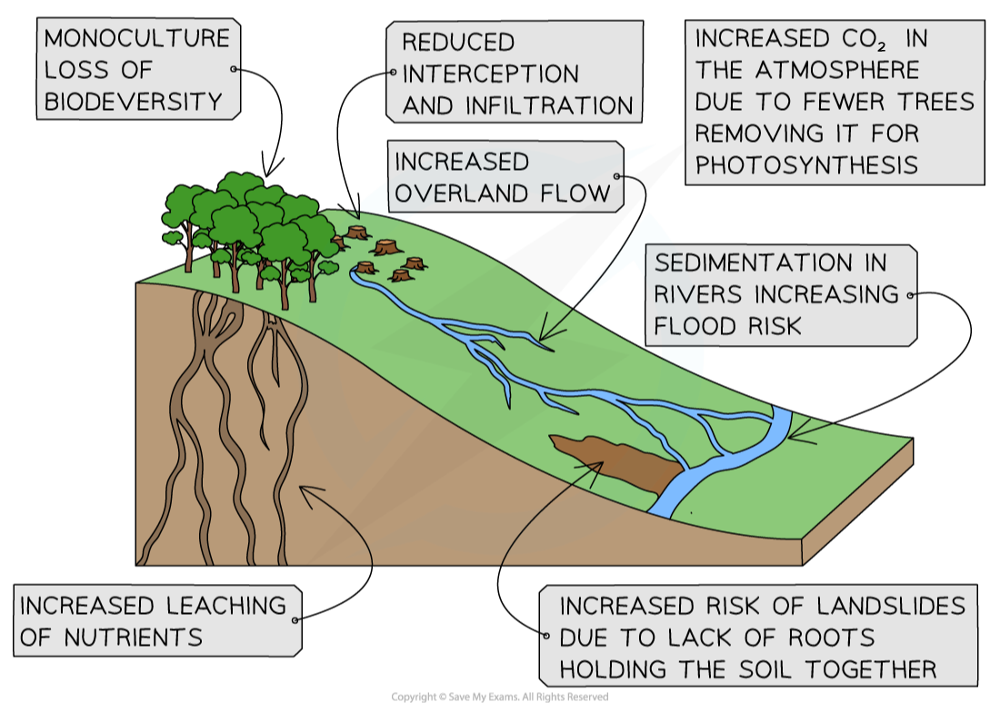

# Deforestation of Tropical Rainforest

## Deforestation of Tropical Rainforest

> **Spec point** — `spcpt_GdRTMDNyrzVj8kqr` · Describe the causes & effects of deforestation of the tropical rainforest

## Deforestation of Tropical Rainforest in Malaysia

- **Deforestation** is the felling and clearance of trees
- Malaysia, Brazil, India and Indonesia are experiencing the highest levels of deforestation in the world

  - The Malayan government has in the past failed to provide the Food and Agriculture Organisation (FAO) with figures for forest loss

*World Deforestation 2015*

- There are six main human causes of deforestation

*Human causes of deforestation*

- **Wildfires** are a natural cause of deforestation:

  - The frequency and severity of wildfires have increased this is linked to human-induced climate change

> **Exam Hint**
> It is important to remember that deforestation is often the result of a combination of factors that are linked together rather than any one cause. For example, the growth of settlements also leads to more land being cleared for agriculture to support the people in the settlements.

### Environmental impacts of deforestation

- Many of the impacts of deforestation are environmental, including:

  - Areas that have been deforested are planted with ***monoculture,*** which reduces **biodiversity**
  - **Interception** and **infiltration** decrease which reduces **evapotranspiration** and as a result, **precipitation** decreases
  - Increased overland flow, which leads to soil erosion and ***sedimentation*** of the rivers
  - Sediment builds up on riverbeds, reducing their capacity and increasing the flood risk
  - Lack of **interception** increases the leaching of nutrients
  - Fewer trees increase the amount of CO2 in the atmosphere, adding to the **enhanced greenhouse effect**

### Impact on the nutrient cycle

- The majority of nutrients in the tropical rainforest are held in the biomass
- When trees and vegetation are cleared by deforestation, the main store of nutrients is removed

IMAGE

*Environmental Impacts of Deforestation*

### Social impacts of deforestation

- Indigenous communities have less land to sustain their traditional way of life. This means:
- Land does not get the opportunity to recover
- Less food available
- Improved quality of life for some people due to increased income and jobs
- Indigenous communities may give up their way of life, leading to a loss of culture and traditions
- Increased risk of landslides, which can destroy homes and block roads
- Loss of potential medicines
- Increased risk of flooding settlements

### Economic impacts of deforestation

- More jobs available in mining, forestry, agriculture and HEP
- Increased income for the country through the export of goods from the forest—minerals, timber, crops
- Almost a quarter of Brazil's GDP comes from activities in the deforested areas of the Amazon

> **Worked Example**
> **Explain why large amounts of deforestation have occurred in tropical rainforests.**
> 
> **[5 Marks]**
> 
> - In your answer, you need to explain, which means that if you just state road building for example, you will not achieve the higher marks
> - You need to explain that road building happens to access remote areas of forest and requires large areas of trees to be felled and removed
> 
> **Final answer:** **Answer **
> 
> - Economic development (for country)
> - To earn money (individuals)/valuable wood
> - Large area so difficult to monitor
> - Corruption
> - Logging/timber/furniture/paper
> - Firewood/charcoal
> - Cattle grazing/ranching/rearing livestock
> - Cash crop farming/palm oil/plantations
> - Settlement/urban growth/examples of buildings, e.g. schools
> - Road building/railways
> - Mining/quarrying minerals or example, e.g. gold
> - HEP/dams etc.

## Example Case Study: Malaysia

> **Spec point** — `spcpt_825NyWTDw2rrcRjY` · An area of tropical rainforest

## Example Case Study: Malaysia

> **Case Study**
> - Malaysia is located in Southeast Asia
> 
> 
> 
> *Location of Malaysia*
> 
> - Almost 70% of the land is covered by tropical rainforest
> 
> ### Climate
> 
> - The climate of Malaysia is typical of tropical rainforest climates
> 
>   - **High rainfall **and **high temperatures **all year round
> 
> 
> 
> *Climate Graph of Kuala Lumbar, Malaysia*
> 
> - The Malaysian rainforest has** **a **high biodiversity** with over:
> 
>   - 15,000 plant species, including 5,500 flowering plants and 2,600 tree species
>   - 750 bird species
>   - 250 mammal species
>   - 350 reptile species
>   - 190 amphibian species
>   - 350 fish species
>   - 1000 butterfly species
> 
> 
> 
> *Malaysian Rainforest Food Web*
> 
> ### Adaptations
> 
> - There are many ways in which the animals and plants have adapted to the rainforest climate, including:
> 
> #### Plant adaptations
> 
> - **Pitcher plants **
> 
>   - Some of these are **epiphytes,** which grow on other structures like trees
>   - They get their nutrients from capturing insects in a funnel which contains a sticky acidic liquid which dissolves the insect
> - **Orchids**
> 
>   - Epiphytes grow on other structures such as trees to reach the light
> - **Lianas **
> 
>   - Vines which attach themselves or wrap themselves around trees to reach the light
> - **Kapur tree**
> 
>   - Grow up to a height of 60 m to reach the light. It has a straight branchless trunk to deter epiphytes and lianas from growing on it
> 
> #### Animal adaptations
> 
> - **Hornbill **
> 
>   - The distinctive bill has multiple uses. The bird uses it to help it climb trees, like a trowel for digging
> - **Orangutans**
> 
>   - Long and very strong arms, which enable them to move easily through the trees
>   - Fingers and toes are long used for gripping tree branches
> - **Malayan Tapir**
> 
>   - Their colour pattern helps to camouflage them, and they use their long nose to forage on the forest floor for leaves, fruit and nuts
> - **Mulu Flying Frog**
> 
>   - Can change colour to camouflage it and it uses flaps of skin on its legs to glide from tree to tree
> 
> ### Deforestation in Malaysia
> 
> - It is estimated that Malaysia has the fastest rate of deforestation in the world
> - Since 2000, an average of over 140,000 hectares of forest has been felled and cleared each year
> 
> #### Causes
> 
> - **Logging**
> 
>   - Malaysia is the largest exporter of **tropical hardwoods**
>   - Although Malaysia has environmental protection policies, there is still evidence of illegal logging in areas of Borneo
>   - **Selective logging** is the dominant type of logging but this requires road construction and settlements, which result in deforestation
> - **Energy**
> 
>   - The construction of dams to provide** hydroelectric power** result in the flooding of large areas of forest
>   - The **Bakun Dam** will result in 700 km of2  land being underwater in Sarawak, Malaysia
> - **Mining **
> 
>   - Tin mines are widespread and require deforestation not only for the mine itself but also for road construction
>   - An iron ore mine planned for the **Som Forest Reserve** will result in the deforestation of over 60 hectares
>   - There is also drilling for oil and gas
> - **Commercial plantations**
> 
>   - Malaysia exports over 30% of the world's **palm oil **and is the second-largest producer
>   - Many palm oil processes are now adopting a **zero-deforestation policy** so that they do not buy palm oil from deforested areas. However, **clear felling permits **are sometimes used in Malaysia to clear land and then sometime later another company will plant palm oil
> - **Settlements **
> 
>   - Up to 1980, people were encouraged to move to rural areas from the cities to try and reduce the pressure on urban areas
>   
>     - This led to the deforestation of approximately 15,000 hectares of rainforest
> - **Subsistence farming**
> 
>   - This can sometimes involve **slash and burn** where areas are cleared using fires; these can sometimes get out of control and destroy large areas of rainforest
> 
> #### Effects of deforestation
> 
> - **Soil erosion **
> 
>   - Without the tree roots to bind the soil, the soil is more easily eroded by wind and rain
>   - Exposed soil is more vulnerable to the* leaching* of nutrients and the soil becomes **less fertile**
> - **Loss of biodiversity**
> 
>   - Habitats are destroyed and the ecosystem is affected by deforestation so the variety of plants and animals decreases
>   - Oil Palm plantations lead to a 35% reduction in species
>   - **Orangutans, pygmy elephants, Sumatran rhinos,** and **Malayan tigers** are all endangered
> - **Local climate change**
> 
>   - Reduced transpiration and evaporation leads to a decrease in precipitation and an increase in temperatures
>   - Rainfall patterns become less reliable and more extreme
> - **Global climate change**
> 
>   - The felling of the trees leads to a decrease in the absorption of carbon dioxide
>   - Increases carbon dioxide concentrations in the atmosphere and as this is a greenhouse gas, this increases human-induced climate change
>   - The use of fire for clearance also increases carbon dioxide emissions
> - ** Indigenous communities**
> 
>   - Indigenous communities such as the **Orang Asli and Temiar** have been forced off land
>   - Pollination of fruits has reduced due to a decrease in pollinating insects and animals such as bats
>   
>     - This has reduced the available food sources
>   - In Kuala Koh village in 2019, at least 15 Indigenous **Batek** died after an outbreak of disease possibly transmitted by loggers working near to the village

### 

## Example Case Study: Hot Desert, Namib Desert

> **Spec point** — `spcpt_fCH7pcrFRrQxJsg7` · An area of hot desert

## Example Case Study: Hot Desert, Namib Desert

> **Case Study**
> - The Namib Desert is located mainly in Namibia on the west coast of Southern Africa
> 
> 
> 
> *Location of the Namib Desert*
> 
> - Stretching for over 2,000 km from Angola in the north to South Africa to the south
> - The desert is 160 km wide
> 
> ### Climate
> 
> - The highest daytime temperatures can reach over 45 ºC
> - Night-time temperatures can be as low as 0ºC
> - The areas nearest to the coast are cooler due to the effect of a cold ocean current—the **Benguela** current
> - The cooling effect of the ocean can also lead to the formation of fog, which can affect coastal areas for more than half the year
> - Annual precipitation varies between 2-200mm a year
> 
> 
> 
> *Climate Graph of Swakopmund *
> 
> - The Namib Desert has many species which are endemic and has higher levels of biodiversity than other hot desert areas
> 
>   - There are approximately 3,500 plant species, over 50% of which are endemic
>   - 200 mammal species
>   - 268 reptile species
>   - Over 6,000 insect species
> 
> ### Adaptations
> 
> - There are many ways in which plants and animals have adapted to the Namib Desert's unique climate, including:
> 
> #### Plant adaptations
> 
> - **Welwitschia mirabilis **
> 
>   - With just two leaves, this plant only grows when conditions are favourable
>   - The long leaves wrap around the bottom of the plant to give shade to the roots and reduce water loss
>   - The colour of the leaves changes, turning red when it is very hot to protect the plant from the sun
> - **Nara plant **
> 
>   - This plant has spikes instead of leaves to reduce water loss
>   - It absorbs the water droplets from fog through its stems
>   - The bottom of the plant dies off as it is covered with sand; this provides nutrients for the new growth
> - **Quiver Tree **
> 
>   - These are succulents; they can store water in their trunks and branches due to the spongy fibre
>   - Their leaves also store water and have a smooth waxy surface to reduce water loss
>   - The yellowish bark helps to reflect the sun's heat
> - **Camel Thorn Tree**
> 
>   - Has a strong tap root which can grow up to 60 meters, allowing it to absorb water from deep underground
> 
> #### Animal adaptations
> 
> - **Fog-basking beetle**
> 
>   - Gathers water by standing on its head in the morning whilst the fog condenses on its back and trickles down to its mouth
> - **Desert elephant **
> 
>   - Have smaller bodies, broader feet and longer legs than other elephant
>   - The broader feet help to spread their weight on the sand and the smaller body
> - **Wheel spider**
> 
>   - These spiders are nocturnal and so hunt at night when temperatures are cooler
> - **Golden mole**
> 
>   - With powerful digging claws and dense fur which repels dirt, they can almost swim through the sand
>   - With very efficient kidneys, they do not need to drink much water all
> 
> #### Threats and impacts on the desert ecosystem
> 
> - **Tourism**
> 
>   - Increasing tourism to the Namib desert has led to more activities such as off-roading and sandboarding
>   - Estimates suggest that desert soil takes over 2000 years to recover from being driven over
>   - Vehicles destroy the small, but essential, lichens and plants which are the foundation of the food web
> - **Mining**
> 
>   - Mining for diamonds, uranium, copper and zinc all occur in the Namib desert, including the **Rössing uranium mine** near Swakopmund
>   - It involves the removal of large areas of sand, which then destroys plant and animal habitats
>   - Increased pressure on scarce water resources due to the amount of water used in processing
>   - Increase in air, soil and water pollution
>   - Toxic waste may leach into the ground (leachate), which affects water sources
> - **Agriculture**
> 
>   - Irrigation increases salt levels in the soil and reduces plant life
>   - Increases the pressure on scarce water resources
>   - Over-grazing in increasingly limited areas reduces the number of plant species and has impacted on the **Golden Mole** population
>   - Farmers shoot and kill the **desert lion **as they view it as a threat to their livestock. This lion is now on the vulnerable species list
> - **Poaching**
> 
>   - Illegal poaching of animals such as the **pangolin** has impacted on the food web
>   - **Black rhino** numbers have also decreased significantly as a result of illegal poaching

> **Worked Example**
> **Study Fig. 1 shows a waste heap produced by the mining of copper ore. Suggest how this may pose a threat to the natural environment**
> 
> **[3 m arks]**
> 
> 
> 
> *Fig 1 - Waste heap from a copper mine*
> 
> **Final answer:** **Answer**
> 
> - loss of vegetation** [1]**
> - loss of animal habitats ** [1]**
> - covers a large area ** [1]**
> - waste could be toxic/toxic leachate ** [1] **affecting rivers/groundwater (dev.)** [1]**
> - visual pollution ** [1]**
