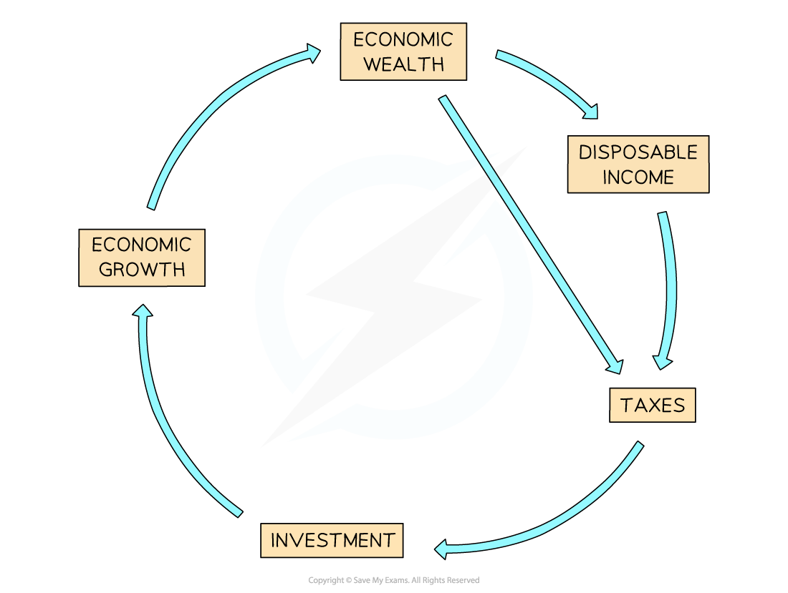

# Levels of Development

## Levels of Development

> **Spec point** — `spcpt_7s95fHhqWYYwHvjf` · Use a variety of indicators to assess the level of development of a country

## Levels of Development

- **Development **refers to a country's progress towards improving the **quality of life** and independence of its** **population
- The quality of life includes ***subjective*** factors like happiness
- The different parts are interconnected and influence each other; for example, health and environment depend on income, which can impact happiness

  - **Physical**: water supply, housing, power and heat, climate, diet and nutrition, etc
  - **Social: **family and friends, education, health, etc.
  - **Psychological: **happiness, security, freedom, etc.
  - **Economic: **income, job security, standard of living, mobility, etc
- Development is not a smooth, continuous process
- Development can occur for several reasons

  - Investment in agriculture (tractors, fertilisers, etc.) improves food supplies, which improves the health of people
  - Improvements in supplies of power to rural areas
  - Improvements in access to education for females and overall literacy rates
- Development can slow, halt and even reverse through:

  - war/conflict
  - disease
  - disasters
  - economic ***recession***

### Cycle of wealth

- The cycle of wealth is the **key indicator** of development
- A stable and effective government aids in economic development, which produces wealth
- More people will work and earn more money as the economy grows, which allows the government to collect more taxes and gives them more money to spend, which boosts business profits
- Businesses can then use their revenues and taxes to fund infrastructure, healthcare, education, and other areas, as well as future growth

*The cycle of wealth*

### Measures of national income

- The country's ***GDP*** (gross domestic product),*** GNI*** (gross national income), and ***GNP***** **(gross national product) are the traditional measures used to measure wealth
- GDP per capita is the total of a country's annual output of goods and services divided by its total population

  - Depending on a nation's size and population, its GDP might vary greatly
  - More meaningful comparisons can be made between countries when dividing it by the population
- Wealth disparity is hidden as GDP is calculated as an average
- For instance, two countries can have the same average GDP; however:

  - Country A has a lot of people living in poverty, with a small number of very wealthy people
  - Country B has a more even distribution of wealth
- It is impossible to know what the GDP is used for; for instance, the need to rebuild following an earthquake causes the GDP to rise

  - This does not mean that everyone's quality of life has increased or that the country is more developed
- **GNP per capita** (per person) allows a better comparison since different countries have varying populations

  - For instance, the GNP of the UK is lower than that of India, but the GDP per capita of the UK is higher than that of India (India has a higher population compared to the UK)
  - However, GNP per capita does not take into account the cost-of-living in the country - \$1 will go further in Bangladesh than in the USA
- To even this discrepancy, the GNP per capita at ***Purchasing Power Parity*** (PPP) is calculated
- Comparison between countries' level of development is easy to see, but it fails to identify:

  - How wealth is distributed around a country - the wealth gap
  - Government investment in the country
  
    - Despite Cuba's low GNP per capita, the government has historically placed a strong priority on social investment, and the country enjoys higher literacy rates, a lower infant mortality rate, and a comparable life expectancy to America
- Levels of development vary on a local, national and international scale
- There are variations within the same country, within the same city, and between countries
- These include:

  - literacy
  - life expectancy
  - infant mortality
  - doctors per 1000 people
  - energy consumption per capita
  - internet access
  - car ownership

> **Exam Hint**
> Remember, increasing wealth is not equally distributed. In all countries, some people will benefit more from the cycle of wealth and economic development. Often, as a country develops, the gap between the rich and poor increases.

### Human development index

- The UN created the** Human Development Index (HDI)** in 1990 as a way of measuring differences between country's
- The index takes into account four indicators of development:

  - Life expectancy at birth
  - Mean years of schooling for adults aged 25 years
  - Expected years of schooling for children at school entering the age
  - **Gross National Income** (GNI) per capita (PPP\$)
- Countries can be divided into four groups using HDI

  - **Very High Human Development (VHHD) **
  - **High Human Development (HHD)**
  - **Medium Human Development (MHD)**
  - **Low Human Development (LHD)**
- HDI is scored from 0 to 1
- The higher the HDI, the higher the level of development and quality of life

  - Norway has the highest HDI at 0.957  (2024)
  - Niger has the lowest HDI at 0.394 (2024)

### Gini coefficient index

- The HDI and GNP cannot detect disparities across a country
- The** wealth gap** in some countries is more significant than in others
- The **Gini coefficient index **is used to analyse the distribution of wealth and identify countries where wealth distribution is the most unequal

  - Measured on a scale of 0 to 1.0 or as a percentage
  - A **low value** means that the distribution of wealth is more equal; a measurement of 0 would mean that wealth is distributed completely equally
  - A **high value **means the distribution of wealth is unequal; a measurement of 1 would indicate maximum inequality
  - The Gini coefficient index is usually between 0.24 and 0.63 or 24%-63%
- The highest inequality is currently in South Africa, Central Africa, Namibia, Zambia and Suriname
- The lowest inequality is in the Czech Republic and Croatia

> **Worked Example**
> **Identify the meaning of the term quality of life**
> 
> **[1 mark]**
> 
> **A: **A person's well-being in terms of environment, security and health
> 
> **B: **A person's level of deprivation
> 
> **C: **A person's level of income
> 
> **D: **A person's type of job
> 
> ### Solution
> 
> **The correct answer is A ****[1 mark].**
> 
> - The other answers are incorrect as they are subjective and do not relate to the quality of life

### Indices of political corruption

- The effects of political corruption on human welfare and progress can be devastating
- It shows that money is often given to wealthy people rather than being used for infrastructure,  human welfare or development
- It leads to a lack of trust between local/national governments and the population
- Depending on the level of corruption in the public sector, **Transparency International** ranks 180 countries out of a maximum score of 100

  - The lower the level of corruption, the higher the score
- With scores of 85/100 or above, Denmark, New Zealand, Finland, and Singapore have the lowest levels of public sector corruption
- South Sudan, Syria, and Somalia have the greatest rates of public sector corruption, with scores below 15 out of 100

> **Worked Example**
> **Suggest why GDP per capita is not necessarily a good indicator of the quality of life.**
> 
> **[2 marks]**
> 
> ### Solution
> 
> - **GDP measures only economic production** **[1 mark].**
> - **Quality of life is not only about income**** [1 mark].**
> - **Alternative content**
> 
>   - GDP is an average measure and income varies
>   - The wealth is not shared equally across the population** **
>   - It depends on what the GDP is spent on; weapons do not improve the quality of life** **
>   - It does not consider levels of health or education
