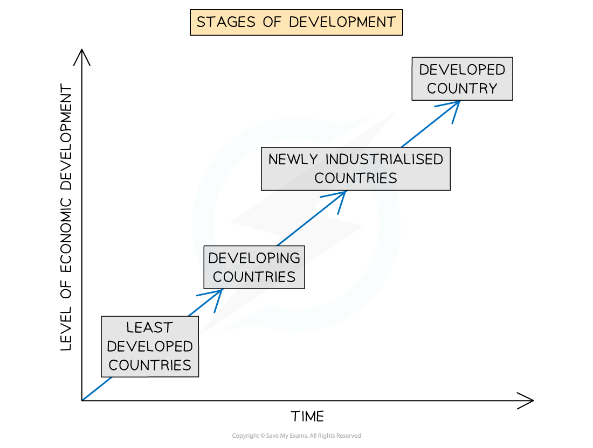
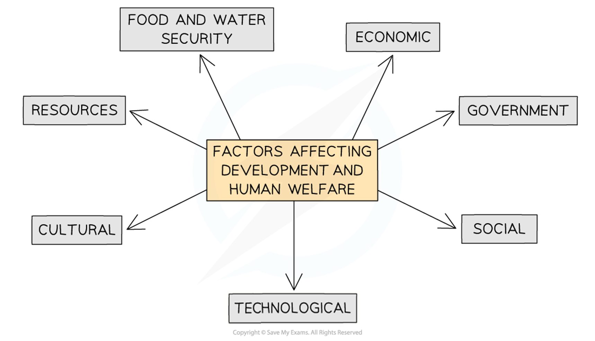
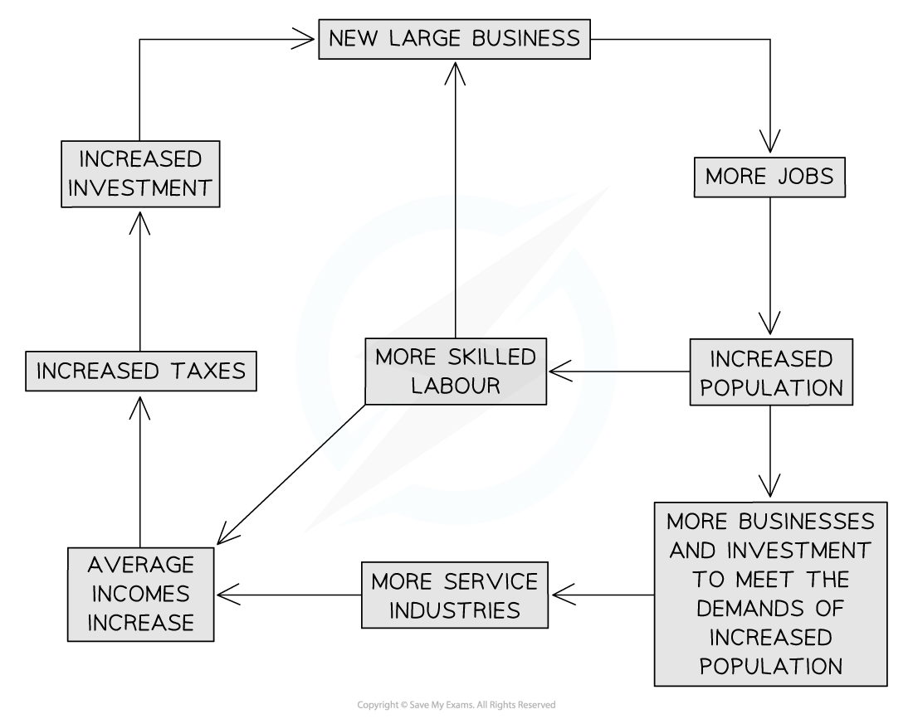

# Inequalities in Development

## Inequalities in Development

> **Spec point** — `spcpt_Z7hqXS9FX6DwQ3Zz` · Identify & explain inequalities between and within countries

## Inequalities in Development

### Stages of development

- All countries move through the different stages of development
- The UN identifies four main stages of development

*Stages of Development*

### The development gap

- The **development gap **is the difference in levels of development between the least developed and most developed countries in the world
- There are many factors which lead to the differences in development

*Factors Affecting Development and Human Welfare*

- **Physical geography**

  - ***Landlocked*** countries find trade more difficult and so often develop more slowly
  - Small countries develop more slowly due to having fewer human and natural resources
  - Those countries with extreme climates develop more slowly
  - The physical geography also impacts on the natural resources available

- The physical environment provides  natural resources

| **Natural resource ** | **Uses** |
|---|---|
| **Water** | Domestic use, energy |
| **Forests** | Timber, habitat, rubber, recreation, food, medicines |
| **Fossil Fuels** | Fuel, energy |
| **Soil** | Growing crops |
| **Rocks** | Construction |
| **Minerals** | Glass, jewellery, money |
| **Animals** | Food, skins |

- Some countries are able to meet all their needs from the natural resources they have
- Many countries have to ***import*** some natural resources that are not available within their borders
- **Water, food** and **energy security** are particularly important to support a country's development
- **Demography**

  - The population structure of a country
  - The birth and death rates, as well as immigration, affect the available workforce
  - Those countries where birth rates have fallen the most show the highest rates of growth
- **Technology**

  - Can help to increase water, food and energy security
  - Mechanisation of farming increases yields and improved land surveying may reveal more energy sources
  - Technology can also mean that existing resources are used more efficiently
- **Social **

  - Levels of education affect the skills people have. The more educated a population is, the more a country will develop
  - Healthcare affects how well people are which affects their ability to work
  - Lack of equality can mean that the overall productivity of a country is affected
- **Government policies**

  - The stability and effectiveness of government can have a significant impact on development and human welfare
  - Development and human welfare are greatest where there is a democratically elected government
  - Corrupt governments do not invest in the country's development or in improving the quality of life for the population
  - A government's economic policy affect development and human welfare through:
  
    - Open economy: where foreign investment is encouraged, which generates faster development
    - Higher rates of saving and lower spending compared to GDP results in further development

### Differences within countries

- As well as differences between countries, there are also differences in development **within countries**:

  - This can be seen in all countries, whether they are developed, emerging or developing
  - Often development is focused on particular regions
- Inequalities within countries are due to several factors
- **Cumulative causation** theory is one explanation for regional differences:

  - Growth in the core region attracts skilled labour and capital
  - Areas in the periphery suffer as skilled labour leaves and investment is focused on the core
  - The gap between the core and the periphery increases
  - Eventually, the growth of the core region may stimulate growth in the periphery due to the demand for raw materials

*Cumulative Causation*

- There are three stages of regional inequality:

  - **Pre-industrial stage:** regional differences are at their lowest
  - **Period of rapid economic growth**: increasing regional differences
  - **Regional economic convergence**: where wealth from the core spreads to other parts of the country

### Causes of regional inequalities

- **Residence:** urban areas generally attract greater levels of investment, leading to increased business and incomes. There may also be inequality within the urban area
- **Ethnicity:** discrimination can result in ethnic groups having income levels significantly below the dominant groups within a country. This reduces the opportunities open to these groups
- **Employment**: the split between formal and informal employment impacts incomes. Formal jobs usually have higher incomes and greater benefits, such as holidays and sick pay
- **Education:** those with higher levels of education usually gain higher-paying employment
- **Land ownership:** inequalities in land ownership are strongly linked to inequalities in income

> **Worked Example**
> **Study the figure below, which shows GDP per capita in South America along with the percentage change in GDP**
> 
> 
> 
> **State one piece of evidence that there is a development gap in South America**
> 
> **[2 marks]**
> 
> - As this is for two marks, it is important that you use evidence from the source for the second mark
> 
>   - There is a difference in GDP per capita between countries **[1] **French Guiana has a GDP per capita of less than US\$4,000, whereas Suriname has a GDP per capita of over US\$13,000 **[1]**
> 
> **OR**
> 
> - There is a difference in the percentage increase of GDP per capita** [1] **Guyana's increase in GDP per capita is only 1.4%, whereas Chile's is 3.7% **[1]**

> **Exam Hint**
> - Remember, where an exam question asks for one piece of evidence, do not give more than that.
> - In the case of the worked example, the one piece of evidence is the comparison between two countries.
