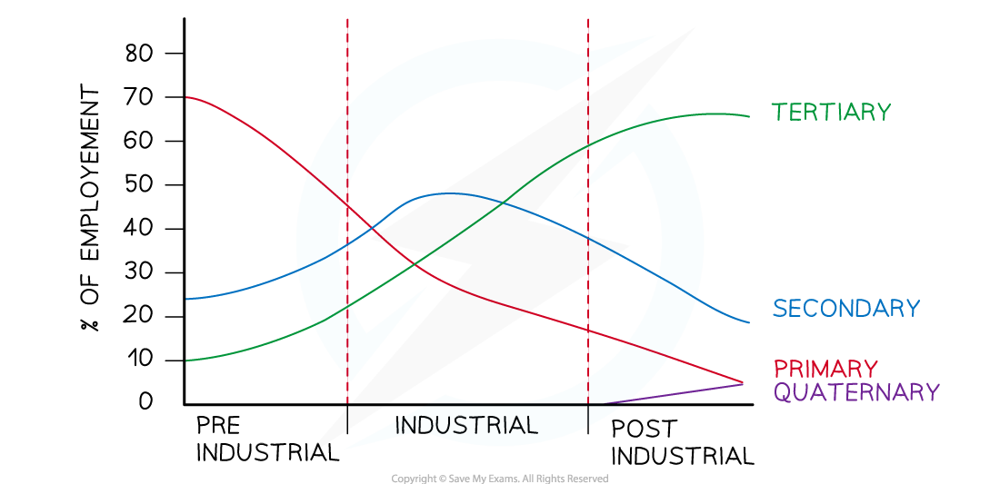
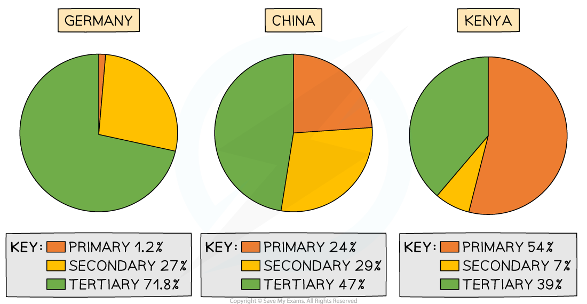

# Employment Sectors

## Employment in Economic Sectors

> **Spec point** — `spcpt_CVPN3BcbfRqhFnv7` · Describe & explain how the proportions employed in each sector vary according to the level of development

## Employment in Economic Sectors

- Economic sectors are an indicator of a country's** economic development** using either:

  - The amount each sector contributes to the ***Gross Domestic Product*** (GDP)
  - The percentage of the population they employ
- The proportions of each economic sector's GDP and employment changes over time:

  - In the ***pre-industrial***** **period, the primary sector dominated, with steady increases in the secondary and tertiary sectors
  - As countries develop, the reliance on the primary sector for GDP and employment rapidly decreases
  - During the **industrial** period, the amount of GDP and employment in the secondary sector increases to become dominant and then decreases. The primary sector continues to decrease and tertiary sector increases
  - In the **post-industrial** phase, the tertiary and quaternary sectors increase whilst the secondary and primary sectors decrease.
  - The tertiary sector dominates employment and GDP in the post-industrial period

*Clark-Fisher Sector Model *

- As countries develop, the number of people employed in each economic sector changes
- This can be seen in the **Clark Fisher Sector Model **above and the examples below:

> **Exam Hint**
> You should be able to look at a pie chart or graph of the economic sectors and work out the stage of development of a country. A developing country will be dominated by primary economic activities, a newly industrialised country is likely to have fairly equal amounts of each type of economic sector employment; and finally, a developed country will be dominated by tertiary economic activities.

### Causes of changes over time

- There are several reasons for the change in percentages employed in each sector:

  - Increasing ***mechanisation*** in agriculture led to a decrease in the jobs available
  - People moved to urban areas to find jobs in secondary and tertiary sectors
  - Increasing mechanisation and global changes led to a decrease in secondary employment in some countries
  - Technological improvements have led to an increase in tertiary and quaternary employment
- There is a clear link between employment structure and indicators of development
