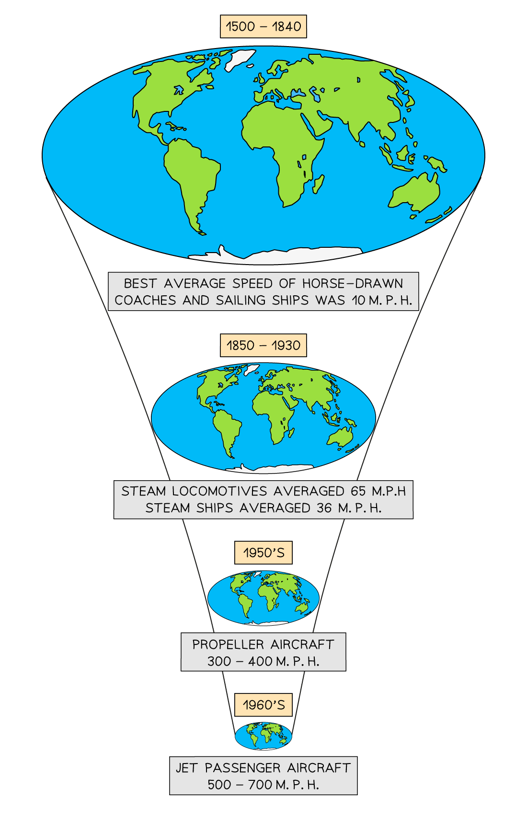
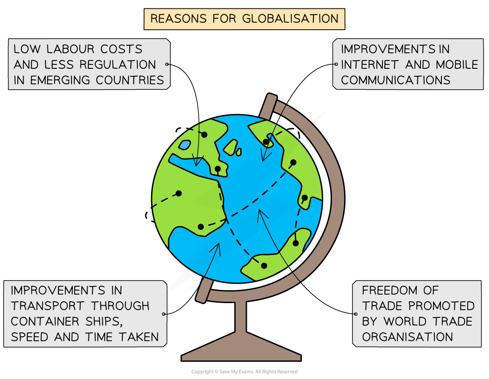

# Globalisation

## Globalisation

> **Spec point** — `spcpt_FwfQZDXNDtMPDPKP` · Describe & explain the process of globalisation, and consider its impacts

## Globalisation

- **Globalisation** is where the world has become more **interconnected **through the **processes **of economics, culture, politics, trade and tourism
- Environmental globalisation can also be considered part of the interconnection, as can be seen with the impacts of global warming
- Globalisation is nothing new; trade between people, businesses and countries has always existed
- Whereas trade would have taken weeks, months or even years in the past, modern transport and communications have made trading and interaction almost **instantaneous – time-space***** compression***
- Globalisation has effectively removed the political borders of countries, which makes countries more ***interdependent*** on each other, with the more powerful countries and business empires affecting decisions in other parts of the world
- This has led to a rise in **global inequality**
- These improvements and developments in communication and transport have made globalisation what it is today – a** shrinking world**

*Time-Space Compression*

- Overall, connections around the globe are:

  - **Faster – faster** speeds for talking, travel, money exchange, etc.
  - **Deeper – connecting** lives with faraway places
  - **Longer – connecting** links between places are further apart
- These connections are viewed as network flows to various places and populations by **four **significant developments:

  - Appearance of large transnational corporations (***TNCs***)
  - Growth of regional economics and ***trading blocs***
  - Development of modern transport networks
  - Advances in ***IT*** and communications, particularly the ***WWW*** and the ***internet***

### Production chain

- These developments have led to the ***global economy***
- Almost every country in the world has 'networked' in one way or another
- There are **five **different network flows:

  - **Trade – import** and export of raw materials, food goods and services through the reduction of trade barriers
  - **Aid – most** aid is economic, either through receiving or donating, allowing developing countries to invest in education, health, infrastructure and trade
  - **Foreign investment – either** directly or indirectly through business opportunities, e.g., Shell oil investing in Niger
  - **Labour is important** to the working of the global economy and labour migration fuels this market either with specialists or cheap labour
  - **Information – fast** data transfer and communication are vital to the global economy
- The global production, supply or ***commodity chain*** pulls these flows together to produce goods or ***commodity***
- At each stage of the flow, **value is added** to the emerging product
- Despite the miles involved and the number of countries involved, the product is still cheaper to produce in various stages
- This is known as the **Economies of Scale** - the cost per item reduces when operated on a large scale
- Transport improvements through large container ships mean that costs are reduced and moved further quicker
- Labour costs are cheaper in emerging and developing countries and there are usually reduced legal restrictions

### Global investment

- **Investment** is not just monetary (economic), although this is a large part of it
- Investment can be in **people, research or products**
- **Foreign investment refers to the process in which individuals or firms from abroad invest their resources in another country.**

  - Call centres can be located anywhere e.g. India
  - Investment is made in the country through building the call centre, paying taxes, etc.
  - Local people are employed and trained
  - Service is provided to the donor country – the UK
- **Moving manufacturing** from developed to developing or emerging countries

  - China is the main area for manufacturing goods from around the world
  - Investment is made in China to produce goods
  - Completed goods are shipped back to the original country e.g. Germany
- **Investment **in **people** either for cheap labour or for their expertise

  - A specialist surgeon from the USA to Australia
  - Investment in developments that attract cheap labour—the construction of Dubai attracts many Indian migrants
  - Research and development investment—motor car industry to build more fuel-efficient motoring—Elon Musk's Tesla electric cars
- **Investment** can be from **aid **for rebuilding after a disaster; Ukraine will need aid after the war with Russia ends

  - Aid can be funds sent to the government to use as necessary, although this can often lead to corruption and funds not going where they should
  - Aid can be in the form of goods and services directed to the affected area—refugee camps or after a natural hazard such as a tropical storm or earthquake

### Transnational corporations (TNCs)

- **Transnational Corporations (TNCs)** operate in foreign countries individually and **not **through a centralised management system
- TNCs and countries are the two main elements of the global economy
- Governments and global institutions set the rules for the global economy, but the main** investment **is through TNCs
- TNCs involve themselves in all economic sectors and **impact the global economy,** with the largest TNCs representing the biggest percentage of total global production
- TNCs **directly invest** in one country and later expand to other nations (usually developing countries) to take advantage of lower labour costs and incentives
- They may not be loyal to the operating country's values and will only look to the **expansion **of their business, as they have no connection to the country they operate in
- It is the process of moving manufacturing around the globe that has resulted in the development of emerging countries such as China, India and Brazil

> **Exam Hint**
> - Remember that Transnational Corporations (TNCs) are **not **the same as Multinational Corporations (MNCs)
> - The biggest difference is that an MNC has a home country that makes decisions and passes them around the global companies, whereas TNCs operate independently
> - An example of an MNC is Apple, where R&D and major decisions are made in California and passed along the operating chain
> - Cadbury's chocolate is a TNC as they have to make decisions to vary the recipe to local tastes and conditions – e.g., the chocolate is sweeter in China

> **Worked Example**
> **Identify the meaning of the term TNC**
> 
> **[1 Mark]**
> 
> **A: **Translocal Corporation
> 
> **B: **Transnational Corporation
> 
> **C: **Transnational Country
> 
> **D: **Transporting National Corporation
> 
> ### Solution
> 
> - **The correct answer is B ****[1 mark].**
> - All the alternative answers are incorrect, as none of the other terms exist.

### Impacts of globalisation on people

- Globalisation has generated benefits and costs for many people but at different levels
- Some have benefitted more than others, with the poorest tending to be the losers
- However, it can be argued that without globalisation, the poorest would be worse off than they are now, as they would lose job opportunities and income from inward investment from TNCs
- Countries such as China, Brazil and India have transformed themselves from developing to emerging economies, which has directly benefitted their population
- The gender gap within individual countries is generally lower in more globalised countries
- Skilled workers are in demand and benefit from globalisation more than unskilled workers

#### Benefits and costs of globalisation at a local level

| Benefits | Costs |
|---|---|
| - Cheaper products available for people - Greater choice of goods - Bigger export market for domestic manufacturers - Integration of cultures – multiculturalism - Education and skills are improved - More freedom of movement - Spread of technology and innovation - A higher standard of living - Availability of housing, sanitation, food and water is better - Gender equality and gender pay gap closing in developed countries | - Small local businesses cannot compete with global companies - Labour drain – skilled workers migrate elsewhere, leaving unskilled or no workers behind - Dependence on single TNC employment - Worker exploitation/cheap labour - Closure of TNC leaves high unemployment rates - Cultural dilution or loss of cultural identity - Environmental cost of increased production, trade and growth - Pollution impacts the health of people - Daily living costs increased |

#### Benefits and costs of globalisation at a national level

| Benefits | Costs |
|---|---|
| - Higher levels of incoming revenue from tourism, exports and imports - Growth of improved health care, infrastructure, social care and education - Social mobility is greater – access to higher education and senior leadership roles - TNC offer apprenticeships and incentives for progression | - Increased levels of disparity between places – some towns and cities will benefit more from government policies - Social mobility is limited to urban areas; people in rural areas need to migrate - TNCs control a large labour force and can 'blacklist' workers, effectively preventing people from working elsewhere - Industrial growth impacts the environment – burning fossil fuels adds to global warming and pollution - Growth of urban slums |

#### Benefits and costs of globalisation at an international level

| Benefits | Costs |
|---|---|
| - Skilled workers are in demand and can move relatively easily between countries - Higher levels of income and quality of life - Access to wide levels of skills and research - International trade routes and foreign investment improve opportunities | - Movement of people, transport ownership and loss of biodiversity increases globally - The impact is greater on developing countries, particularly remote rural areas, increasing the development gap - Decisions made elsewhere do not consider local or national identities - The movement of skilled workers and researchers leaves an imbalance in developing and emerging countries, reducing the   potential for further development unless they pay higher wages, leading to higher global costs |

#### Impacts of globalisation on countries

- TNCs are key in globalisation
- They link raw materials with manufacturers, research and development opportunities and products with global markets
- Global marketing establishes TNCs as '**the brand**' to have
- However, TNCs answer to shareholders and need to maximise their profits, usually at the cost of their workers
- TNCs, therefore, can impact countries positively or negatively

**Benefits and Costs of Globalisation to Countries at a Variety of Levels**

| **Benefits** | **Costs** |
|---|---|
| - TNCs bring skills, opportunities, money and technology to developing and emerging countries - Inward investment in host countries increases the level of development - The host country's infrastructure is improved by TNC or for TNC – access, communications, energy supplies, etc. - TNCs create jobs, allowing people to buy more and pay more tax - Foreign currency is earned through exports - TNCs have a ***multiplier effect*** by encouraging other industries to grow around them | - TNCs pay low wages and expect long hours and are generally exploitive, particularly of female workers - TNCs are powerful and are not loyal to a host country's government – investment can disappear as quickly as it came - TNCs can leave a country if global or local economies change or somewhere else becomes more profitable - Profits 'leak' out of the host country either to open up new business elsewhere or are paid in bonuses and dividends to share holders - TNCs often ignore the environmental and social costs of their investment - TNC jobs are often boring and repetitive and don't develop skills – effectively trapping their workers in the company |
|   |   |
|   |   |
|   |   |
|   |   |
|   |   |

## Case Study - Nike

> **Spec point** — `spcpt_PmRpS8HbJmvFngz7` · A transnational corporation and its global links

## Case Study – Nike

- Make sure you know your case study of the global operation of a TNC
- You need to be able to identify the costs and benefits to the host country as well as to the TNC's own country of origin
- For example, you could produce something along these lines on the USA-based company Nike

| **Country** | **Cost ** | **Benefit** |
|---|---|---|
| **Vietnam** | - Exploitation of workers - Poor working conditions - Child labour | - Substantial employment - Pays higher wages than local firms. - The status of brand encourages other TNCs to invest |
| **USA** | - Indirect loss of jobs as manufacturing is outsourced - The balance of profit to cost isn't passed onto the customer - Company image damaged due to outsourcing | - Bigger profits made as manufacturing costs are lower - High-level skills in design, R&D in demand |

- Remember to keep it simple and use facts and figures to keep it 'real' and not a generic case study
