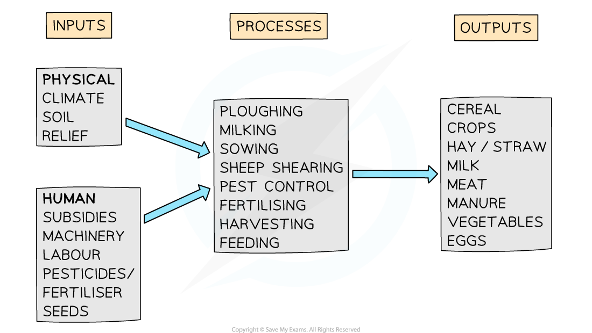

# Agricultural Systems

## Agricultural Systems

> **Spec point** — `spcpt_YQ3dYv46SYrxgNyN` · Describe & explain the main features of an agricultural system; inputs, processes & outputs

## Agricultural Systems

- To obtain food, humans use and modify the ecosystems through farming
- There are four groupings commonly used to categorise farming:

  - ***Arable*** and ***pastoral***
  - ***Commercial*** and ***subsistence***
  - ***Extensive*** and ***intensive***
  - ***Nomadic*** and ***sedentary***
- A farm that has both livestock and crops is a **mixed farm**

### Factors influencing the type of agriculture

#### Physical factors

- **Temperature **

  - All crops have a minimum temperature below which they will not grow or will not produce a good ***yield; wheat*** grows best between 21 and 24 ºC
- **Growing season**

  - The length of the growing season affects the type of crop grown—barley needs about 90 days from sowing to harvest, whereas rice takes about 120 days
- **Precipitation**

  - Both the average annual rainfall and the distribution of rain over the year affect the types of crops grown
- **Relief and slope aspect **

  - The altitude of the land affects temperature and the steepness affects the suitability for crops
  - In local areas, different crops may be grown on south-facing slopes, which get more sunshine and are warmer
- **Soil type and fertility**

  - In areas with thin, infertile soils, grazing is likely to dominate as crops need deeper, more fertile soil
- **Drainage **

  - For most crops to grow, the land needs to be well drained so that roots do not get waterlogged

#### Human factors

- **Tradition **

  - Many farms simply grow the crops or raise the livestock that have been on the farm for generations
- ***Subsidies***

  - Farmers may change crops or livestock depending on the money available from the government
- **Transport **

  - The cost of transporting the product may affect what is produced
  - Livestock transport is more expensive than grain transport
- **Farm size**

  - Due to ***economies of scale,*** larger farms can afford more in terms of feed, fertiliser and machinery; this may affect what is produced
- **Market demand **

  - The changing demand for produce
  - There has been an increase in demand for meat such as buffalo and ostrich, which may affect the choice of what is produced
- **Capital **

  - The amount of money a farmer has to invest will affect the machines and artificial inputs (irrigation, pesticides, fertilisers) they can afford

### Farming systems

- All farms are systems; they have inputs, processes and outputs

*A farming system*

#### Impacts of farming systems

- All farming systems impact the ecosystem in which they are located
- Some have more impact than others:

  - **Monocultures** reduce diversity by limiting animals' food access
  - Nutrient cycling often depends on natural (manure) or artificial fertilisers
  - Ecosystems are modified with inputs of seed, fertiliser, pesticides, herbicides and the use of machines
  - Where food webs are reduced, so too is the amount of biomass

> **Exam Hint**
> Remember, farms do fit into more than one category. For example, a sheep farm in Cumbria. The UK would be categorised as arable, commercial, extensive and sedentary.

> **Worked Example**
> **Insert the following words into the table below to show examples of inputs, processes and outputs of a mixed farm.**
> 
> **[3 marks]**
> 
> #### Choose from the words below
> 
> milk                          wheat                     harvesting     ploughing         water                      pesticides
> 
> | Inputs | Processes | Outputs |
> |---|---|---|
> |   |   |   |
> |   |   |   |
> 
> **Final answer:** **Answer**
> 
> | Inputs | Processes | Outputs |
> |---|---|---|
> | water | harvesting | wheat |
> | pesticides | ploughing | milk |

## Case Study: Sheep Farming

> **Spec point** — `spcpt_QdCwR4YSXdq2QT25` · A farm or agricultural system

## Case Study: Sheep Farming

- There are many examples of farming that can be used in the final exam
- The example below is of sheep farming in Cumbria

> **Case Study**
> - The relief of the land in Cumbria limits the type of farming
> - Lowland areas are used for cattle grazing and limited amounts of crops
> - **Sheep farming** dominates, with approximately 3 million sheep farmed in the area
> - An example of extensive, commercial, pastoral and sedentary farming
> 
> #### Characteristics
> 
> - Sheep farms usually have three land use zones:
> 
>   - The **fell:** these are the hills over 300 m and is used for grazing
>   - The **intake:** the lower slopes, which are divided into fields
>   - The **inbye:** land close to the farm buildings used to bring the sheep in for lambing and shearing. Some crops may also be grown here for animal feed (turnips/hay)
> 
> #### Inputs
> 
> - Inputs can be divided into physical and human
> 
> #### Physical inputs
> 
> - **Climate **
> 
>   - A short growing season means the area is unsuitable for most crops, as well as high rainfall. In many areas over 1500mm
> - **Soils**
> 
>   - In the upland areas' soils are thin and acidic
> - **Relief **
> 
>   - Many steep slopes with large areas of upland
> 
> #### Human inputs
> 
> - **Machinery, fuel and buildings **
> 
>   - Quad bikes and sheds for lambing
> - **Labour **
> 
>   - Low labour requirements. Farms are often worked by one person with additional help when needed
> - **Subsidies **
> 
>   - Without subsidies, many sheep farmers would make a loss
> - **Feed **
> 
>   - Needed for winter months when uplands are snow-covered and grass doesn't provide the nutrients needed
> 
> #### Processes
> 
> - There are not large numbers of processes on a hill sheep farm, but they do include:
> 
>   - monitoring the sheep
>   - lambing
>   - dipping—to reduce parasites and maggots
>   - shearing
> 
> #### Outputs
> 
> - Lambs are bred for **meat** and sent for slaughter before they are 1 year old (usually 6-8 months)
> - **Wool **from shearing (this often costs more than the farmer gets for the fleece)
> - Mutton—this is meat from sheep over 1 year old
> 
> #### Challenges
> 
> - Hill sheep farming is often **not profitable**, and farmers rely upon **subsidies** or ***diversification***
> - Disease: **foot and mouth outbreak**. In 2001, nearly 500,000 sheep had to be killed to prevent the further spread of the disease
> - Fuel, machinery and feed costs have all increased
> - **Lamb prices** fluctuate depending on the market and this affects income
> - **Wool prices** average about 32p for a kilo; this is less than the cost of shearing the sheep so shearing costs the farmer money
> - Fewer people want to become sheep farmers
> - Since leaving the EU, the UK is intending to phase out subsidies and replace them with payments for environmental work
> 
> #### Impacts
> 
> - Many sheep farmers are diversifying into areas such as campsites and holiday cottages
> - Conversion to **organic,** such as **Low Sizergh Farm** in South Cumbria, can increase profits as people pay more for organic meat and wool
> - Farmers taking on additional jobs and farming part-time
> - Changing of breeds to those that shed their fleece and don't require shearing, though this may not be suitable for the upland areas

###
