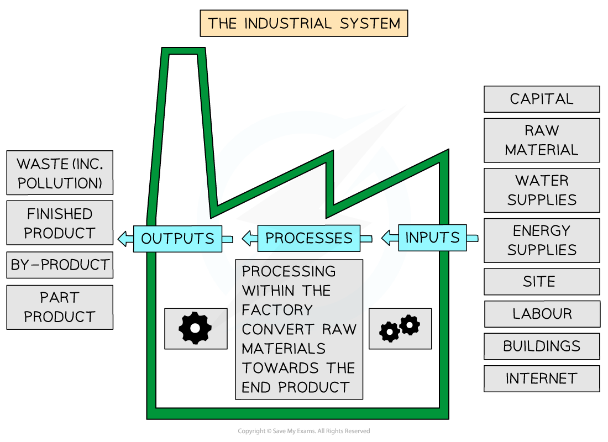
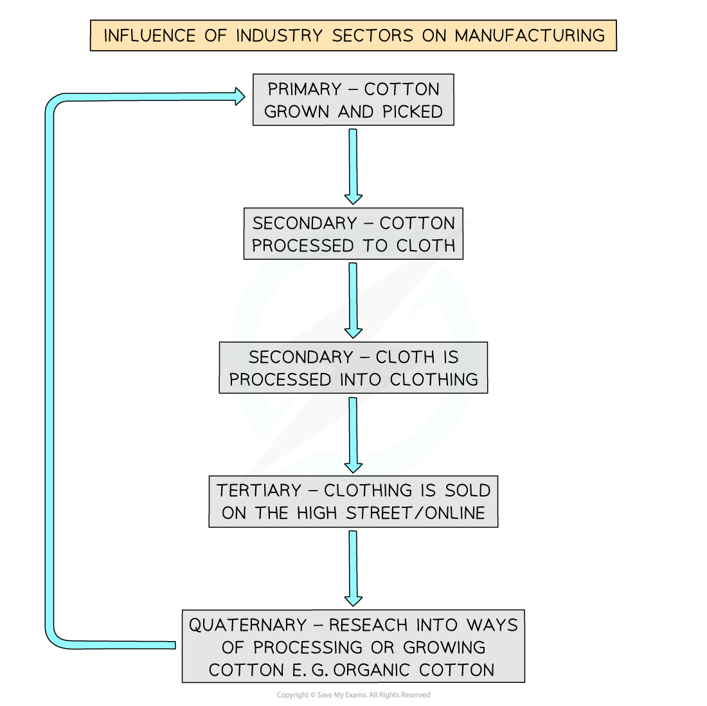

# Industrial Systems

## Industrial Systems

> **Spec point** — `spcpt_gGCbTcSbtC5mRVQz` · Demonstrate an understanding of an industrial system; inputs, processes and outputs (products & waste)

## Industrial Systems

- Industrial systems have inputs, processes and outputs

  - **Inputs: basic** items needed to begin the process
  
    - Raw materials, labour, energy, capital, land, buildings, etc.
  - **Processes: activities** that take place to make a finished product (goods)
  
    - Cutting, sewing, welding, brewing, painting, steel moulding, etc.
  - **Outputs: finished** products, by-products, products for continued manufacturing elsewhere and waste
  
    - Finished products such as cars, clothing, beer, shoes, etc.
    - By-product such as Marmite from beer brewing
    - Continued manufacturing (part manufacturing) such as cleaning wool or cotton, weaving wool or cotton for material, material made into clothes for a finished product, etc.
    - Waste is produced with all manufacturing; it has no value but creates a cost for disposal
- Manufacturing can be classified as:

  - **Heavy:** **iron **and steel manufacturing is heavy industry as it uses large, bulky raw materials on a huge scale, producing big items
  - **Light: computer** manufacturing, smart phone assembly, clothing, microbrewing, etc.

- Some industries need a lot of processes or processing, and this can lead to heavy pollution

#### Specialised steel production

- **Input: **alloys such as chromium and cobalt
- **Processes: **electric arc furnace, oxygen furnace, rolling and cutting
- **Output: **steel slabs, ingots, sheets, waste, slag and gases
- **Impact: **noise, dust, air pollution, smell and water pollution

#### Iron production

- **Input: **iron ore, coke, limestone to separate iron from impurities, water and recycled scrap iron
- **Processes: **blast furnace to melt iron ore, coke oven, rolling into sheets and cutting into lengths
- **Output: **cast iron, pig iron, slag, sulphur dioxide, carbon dioxide, hydrogen sulphide, water and heat
- **Impact: **large building, noise, air pollution, smell, water pollution, contaminated cooling water, scrubber waste, risk of fire and explosions

- The sectors of industry are interrelated, and an individual industry will often use more than one sector to produce products

### High-tech industry

- Fastest-growing industry in the world
- Most MEDCs and NICs have at least one hub of high-tech industry
- The industry has a high degree of research and development to maintain a competitive edge
- Manufacturing is mostly computer-automated
- Outputs include precision instrumentation, pharmaceuticals, biotechnology, mobile phones, vaccines, etc.

> **Worked Example**
> **In which sector would the following people who are employed in a factory work? **
> 
> **[3 Marks]**
> 
> - **Primary**
> - **Secondary**
> - **Tertiary**
> - **Quaternary**
> 
>   1. Workers who carry out research and use it to design new machines
>   2. Drivers of lorries transporting products from a factory
>   3. People operating machines in a factory
> 
> **Final answer:** **Answers**
> 
> 1. Quaternary
> 2. Tertiary
> 3. Secondary
