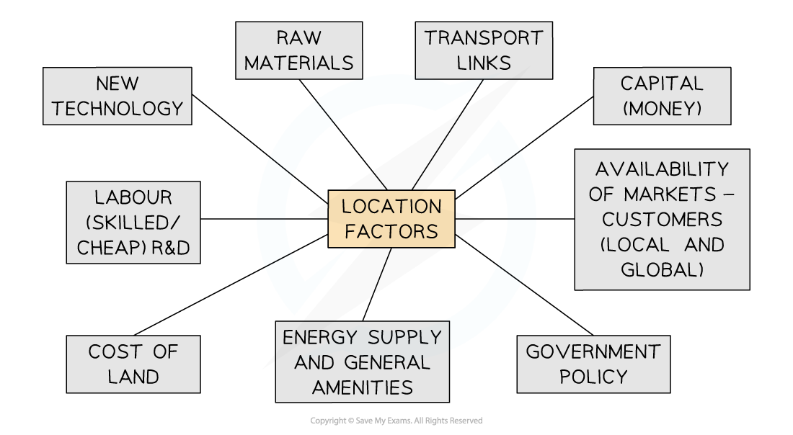

# Distribution of Industrial Zones

## Distribution & Location of Factories & Industrial Zones

> **Spec point** — `spcpt_5fgJnH7sbVxtq8Zx` · Describe & explain the factors influencing the distribution & location of factories & industrial zones

## Distribution & Location of Factories & Industrial Zones

- Every day, companies make decisions about where to locate their industries
- Different industries require different **inputs,**
- But they also require them to be readily and cheaply available

- Most companies look for the least cost but highest profit location
- Manufacturers need to find the **optimum location** that will produce maximum profit
- This depends on a number of factors—physical, human and economic

### Physical factors

- **Raw materials**: industries that need heavy or bulky materials will locate as near as possible to these materials
- **Site **availability and cost of land are important. Large factories need flat, well-drained land with or without the potential for expansion later on
- **Climate: industries** such as aerospace and film benefit from sunnier climates. A good climate also reduces energy bills and a better quality of life
- **Energy-demanding** industries may relocate to countries/areas with readily available or cheaper energy
- **Natural routeways**—harbours, motorways, airports and railways—provide good locations for ports and industrial complexes, which create good access points for inputs but also outputs
- **Water supplies**: some industries (paper and cotton processing, etc.) require a lot of water in their manufacturing and so need to be near a reliable water supply such as lakes, rivers, etc.

### Human and economic factors

- **Capital: some** areas naturally attract inward investment as the returns will be higher
- **Markets: location** and size of the potential market are major influence for some industries
- **Government influence—incentives,** grants and policies can make areas attractive for industries to invest in
- **Transport: the cost** of transport is expensive and accessibility for easy access helps to reduce those costs. Central to motorways, railways, ports and airports can influence where industry locates
- **Communications**: being able to communicate effectively and quickly with customers and suppliers is vital to successful manufacturing
- **Labour force: quality** and cost of labour are central to effective manufacturing; having a reliable workforce is necessary, but also mobility, turnover and reputation are also factors
- **Quality of life**: highly skilled workers will prefer areas where the work/life balance is good

> **Exam Hint**
> Remember, no one factor decides the location of an industry but a combination of them and most companies look for the least cost with the highest profit location.

### High-tech industry

- High-tech companies are involved in research and development, aerospace technology, weapons guidance systems, medical robotics, software, computer hardware, and other technically advanced products
- High-tech industries are usually grouped together in science parks
- Usually close to the university or a research centre with good security systems
- Purpose built to encourage research and development (R&D), high-tech industries and other quaternary activities
- Close to transport networks (including airports) to allow for knowledge transfer
- Further away from housing estates and retail parks to reduce sound, air and visual pollution

> **Worked Example**
> **Give an example of a science park and its location **
> 
> - **Example Southampton Science Park**
> - In a prime location close to the London M3 motorway, the 17-hectare park provides high-quality office and laboratory space in attractive landscaped surroundings. Over 60 companies, dealing in high-tech research fields, sit side by side, resulting in a thriving community of young and old sharing ideas and knowledge. The park's advantageous location, quality surroundings, and accessibility to some of the UK's top scientific talent at the University of Southampton all draw people in.

### Changes to manufacturing and location over time

- **Raw Materials: sources** of raw materials often run out

  - Manufactures will move in response
  - Infrastructure means business not tied to energy centres—coalfields, etc.
- **Rising costs:** wage levels, laws, etc. means costs go up in MICs so work moves elsewhere (e.g. manufacturing)
- **Transport:** commuting & migrating easier because there are now fewer barriers to travel
- **Competition:** fewer people are needed to complete work now, e.g. banking uses ICT
- **Technology:** advances in ICT mean more work from home, air travel, etc.
- **Outsourcing:** saves money; work sent elsewhere to save costs (e.g. call centres)

- As an economy advances, the proportion of people employed in each sector changes
- Places like the UK and the USA are ‘post-industrial societies’, where most work in the tertiary or quaternary sectors
- Places such as China and India are ‘industrial societies’, where many people work in the secondary sector
- Bolivia and Mozambique are ‘pre-industrial societies’, where most people work in the primary sector

> **Worked Example**
> **Study the photograph and suggest three reasons why the location was chosen for the retail park. **
> 
> **[3 Marks]**
> 
> 
> 
> *A Retail Park*
> 
> **Final answer:** **Answer**
> 
> - Any three of the following:
> 
>   - Close to a main road for accessibility **[1]**
>   - Flat land** [1]**
>   - Houses nearby for workers/customers **[1]**
>   - Space for car parking **[1]**
>   - Room for expansion** [1]**

## Case Study - Manufacturing Industry: Pakistan’s Iron & Steel Industry

> **Spec point** — `spcpt_6F3QD7683JSGsmy8` · An industrial zone or factory

## Case Study: Manufacturing Industry: Pakistan’s Iron & Steel Industry

#### Location

- Pipri, near Gharo Creek, Flat, cheap land near Port Qasim, which has a natural harbour to import raw materials and export steel
- Close to market: steel-using industries in Karachi, such as tool making
- Along a railway: Karachi-Pipri-Kotri and metalled road

#### Inputs

- Iron ore
- Coke
- Limestone
- Scrap iron
- Water required for making steel brought from Lake Haleji
- Economic assistance from Russia: technical expertise and capital
- Availability of cheap labour from Karachi
- Energy source from Pipri thermal power station and Karachi nuclear power station

#### Processes

- Heating of ore to separate iron
- Burning coke
- Rolling into sheets and cutting into lengths

#### Output

- Cast iron and pig iron
- Slag
- Gases: sulphur dioxide, carbon dioxide, nitrous oxide, hydrogen sulphide

#### Impact

- Noise pollution from machinery
- Visual pollution due to large, ugly factory buildings
- Air pollution from burning iron ore
- Water pollution from contaminated cooling water, scrubber effluent and ships supplying raw materials
- Depleted fresh water supplies
- Risk of fire and explosions
