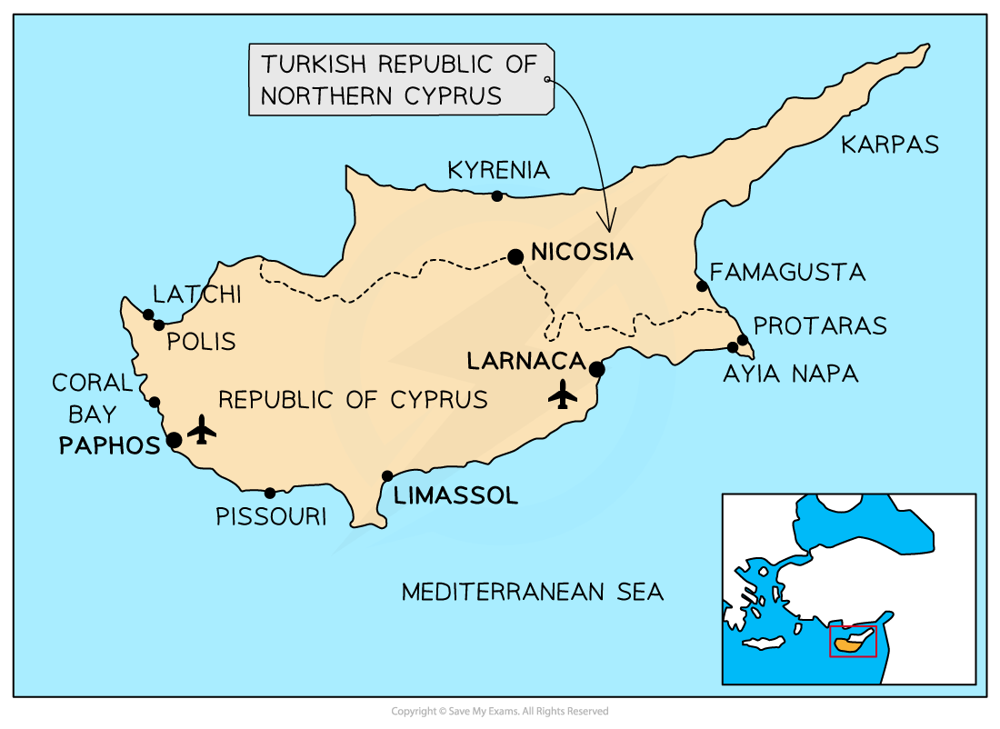

# Management of Tourism

## Management of Tourism

> **Spec point** — `spcpt_KMWmrRCBGrXNQd7s` · Demonstrate an understanding that careful management of tourism is required in order for it to be sustainable

## Management of Tourism

- Tourism is so widespread that it needs to be managed
- Key tourist locations seek **sustainability** to maintain their economies and landscapes
- Not all sustainable tourism schemes work, and some have been more successful than others

### Sustainable tourism

- Designed to sustain environmental, social, and economic standards without affecting current regions
- With finite resources, tourism's impact is becoming an issue
- People and environmental groups are becoming more aware of the ***destination footprint*** and urge people to:

  - Fly less and stay longer
  - Consider slow travel
  - Stay local
  - Avoid international chain hotels and inclusive holidays
  - Carbon-offset their flight

### Ecotourism

- The most easily recognised of sustainable tourism
- This speciality tourism takes small groups to coral reefs, tropical rainforests, remote mountain locations, Antarctica, and other protected areas
- Community-based tourism is growing in fragile LEDCs, benefiting the local community and creating jobs

#### Ecotourism in Bhutan

- Ecotourism involves minimising visitors' **carbon footprint** to benefit the community and environment
- Despite being one of the poorest developing nations, Bhutan has one of the most sustainable tourism sectors
- Bhutan is one of the world's most exclusive tourist destinations due to its stunning natural environment, authenticity, remoteness, and well-protected cultural legacy
- Unlike commercial ecotourism companies, Bhutan's government has adopted 'high value but low volume' tourism, generating exclusivity
- Bhutan opened its gates to tourists in 1974 after 300 years of isolation
- It was realised that hotels built for the King's coronation might be used to house paying guests, raising foreign exchange and providing much-needed cash for the country's development

  - Initial foreign visits were limited to 2500; presently they've increased, increasing exclusivity
  - All tourists must go on approved tour companies in groups to certain places and a \$200 (£167) daily **'Sustainable Development Fee' **is required
- The sustainable development fee offsets tourists' carbon footprint, upskills workers, and protects Bhutan's heritage and mountain splendour
- Some say it only attracts wealthy tourists and promotes Bhutan as a speciality destination; however, Bhutan's strategy manages tourist volume and impact

### Protected areas

- This involves protecting vast areas from development
- **National Parks:** Yellowstone was the first to be established in 1872 and now there are more than 4000 worldwide
- Many countries have National Forests, Country Parks, **Areas of Outstanding Natural Beauty,** **World Heritage Sites** and other areas considered important to protect

### Tourist hubs

- Concentration of tourism into one particular area of a country or region
- Impacts are seen to be kept to one place
- However, it is difficult to keep tourism within boundaries and overspill occurs
- Any benefits are kept within that area and not spread throughout the community
- Creates division within the area

### Quotas

- The number of tourists would not be allowed to exceed a sustainable level
- Based on a lottery system of so many places being available
- This can be difficult to administer and causes tension
- Conservation areas have permits allowing visitors to see unique areas or animals—coral reefs, mountain gorillas, Galapagos Islands, etc

> **Exam Hint**
> It is important that you don't confuse conservation with preservation
> 
> Preservation is about keeping something exactly as is, with no option for development
> 
> Whereas conservation allows development to occur, providing it doesn't detract from the character of the area

## Case Study - Importance of Tourism to Cyprus

> **Spec point** — `spcpt_zVb5kRpgK7Kb3hQJ` · An area where tourism is important

## Case Study: Importance of Tourism to Cyprus

- Tourism is important to Cyprus as it provides thousands of jobs and contributes an average of 20% to the country's GDP
- Cyprus island is ***partitioned*** into the Turkish Northern Cyprus and the Greek Cypriot Republic of Cyprus
- This case study will focus on the southern Greek island area
- Cyprus' Mediterranean climate offers hot, dry summers (average 28°C) and rainy winters (10°C)
- Annual demand for water exceeds supply, making Cyprus 'water poor'
- **Desalination **facilities are used more, which increases energy consumption but only meets 45% of demand and harms the environment
- The **Cyprus Sustainable Tourism Initiative (CSTI)** was founded in 2006 to promote sustainable tourism in Cyprus
- The initiative:

  - Helps tourism-disadvantaged communities live better
  - Conserve and safeguard Cyprus's environment while exploiting its natural resources sustainably
  - Reduces tourism-related carbon emissions
  - Promote sustainability education and research
  - Some projects include:
  
    - Water, energy, and water management
    - Hotels use up to 22% of their water on gardens and landscaping
    - Use less grass and exotic plants, which need frequent watering
    - Native flora are representative of Cyprus and respond to less rainfall; thus, hotels should utilise them
    - Fewer swimming pools
- Increased use of renewable energy;

  - Cyprus relies on solar power
  - Energy-saving technologies in hotels and public spaces
  - Plastic use and waste should be reduced
- Enhanced beach conditions with coordinated cleaning events

  - Working with tourism to minimise single-use plastics in Ayia Napa and other tourist destinations
  - Conduct turtle watches during hatching to ensure hatchlings reach the sea and not hotel establishments
- Encourage rural tourism to support disadvantaged areas through art, history, accommodation, and local events
- Most tourists arrive by plane and explore Cyprus by car or coach, making it difficult to reduce Cyprus's carbon impact

