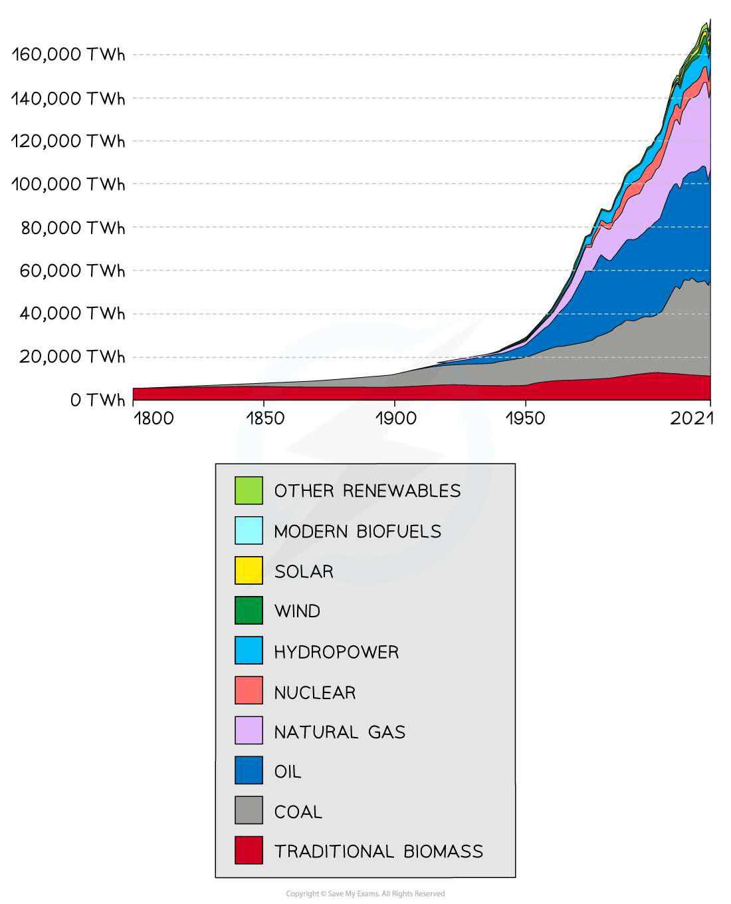
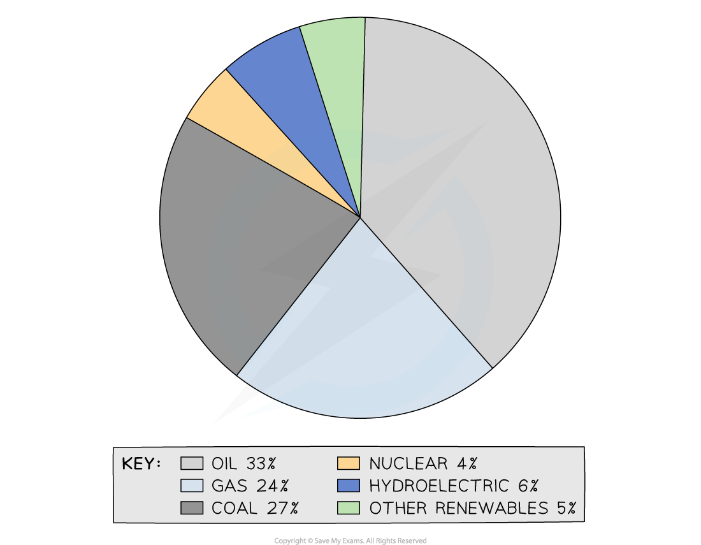
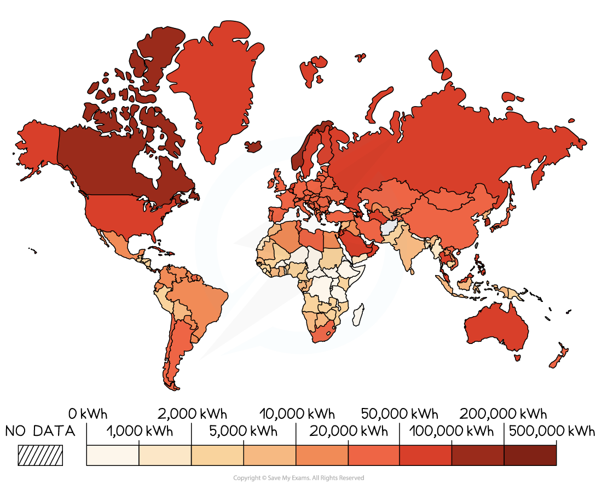
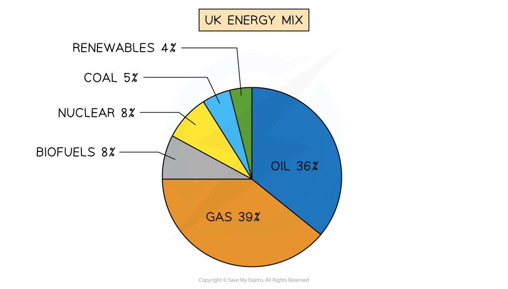
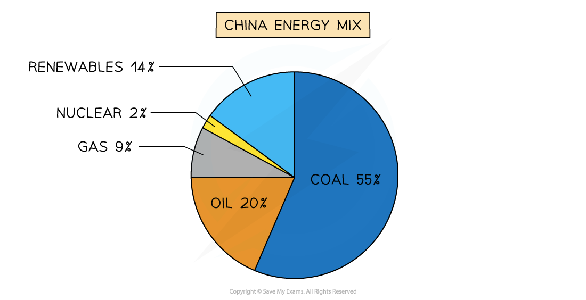

# Non-Renewble Fossil Fuels

## Importance of Non-Renewable Fossil Fuels

> **Spec point** — `spcpt_6jWvQFvstNYdyGcB` · Importance of non-renewable fossil fuels globally and in different countries at different levels of development

## Importance of Non-Renewable Fossil Fuels

- Global energy demand is rising rapidly
- Population growth and development are the key drivers of increased energy consumption because

  - **Food production**:
  
    - The **higher demand for food** leads to more **intensive farming,** which needs more energy for machines, light and heat
  - **Industrial growth**:
  
    - Factories need energy for operations, heating, and lighting
  - **Transportation:**
  
    - Increased movement relies on petrol, diesel, and electricity
  - **Urbanisation**:
  
    - Increasing urban population use domestic appliances, heating, and lighting
  - **Economic development**:
  
    - **Rising wealth** leads to people buying more appliances and technology that need energy

*Graph showing world energy demand by source.*

- Over 80% of the world's energy is provided by **fossil fuels** (coal, oil and gas)

  - 33% oil
  - 27% coal
  - 24% gas
- Fossil fuels are fuels formed from the remains of living organisms (plants/animals)

  - These are **non-renewable **as they cannot be replaced at a speed that keeps up with consumption
- It is estimated that based on current use and availability, gas and oil will run out by 2080

*World energy mix*

- The use of nuclear and renewable energy is growing but non-renewable fossil fuels still **dominate energy production**
- It is predicted that the use of gas and oil will continue to increase over the next 30 years

  - Fossil fuels are expected to still provide over 75% of the world's energy by 2040

### Coal

#### Advantages

- World reserves estimated at 120 years
- **Reliable **and easy to produce energy from
- Technology has enabled coal to be obtained more easily

#### Disadvantages

- **Non-renewable—**it will run out
- **Releases carbon dioxide** (greenhouse gas) and sulphur dioxide (causes acid rain) when burnt
- **Heavy and bulky **to transport
- Most accessible coal has been used and so the cost of production has increased as coal reserves are more difficult to access
- Risk of accidents due to mine collapse and gas release
- Opencast mining damages large areas of the environment

### Oil and gas

#### Advantages

- **Reliable **and easy to produce energy from
- Efficient—it has a high energy density so it produces a lot of energy per kilogram
- Not as harmful to the environment as coal (gas is the least harmful)
- Easy to transport via pipeline

#### Disadvantages

- World reserves estimated to be between 50-60 years
- **Non-renewable—**they will run out
- The gases released when they are burnt are **greenhouse gases**
- Oil spills damage the environment and wildlife over large areas
- Prices fluctuate rapidly
- Supplies can be affected by conflict and political disagreements, e.g. the war in Ukraine

### Energy use

- MEDCs usually use more energy than LEDCs

  - Countries with the highest energy consumption per person tend to be MEDCs and include Canada, Norway and Saudi Arabia
  - Countries with the lowest energy consumption per person are LEDCs, which are all in Africa and include Niger, Chad and Tanzania
- The greatest growth in energy use in LEDCs and newly emerging economies such as China and India
- Development means more use of energy in

  - businesses and factories
  - homes as people buy more appliances and technology
  - transport

*Energy use per person in kwh*

### Energy security

- An **energy gap** is when a country cannot meet the demand for energy using its own resources
- When countries have an energy gap, they have to import energy to meet the demand
- Having an energy gap means that a country is not **energy-secure**
- To be energy secure, a country needs an

  - **uninterrupted **supply of energy
  - **affordable** supply
  - **accessible **supply
- The UK has a **widening energy gap** and is **not energy secure** because:

  - Renewable energy is not as efficient and so cannot replace full energy from fossil fuels
  - It is cheaper to import fossil fuels than it is to exploit the resources in the UK
- The commitment of many countries to tackling climate change and reducing the use of fossil fuels has **increased energy insecurity** in many countries
- Energy security can also be affected by:

  - energy sources running out
  - war/conflict
  - natural hazards
  - political disputes

### Energy mix

- The energy mix in countries varies depending on the level of development
- The most economically developed countries have a wider use of renewables and nuclear energy

- The newly emerging countries are more dependent on fossil fuels

- The least economically developed countries are dominated by biofuels, which are mostly ***fuel wood*** used for heating and cooking, particularly in rural areas

> **Worked Example**
> **Table 1 shows energy consumption in the USA in 2007 and 2016.**
> 
> ***Table 1***
> 
> 
> 
> **Describe the changes in non-renewable energy consumption shown in Table 1.**
> 
> **[3 marks]**
> 
> **Final answer:** **Answer**
> 
> - Coal has decreased from 22.9% to 14.6% **[1]**
> - Gas has increased from 23.3% to 29.2% **[1]**
> - Oil has decreased slightly from 37.5% to 36.9% **[1]**
> - Uranium has decreased slightly by 0.1% **[1]**
