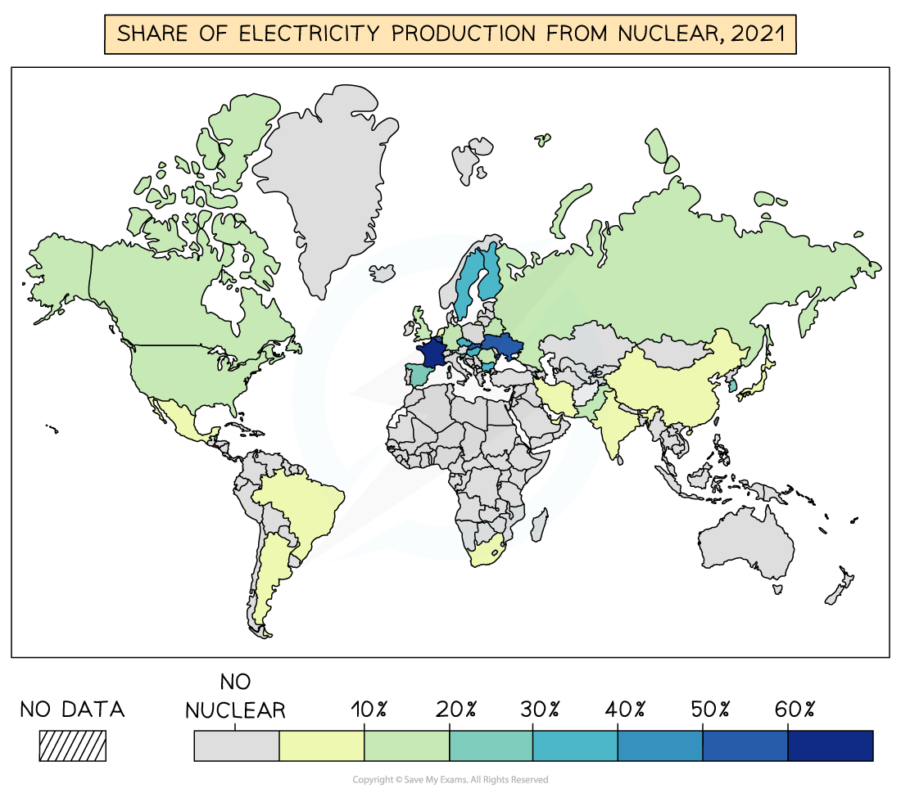

# Nuclear Energy & Fuelwood

## Nuclear Energy & Fuelwood

> **Spec point** — `spcpt_jZgSjP5z5XNzTmm3` · Importance of nuclear energy & fuelwood globally and in different countries at different levels of development

## Nuclear Energy & Fuelwood

### Nuclear energy

- Nuclear fuel has the potential to provide large amounts of energy
- It is often used countries who do not have their own supplies of fossil fuels such as France

*Share of electricity production from nuclear.*

- In 2019, approximately 4% of the global primary energy supply was from nuclear power
- There are 439 active nuclear reactors across the world
- Most of these are in just five countries:

  - USA (92)
  - France (56)
  - China (54)
  - Russia (37)
  - Japan (33)

#### Controversy

- Nuclear energy is controversial due to the issues surrounding waste disposal and nuclear accidents
- **Three Mile Island** in the USA in 1979

  - Partial meltdown of the nuclear reactor
  - Slight increase in cancer rates in the area affected by the release of radioactive contamination
- **Chernobyl, **Ukraine (at the time part of the USSR) was the site of a reactor explosion in 1986

  - 50 direct deaths (UN estimate)
  - An estimated 4000 people have or will die as a result of exposure to radioactive materials
  - Radioactive fallout entered the atmosphere and fell over a large area, including Scandinavia and the UK
- The **Fukushima **nuclear reactor failed in Japan in 2011

  - The tsunami that resulted from the 2011 earthquake flooded parts of the power station, causing a loss of power, which meant they lost the ability to cool the reactor. This led to explosions, a meltdown of the reactor and the release of radioactive contamination
  - 154,000 people evacuated
  - There has been an increase in thyroid cancers in the area since 2011 but this may be that more are being detected due to the screening program established after the event

#### Advantages and disadvantages of nuclear energy

#### Advantages

- No greenhouse gas emissions
- Efficient
- Small amounts of uranium are needed, and large reserves are available
- It is not bulky so it is easy to transport
- Reduces reliance on fossil fuels
- Increases energy security

#### Disadvantages

- Nuclear waste is radioactive and expensive to dispose of
- Power stations are expensive
- Risk of nuclear accidents
- Possible health impacts in the areas around nuclear power stations
- The cost of decommissioning (shutting down) is very high
- Risk of use of nuclear fuel by terrorists or ***rogue states***

> **Worked Example**
> **Describe the advantages of using nuclear power to generate electricity.**
> 
> **[3 Marks]**
> 
> **Final answer:** **Answer**
> 
> - Only small amounts of uranium/fuel are needed (to generate large amounts of power); it is efficient **[1]**
> - Uranium will not run out in the foreseeable future **[1]**
> - Does not produce greenhouse gases/acid rain **[1]**
> - Improved regulation and safety record **[1]**
> - Reduces reliance on fossil fuels **[1]**
> - Increases energy security **[1]**

> **Exam Hint**
> Remember, nuclear fuel is **non-renewable **because uranium cannot be replaced at the speed it is being used. It is not a fossil fuel because it uses uranium rather than a fuel formed from the remains of living organisms.

### Fuelwood

- It is estimated that between 2 and 3 billion people across the world rely on fuelwood for heating and cooking

  - This is usually because they do not have access to other forms of energy
- Approximately 13% of the world's population does not have access to electricity

  - This is mostly an issue in LEDCs within Sub-Saharan Africa and Asia
- Fuelwood is often included as a** biofuel **but the wood is not usually grown specifically for use in heating and cooking

  - The trees felled are not replaced, which would make them sustainable
- The reasons for this include

  - It is free
  - It does not require technology
  - That it can be renewable if the trees are replaced
  - No high-technology equipment is needed to use the fuel
- There are disadvantages to this reliance on fuelwood:

  - The use of fuelwood contributes to **deforestation**, **soil erosion** and **desertification** in many countries
  - The amount of wood cut each year is greater than the rate of replanting and regrowth
  
    - In many areas, there is little wood left, and people have to walk further and further to collect it
  - Indoor pollution leads to health issues from exposure to smoke. It is estimated that it is responsible for 1.5 million deaths each year in LEDCs

> **Worked Example**
> **Explain the importance of fuelwood to people in many countries.**
> 
> **[3 marks]**
> 
> **Final answer:** **Answer**
> 
> - Important in LEDCs** [1]**
> - Important in rural areas **[1]**
> - May be free to the user **[1]**
> - Does not require high-technology equipment **[1]**
> - Fuels for heating/cooking **[1]**
> - Can be renewable/sustainable **[1]**
> - In some areas, there is little wood left **[1]**
> - Can be sold by the roadside as a cash crop **[1]**

## Case Study: Nepal

> **Spec point** — `spcpt_q657vFsdzDg9K9QG` · Energy Supply in a country or area

## Case Study: Nepal

- There are examples of energy use in every country
- The example below is of an LEDC (developing) country and can be used in the final exam to give place-specific detail

> **Case Study**
> - Nepal is a developing country located between China and India
> - The landscape is **mountainous** and includes much of the Himalayas
> - Nepal is* landlocked*
> - The population is rural, with only 16% of the population living in towns and cities
> - Energy demand is **very low **but growing as the country develops
> 
> 
> 
> *Energy use per person in Nepal and UK*
> 
> ### Energy mix
> 
> - The main source of energy for 82% of the rural population is **fuelwood**
> - In urban areas, the use of fuelwood is 36%
> - Nepal has no suitable coal, oil or gas reserves, so these have to be imported
> - 98% of all electricity in Nepal is generated through hydropower
> 
> 
> 
> *Energy mix in Nepal*
> 
> ### Sustainable future
> 
> - Access to electricity has increased rapidly over the past 15 years:
> 
>   - 88% of the population now have access to electricity
> - Support from the World Bank has led to more investment in hydropower
> - There are now over **3000 micro-hydro** plants in Nepal
> 
> #### Ruma Khola micro-hydro
> 
> - Completed in 2009
> - Provides electricity for the town of **Darbang** and five neighbouring villages
> - It supplies energy for 22 industries, including:
> 
>   - metal workshops, furniture manufacturers, cement block manufacturers, a noodle factory, poultry farms and dairy farms
> - Built and operated by the community, the micro-hydro plant was funded using grants from the government with support from the** World Bank**
> - The loans are paid back using money that the community pays for the electricity supply
> - It has improved the standard of living in the communities
> - Reliance on kerosene and fuelwood has reduced and emissions have fallen
> - Deforestation has decreased
