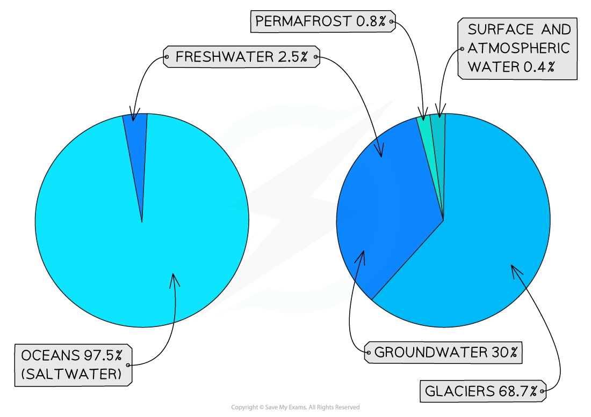
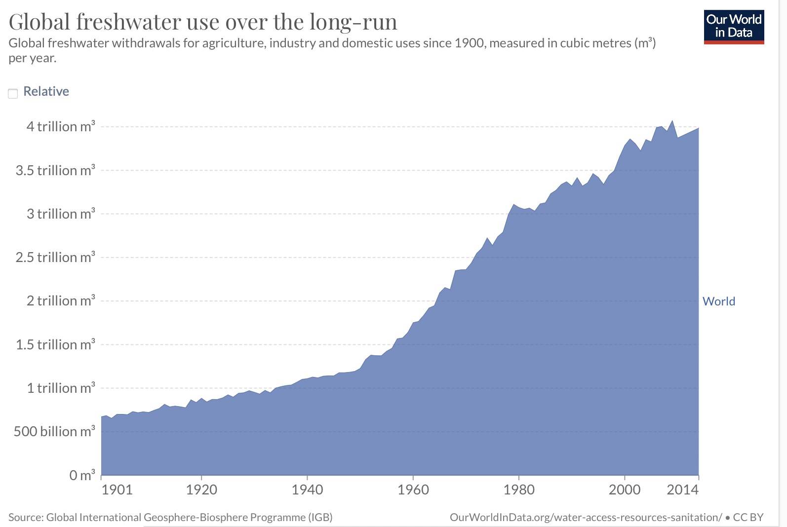
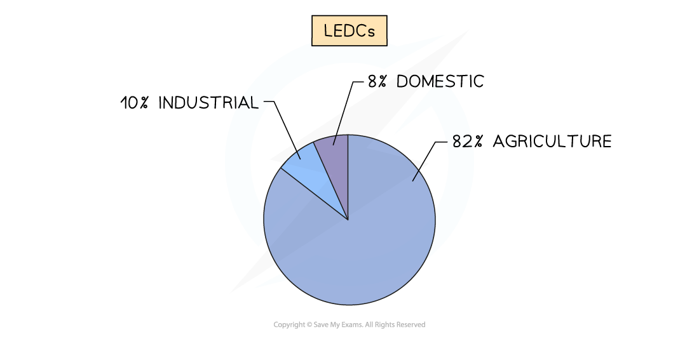

# Water Supply and Use

## Global Water Supplies

> **Spec point** — `spcpt_zZ94wQPJTf2xFspY` · Describe methods of water supply & the prooprtions used for agriculture, domestic & industrial purposes in countries at different levels of economic development

## Global Water Supplies

### Global water supply

- Only **2.5%** of the water on Earth is ***freshwater***
- Approximately** 68.7%** of freshwater is stored in glaciers and ice sheets and **30%** is groundwater
- The remaining **1.3%** of freshwater is in rivers, soil moisture, lakes and the atmosphere

  - This is not evenly distributed across the globe—Canada contains more lakes than the rest of the world combined

*Pie chart showing sources of water.*

*(note: due to rounding of figures, the % on the pie chart to the right adds up to 99.9%)*

### Water supply

- The supply of water humans use comes from three main sources:

  - Lakes and rivers
  - ***Aquifers***
  - ***Reservoirs***
- Other sources of water supply include:

  - ***Desalination***
  - Rainwater harvesting—collecting water that falls as precipitation

#### Groundwater/aquifer

- Water stored underground
- The water has filtered through soil and rocks
- It is obtained by drilling boreholes or digging wells
- When all the rock is fully **saturated** with water, it is an **aquifer**
- Groundwater may also come to the surface as a spring
- Issues with groundwater/aquifers include:

  - Overuse or **over-abstraction **of water in some areas means that aquifers do not have time to **recharge** through precipitation
  - **Pollution** from industry, agriculture and domestic waste can leach into the groundwater

#### Surface water

- Water is stored in lakes, reservoirs, and rivers
- Issues with surface water include:

  - **Pollution** from industry, agriculture and domestic waste can enter the water system through surface runoff
  - Dams are used to store water in reservoirs, but the construction of dams has slowed due to a lack of suitable sites and concerns regarding the environmental impact

#### Desalination

- The removal of salt from seawater means that it can be used for domestic, agricultural and industrial purposes
- Issues with desalination include:

  - Expensive to set up and run
  - Desalination plants use a lot of energy

### Global water use

- Global water use by sector is:

  - **70%** agriculture—irrigation of crops and water for livestock
  - **20%** industry—producing goods and generating energy
  - **10%** domestic—toilets, cooking, cleaning, washing
- The use by sector varies across countries depending on whether they are MEDCs or LEDCs

#### Water demand

- The global demand for water is increasing
- Between 1934 and 2014, demand increased from 1 trillion m3 to 4 trillion m3

*Graph depicting global freshwater use from 1900 to 2014*

#### Water use in MEDCs

- 11% Domestic
- 30% Agriculture
- 59% Industry

#### Water demand in MEDCs

- The water demand in MEDCs is higher than in LEDCs for the following reasons:

  - Improving **living standards—**people have more appliances/sanitation that use water
  - Increased use of water in** leisure and tourism—**water parks, golf courses
  - Increased** urbanisation**
  - Increasing** industry—**water is needed for the production of goods and energy production
  - Increasing use in** agriculture—**more water is needed for livestock
- The largest use of water in MEDCs tends to be industry

#### Water use in LEDCs

*Water use in LEDCs*

#### Water demand in LEDCs

- Unlike MEDCs, water use in LEDCs is mostly used for agriculture
- Many people are still dependent on agriculture
- There is far less industry in many LEDCs so the demand for water for industrial processes is low
- Many people in LEDCs do not have access to piped water and, as a result, are more cautious with water use

> **Worked Example**
> **Study Fig 1, which is a map showing information about the percentage of the population in each country with access to clean drinking water.**
> 
> 
> 
> ***Fig 1***
> 
> **Describe the distribution of countries where 75% or less of the population have access to clean drinking water.**
> 
> **[3 marks]**
> 
> **Final answer:** **Answer **
> 
> - Mainly/most in Africa** [1]**
> - Except Egypt and South Africa/except in North and South **[1]**
> - A few/some in Asia **[1]**
> - Near/on the equator, mainly in the tropics, between the Tropics of Cancer and Capricorn, Central Africa, and sub-Saharan Africa **[1]**
> - Uneven/clustered **[1]**

> **Exam Hint**
> When describing the distribution from a map, ask yourself the following questions:
> 
> - What is the general pattern?
> - Does the pattern relate to anything else for example, the location of LEDCs and MEDCs?
> - Are they near the equator or further away?
> - Is the pattern uneven or clustered?
> 
> Use map features to help with your description: place names (countries and continents), compass rose, latitude and longitude, the equator and the tropics.
