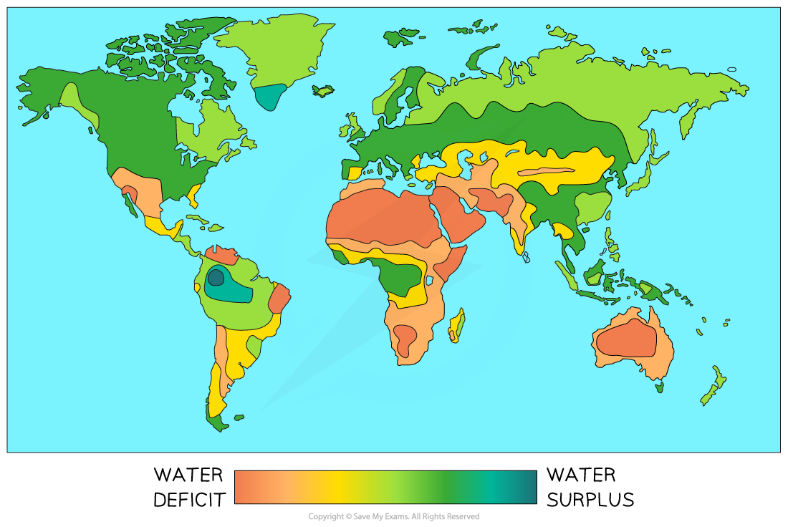
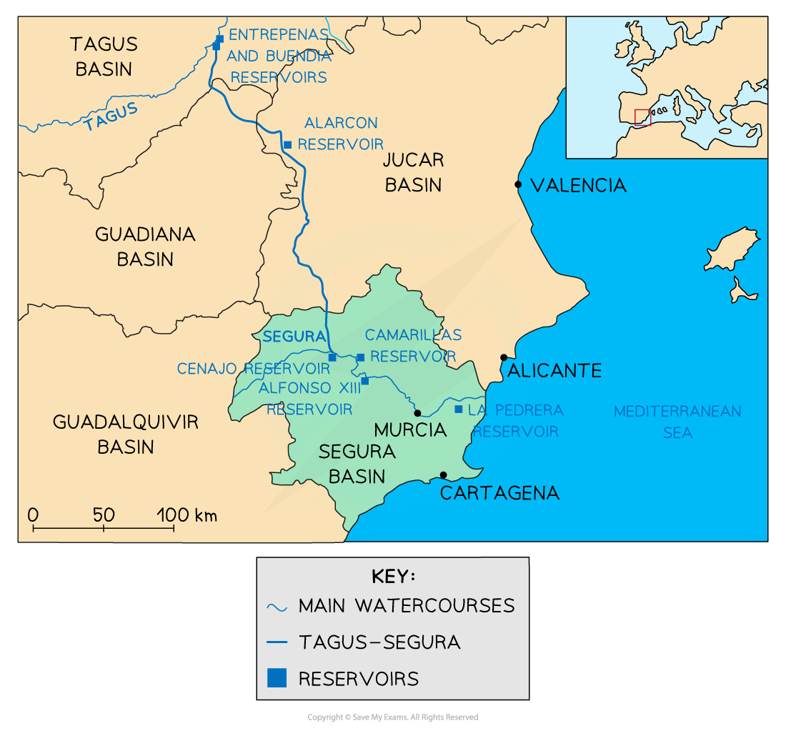

# Water Shortages

## Water Shortages and Management

> **Spec point** — `spcpt_TYPRFxhS6bT3TxMY` · Explain why there are water shortages in some area and demonstrate that careful management is required to ensure future supplies

## Water Shortages and Management

### Water shortages (deficit)

- Many areas of the world have water shortages** (deficits)**
- Water deficit can be due to:

  - **Low supply**:
  
    - Lack of precipitation
    - High levels of evaporation
    - Poor water management
    - *D****rought***
    - Pollution
  - **High demand**:
  
    - Increasing population
    - Industry
    - Agriculture
  - A **combination **of low supply and high demand
- Areas with the greatest water-deficit include:

  - Australia
  - North, East and South Africa
  - Middle East
  - Southwest USA
  - East Brazil, parts of Argentina and Chile
  - India
- These tend to be areas around the Tropic of Cancer and Tropic of Capricorn

*Water surplus and deficit*

- There are different levels of water shortage:

  - **Water stress** occurs when the supply of water is **below 1700 m****3** a year per person
  - **Water scarcity** is when the supply is **below 1000 m³ **a year per person
- There are two types of water scarcity:

  - **Physical water scarcity—**when physical access to water is limited due to the climate conditions of the area
  - **Economic water scarcity—**when a population does not have the money to utilise the available water resources
- The UN** Millennium Development Goals (MDG) **included Goal 7

> **blockquote**
> "*Halve by 2015 the proportion of the population without sustainable access to safe drinking water and basic sanitation.*"

- This goal was not met but access to clean water has improved
- In 2020, 74% of the world's population now have access to clean water supplies

- In some areas, there may be water supply, but this is not ***potable***

  - UNICEF estimates **2.2 billion** people do not have access to potable (clean drinking) water
  - Around **4.2 billion** people** **do not have access to safely managed sanitation services

- Water scarcity is expected to increase across the world due to:

  - increasing population
  - development increasing demand
  - climate change increasing aridity
  - pollution

### Causes of water shortage

- Many of these areas have a **deficit** due to **low precipitation** throughout the year or **drought **
- **Demand** is greater than supply in some countries due to increasing population, industry and agriculture
- In some areas, rivers flow through many countries

  - This leads to issues with water ***abstraction*** and other activities
  - The **upstream** country may:
  
    - take large amounts of water from the river for agriculture, industry or domestic use, leaving less for the country further downstream
    - build dams or alter river flow, which impacts discharge downstream
    - reduce water quality by introducing pollution to the river
- **Higher temperatures** may lead to increased evaporation and transpiration, reducing the amount of water available
- The type of land use

  - Agriculture leads to increased water consumption
- In some countries, there is a disparity in water supply between areas

  - China has severe water shortages in the north but water is more available in the south
- Conflict

  - Many of the LEDCs who have struggled to meet the MDG are experiencing conflict

#### Impacts of water shortage

- There are many impacts of water shortages, including:

  - Death and illness due to **waterborne diseases** such as cholera and dysentery
  - Potential for **conflicts** over water supply, particularly where countries share a river basin
  - Children in rural areas in LEDCs often miss out on school as they are responsible for collecting water (they may have to walk miles to the nearest water source)
  - **Lack of food** due to:
  
    - Crops cannot be irrigated so yields are lower
    - Livestock dies due to lack of water
  - **Damaged ecosystems** and loss of habitats
  - Delayed **economic development** because water is not available for industry

### Managing water supply

- There are many ways in which water supply can be managed but this is easier in MEDCs, where the money to implement these schemes is available

#### Industry

- Most water in MEDCs is used for industry
- Some of this water could be recycled and used again within the process to reduce consumption

#### Agriculture

- Drip irrigation, which delivers water to the roots of plants
- Irrigation leads to 40% of the water used being lost to evaporation and poor management
- Drip irrigation reduces this loss significantly

#### Domestic

- Water-efficient appliances
- Rainwater collection
- Use of grey water for washing cars and watering plants
- Low-flush toilets and water-saving shower heads
- Water companies fixing leaks and improving efficiency

- In LEDCs, water management is more difficult due to a lack of funding
- The involvement of **non-governmental organisations (NGOs),** such as Water Aid, helps to fund projects
- ***Appropriate technology*** is essential to manage water in LEDCs; they include:

  - wells
  - **gravity-fed systems** where water is piped from a spring or river higher up a valley
  - boreholes use a hand pump to bring water to the surface
  - rainwater collection from roofs
  - drip irrigation
  - drought-resistant crops

> **Exam Hint**
> Remember when interpreting maps to pay close attention to the key and title.
> 
> In the above example, the map shows the surplus and deficit of water supply on a sliding scale. Areas of greatest water surplus are dark blue and areas of greatest water deficit are dark orange.

## Case Study: Spain

> **Spec point** — `spcpt_cvszhD9Zr5yzpmCP` · Water supply in a country or area

## Case Study: Spain

- The **average precipitation** in southeast Spain is approximately 365 mm a year
- Most precipitation occurs in winter
- The area is one of the** driest** in Europe
- Agriculture uses** 80%** of the water available

  - **147,000 hectares** of land require irrigation
- Regular **droughts** mean the supply of water is further reduced
- There is a **water deficit** as demand exceeds supply
- Tourism increases the problem because:

  - Water parks and golf courses use significant quantities of water
  - An average tourist uses between **450 and 800 litres** per day
  - An average Spaniard uses **127 litres** per day

### Tagus-Segura Project

- Completed in 1978
- Over** 60% **of the water flowing into the Tagus is transferred
- A **286 km** pipeline that connects four Spanish river basins: **Tagus,** **Jucar**, **Segura** and **Guadiana**
- The aim was to supply **Alicante**, **Murcia** and **Cartagena** in the **southeast **to reduce the water deficit

*Map showing the Tagus-Segura project*

### Issues

- Much of the water transferred went to the tourist and leisure users, not to small-scale farmers
- **Water consumption** in the southeast **increased** due to an increase in supply
- It is estimated that **15%** of the transferred water is being illegally used by leisure users such as golf courses
- Large commercial farms are benefitting more than small-scale farmers

### Ebro project

- A second water transfer project was proposed in 2001 to transfer water from the River Ebro
- This project was abandoned due to the

  - failure and issues with the Tagus-Segura project
  - cost
  - threat to the Ebro Delta, as the scheme would have disrupted sediment flow to the delta
- Spain has now moved to utilising **desalination** plants to meet the demand for water
