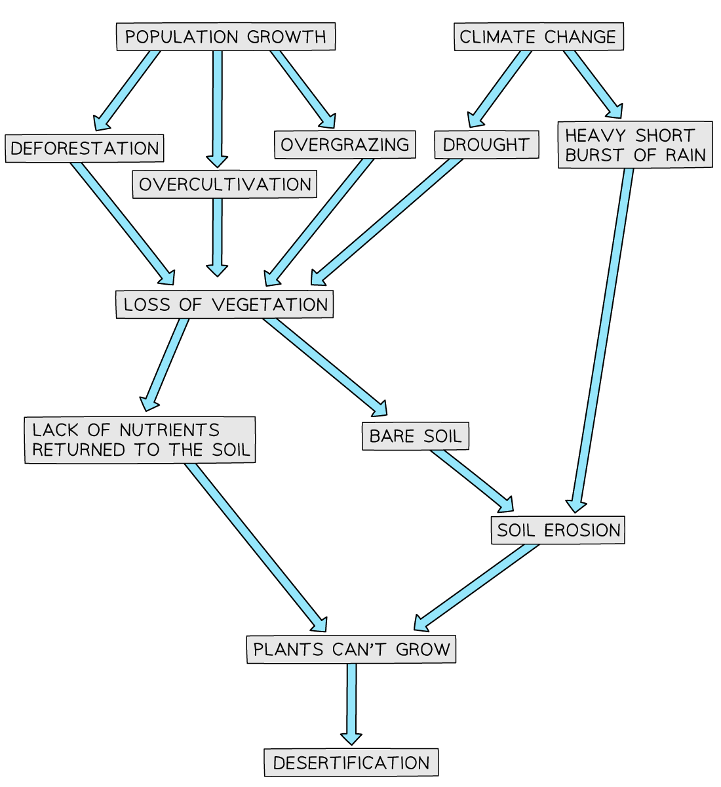
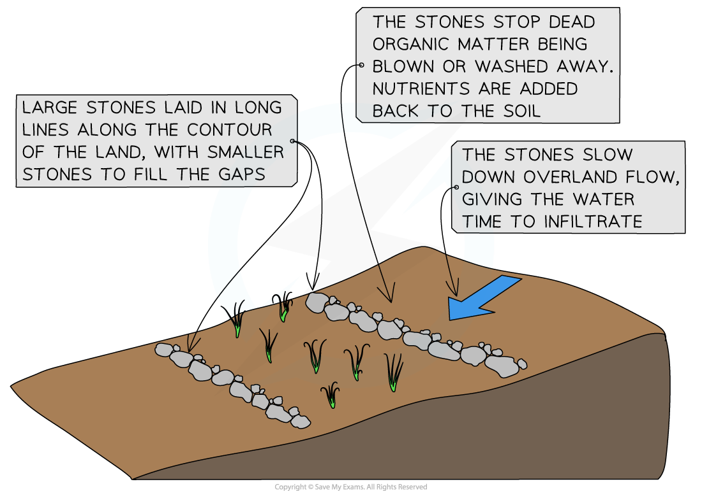

# Soil Erosion & Desertification

## Soil Erosion & Desertification

> **Spec point** — `spcpt_yPZdD7CXCtd4N3rf` · Describe how economic activities may pose threats to the natural environment & people, locally & globally

## Soil Erosion & Desertification

### Soil erosion

- Soil erosion is the wearing away of the **topsoil** by the action of wind or water
- It is a **natural process** which is made worse by human activities which leave the soil exposed to wind and water

### Causes of soil erosion

- **Deforestation**

  - Removes the trees **reducing interception** so the soil is more exposed to the rainfall
  - Reduces the amount of roots which reduces **infiltration** and **increases surface runoff**
  - The bare soil is more exposed to the wind which would have been reduced by tree cover
- **Overgrazing**

  - Removes vegetation cover which acts to protect the soil from both wind and water
  - More animals trampling the land leads to **compaction** and **increased surface runoff**
  - This happens more in LEDCs where farmers have less and less land to graze
- **Over-cultivation**

  - Land is not left to rest (fallow) between crops and so the fertility of the soil is reduced
- **Population increase**

  - More people increase the settlement sizes reducing the areas which can be farmed - increasing **over-cultivation **and **overgrazing**
  - Increases the demand for food which leads to over-cultivation and overgrazing
- **Over-abstraction of groundwater**

  - This leads to the **soil moisture** content decreasing
  - Drier soil  is more easily eroded by wind or water
- **Human-induced climate change**

  - Changes in climate patterns, **increasing floods** and **increasing droughts** all lead to an increase in soil erosion

### Salinisation

- **Salinisation** is also an increasing issue in many semi-arid areas

  - Occurs when high rates of **evaporation** lead to groundwater being drawn to the surface
  - When the groundwater evaporates salts are left in or on the topsoil
  - These salts make the land toxic to many crops and so the land can no longer be used
- Soil erosion may over time lead to **desertification**

### Desertification

- ***Desertification*** is caused by both natural factors and human activities
- Many of the natural causes may be made worse by climate change

#### Natural causes

- Soil erosion leads to the loss of nutrients

  - As a result, plants cannot establish and grow
- Less predictable rainfall leads to drought and vegetation dying
- Intense rainfall leads to increased surface runoff
- Reduced vegetation means that fewer nutrients are added to the soil

#### Human causes

- **Overgrazing** reduces the amount of vegetation so the soil is bare and no nutrients are added to the soil
- **Over-cultivation **means that the crops take up all the remaining nutrients
- **Deforestation** decreases:

  - the nutrients added to the soil
  - **infiltration**
  - **interception**
  - the number of roots which bind the soil
- **Population growth** increases the pressure on the land increasing the number of animals and crops

*Causes of desertification*

> **Worked Example**
> **Fig 1 gives information about annual rainfall in one of the areas at risk of desertification in Africa. It shows the years that have been wetter than average and drier than average between 1950 and 2016.**
> 
> 
> 
> ***Figure 1***
> 
> **Using Fig 1, explain how rainfall could be one factor that could lead to desertification.**
> 
> **[2 Marks]**
> 
> - Although the question suggests rainfall could cause desertification, what the examiners are looking for is an answer that explains how lack of rainfall could cause desertification
> 
> **Final answer:** **Answer**
> 
> - Droughts/rainfall below the average over a prolonged period/dry years (this is a compulsory point and must be mentioned to gain marks) **[1] **
> - Vegetation dies **[1]**
> - Overgrazing due to lack of vegetation **[1]**
> - Leads to soil erosion** [1]**

> **Exam Hint**
> Remember, desertification is not the expansion of the deserts that already exist. It is when semi-arid ecosystems become desert-like as a result of human activity and unsustainable land use.

### Sustainable Management of Soil Erosion and Desertification

- Halting and reversing soil erosion and desertification means tackling the causes
- There are a variety of political and social responses

#### Education

- Education, including:

  - **Sustainable farming methods,** including ***agroforestry*** and ***crop rotation***, help to keep the soil healthy
  - **Family planning** to reduce population growth

#### Agroforestry

- This combines agriculture with forestry, which means some trees remain, which

  - **Decreases deforestation**
  - It provides shade as well as **increasing infiltration** and** interception**, which reduces soil erosion
  - Provides organic matter from the trees and adds nutrients to the soil

#### Afforestation

- Tree planting, such as the **Great Green Wall **across the** Sahel**, helps to reverse desertification in several ways:

  - The roots help to bind the soil together, reducing soil erosion
  - The canopy offers shade, helping to prevent the soil from drying out and also reducing soil erosion from rainfall landing directly on the soil
  - Nutrients in the soil are replaced by falling leaves and branches
  - The trees increase animal and insect activity, which helps improve soil quality

#### Contour Stones and Terraces

- These help to **reduce soil erosion** by:

  - Preventing the soil from being blown or washed away
  - **Increasing infiltration** of water and reducing overland flow
  - Ensuring that dead organic matter stays in one place and can decompose, adding nutrients to the soil

*Contour stones*

> **Worked Example**
> **State two methods that people in rural areas of LEDCs could use to reduce desertification.**
> 
> **For each of your chosen methods, explain why you think it will be successful.**
> 
> **[4 marks]**
> 
> - For this question you need to give two methods and then explain each one and why it works to gain the full four marks. Just giving two methods will only gain you two marks
> - You also need to ensure they are things that people can do rather than things people should not do. For example, do not overgraze would not gain any marks
> 
> **Final answer:** **Answer**
> 
> - Limit the size of herds/rotate grazing land [1], which leads to less overgrazing [1]
> - Plant trees/shelter belts/afforestation [1] so the roots help to bind the soil [1]
> - Contour ploughing/ploughing across slope [1], which reduces surface runoff [1]
> - Education about agricultural techniques [1] leads to less deforestation/overgrazing/over-cultivation
> - Crop rotation [1] improves soil fertility [1]
> - Terracing [1], which reduces surface runoff [1]
> - Maintain soil cover/plant drought-resistant plants [1] that reduce surface runoff/improve soil fertility [1]
> - Mulching [1], which reduces surface runoff/improves soil fertility [1]
> - Micro HEP project/small-scale cookers [1] reduce deforestation [1]
