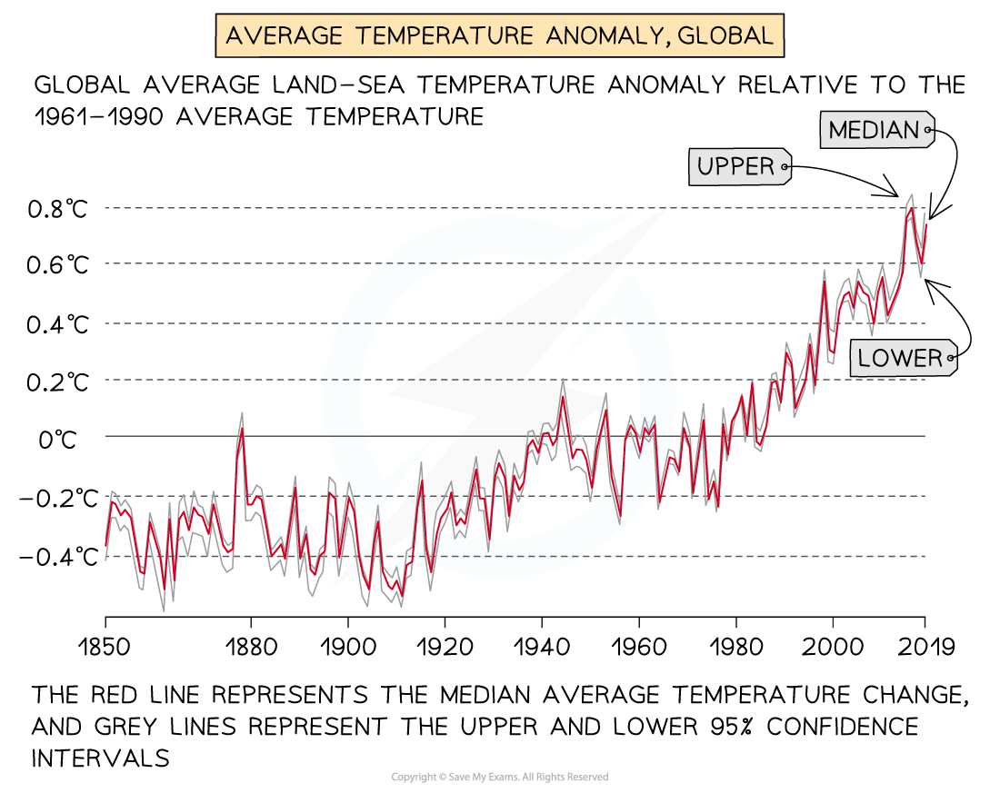

# Global Warming

## Global Warming

> **Spec point** — `spcpt_fSywvbvGJYWH3bHn` · Describe how economic activities may pose threats to the natural environment & people, locally & globally

## Global Warming

### Changes in the global climate

- The global climate conditions of the Earth change over time, leading to colder and warmer periods
- The last 2.6 million years are the **Quaternary** period, when there have been 60 cold periods and warmer ***interglacial*** periods
- The last **ice age** ended approximately 25,000 years ago
- The evidence supporting these changes can be found:

  - **Ice cores **that trap ash, air bubbles and microbes
  - Preserved **pollen**
  - **Historical sources** such as diaries and art
  - **Tree rings**

### Natural causes of climate change

#### Milankovitch cycles

- These are **long-term** changes to the Earth's orbit and position
- This changes how much solar radiation the Earth receives
- The Earth's orbit changes every** 100,000 years. **A more circular orbit leads to cooler periods and an elliptical orbit leads to warmer periods
- The Earth's tilt varies every** 40,000 years **and the greater the tilt, the hotter the summers and the colder the winters are
- Every** 24,000 **years the Earth wobbles on its axis and this can affect the seasonal temperatures

#### Volcanic eruptions

- Large-scale eruptions lead to vast quantities of ash being ejected into the atmosphere
- Ash in the atmosphere blocks solar radiation, leading to a decrease in temperatures

#### Sunspot activity

- Increased sunspot activity is linked to higher average temperatures

#### Atmospheric dust

- Asteroids and meteors entering the Earth's atmosphere may increase the amount of dust, which decreases temperatures

### The greenhouse effect

- The greenhouse effect is essential to the survival of life on Earth

  - Greenhouse gases in the atmosphere allow **short-wave radiation** from the sun through to the Earth's surface
  - This is then radiated back into the atmosphere as** long-wave radiation (heat)**
  - The greenhouse gases absorb some of the long-wave radiation (heat) and stop it from radiating out into space
  - This maintains the Earth's average temperature
  - Without the greenhouse effect, the average temperature would be -18°C

#### Greenhouse gases from natural sources

- **Water vapour—**evapouration from the oceans/seas and plants
- **Carbon dioxide—**volcanic eruptions, wildfires and respiration
- **Methane **is emitted from oceans and soils as part of decomposition; termites also emit methane
- **Nitrous oxide—**soils and oceans

### The enhanced greenhouse effect

- Human activity is increasing the number of greenhouse gases in the atmosphere

  - **Carbon dioxide** **(CO****2****) **levels in the atmosphere have increased by more than 100 parts per million (ppm) to 420 ppm in 2020
- Increased amounts of greenhouse gases have led to the **enhanced greenhouse effect:**

  - Less **long-wave radiation (heat) **can escape the atmosphere
  - Average global temperatures have increased over 1°C since pre-industrial times

*Average Global Temperatures*

*Human Sources of Greenhouse Gases*

#### Greenhouse gases from human activity

- **Carbon Dioxide (CO****2****) **- the burning of fossil fuels, burning of wood and deforestation (less CO2 is removed from the atmosphere)
- **Methane (CH₄)—**decaying organic matter, including manure and waste in landfills, rice fields and livestock
- **Nitrous Oxide (N****2****O)—**artificial fertilisers and burning of fossil fuels
- **Chlorofluorocarbons (CFCs)—**aerosols, refrigeration, air conditioning

> **Worked Example**
> **Study Fig 1, which shows information about human influence on the greenhouse effect.**
> 
> **Using Fig 1 only, explain how humans are influencing the natural greenhouse effect.**
> 
> **[3 marks]**
> 
> - **Remember, **when a question states 'Using Fig 1 only,' you will only be awarded marks for information that you have taken from the figure and not for information you have from elsewhere.
> 
> **Final answer:** **Answer**
> 
> - Greater/more/build-up of greenhouse gases **[1]**
> - Named examples of greenhouse gases that have increased **[1]**
> - More heat is trapped **[1]**
> - Less heat escapes **[1]**

> **Exam Hint**
> Remember, not all scientists agree about the causes of climate change. A few scientists argue that global warming is the result of the Earth's natural climate pattern and not the result of human activities.

### Impacts of the enhanced greenhouse effect

#### Health

- Increased temperatures and lack of precipitation may lead to the spread of diseases:

  - Italy has experienced cases of **malaria** since 2017 when it was previously a malaria-free area
  - An additional **280 million** people may be affected by malaria
  - **Waterborne diseases** are more likely to spread
- **Heat waves** may become more frequent
- ***Heat stroke***, dehydration and sunburn increase during heat waves
- Stagnant air during heat waves increases air pollution levels:

  - ***Respiratory*** diseases increase and those suffering from respiratory illnesses such as asthma may be more affected
- Increased temperatures negatively affect people with ***cardiopulmonary*** diseases
- Diets may be restricted by **food shortages** leading to **malnutrition **and **famine**

#### Homes and settlements

- **Increased flooding** due to **sea level rise** and increased frequency and severity of storms will lead to the*** displacement*** of large numbers of people
- Settlements in low-lying areas may have to be abandoned or need additional defences against sea level rise

  - Moving settlements or improving flood defences will be costly

#### Agriculture

- Farmers may need to change the crop they grow if climate conditions become unsuitable
- Coastal flooding may lead to ***salt intrusion***
- Reduced availability of water will mean that irrigation is limited or impossible
- Food shortages will lead to malnutrition and famine

#### Employment

- Job opportunities may change or decrease because:

  - Tourism may decline in some areas; for example ski resorts may close due to the lack of reliable snow
  - Coastal resorts may be at risk of flooding leading to the closure
  - Farmers may have to change the crop they grow or livestock they raise or leave farming
  - In some areas, agriculture may decline due to rising temperatures or changing rainfall patterns

#### Sea level rise

- Warmer temperatures cause the water in seas and oceans to expand, increasing the sea level
- Melting ice is adding to the increasing volume of water:

  - Average sea levels have risen **23 cm since 1880**
  - Sea levels are forecast to increase a further **30 cm by 2050**
- Low-lying coastal areas and islands are at higher risk of flooding:

  - The Maldives may be uninhabitable by 2050
- **Beach erosion** will increase, leading to greater coastal erosion
- **Coastal ecosystems,** including coral reefs and mangrove swamps, will be affected
- Saltwater is contaminating freshwater supplies and affecting coastal agriculture

#### Ecosystem change

- The location of** biomes** may shift to the north (Northern Hemisphere) and south (Southern Hemisphere) as they rely on specific climate conditions:

  - **Polar and tundra biomes** are at risk of becoming extinct as they cannot shift any further north/south
- Increasing sea temperatures and ***ocean acidification*** have resulted in ***coral bleaching***
- Migration and behaviour patterns of animals affected by changing temperatures:

  - Fish species are moving north and south of their usual habitats to seek cooler water
  - Reduced hibernation due to warmer winters
- Melting of ice caps/glaciers leading to changing ocean currents
- **Mangrove swamps and coral reefs** are threatened by rising sea levels
- Loss of habitats through flooding, drought and wildfires
- Food webs breaking as species numbers are reduced and food sources are decreased
- Loss of plants and vegetation

#### Natural hazards

- Changes in climate patterns are likely to increase the **frequency and severity of storms:**

  - The 2020 Atlantic hurricane season was the first most active on record and 2021 was the third most active
- The **frequency and length of droughts** are increasing
- Dry conditions lead to the increased risk of **wildfires:**

  - In 2021, Australia, Greece, South Africa, Brazil and the USA were just some of the places to experience severe wildfires
  - In September 2021, the USA National Fire Centre reported 44,647 wildfires that had burnt 5.6 million acres
- Rising sea levels together with increased storms lead to **increased flooding **risk

### Responses to climate change

- Global warming and climate change require an **international response** because they affect the entire globe
- Responses can involve either ***adaptation*** or ***mitigation***
- In 1988 the **Intergovernmental Panel on Climate Change (IPCC)** was set up to assess the 'risks of human-induced climate change
- This was followed by several international agreements

#### Earth Summit, Rio 1992

- Set out aims to stabilise greenhouse gas levels

#### Kyoto Protocol 1997

- Delegates from 150 countries agreed to **reduce greenhouse gas emissions**
- It stated that industrialised countries would **reduce emissions** to below the levels in 1990
- Developing countries, including China and India, were exempt from the agreement
- The USA did not sign up for the treaty
- Canada withdrew in 2011, stating that without China and the USA, the treaty would not work

#### Paris Agreement 2015

- Global agreement to limit global warming to 2°C (preferably 1.5°C) above pre-industrial levels
- The agreement also includes reducing CO2 emissions by at least 60% by 2050
- Signed by 196 countries, including the USA and China (the USA withdrew in 2020 and rejoined in 2021)

#### Conference of the Parties (COP)

- The United Nations (UN) holds an annual (every year) meeting to discuss climate change.
- COP29 was held in Baku, Azerbijan
- All nations agreed to:

  - continue to take action to further reduce greenhouse gas emissions
  - triple financial aid to developing countries

#### Reducing emissions

- Emissions can be reduced in several ways, including

  - reducing deforestation
  - increasing afforestation
  - improving energy efficiency in industry and domestic appliances
  - reducing emissions from industry
  - improving public transport
  - electric vehicles
  - use of renewable energy and nuclear power

> **Worked Example**
> **Explain why global warming is a threat to the natural environment.**
> 
> **[4 marks]**
> 
> - Remember this question is asking about the natural environment so you should not include impacts on humans
> 
> **Final answer:** **Answer**
> 
> - Melting of ice caps/glaciers** [1]**
> - Loss of natural habitat **[1]**
> - Rising sea/water levels **[1]**
> - Flooding of low-lying islands/countries leads to habitat loss **[1]**
> - Loss of food sources for wildlife **[1]**
> - Loss of species/extinction/animals die (or example) **[1]**
> - Breaking of food chains/threats to predators **[1]**
> - Diversion of cold ocean currents **[1]**
> - Warming of seawater can destroy/bleach coral **[1]**
> - Increasing aridity/drought/desertification **[1]**
> - Forest fires **[1]**
> - Vegetation loss/trees die etc. **[1]**
