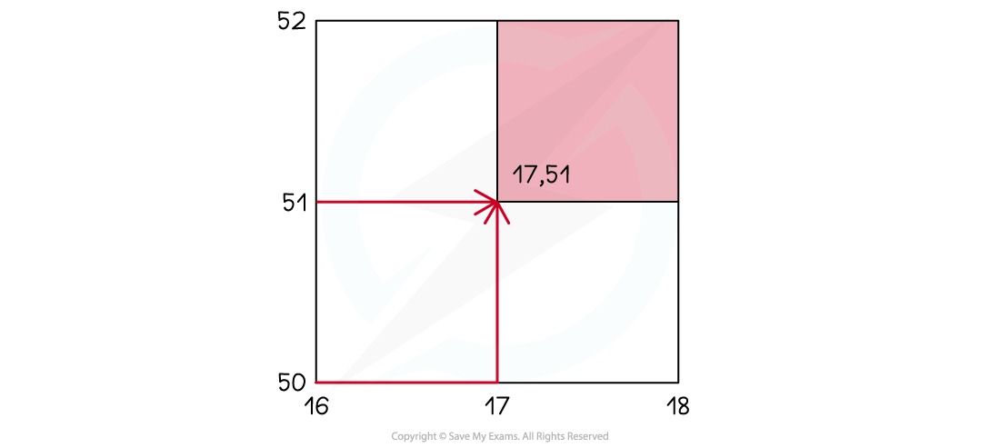
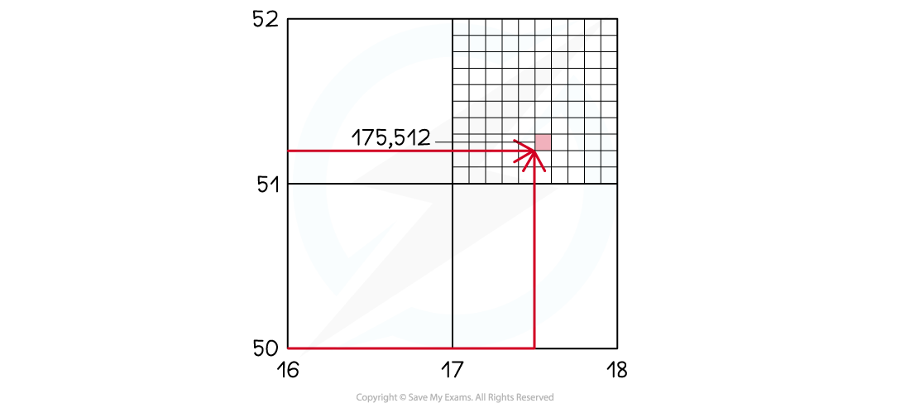
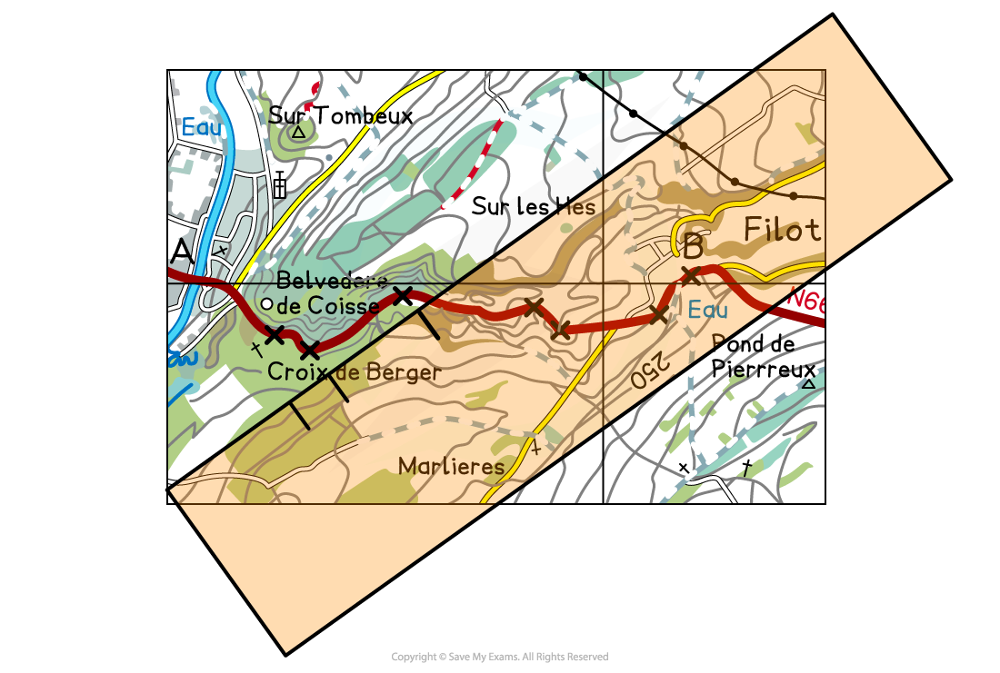
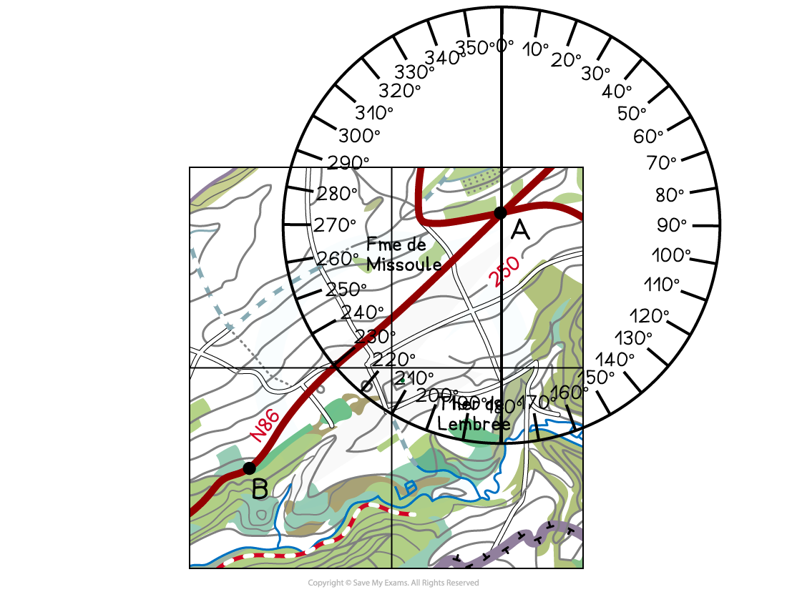
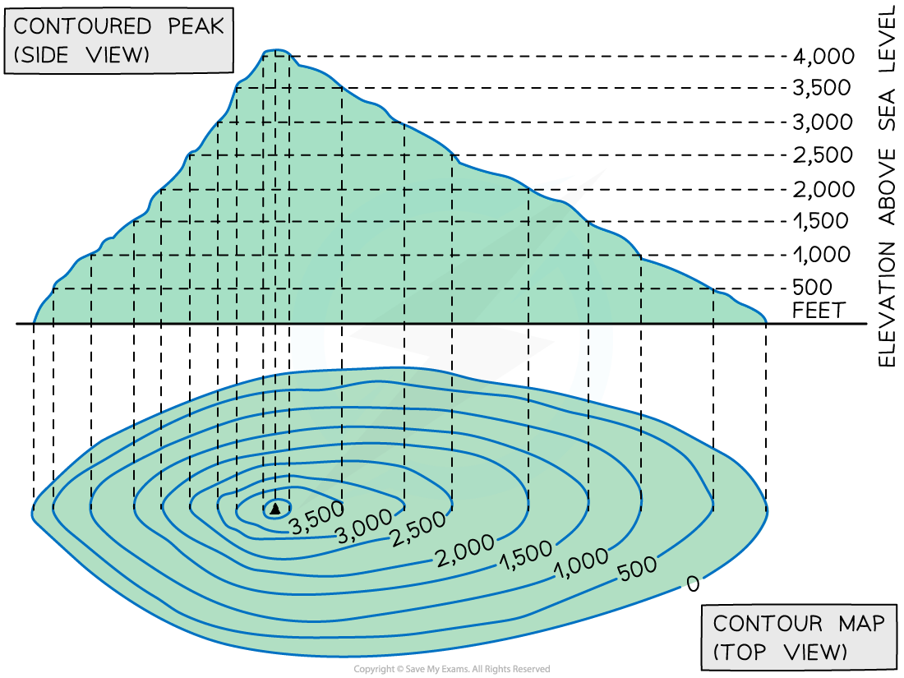
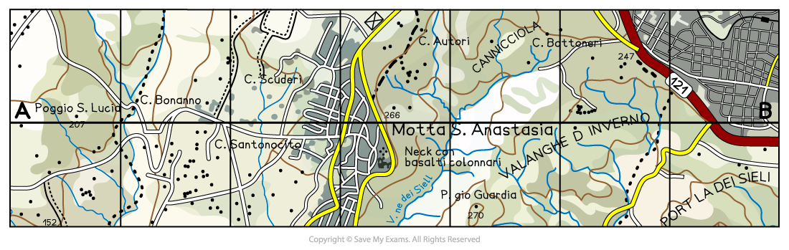
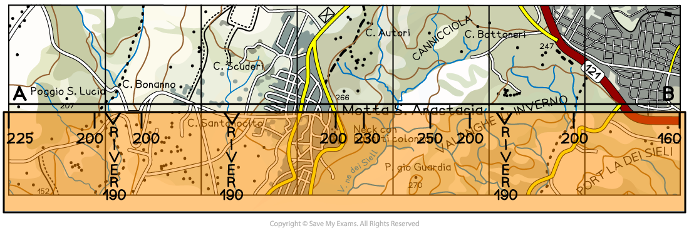
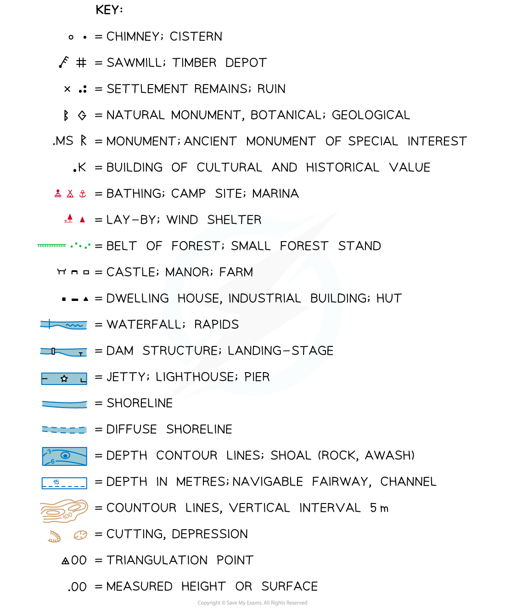

# Maps

## Maps

> **Spec point** — `spcpt_gyxC3Ybv38BJBCTR` · Use a co-ordinate reference system and to give and read four-figure and six-figure grid references to locate places. Give directions, both in terms of a 16-point compass (such as north, north-north east, north east, etc.) and as a bearing from grid north of one place from another. Be able to measure horizontal distances, calculate height, complete a cross-section, interpret physical and human landscapes and features. 

## Maps

- Questions in the exam will be based on topographical maps

  - The maps can be from anywhere in the world
  - Maps will have a key, scale, northings and eastings
  - These all need to be used to answer the questions

### Grid references

- 4-figure are used to locate specific grid squares within the map

  - The first two figures are the **eastings**, which indicate how far east or west a grid is across the map
  - The second two figures are the **northings**, which indicate how far north or south a grid is on the map
- 6-figure grid references are used to locate exact points within grid squares

  - The first three figures are the eastings
  - The second three figures are the northings
- To find a 4 and 6 figure grid reference

  - First, find the four-figure grid reference by giving the number from the bottom of the map first and then the number from the side of the map.

*4 - figure grid reference*

- In image above, the 4-figure grid reference would be 17, 51
- To give the 6-figure grid reference, you need to imagine that the grid square is divided into 100 smaller squares

> **Worked Example**
> **Figure 1.1 shows some of the features around the main settlement at Misterblanco in the north-east of the map extract**
> 
> 
> 
> **What is the six-figure grid reference of the junction to the north of B in Fig 1.1?**
> 
> **[1 mark]**
> 
> **Final answer:** **Answer**
> 
> - **017 517**

> **Exam Hint**
> The paper 2 exam will always contain a map. You will be expected to be able to give and use grid references to locate specific places on the map extract.

### Scale

- Maps in exams will be scaled at either:

  - 1:25,000 (1 cm = 250 m in real life)
  - 1:50,000 (1 cm = 500 m in real life)
- Distance measurement methods:

  - For straight or nearly straight distances:
  
    - Use a ruler
    - Use the edge of a straight piece of paper
  - Using map scale:
  
    - Mark distances on a piece of paper using the scale at the map's bottom
    - Lay the marked paper from first to second point to calculate distance

*Using scale to measure a straight line*

- Measuring curved route distances:

  - Divide the route into segments
  - Rotate and mark the paper in stages to calculate the full distance
- Measuring road route on map:

  - Divide the route into straight sections using crosses
  - Use the paper to measure from A to the first cross
  - Rotate the paper, pivoting at the cross to mark the second cross

*Measuring a curved route*

### Bearings

- Directions on a map should always be given using compass points
- There are 16 compass points

*Sixteen Compass Points*

- A grid bearing is measured from the grid north at 0°, east at 90°, south at 180°, and west at 270°
- Grid bearings are given using a protractor

  - The 0º should be pointing north and the centre of the protractor on the place the bearing is been given from
  - The compass direction and grid bearing from the crossroads at A to the location at B

*Illustration showing how to take a map bearing*

- On the map below, B is south-west of A
- The bearing is 230º

### Height

- Height can be shown in three main ways:

  - **spot height**
  - **contour lines**
  - **trigonometrical (trig) stations**
- Spot heights show the height at a specific point with the height measurement written next to it
- Contour lines are** isolines**

  - They join points of equal height and are usually at 5 or 10-metre intervals (distance between the contour line) this means that the height of the land increases by 5 or 10 metres between the lines
- A trigonometrical (trig) station is marked by a small black triangle with a height measurement written next to it

### Topography

- The contour lines can also indicate the shape and slope of the land or topography
- Contour lines close together indicate steep land
- Contour lines very far apart indicate gently sloping or flat land dependent on the distance apart
- V-shaped valleys have a v-shaped set of contours
- A hill is shown by a set of circular contour lines

*Contour lines *

> **Worked Example**
> **Study the map extract and Fig 1 for Stoumont, Belgium. The scale is 1:50000**
> 
> 
> 
> 
> 
> ***Fig 1 ***
> 
> **Using the map extract, identify the following features shown in Fig. 1**
> 
> **The height above sea level of the contour at C**
> 
> **.................... metres**
> 
> **[1 mark]**
> 
> **Final answer:** **Answer**
> 
> - **250 metres**

### Cross-sections

- A cross-section is a slice through the landscape
- They are represented on a map by a line, which is often labelled A at one end and B at the other
- They use the contour lines to determine the height of the land

*Cross-section on a map*

- A piece of paper is then laid along the line and points A and B are marked on
- The contour lines are then marked on each time they cross the paper

*Marking on the contour lines*

- These figures can then be used to create the cross-section

> **Exam Hint**
> In the exam, you may be asked to finish a cross-section or interpret a cross-section. When interpreting cross-sections, you should include:
> 
> - The highest and lowest points
> - Comparison of slopes
> - Anamolies

### Key

- Maps can be used to identify a range of landscape features
- These may be physical and human features
- Each map has a key to show what the symbols mean

*Example of a map key*
