# Graphs & Diagrams

## Graphs & Diagrams

> **Spec point** — `spcpt_Xn2ym5TDKMCYbRQN` · Extract specified geographical information from graphs, diagrams and tables of data  

## Graphs & Diagrams

### Types of data

- **Continuous data **is numerical data that can take any value within a given range, e.g. heights and weights
- **Discrete data **is numerical data that can only take certain values, e.g. shoe size
- **Quantitative data** is where the results can be expressed using numerical values
- **Qualitative data** is where the results can’t be expressed as numbers, e.g. opinions

### Line graph

- One of the simplest ways to display continuous data
- Both axes are numerical and continuous
- Used to show changes over time and space

| Strengths | Limitations |
|---|---|
| - Shows trends and patterns clearly - Quicker and easier to construct than a bar graph - Easy to interpret - Anomalies are easy to identify | - Does not show causes or effects - Can be misleading if the scales on the axis are altered - If there are multiple lines on a graph, it can be confusing - Often requires additional information to be useful |

#### Example

- A river cross-section is a particular form of line graph because it is not continuous data, but the plots can be joined to show the shape of the river channel

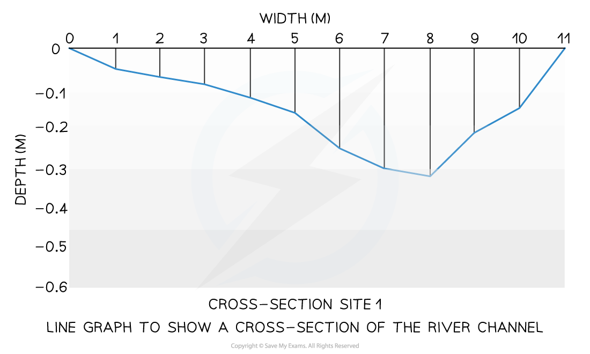

*Example of a line graph*

### Bar chart

- A bar chart is the simplest form of displaying data
- Each bar is the same width but can have varying lengths
- Each bar is drawn an equal distance apart (equidistant)
- The data is ***discrete*** data
- Bar graphs are useful for:

  - Comparing classes or groups of data
  - Changes over time

| Strengths | Limitations |
|---|---|
| - Summarises a large set of data - Easy to interpret and construct - Shows trends clearly | - Requires additional information - Does not show causes, effects or patterns; can be too simplistic - Can only be used with discrete data |

#### Example

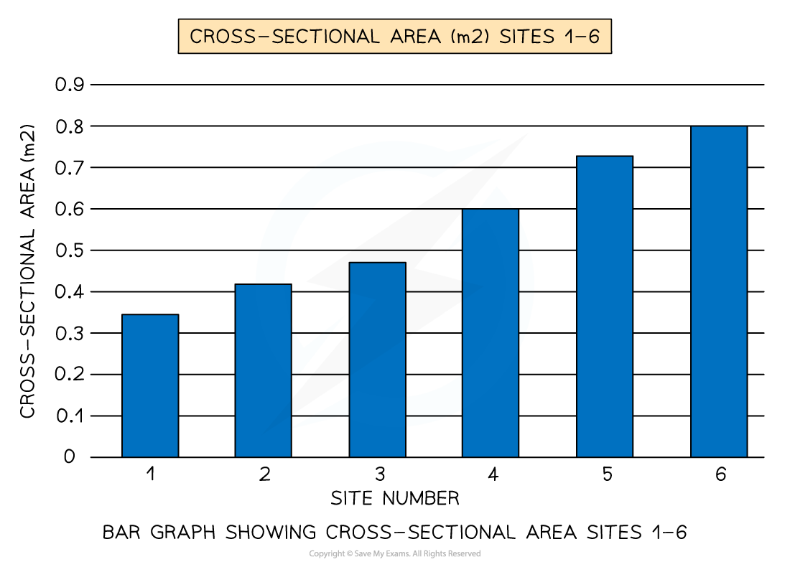

*A typical bar graph*

### Histograms

- Histograms show **continuous data**
- **Always** use a ruler to draw the bars
- All bars should be the **same width **
- The top of the bar should reach the number on the side of the graph that is being represented
- There should be no gaps; all bars should be touching
- Ensure all axes are labelled and that the graph has a title

| Strengths | Limitations |
|---|---|
| - Large data sets can be graphed easily - Data can be compared | - Can be difficult to pinpoint exact data values - They can only be used for numerical data |

#### Example

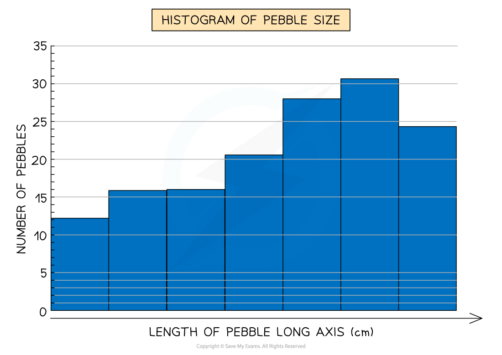

*Example of a histogram*

### Compound or divided bar chart

- The bars are subdivided to show the information, with all bars totalling 100%
- Divided bar charts show a variety of categories
- They can show percentages and frequencies

| Strengths | Limitations |
|---|---|
| - A large amount of data can be shown on one graph - Percentages and frequencies can be displayed on divided bar charts | - A divided bar chart can be difficult to read if there are multiple segments - It can be difficult to compare data sometimes |

#### Example

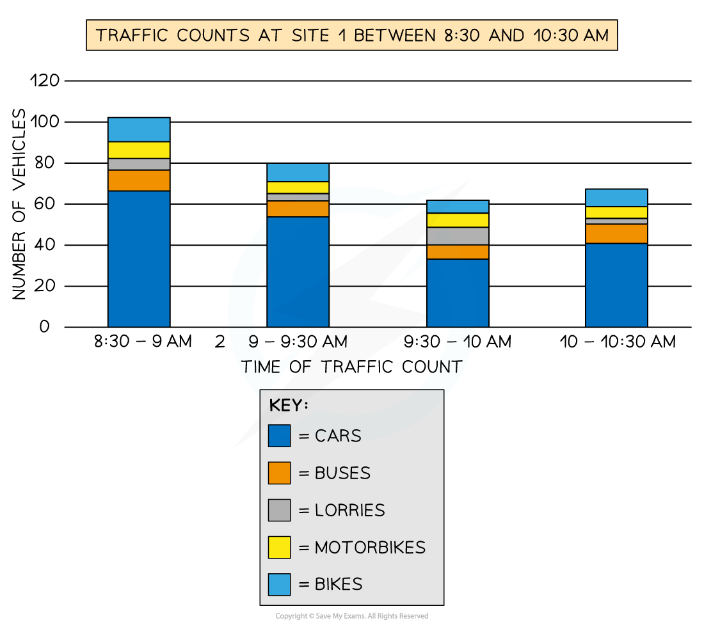

*Example of a compound bar chart*

### Population pyramid

- This is a type of histogram
- Used to show the age-sex of a population
- It can be used to show the structure of an area/country
- Patterns are easy to identify

| Strengths | Limitations |
|---|---|
| - Easy to compare age and sex data - Easy to read and annotate | - Can take a long time to construct - Detail can be lost in the data (figures just show a cohort); additional annotations may be necessary |

#### Example

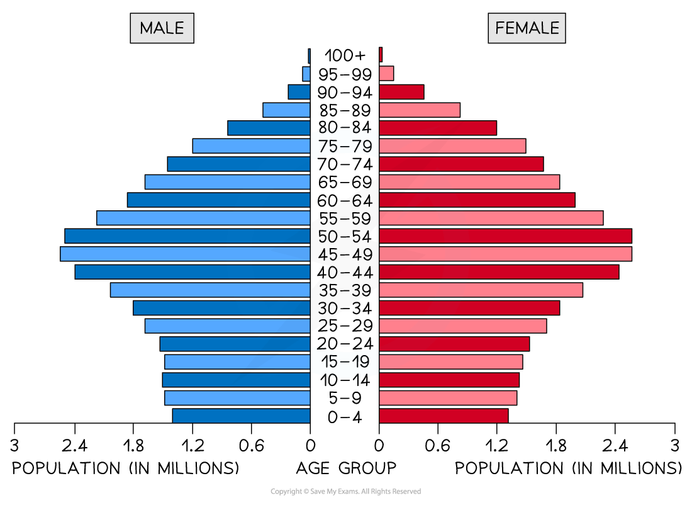

*Example of a population pyramid*

### Pie chart

- Used to show proportions, the area of the circle segment represents the proportion
- A pie chart can also be drawn as a proportional circle
- Pie charts can be located on maps to show variations at different sample sites
- The percentage of the pie chart must add up to 100%
- To calculate degrees of the pie chart (which totals 360°), divide the percentage by 100 and then multiply by 360
- Each segment should be a different colour

| Strengths | Limitations |
|---|---|
| - Clearly shows the proportion of the whole - Easy to compare different components - Easy to label - Information can be highlighted by separating segments | - Does not show changes over time; hard to compare two sets of data - Difficult to understand without clear labelling - Calculating the size of each section can be difficult - Can only be used for a small number of categories; otherwise, lots of segments become confusing |

#### Example

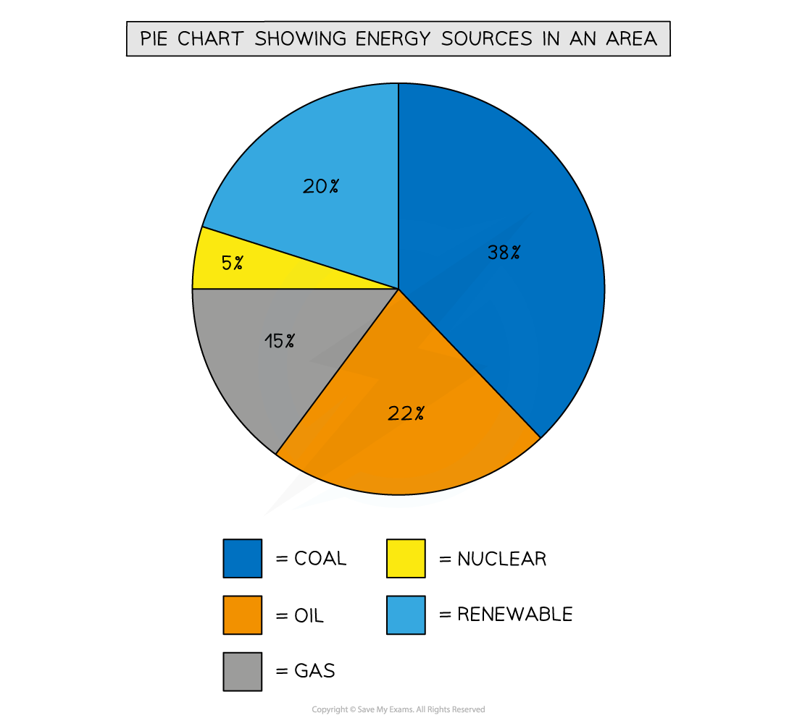

*Pie chart showing energy sources in an area*

> **Exam Hint**
> To work out the percentage increase/decrease, work out the difference between the two numbers, divide the difference by the first number, then multiply this number by 100.
> 
> For example, the difference between 37 and 43 is 6. Then 6 / 37 x 100 = 16.21.
> 
> The percentage increase is therefore 16.21%.

### Rose diagram

- Uses multidirectional axes to plot data with bars
- Compass points are used for the axis's direction
- Can be used for data such as wind direction, noise or light levels

#### Example

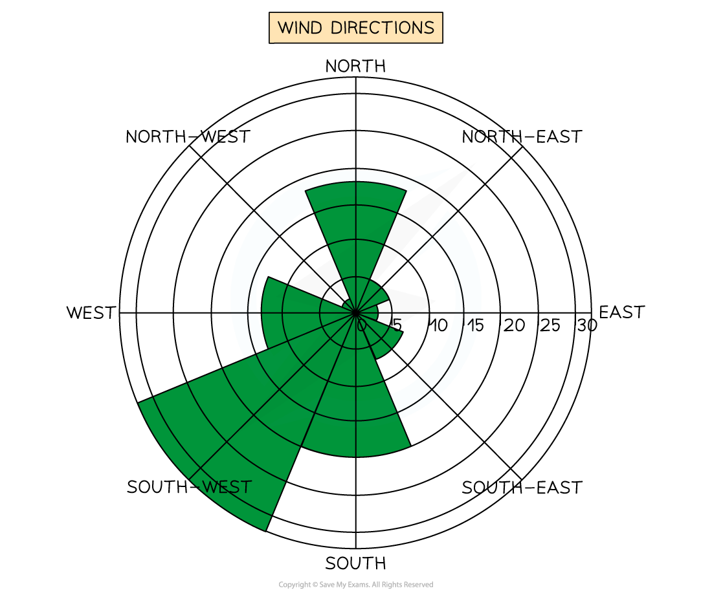

*Example of wind direction being shown on a rose diagram*

### Triangular graph

- Triangular graphs are used to display data, which can be divided into three

| Strengths | Limitations |
|---|---|
| - Triangular graphs can be used to plot data such as soil content, rock size or type, or employment in economic activities, etc. | - The data must be in percentages - Can be difficult to read |

#### Example

- Read each side carefully so you are aware which direction the data should be considered

  - Always read from 0 to 100 and follow through to the next 0
  - Can be either clockwise or counter-clockwise
  - In the example below, the data reads clockwise

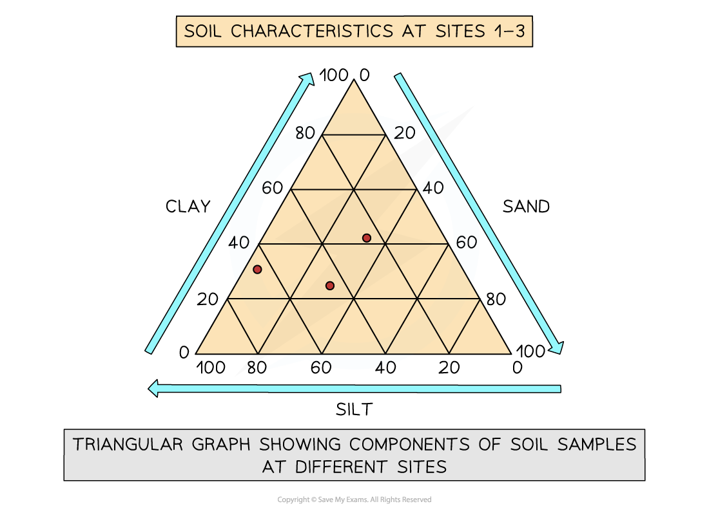

*Example of a triangular graph *

### Scatter graph

- Points should not be connected
- The best fit line can be added to show the relations
- Used to show the relationship between two variables

  - In a river study, they are used to show the relationship between different river characteristics, such as the relationship between the width and depth of the river channel

| Strengths | Limitations |
|---|---|
| - Clearly shows data correlation - Shows the spread of data - Makes it easy to identify anomalies and outliers | - Data points cannot be labelled - Too many data points can make it difficult to read - Can only show the relationship between two sets of data |

#### Example

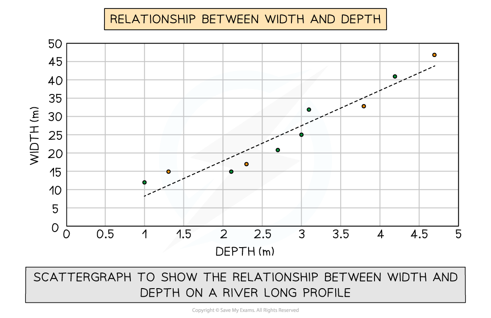

*Example of a scatter graph with a trend line (aka line of best fit)*

### Types of correlation

- **Positive correlation**

  - As one variable increases, so too does the other
  - The line of best fit goes from bottom left to top right of the graph
- **Negative correlation**

  - As one variable increases, the other decreases
  - The line of best fit goes from the top left to the bottom right of the graph
- **No correlation**

  - Data points will have a scattered distribution
  - There is no relationship between the variables

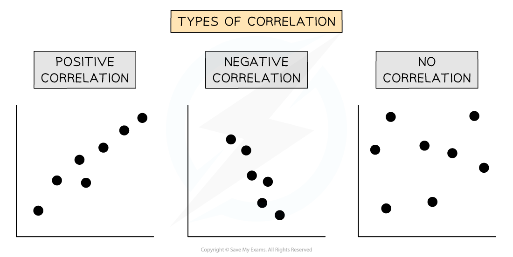

*Examples showing three types of correlation*

> **Worked Example**
> **Making predictions from a set of data**
> 
> - You may be asked to make a prediction for the next step in given data (either table or graph form) in your exam
> - Study the data carefully
> - Look at the direction in which the data is going
> 
>   - Are the numbers increasing or decreasing?
>   - Is there a clear pattern forming?
>   - E.g. does the data point value change by 3, 4, 6, etc. each time
> - Study the scatter graph below, which shows the cost against distance travelled
> 
> 
> 
> *Cost against distance travelled scatter graph*
> 
> - Predict what the cost at would be at 1.75 km
> - Answer:
> 
>   - To predict the cost at 1.75 km, look at the cost at 1.5 km and 2.0 km
>   - Then follow the line of best fit to predict the value at 1.75 km
>   - Cost would be £1.3

> **Exam Hint**
> In the exam, you will not be asked to draw an entire graph. However, it is common to be asked to complete an unfinished graph using the data provided. You may also be asked to identify anomalous results or to draw the best-fit line (aka trend line) on a scatter graph.
> 
> - Take your time to ensure that you have marked the data on the graph accurately
> - Use the same style as the data which has already been put on the graph
> 
>   - Bars on a bar graph should be the same width
>   - If the dots on a graph are connected by a line, you should do the same

### Choropleth map

- These are maps that are shaded according to a pre-arranged key
- Each shade of colour represents a range of values
- It is common for one colour in different shades to be used
- Can be used for a range of data, such as annual precipitation, population density, income levels, etc.

| Strengths | Limitations |
|---|---|
| - The clear visual impression of the changes over space - Shows a large amount of data - Groupings are flexible | - Makes it seem as if there is an abrupt change in the boundary - Distinguishing between shades of colour can be difficult - Variations within the value set are not visible |

#### Example

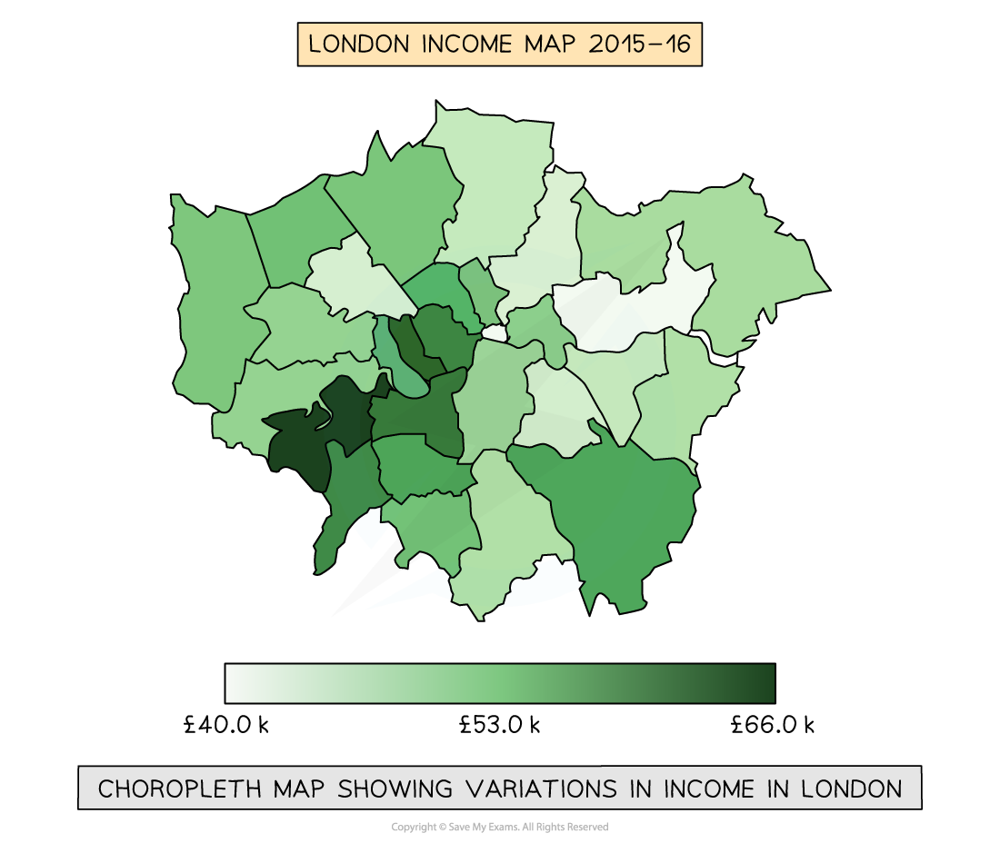

*Example of a choropleth map*

### Proportional symbols map

- The symbols on the map are drawn in proportion to the variable represented
- Usually, a circle or square is used but it could be an image
- Can be used to show a range of data, for example, population, wind farms and electricity they generate, traffic or pedestrian flows

| Strengths | Limitations |
|---|---|
| - Illustrates the differences between many places - Easy to read - Data is specific to particular locations | - Not easy to calculate the actual value - Time-consuming to construct - Positioning on a map may be difficult, particularly with larger symbols |

#### Example

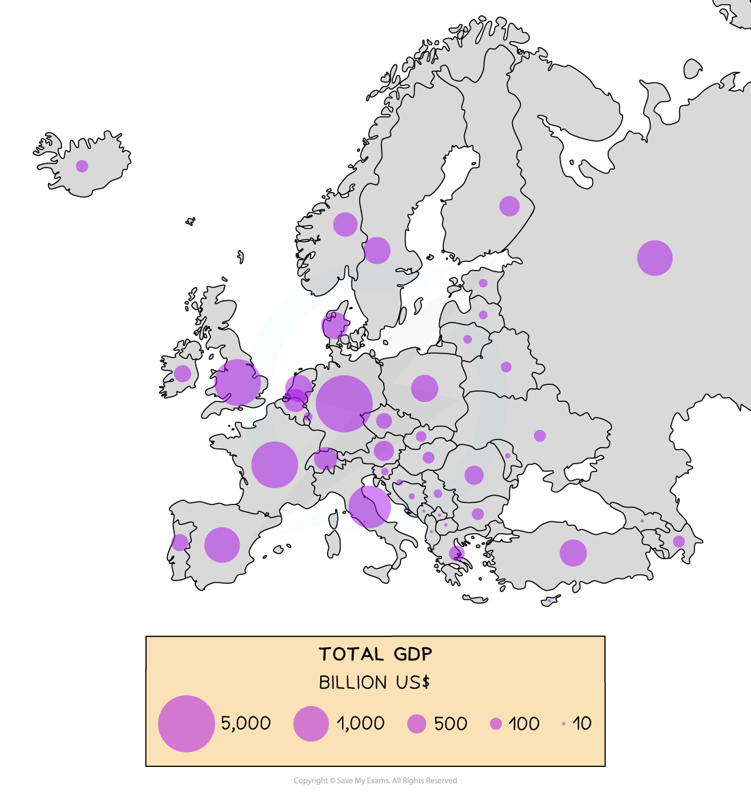

*Proportional circles map showing GDP (billion US$) across Europe*

### Pictograms

- These are a way of displaying data using symbols or diagrams drawn to scale
- Useful way of showing data if accuracy is not too important and data is discrete
- Years do not need to be continuous
- Symbols do not need to be whole but can represent a proportion
- A key is needed to show if the total number of objects or events that image represents exceeds one

#### How to read a pictogram

- **Step 1**: Read the problem carefully and identify the specific information requested from the pictogram
- **Step 2**: Count the symbols corresponding to the desired information and report the count

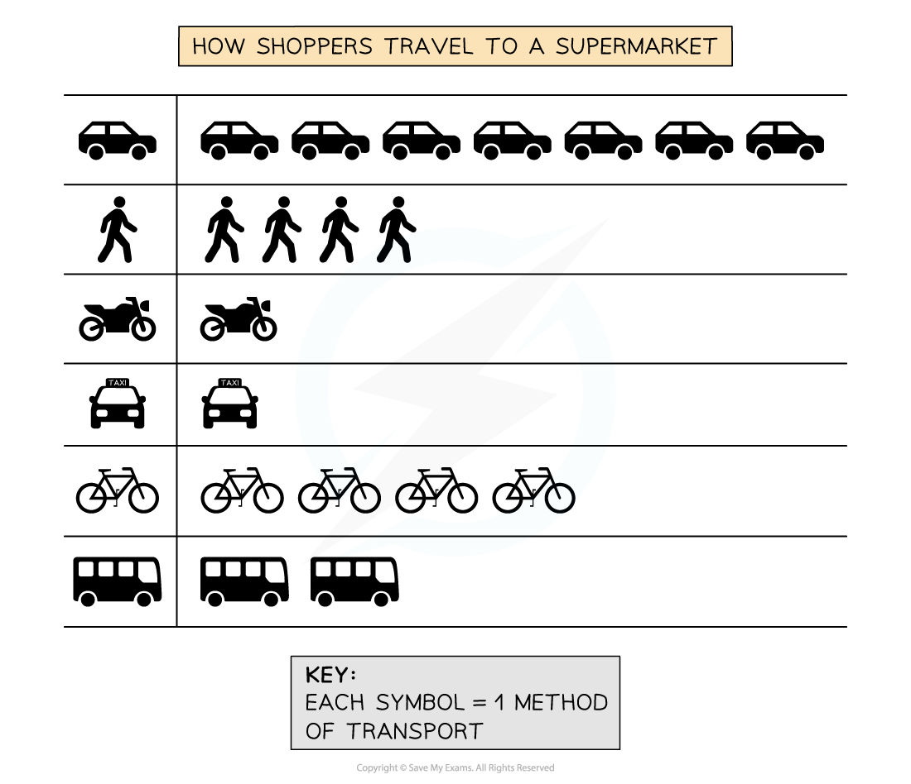

*Example of a pictogram*

- In the pictogram above, you can see that 4 shoppers walked to the supermarket, but only one used a taxi
- The majority of shoppers used a car to travel to the supermarket
