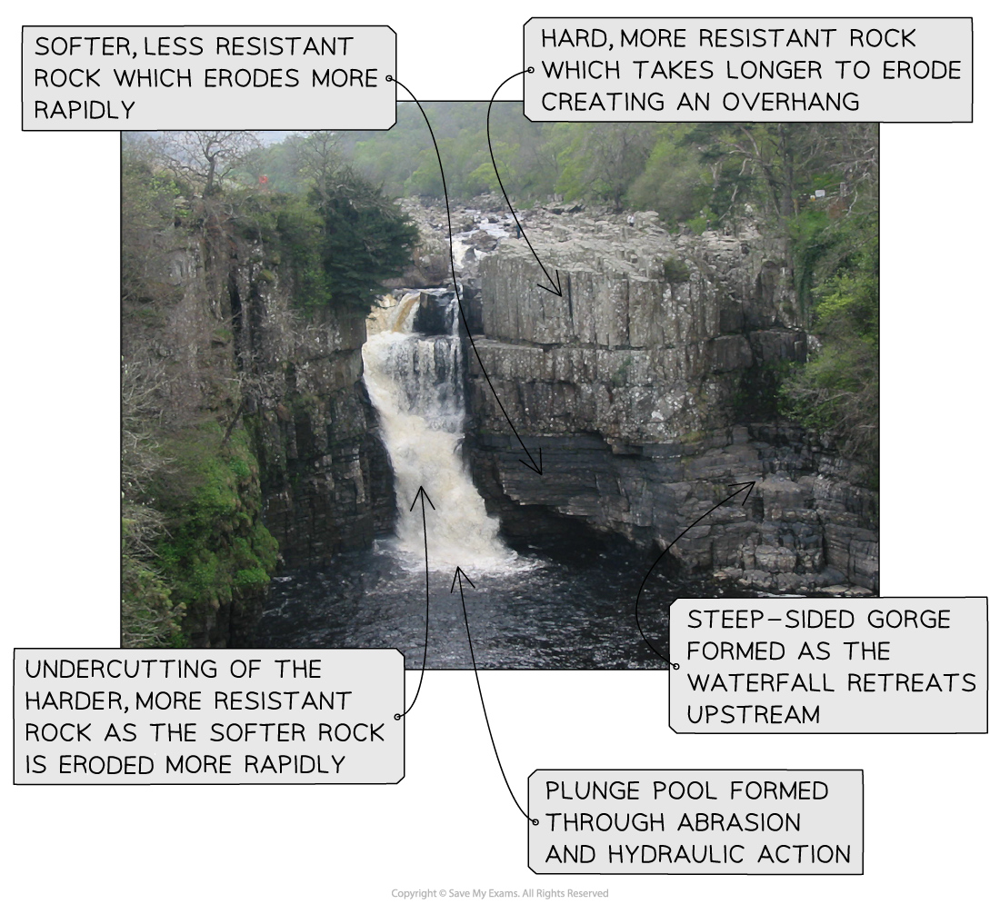

# Analysis & Conclusions

## Analysis & Conclusion

> **Spec point** — `spcpt_VdRJqxxJbP5GCHcD`

## Analysis & Conclusion

### Analysis

- Once data has been collected and presented, it needs to be analysed
- Analysis is the process that makes sense of the data collected

  - It identifies patterns, trends, significance, connections, and/or meaning in the data
- The analysis of data involves several stages

  - Describe the data shown in the graphs/photographs/maps
  - Identification of the highest and lowest results
  - Identification of any patterns and trends
  - Identification of any relationships between data
- Methods of analysis depend upon the data collected
- **Quantitative** data is analysed using numerical and statistical methods

#### Numerical and statistical skills

- Statistical methods can be used to help explore and explain the results gathered during data collection

#### Mean, median and mode

- These are measures of ***central tendency***
- The **mean** (average) is calculated by adding up all of the values in the data set and then dividing by the total number of values in the data set
- The **median **is the middle value of a set of data. The numbers are arranged in rank order and then the middle value is selected
- The **mode **is the value that occurs most frequently in a set of data

#### Range

- A measure of **dispersion—**the spread of data around the average
- The range is the distance between the highest and lowest value
- **The interquartile range** is the part of the range that covers the middle 50% of the data

#### Anomalies

- These are results that do not fit the pattern or trend
- They need to be described and explained

### Analysing photographs and field sketches

- Annotation of photographs and field sketches is part of the analysis
- The use of photographs and field sketches is** a qualitative **analysis
- Analysis in annotation gives meaning to the features shown in the photograph/field sketch

### Conclusion

- **The fieldwork conclusion should:**

  - **return **to the hypothesis and aim
  - **identify **any evidence that supports the hypothesis
  - **outline **any evidence that contradicts the hypothesis
  - **describe **and explain any links to geographical theories
  - **acknowledge **any unusual results
  - **state **whether the hypothesis is supported or not

- A key focus in the fieldwork questions in the exam is the evaluation of data collection
- Enquiry evaluation should:

  - identify any problems with, or limitations of, data collection methods
  - suggest other data that would have been useful in the study or improvements that could be made
  - evaluate how reliable the conclusions were
  - suggesting how the scope of the study could be extended

### Data collection - problems and limitations

- There are always issues and limitations associated with data collection; they may include:

  - **Accessibility **of sample sites—could all sample sites be accessed?
  - **Sample size: **Was the sample size large enough?
  - **Duration** of the data collection—was the enquiry time long enough to collect the data needed?
  - **Methods: **Were the questionnaire questions appropriate to meet the aim and test the hypothesis?
  - Were there any issues with the** equipment?**
  - Was there any** human error **in the process of recording data or reading the equipment?
  - **Time of the data collection—**did the weather or time impact the results collected?
  - **Unforeseen issues—**were there any problems on the day, such as road works and river flow, that affected the results?

#### Other data and improvements

- There are always improvements that could be made to data collection; these may include:

  - increasing the sample size
  - taking more measurements
  - looking at a wider range of secondary sources
  - using other equipment—a flow meter would be more accurate for measuring river velocity than a float

### Evaluating the conclusions

- To evaluate the conclusion, students should examine whether the

  - conclusions reflect the aims and hypothesis set out at the start of the enquiry
  - aim and hypothesis were appropriate—could the hypothesis be easily assessed?
  - location was appropriate
  - accuracy of results could be improved if the data collection were to be repeated
