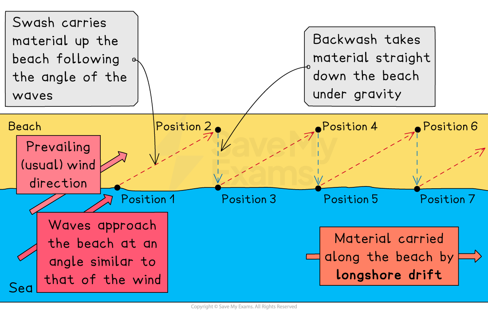
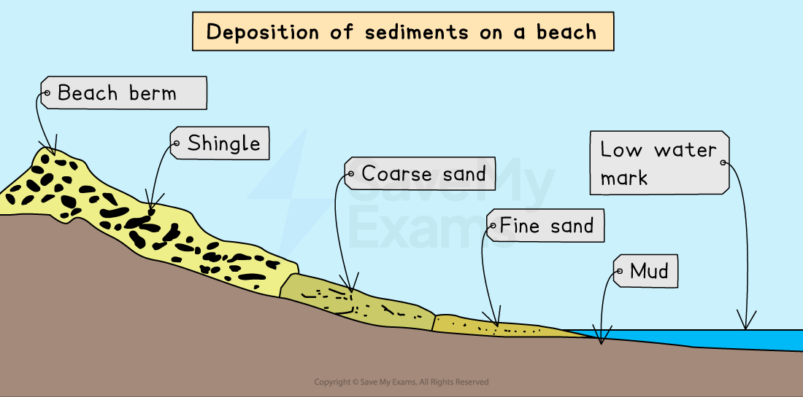
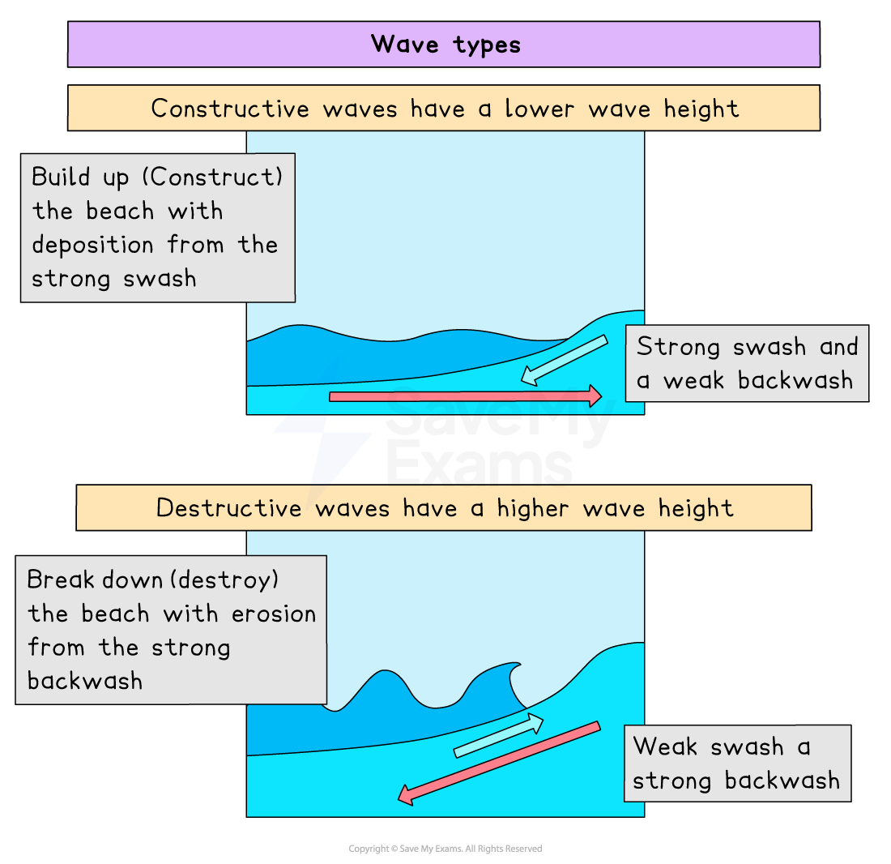
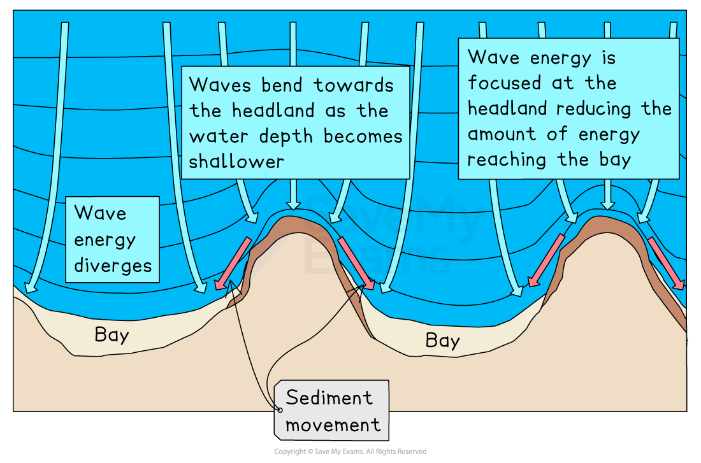

# Coastal Processes

## Specification link

This page covers sections 2.1.1  and 2.1.2 of the [CIE IGCSE Geography specification.](https://www.cambridgeinternational.org/Images/718150-2027-2029-syllabus.pdf)

- **2.1.1 **- Coastal erosion: hydraulic action, corrosion, corrasion, attrition, transportation, deposition, and longshore drift.
- **2.1.2 **- Types of waves: constructive and destructive and wave refraction.

## Coastal processes

> **Spec point** — `spcpt_Qp4ZZYgkMm7wMVQM` · Coastal erosion: hydraulic action, corrosion, corrasion, attrition; transportation; deposition; longshore drift.

## Coastal processes

- The **coast **is the area where land and sea meet
- Coastal processes are divided into two parts:

  - **Marine** processes: **offshore** (water-based)
  - **Terrestrial** processes: **onshore** (land-based)
- These processes are further divided into:

  - Erosion
  - Transportation
  - Deposition by wave action
- Together with the local geology, these processes produce distinctive landforms around the coastline

  - A coastline made up of softer rocks such as sands and clays will be easily eroded by **destructive waves **to form low, flat landscapes such as bays and beaches
  - Coastlines of more resistant, harder rock will take longer to erode and produce rugged landscapes such as headlands

### Marine erosion

- Destructive waves are responsible for the majority of erosion that happens along a coast
- They cut into the coastline in four ways:

  - **Hydraulic action** is the sheer force of the waves hitting the coast
  - **Attrition **occurs when material carried in the waves bumps against each other and becomes smaller and smoother
  
    - This does not erode the coast but forms the sand and shingle
  - **Corrosion, **also known as** solution, **occurs because seawater is slightly acidic and gradually dissolves material. Some types of coastal rock such as limestone and chalk, are particularly prone to corrosion
  - **Abrasion, **also known as** corrasion, **occurs when waves pick up material and hurl it at the cliffs

> **Exam Hint**
> Please ensure you understand the distinction between the four types of erosion, especially between **abrasion (corrosion)** and **attrition**. Many students confuse these two terms.
> 
> A tip for you is to think of abrasion as rubbing with sandpaper; maybe you have grazed your knees or elbows when you fell off your bike or skateboard.  Those grazes were abrasions on your knees/elbows, etc.

## Marine transportation

- The sea transports sediment that it gets from erosion in the same way rivers do
- Material in the sea arrives from many sources:

  - eroded from cliffs
  - transported by** longshore drift** along the coastline
  - brought inland from offshore by **constructive waves**
  - carried to the coastline by a river
- In the water, material is moved through:

  - **Traction **when large, heavy material is dragged along the sea floor
  - **Saltation **occurs when smaller material bounces along the sea floor
  - **Suspension** is the fine material held in the seawater
  - **Solution **is dissolved material carried in the seawater

### Longshore drift (LSD)

- Longshore drift (LSD) is the main process of transportation along the coast
- Waves approach the beach at an angle due to the **prevailing wind**
- As the waves break, the **swash** carries material up the beach at the same angle
- As the ***swash*** dies away, the ***backwash*** carries the material down the beach at right angles (90°)
- The process repeats, transporting material along the beach in a zig-zag movement

*Illustration showing the process of longshore drift*

- Beach sediment is carried farther down the coast on coasts where longshore drift is one way; if it is blocked, sediment cannot move, and the area farther down the coast is deprived of sediment. This results in two problems:

  - Smaller beaches are less attractive to tourists, causing a loss of income
  - Removes natural coastal protection

> **Worked Example**
> **Describe and explain the process of longshore drift**
> 
> **[4 Marks]**
> 
> #### Solution
> 
> - Longshore drift is the process where the waves transport material, such as sand, along the beach in the direction of the prevailing wind **[1 mark]**. The swash moves material up the beach at an angle **[1 mark] **as the waves approach in a similar direction to the wind. The backwash moves material back down the beach perpendicular (90°) to the shoreline due to gravity **[1 mark]**. This movement continues along the beach in a zigzag motion in the direction of the prevailing wind **[1 mark].**
> 
> ### Marking guidance
> 
> - The answer above is just one example of a response to this question
> - The commands are to **describe and explain **and answers should detail the steps and reasons for longshore drift
> - The focus must be on the process of 'longshore drift' and what it does

> **Exam Hint**
> - You can gain full marks using well-annotated diagrams to support your answer. Just as you like having a visual prompt, it helps the examiner to see that you do know the answer. Occasionally a diagram is easier than actually writing it all out.
> - Longshore drift does **not **produce landforms; it is the **process of transportation** that supplies the sediment for the process of deposition (which does form features).

## Marine Deposition

- The waves carry sand or shingle as they travel

  - **Swash** carries sediment **onto **the shore
  - **Backwash **carries sediment **away **
- The largest material is deposited along the upper reach of the swash when a **constructive wave **carries sediment up the beach
- The backwash loses water and energy as it travels because of the sand's porosity, resulting in smaller and smaller deposits.
- When a constructive wave carries sediment up the beach, the largest material is deposited along the upper reach of the swash
- During a storm, large **shingle** is thrown above the usual high tide level to form a ridge at the top of the beach called a **berm**

*The action of the waves deposits sediment onto a beach*

## Wave types

> **Spec point** — `spcpt_79RZNtQk5GDr7H2d` · Types of waves: constructive and destructive and wave refraction.

## Wave types

- Waves are** marine processes**

  - They erode, transport and deposit material
- Waves are formed by winds blowing over the surface of the sea
- The height and strength of a wave are dependent on three factors:

  - the ***fetch***** **
  - the amount of time the wind blows
  - the strength of the wind
- The greater the strength, time and fetch of the wind, the larger the wave
- As a wave approaches the coast, it enters shallower water; friction from the seabed causes the wave to lean forward and eventually crest and break onto the beach
- The movement of water up the beach is called the **swash**, and the return movement is the **backwash**

### Types of waves

- There are two types of waves:

  - **Destructive** waves erode the beach
  - **Constructive** waves are beach builders

#### Constructive waves

- **Constructive waves, **also known as beach builders, have the following characteristics:

  - a long wavelength with low height
  - a low-frequency wave rate of 6-8 per minute
  - a shallow wave gradient
  - low energy
  - a stronger swash that carries material up onto the beach and deposits a gently sloping, sandy beach

#### Destructive waves

- **Destructive** waves erode the beach and have:

  - a steep wave gradient
  - a short wavelength with high height
  - a high-frequency wave rate of 10-12 per minute
  - high energy
  - a strong, abrasive backwash that drags material out to sea and forms steep, shingle beaches

*Diagram showing constructive and destructive waves*

### Wave refraction

- Coastlines have different-depths of water and reflect waves
- The depths vary because headlands and bays have formed over time
- As waves travel into shallower water near the beach, they slow down
- This makes the wave bend or refract to fit the shape of the shoreline
- When waves are refracted, the energy is focused on the headland
- This cause more erosion to the headland than bays, where sediment is deposited

*Wave refraction at a headland*

> **Exam Hint**
> Make sure you are familiar with how waves form and their different characteristics. You may have to identify the type of wave from a list of characteristics, such as wavelength, height, and the strength of swash and backwash.

> **Worked Example**
> **Which statement below best describes the characteristics of a destructive wave? ****[1]**
> 
> **A. **Long wavelength and weak backwash
> 
> **B. **Short wavelength and weak backwash
> 
> **C.** Short wavelength and strong backwash
> 
> **D. **long wavelength and strong backwash
> 
> **Final answer:** **Answer**
> 
> - The correct answer is **C**
> 
>   - A destructive wave has a short wavelength, high-frequency rate, steep wave gradient and a strong backwash
> - The alternative answers are incorrect because:
> 
>   - **A** is a constructive wave
>   - **B** and **D** are neither constructive nor destructive
