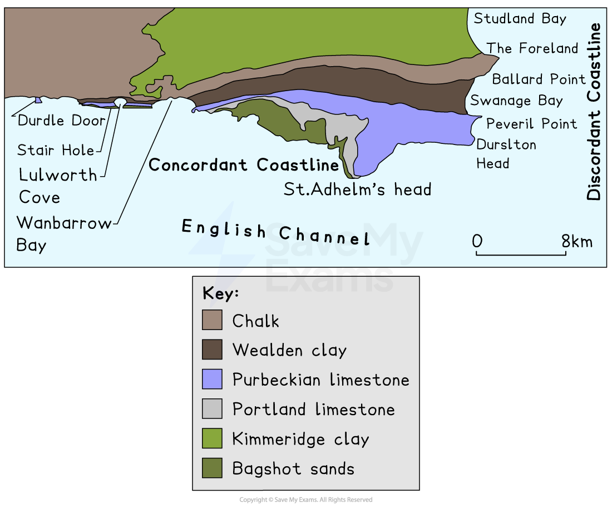
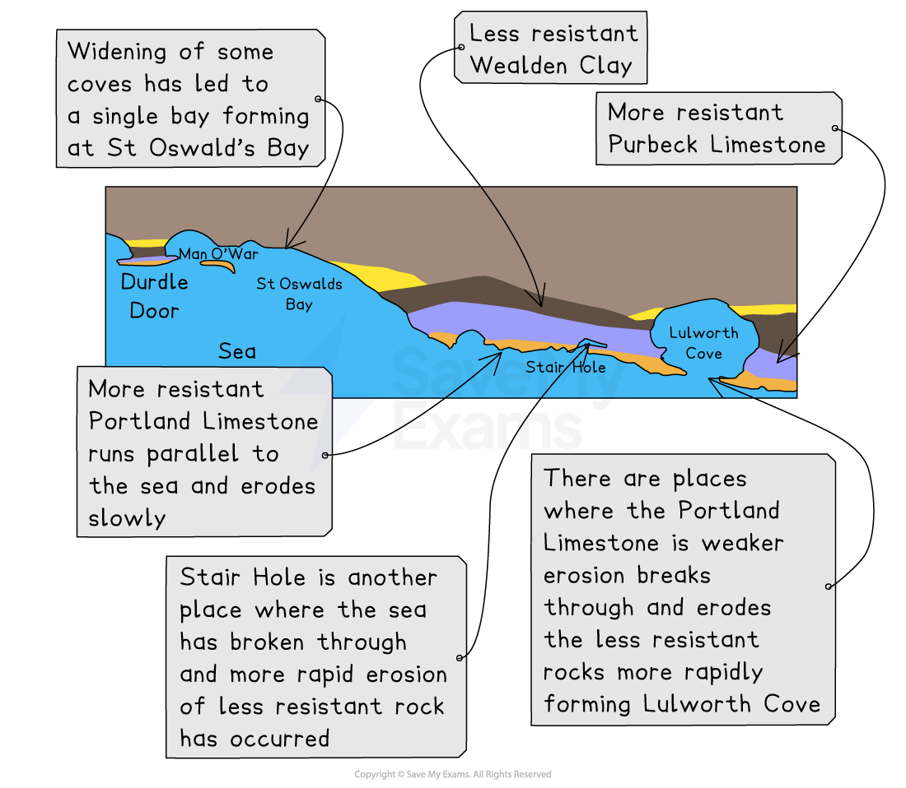
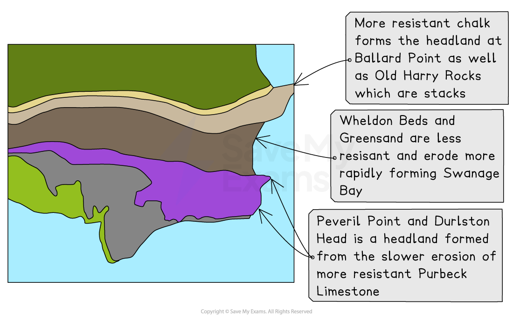

# Coastline Formation

## Specification link

This page covers section 2.2.2 of the [CIE IGCSE specification](https://www.cambridgeinternational.org/Images/718150-2027-2029-syllabus.pdf) .

- **2.2.2** -  The formation and characteristics of discordant and concordant coastlines.

## The influence of geological structure

> **Spec point** — `spcpt_7Q4jW3TsxKR4gzZN`

## The influence of geological structure

- **Geological structure** influences the shape of the coastline
- A coastline made up of softer rocks such as sands and clays will be more easily eroded
- Coastlines of more resistant, harder rock will take longer to erode and produce rugged landscapes
- ***Joints*** and ***faults*** expose rock to erosion and weathering
- The differences between hard and soft rocks will also impact the shape and characteristics of cliffs

**The Effects of Rock Type on the Coastline**

| ** ** | **Hard Rock** | **Soft Rock** |
|---|---|---|
| **Shape of cliff** | High and steep | Generally lower and less steep |
| **Cliff face** | Bare rock and rugged | Smoother; evidence of slumping |
| **Foot of cliff** | Boulders and rocks | Few rocks; some sand and mud |

- The angle of the rocks at the coastline determines the shape that the coastline will take
- This forms a **concordant **or **discordant **coastline, such as the Dorset coastline

*Map of Dorset coastline showing a concordant and discordant coastline*

- **Geology**, therefore, **determines** the coastline **vertically **through the height and profile of a cliff and **horizontally **with bays and headlands

## Concordant coastlines

> **Spec point** — `spcpt_HvXCxFJ5gYp747V4` · The formation and characteristics of discordant and concordant coastlines.

## Concordant coastlines

- **Concordant **coastlines are made up of the **same rock type, running parallel **to the sea
- This causes **even rates of erosion** along the coastline
- These coastlines typically produce coves

  - An example of a concordant coastline can be found in the area around **Lulworth Cove **in Dorset
  - More resistant **Portland Limestone** runs parallel to the sea, with less resistant **Purbeck Limestone **and **Wealden Clay** behind it
  - The formation of coves has occurred where the water has broken through at weaker points in the Portland Limestone

*Concordant coastline in South Dorset, showing coastal erosion at Durdle Door and Lulworth Cove*

## Discordant coastlines

> **Spec point** — `spcpt_j4BWN8vsySmwzwxp` · The formation and characteristics of discordant and concordant coastlines.

## Discordant coastlines

- **Discordant **coastlines have **alternating bands **of **rock perpendicular **(90°)** **exposed** **to the sea
- This causes **uneven rates of erosion** along the coastline
- These types of coastlines form headlands and bays

  - For example, to the east of Lulworth Cove in Dorset, the coastline runs north to south and so the rocks meet the coast at an angle, creating a discordant coastline

*Headland and bay formations on a discordant coastline*
