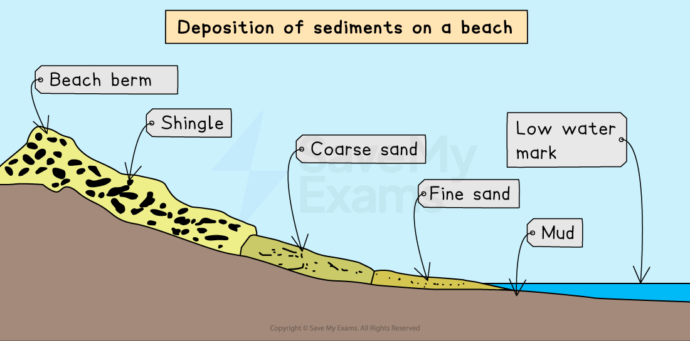
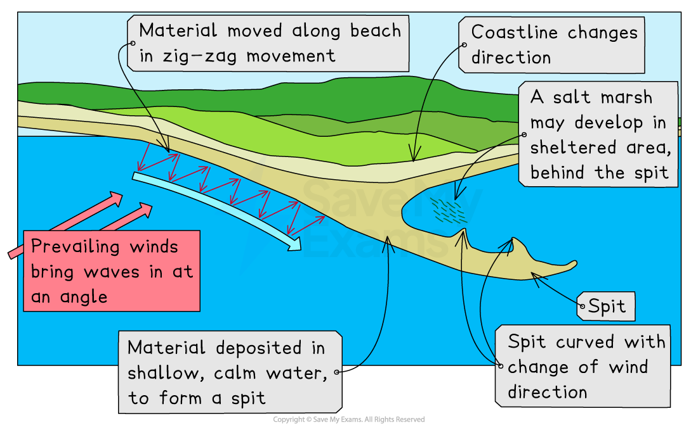
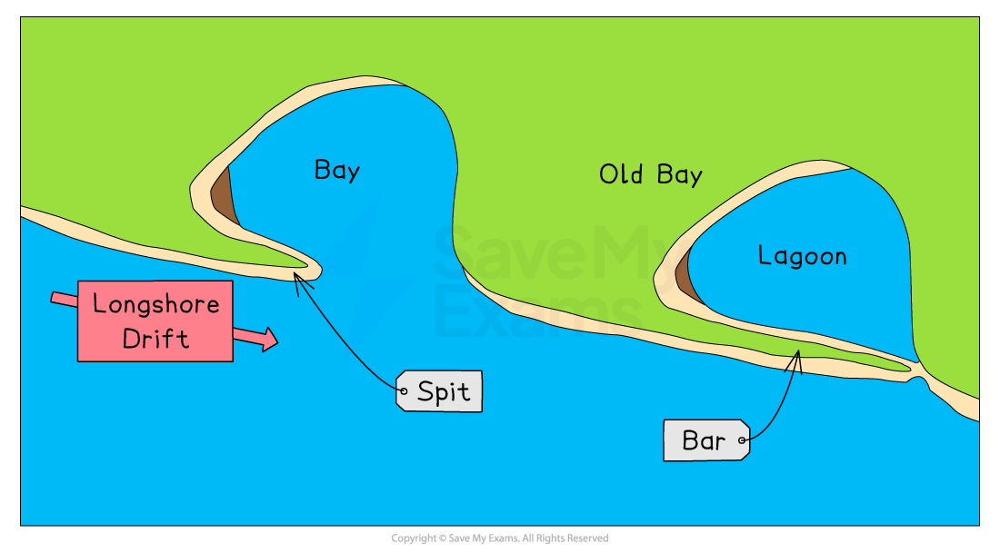
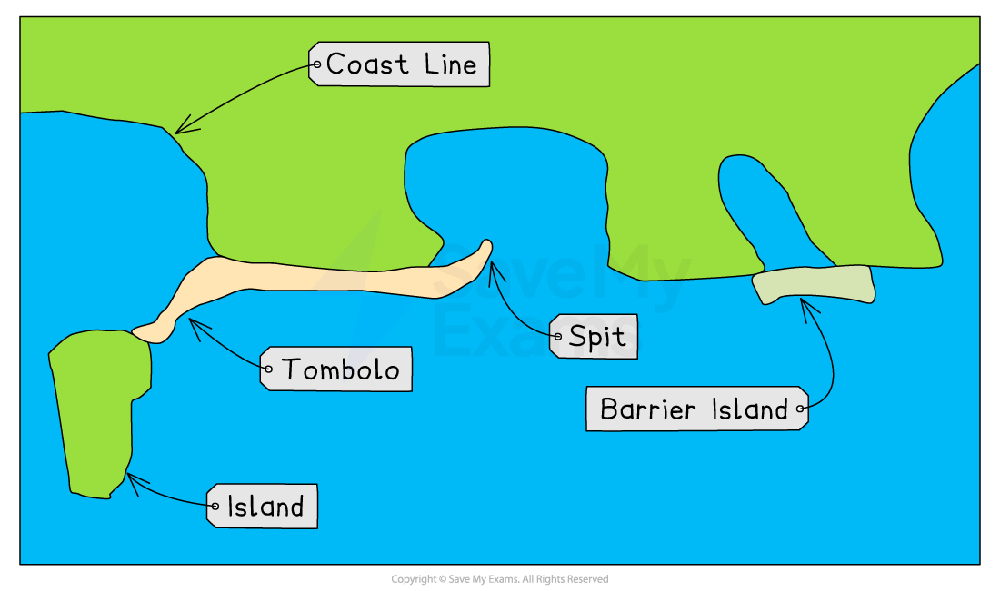
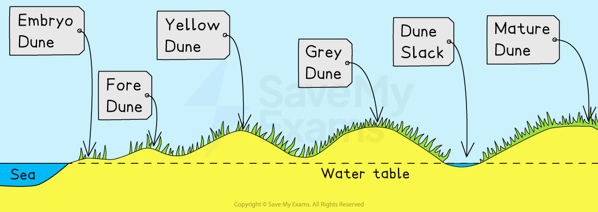

# Landforms of Coastal Deposition

## Specification link

This page covers section 2.2.1 of the [CIE IGCSE specification](https://www.cambridgeinternational.org/Images/718150-2027-2029-syllabus.pdf) .

- **2.2.1  - **The characteristics and formation of landforms: beaches, spits, bars, sand dunes.

## Formation of deposition coastal landforms

> **Spec point** — `spcpt_jtczfdzbwXyVMyfq` · The characteristics and formation of landforms: beaches, spits, bars, sand dunes.

## Formation of deposition coastal landforms

### Beaches

- Typically, beaches form during the calmer summer months, in sheltered areas such as bays
- **Constructive wave **action causes **deposition**, with the **swash** being stronger than the **backwash**
- Strong winds can occasionally carry sand from offshore bars onto the shore
- Blown sand can create sand dunes at the ***backshore*** of a beach

  1. When a constructive wave carries sediment up the beach, the largest material is deposited along the upper reach of the swash
  2. As the backwash moves back down the beach, it loses water and therefore energy as it travels due to the porosity of the sand
  3. Consequently, the deposition of sediment gets progressively smaller, and the beach is therefore, sorted by wave deposition, with the smallest mud particles settling in the low-energy environment offshore
  4. If a destructive wave forms due to a storm, then large shingle is thrown above the usual high tide level to form a ridge at the top of the beach called a **berm**

*Diagram of sediment deposition on a beach*

### Spit

- A spit is an extended stretch of sand or shingle that extends out to sea from the shore
- Spits occur:

  - When there is a change in the shape of the coastline
  - **or**
  - When the mouth of a river prevents a spit from forming across the **estuary**

- A spit may or may not have a 'hooked' end, depending on opposing winds and currents
- A good example is **Spurn Point**, which stretches for three and a half miles across the **Humber Estuary** in the northeast of England

#### Stages of spit formation

1. Sediment is transported by ***longshore drift***
2. Where the coastline changes direction, a shallow, sheltered area allows for **deposition of sediment**
3. Due to **increased friction**, more deposition occurs
4. Eventually, a spit slowly builds up to sea level and extends in length
5. If the wind changes direction, then the wave pattern alters and results in a hooked end
6. The area behind the spit becomes sheltered
7. ***Silts*** are deposited here to form **salt marshes** or **mud flats**

*Illustration showing spit formation with a 'hooked' end*

#### Bar

- A bar occurs when a spit grows across a bay, and joins two headlands together
- A **bar **of sand is formed (**sandbar**)
- Sandbars can also form **offshore **due to the action of breaking waves from a beach

*Illustration showing bar formation*

#### Lagoon

- A **lagoon** is where a small body of water is cut off from the sea
- They may form behind a bar or tombolo
- Lagoons do not last forever and may fill with sediment and form new land

#### Tombolo

- A **tombolo **is formed when a spit joins the mainland to an island
- Chesil Beach in Dorset is a tombolo, as the mainland is joined to the Isle of Portland

#### Barrier island

- **Barrier islands** form **parallel** to the coast
- The main difference between a bar and a barrier island is that a bar joins two headlands, whereas a barrier island is open at one or both ends

*Illustration showing the formation of a tombolo and barrier island*

> **Exam Hint**
> You may be asked to draw and label a diagram showing how depositional landforms (beaches, spits, etc.) are formed. You must demonstrate how waves transport sediment along the coast. Practice drawing and labelling these diagrams so you can reproduce any of them in the exam. Marks are awarded for the accuracy and completeness of your labelling and drawing.

### Sand dunes

- Sand dunes are a ***dynamic*** environment and changes occur quickly
- Sandy beaches are usually backed by sand dunes due to strong onshore winds, which transport dried-out, exposed sand
- Sand grains are trapped and deposited against an obstacle (rubbish, rocks, driftwood, etc) to form dunes
- Dune ridges move inland due to onshore winds pushing the seaward side to the leeward side
- It is the interaction of winds and vegetation that help form sand dunes

### Formation of a sand dune

- Windblown sand is deposited against an obstruction, such as a pebble or driftwood
- As more sand particles are caught, the dunes grow in size, forming rows at right angles to the prevailing wind
- In a process known as ***succession,*** vegetation will eventually colonise and fix the ridges of the dunes

*Illustration of coastal dune succession*

- **Embryo dunes**

  - Embryo dunes are very fragile and easily damaged
  - Pioneer species such as Lyme Grass and Sea Couch Grass begin to grow
- **Fore dunes**

  - Marram grass begins to stabilise the dune with its root system
  - A **microclimate** forms in the *dune slack*
- **Yellow dunes**

  - Marram grass continues to stabilise the dune with its root system
  - More delicate flowering plants and insects are found in the dune slacks
- **Grey dunes **

  - Grey dunes are more stable and shrubs and bushes begin to appear
- **Mature dunes**

  - These are the oldest and most stable of the dunes
  - The soil can support a variety of flora and fauna, such as oak trees
  - This is the final stage in succession

> **Worked Example**
> **Figs. 3.1, 3.2 and 3.3 show three coastlines.**
> 
> 
> 
> Identify each of the following landforms:
> (i) landform **W** in Fig. 3.1
> 
> **[1]**
> 
> (ii) landform **X** in Fig. 3.2
> 
> **[1]**
> 
> (iii) landform **Y** in Fig. 3.2
> 
> **[1]**
> 
> (iv) landform **Z** in Fig. 3.3.
> 
> **[1]**
> 
> ### Solution
> 
> - **W:** **Wave-cut platform**
> - **X**: **Beach**
> - **Y:** **Sand dunes**
> - **Z:** **Cliff**
