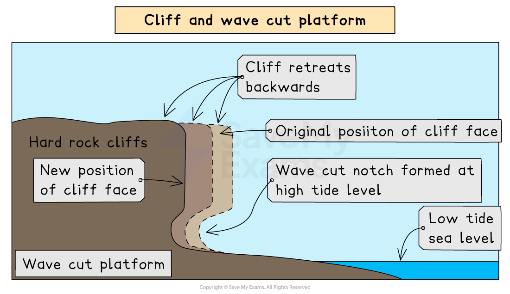
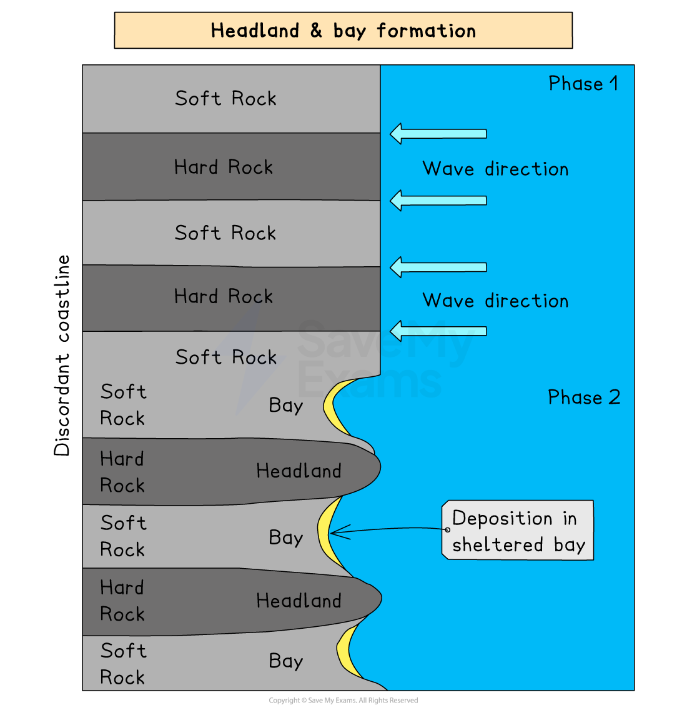

# Landforms of Coastal Erosion

## Specification link

This page covers section 2.2.1  of the [CIE IGCSE specification](https://www.cambridgeinternational.org/Images/718150-2027-2029-syllabus.pdf) .

- **2.2.1  - **The characteristics and formation of landforms: headlands, bays, cliffs, wave-cut platforms, caves, arches, stacks and stumps.

## Formation of erosional coastal landforms

> **Spec point** — `spcpt_SGvpxJfFTf7jsGBk` · The characteristics and formation of landforms: headlands, bays, cliffs, wave-cut platforms, caves, arches, stacks, stumps, 

## Formation of erosional coastal landforms

### Cliffs

- Cliffs are sloping or steep rocks with different profiles depending on the *topography* and geology of the cliff
- The cliff face angle is also affected by geology and wave attack at its base
- Cliffs are shaped through erosion

  - Low-energy waves cause less damage than high-energy ones
  - Soft rock erodes quickly and will form sloping cliff faces
  - Steep cliffs are formed where there is hard rock facing the sea

### Wave-cut platforms

- A wave-cut platform is a wide, gently sloped surface found at the foot of a cliff

  - As the sea attacks the base of a cliff between the high and low water mark, a **wave-cut notch** is formed
  - **Abrasion**, **corrosion** and **hydraulic action** further extend the notch back into the cliff
  - As **undercutting** continues, the cliff above becomes unsupported and unstable and eventually collapses
  - The backwash of the waves carries away the eroded material, leaving behind a **wave-cut platform**
  - The process repeats and the cliff continues to retreat, leading to a coastal retreat

*The process of cliff formation, retreat and wave-cut platform*

### Headlands and bays

- Occur where alternating bands of hard and soft rocks run **perpendicular **to oncoming waves (**discordant **coastline)

  1. At first, the softer rock (e.g. clay) is eroded backward, forming an inlet
  2. As the inlet continues to erode it curves inwards, and a **bay **is formed, usually with a beach
  3. The harder rock (e.g. limestone) is left protruding out to sea as a **headland**
- A headland features usually include:

  - Cliffs along its sides
  - That it projects out to sea
  - It is usually longer than it is wide
  - Geology is of resistant rock
- A bay usually has:

  - A wide, open entrance from the sea
  - A roughly, semi-circular shape extending into the coastline
  - Land that is lower than the headlands surrounding it
  - A bay may or may not have a beach

*Diagram showing headland and bay formation on a discordant coastline*

### Caves, arches, stacks and stumps

- These form in a headland because of wave action
- As waves approach the shore, their speed is reduced as they move along the sea floor
- This changes the angle of the waves, and they will turn so the crest becomes parallel to the coast – known as **wave refraction**
- This refraction concentrates erosive action on all sides of the headland
- **Hydraulic action, abrasion, and corrosion **take advantage of any weaknesses in the headland

  - As the **crack **begins to widen, abrasion will begin to wear away at the forming **cave**
  - The cave will become larger and eventually breaks through the headland to form an **arch**
  - The base of the arch continually becomes wider and thinner through erosion below
  - Eventually, the roof of the arch collapses, leaving behind an isolated column of rock called a **stack**
  - The stack is **undercut **at the base by wave action until it collapses to form a **stump**

*Illustration showing the formation of a cave, arch, stack and stump*

> **Exam Hint**
> Be able to draw and label coastal landforms, as it's a common exam question.
> 
> Remember that **attrition **is **not **part of the formation of this process; it is the knocking together of rocks to smooth and round them.
> 
> Corrosion is a key part of these features' formation, as all salt water is slightly acidic and most rock contains soluble minerals that react with it.
