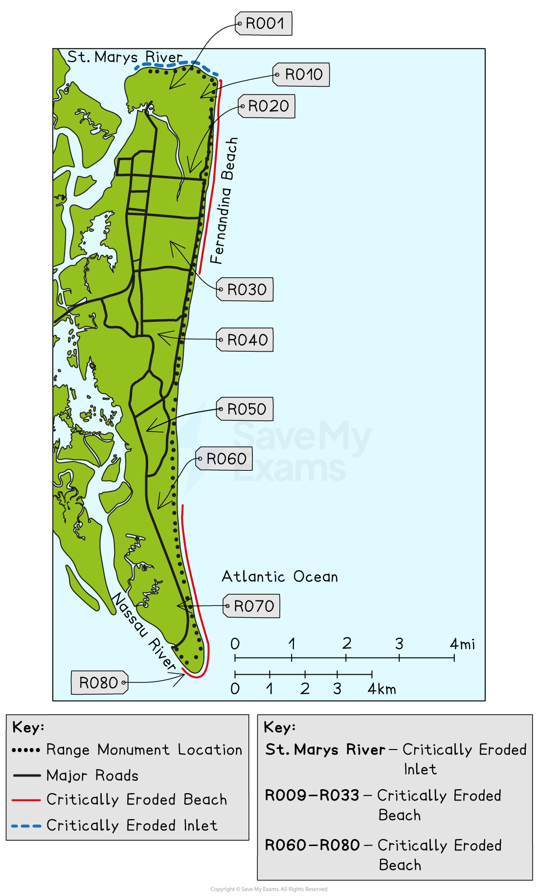
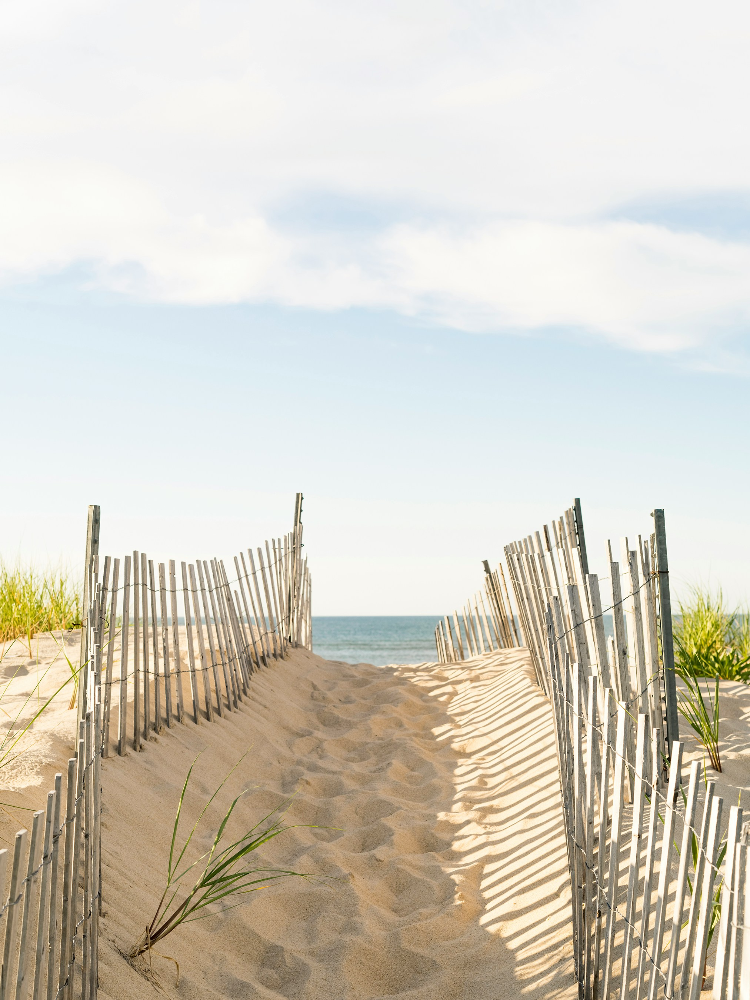

# Detailed Specific Example: Nassau County, Florida

## Specification link

This page covers section 2.3.7 of the [CIE IGCSE Geography specification](https://www.cambridgeinternational.org/Images/718150-2027-2029-syllabus.pdf).

- **2.3.7 **- One detailed specific example of a named country or coastal area to include:

  - the causes and impacts of coastal erosion
  - the strategies and techniques used to protect the coast from tropical storms and manage erosion, including sustainable ones.

## Causes of coastal erosion in Nassau County, Florida

> **Spec point** — `spcpt_3T6YM5YsmrMZGfht` · One detailed specific example of a named country or coastal area to include: 
• the causes and impacts of coastal erosion 
• the strategies and techniques used to protect the coast from tropical storms and manage erosion; including sustainable.

## Causes of coastal erosion in Nassau County, Florida

### Background

- Nassau County is located in northeast Florida, along the Atlantic Ocean
- It includes **Amelia Island**, a popular tourist destination known for its beaches, dunes, and historic towns like **Fernandina Beach**
- This area has experienced growing concerns about coastal erosion due to both natural processes and human activity

### Causes

- Coastal erosion in Nassau County happens when **wind, waves, and storms remove sand and sediment** from beaches and dunes. The main causes are:

#### Tropical storms and hurricanes

- Storms like **Hurricane Matthew (2016)** and **Hurricane Irma (2017)** caused **severe beach erosion** and **flooding**
- These storms bring **storm surges**, high waves, and strong winds that **wash away sand and damage dunes**

#### Sea level rise

- Sea levels are rising due to **global warming**, causing more frequent **high tide flooding** and making erosion worse
- The **sea level along Florida’s coast has risen by about 8 inches (20 cm) since 1950** and is expected to rise much more in coming decades

#### Human activity

- **Construction of seawalls**, roads, and buildings **interrupts natural sand movement**
- In some areas, removing **coastal vegetation** and **sand mining** have weakened dunes and left the beach more exposed to erosion

## Impacts of coastal erosion in Nassau County, Florida

> **Spec point** — `spcpt_9cZj6CGNQJsK8f4s` · One detailed specific example of a named country or coastal area to include: 
• the causes and impacts of coastal erosion 
• the strategies and techniques used to protect the coast from tropical storms and manage erosion; including sustainable.

## Impacts of coastal erosion in Nassau County, Florida

- Coastal erosion in Nassau County has affects the **local economy, housing, infrastructure, ecosystems**, and **public safety**
- Some of the most significant impacts been on **Amelia Island** and **Fernandina Beach**

*Nassau County's critically eroded beaches*

#### Property damage

- Homes, roads, and buildings close to the beach are at risk of collapsing or flooding. Insurance costs have increased

  - **Amelia Island**, especially areas like **South Fletcher Avenue**, is highly exposed to beach erosion
  - Homes along this beachfront have been left just **metres from the ocean** after storms washed away the sand dunes that once protected them
  - After **Hurricane Matthew (2016)**, several oceanfront homes experienced **flooding and structural damage**
  - Emergency sandbags and dune fencing had to be installed to protect houses from further damage
  - Erosion has **lowered property values** and led to **higher insurance premiums** due to increased risk of flooding and storm surge

#### Loss of tourist beaches

- Tourism is a major part of the economy and erosion has reduced beach size, affecting local businesses

  - Fernandina Beach, a popular tourist spot, has seen a narrowing of beaches, particularly near Main Beach Park and North Beach Park
  - Beachfront space for sunbathing, walking, and recreation is **shrinking**, especially during high tides and after storms
  - This has a **direct impact on tourism**, which is one of the main sources of income for Nassau County; with fewer visitors, there is less income for **local hotels, restaurants, and shops**

#### Damage to roads and public infrastructure

- Erosion threatens highways and utility lines near the shore

  - The **South Fletcher Avenue corridor**, a major coastal road, has been **undermined by waves**, with sections repeatedly needing repairs
  - During Hurricane Irma (2017), parts of **Ocean Avenue** were temporarily closed due to **flooding and roadbed erosion**
  - **Stormwater systems** near the beach often fail due to excess sand and debris, increasing **urban flood risk**

#### Habitat loss

- Dunes and beaches support wildlife like **sea turtles**, **shorebirds**, and **dune grasses**
- Dunes along Amelia Island are essential habitats for:

  - **Sea turtles** (especially loggerhead turtles), which nest along the beach each year
  - **Shorebirds** such as plovers and terns
  - **Dune vegetation** like sea oats, which hold sand in place
- Erosion has led to:

  - **Destruction of turtle nesting sites**, decreasing nesting success
  - **Collapse of vegetated dunes**, which act as natural wind and wave buffers
  - **Loss of biodiversity**, as some species struggle to survive in changing conditions

#### Increased flooding and storm impact

- Without wide beaches and strong dunes, Nassau County becomes more vulnerable to:

  - **Storm surges** (a rise in sea level caused by hurricanes)
  - **Saltwater intrusion** into freshwater areas
  - **Flooding of homes, parks, and infrastructure** even during regular high tides (a phenomenon called '**sunny day flooding**')
- **For example**, during Hurricane Dorian (2019), even though the storm didn’t make landfall, storm surge flooded parts of the **Egan’s Creek Greenway** and low-lying neighbourhoods near **Atlantic Avenue**

#### Cost of recovery and maintenance

- Each beach nourishment project in Nassau County can cost between **\$10 million and \$20 million**
- Maintaining infrastructure like **revetments, sand fencing, and emergency dunes** adds to public spending
- Local, state, and federal governments frequently share the economic burden, which means that long-term erosion increases the **financial pressure on communities**

## Strategies used to manage coastal erosion in Nassau County, Florida

> **Spec point** — `spcpt_XWWSsh7QhXKkN6PK` · One detailed specific example of a named country or coastal area to include: 
• the causes and impacts of coastal erosion 
• the strategies and techniques used to protect the coast from tropical storms and manage erosion; including sustainable.

## Strategies used to manage coastal erosion in Nassau County, Florida

- The approach in Nassau County focuses on **balancing development with natural protection**
- Over **\$20 million** has been spent on **erosion control and beach restoration** in Nassau County over the last 10 years
- **Sea turtle nesting areas** on Amelia Island have been protected through dune fencing and vegetation planting
- After Hurricane Matthew (2016), Fernandina Beach lost over **50 feet of sand**, leading to urgent restoration projects
- **Over 15,000 sea oats** were planted in a single season as part of a community dune restoration project

### Hard engineering techniques

#### Seawalls and revetments

- Built along the coast to block wave energy

  - For example a **rock revetment** was installed near **Fernandina Beach** after Hurricane Matthew to protect roads and homes
  - A **concrete seawall** was constructed along **South Fletcher Avenue** in Fernandina Beach to protect homes and a section of the road that was under threat after **Hurricane Matthew (2016)**
  - However, although the wall reduced erosion in that area it has led to **increased erosion further down the beach**, a process known as **'*****coastal squeeze*****'**
- Revetments have been installed in front of **public beach access points** near **Sadler Road and Seaside Park**

  - These were added after **dune failure during Hurricane Irma (2017)**
  - They are visually more natural than seawalls but still require **regular maintenance** and can be dangerous for swimmers

#### Groynes

- Wooden or stone barriers built at right angles to the shore to trap sand moving along the beach
- Help widen beaches in one area but may cause erosion further along the coast

  - Old **wooden groynes** still exist on some parts of **Amelia Island’s northern beaches**
  - Although rarely used in new projects today, these older groynes helped maintain beach width for many decades
  - However, they often led to **erosion on the down-drift side** where sand was no longer transported naturally

### Soft engineering and sustainable management

#### Beach nourishment

- Involves **adding sand** to the beach from another location

  - In **2020**, a major **beach nourishment project** on Amelia Island added **700,000 cubic yards** of sand to restore dunes and widen the beach
  - **Benefits**: This project widened the beach, **improved turtle nesting habitats**, and provided **a natural buffer** against storms
  - Looks natural, supports wildlife, and protects property
  - **Cost**: Sand was **dredged from offshore** and transported to shore
  - Over **\$10 million**, but seen as a long-term investment

#### Dune restoration

- Planting **sea oats and native grasses** to stabilise dunes
- Helps absorb wave energy and **acts as a natural buffer** during storms

  - Community groups like **Keep Nassau Beautiful** have planted over **15,000 sea oats** near **North Beach Park and American Beach** since 2019
  - The county has also installed **fencing and boardwalks** to protect newly formed dunes from foot traffic
- Fencing off dunes to prevent trampling by tourists
- Sand fences are simple wooden slat fences placed in a zigzag pattern to trap sand and help **dune formation**

  - **Seaside Park **and **Main Beach** use sand fencing, especially after storms, to aid in the beach's natural rebuilding.
  - Combined with sea oat planting, this helps create **stronger, wider dunes**

*Sand fencing in Nassau County   Photo by Tommy Kwak on Unsplash*

#### Managed retreat

- In some areas, officials are choosing to **move buildings back** from the beach over time
- This reduces future risk and allows the coast to change naturally

  - **Emerging practice in Nassau County**:
  
    - While no large-scale retreat projects have been completed yet, **development restrictions** near **Egan's Creek Greenway** and **dune buffer zones** are early examples of planning to allow space for the shoreline to shift naturally in the future

#### Zoning and building regulations

- Nassau County has **building setback laws**, which stop developers from building too close to the shoreline
- New homes must be **elevated on pilings** to reduce flood risk

#### Community education and involvement

- Local organisations like **Keep Nassau Beautiful** teach residents about dune protection and organise **coastal clean-ups and dune planting days**
- Locals are encouraged to report erosion and storm damage

## Managing tropical storms in Florida

> **Spec point** — `spcpt_CYMgDdrWY4s923db`

## Managing tropical storms in Florida

- Florida is one of the **most hurricane-prone states in the U.S.**, with a long history of **tropical storms and hurricanes** causing serious damage
- In response, Florida has adopted a wide range of **engineering, ecological, and community-based strategies** to manage these powerful natural events
- Florida’s location between the **Atlantic Ocean and the Gulf of Mexico** makes it vulnerable to **hurricanes every year**, especially between **June and November**
- Over **40% of U.S. hurricanes** have made landfall in Florida
- Storms bring:

  - **Strong winds** (up to 150+ mph)
  - **Heavy rainfall** and **flooding**
  - **Storm surge**, which causes **extreme coastal erosion** and infrastructure damage

### Traditional storm protection methods

- Florida has historically used **hard engineering** to protect its coastlines from tropical storm damage:

  - **Seawalls** in cities like **Miami, St Augustine**, and **Naples** protect urban areas from storm surges
  - **Stormwater drainage systems** and **pumping stations** are installed to quickly remove floodwaters
  - **Building codes** now require new structures in coastal zones to be **elevated**, wind-resistant, and **built with hurricane straps**
  
    - **For example,** after Hurricane Andrew (1992), one of the most destructive storms in Florida's history, the state completely **overhauled its building code system**, making it the **strongest in the U.S.** today

### Sustainable storm management

- Recently, Florida has embraced **nature-based solutions** as part of **sustainable storm management**
- These are cost-effective, support biodiversity, and **work with natural ecosystems** to reduce damage
- **Mangrove restoration (Everglades & Keys)**

  - Mangroves reduce wind speed and storm surge, acting as a **natural hurricane defence system**
  - Each acre of mangroves can **reduce property damage by up to \$250,000** during a storm
  - **Coral reef restoration (Southeast Florida Reef Tract)**
  
    - Coral reefs act like underwater walls, breaking waves and protecting shorelines from surge
  - **Dune and beach nourishment projects (Northeast Florida)**
  
    - Rebuilding dunes and beaches with native vegetation and sand helps **absorb storm energy** and protect homes inland

> **Case Study**
> **Brittany Bay Park & Living Shoreline Project**
> 
> - Brittany Bay Park, Miami Beach is a low-lying urban waterfront park vulnerable to tidal flooding, sea level rise, and storm surge
> - A living shoreline is a natural coastal barrier that **absorbs wave energy**, **reduces erosion**, and **provides wildlife habitats**—unlike concrete seawalls, which can reflect wave energy and increase erosion elsewhere
> - They are made of:
> 
>   - Native vegetation
>   - Oyster reefs
>   - Salt marshes
>   - Coir logs (natural fiber rolls used to trap sediment)
> 
> **Project partners**
> 
> - **The Nature Conservancy** (Virginia-based environmental organisation)
> - **City of Miami Beach**
> - **Florida Power & Light Company (FPL)**
> 
> **Project goals **
> 
> 1. **Reduce flooding and erosion**
> 
>   - Native mangroves and grasses stabilise the shoreline and reduce waves** impact during storms**
> 2. **Improve water quality**
> 
>   - Wetland plants naturally **filter pollutants and sediments** from runoff entering Biscayne Bay
> 3. **Enhance biodiversity**
> 
>   - The area supports fish, crabs, and birds, and it helps connect marine ecosystems
> 4. **Community resilience**
> 
>   - The park is now a **green space that doubles as storm protection**, making it a model for **urban climate adaptation**
> 
> **Project impact and sustainability**
> 
> - Over **100,000 native plants** used in the shoreline
> - Over **30 species of marine life** documented returning to the habitat
> - Designed to withstand **Category 3 hurricane-level storm surge**
> - Integrated into the **Miami Beach Stormwater Master Plan** as a **model for future projects**
> - Funded partly through **public-private partnerships**, showing how cities, companies, and NGOs can collaborate
