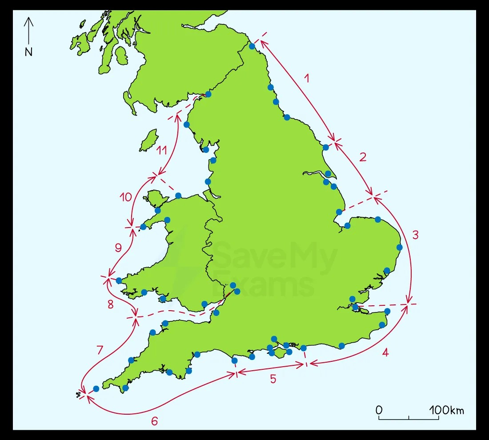

# Coastal Management

This page covers section 2.3.3 of the [CIE IGCSE Geography specification](https://www.cambridgeinternational.org/Images/718150-2027-2029-syllabus.pdf).

- **2.3.3 -** An evaluation of hard and soft engineering strategies and techniques used to manage coastal erosion and flooding; including sustainable.

## Coastal defence strategies

> **Spec point** — `spcpt_FfTPVhVQZt3ZCDSm` · An evaluation of hard and soft engineering strategies and techniques used to manage coastal erosion and flooding; including sustainable

## Coastal defence strategies

- Management of coastal regions is performed by identifying ***coastal cells***
- This technique breaks a long coastline into manageable sections and helps identify **two related risks**:

  - The risk of erosion and land retreat
  - The risk of flooding
- Identifying risks allows resources to be used efficiently to limit their impacts
- The '***cost-to-benefit***' is easier to calculate using coastal cells

*Major sediment cells around the UK. These are then divided into sub cells, represented by the blue dots.*

### Prediction

- Early warning systems allow communities to prepare (evacuate or take shelter) before flooding occurs
- Two methods are used to help ***forecast*** coastal flooding

  - **Past records:** diaries, newspapers, government/council records, etc.
  - These identify areas that are at high risk of flooding and their frequency
  - **Modern technology**: GIS, satellite and computer monitoring, weather stations (local and national), etc.
  - They forecast and track potential hazardous events, such as:
  
    - Storms: track the storm's path and associated storm surge
    - Earthquakes: the size and position of underwater tremors and the possible tsunami outcome
- Both forecasting methods help officials determine when and where the event will occur
- They show the risk of damage and fatalities as well as the potential intensity and scope of the flooding

### Prevention

- **Prevention **is about taking action that **reduces **or **removes **the **risk **of coastal flooding. Actions include:

#### Flood defences

- These are built along high-risk stretches of coast

#### Emergency centres

- Centrally placed on higher ground where people can be safe from flooding

#### Early warning systems

- Allows for the preparation or evacuation of an area

#### Education

- Informing local people on what to do if and when a flood occurs

#### Planning

- Any new development should be planned away from high-risk areas
- Design buildings to deal with low levels of flooding

  - Raise buildings to allow floodwaters to flow underneath
  - Strengthen barriers
  - Sealing a property to prevent floodwater intrusion is known as dry floodproofing
  - Wet floodproofing allows some flooding of the building

#### Buffer zones

- Areas of land are allowed to flood before reaching settlements

  - This slows down the floodwater's journey by allowing the surge's energy to dissipate
  - It can mean moving people away from the coast, which could be controversial

## Hard and soft engineering

> **Spec point** — `spcpt_hfZRpSkWJkJQqzTP`

## Hard and soft engineering

- There are conflicting views about what type of engineering to use for coastal defence
- Most coastal managers aim to use a range of methods depending on the value of what is being protected
- This method is known as** Integrated Coastal Zone Management (ICZM)**
- ICMZ aims to use a combination of methods to best reflect all ***stakeholders'*** needs

### Soft engineering methods

- Soft engineering works with natural processes rather than against them

  - Usually cheaper and do not damage the appearance of the coast
  - Considered a more sustainable approach to coastal protection
- However, they are not as effective as hard engineering methods

  - Areas can just be left at the mercy of the sea
  - More gentle intervention may not be effective
  - People can lose their homes and livelihoods

#### Beach replenishment

- This is the pumping or dumping of sand and shingle back onto a beach to replace eroded material
- **Advantages**

  - Beaches are a natural defence against erosion and coastal flooding by absorbing wave energy
  - Widens the beachfront and looks natural
  - Can improve the attractiveness of a stretch of coast
  - Creates a useful amenity for tourism
  - It is a relatively cheap option and easy to maintain
- **Disadvantages**

  - Has to be repeated regularly, which can be expensive
  - Can impact sediment transportation down the coast
  - People may be prevented from using the beach for several weeks during maintenance

#### Fencing, hedging, and replacing vegetation

- Helps to stabilise sand dunes or beaches
- Reduces wind erosion
- **Advantages**

  - Cheap method to protect against flooding and erosion
- **Disadvantages**

  - Hard to protect larger areas of coastal cliffs

#### Cliff re-grading

- This is when the angle of a cliff is softened to reduce mass movement
- **Advantages**

  - Prevents the sudden loss of large sections of cliff
  - As wave energy is slowed, wave-cut notching is reduced at the base of the cliff
- **Disadvantages**

  - It does not stop cliff erosion; it only slows it down

#### Beach re-profiling

- Beach re-profiling is the artificial re-shaping of a beach using existing beach material
- **Advantages**

  - Replaces shingle after winter storms
  - Increasing the profile reduces wave energy before the base of the cliffs
- **Disadvantages**

  - Re-profiling may have a negative effect on beach habitats

#### Dune regeneration

- Dune regeneration is the artificial creation of new dunes or the restoration of existing dunes using strategies such as marram grass planting or fencing them off from human impact
- **Advantages**

  - Sand dunes act as a physical barrier between the sea and the land
  - Dunes absorb wave energy and water
  - This strategy is considered the most natural and can produce an attractive amenity for tourists
  - Dunes may also increase biodiversity by providing a wider range of natural habitats for plants, animals, and birds
- **Disadvantages**

  - Storms can easily damage them
  - Time-consuming to plant the grass and maintain the area
  - It can also deter tourists at this time

#### Managed retreat

- The existing coastal defences are abandoned, allowing the sea to flood inland until it reaches higher land or a new line of defences
- **Advantages**

  - There are no expensive construction costs
  - Creates new habitats such as salt marshes
- **Disadvantages**

  - Disruptive to people, where land and homes are lost
  - The cost of relocation can be expensive
  - Full compensation to people and businesses may not be paid

### Hard engineering methods

- Hard engineering involves building concrete, wood, or rock sea defences
- Building and maintaining structures is costly
- Defences work against the power of the waves
- Each defence has pros and cons
- Protection in one place can increase erosion and flooding along the coast
- When settlements and expensive installations (power stations, etc.) are at risk, hard engineering is used because the economic gain outweighs the costs

#### Seawall

- A seawall is usually concrete and curved outwards to deflect the power of the waves
- **Advantages**

  - Most effective at preventing both erosion and flooding (if the wall is high enough)
- **Disadvantages**

  - Very expensive to build and maintain
  - It can be damaged if the material in front of the wall is not maintained
  - Restricts access to the beach
  - Unsightly to look at

#### Groynes

- These are wood, rock or steel pilings that are built at right angles to the shore
- Longshore drift moves beach material into groynes
- **Advantages**

  - Most effective at preventing both erosion and flooding (if the wall is high enough)
- **Disadvantages**

  - Keeps material from moving down the coast and protects cliff bases elsewhere
  - Starves other beaches of sand
  - Wooden groynes need maintenance to prevent wood rot
  - Makes walking along the shoreline difficult

#### Rip-rap or rock armour

- Large boulders are piled up to protect a stretch of coast
- Works to absorb wave energy from the base of cliffs and sea walls
- **Advantages**

  - Cheaper method of construction
- **Disadvantages**

  - Boulders can be eroded or dislodged during heavy storms

#### Gabions

- Wire cages are filled with stone, concrete, sand, etc.
- Cages absorb wave energy
- **Advantages**

  - Cheapest form of coastal defence
  - Can be stacked at the base of a seawall or cliffs
- **Disadvantages**

  - Wire cages can break, and they need to be securely tied down
  - Not as efficient as other coastal defences

#### Revetments

- Sloping wooden or concrete fence with an open plank structure
- Revetments work to break the force of the waves
- **Advantages**

  - Traps the beach material behind them
  - Set at the base of cliffs or in front of the seawall
  - Cheaper than seawalls but not as effective
- **Disadvantages**

  - Not effective in stormy conditions
  - It can make the beach inaccessible to people
  - Regular maintenance is necessary
  - Visually unattractive

#### Off-shore barriers

- Large concrete blocks, rocks and boulders are sunk offshore to alter wave direction and weaken wave energy
- **Advantages**

  - Beach material is built up
  - Low maintenance
  - Maintains a natural beach appearance
- **Disadvantages**

  - Expensive to build
  - Can be removed in heavy storms
  - Can be unattractive
  - Prevents surfing and sailing

## Shoreline management plans

> **Spec point** — `spcpt_jDby3Rr2N6Y7nVnq`

## Shoreline management plans

- **Shoreline Management Plans (SMP)** set out an approach to managing a coastline from flooding and erosional risk
- The plans aim to reduce the risk to people, settlements, agricultural land and natural environments (salt marshes, etc.)
- There are **four **approaches available for coastal management, with differing costs and consequences:

#### Hold the line

- Long-term approach and the most costly
- Build and maintain coastal defences so the current position of the shoreline remains the same
- Hard engineering is the most dominant method used, with soft engineering used to support

#### Advance the line

- Build new defences to extend the existing shoreline
- Involves land reclamation
- Hard and soft engineering are used

#### Managed realignment or retreat

- Some or all coastal defences are removed, allowing the coastline to move naturally
- Over time, the land becomes flooded marshes, effectively protecting the land behind
- Most natural approach to coastal defence, as it doesn't need maintenance and creates new habitats for animals and plants
- However, the land is lost to the sea, which brings conflict, loss of livelihood and saltwater damages the existing ecosystems
- Mostly soft engineering with some hard engineering to support

#### Do nothing

- Cheapest method, but most controversial of the options
- The coast is allowed to erode and retreat landward
- No investment is made in protecting the coastline or defending against flooding, regardless of any previous intervention

- Decisions about which approach to apply are complex and depend on:

  - **Economic value of the resources** that would be protected, e.g. land, homes, etc.
  - **Engineering solutions: **It might not be possible to 'hold the line' for moving landforms such as spits or unstable cliffs
  - **Cultural and ecological value of land:** Historic sites and areas of unusual diversity
  - **Community pressure: **Local campaigns to protect the region
  - **Social value of communities:** long-standing, historic communities

> **Exam Hint**
> In the exam, you may be asked to "evaluate" the coastal defence methods. To ensure that you can do this, you need to know how effective the different methods are in reducing coastal erosion. Examples of evaluation include:
> 
> - Soft engineering may be longer-term because strategies such as dune regeneration take time to work
> - Hard engineering is effective in the short-term but is expensive and damages the environment
