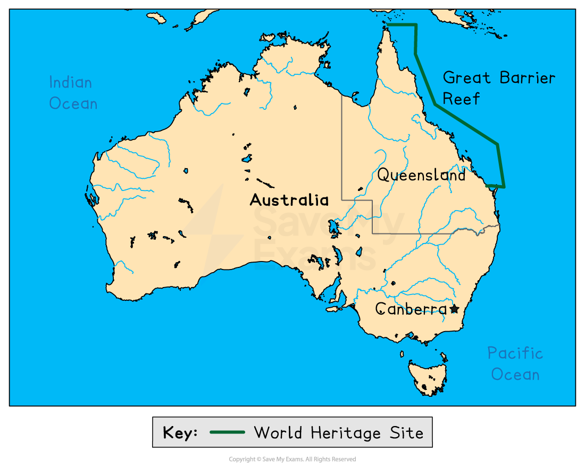
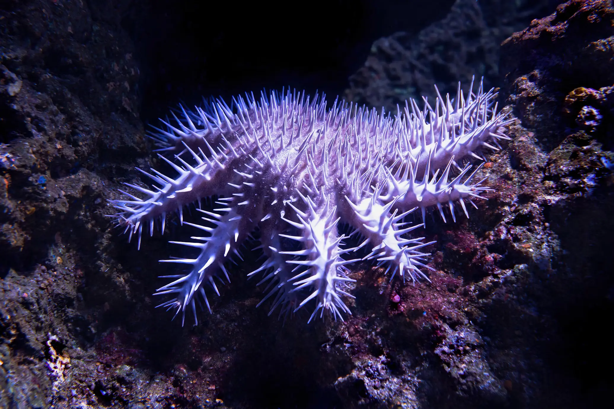

# Detailed Specific Example: Great Barrier Reef

## Specification link

This page covers section 2.3.8 of the [CIE IGCSE Geography specification](https://www.cambridgeinternational.org/Images/718150-2027-2029-syllabus.pdf).

- **2.3.8 **- One detailed specific example of a named country or coastal area to include:

  - why the coral reef is important
  - threats to the coral reef
  - the strategies and techniques used to protect and manage and the coral reef; including sustainable.

## Why the Great Barrier Reef is important

> **Spec point** — `spcpt_r4xCXnVFjMSp2nnk` · "One detailed specific example of a named country or coastal area to include:
• why the coral reef is important
• threats to the coral reef
• the strategies and techniques used to protect and manage and the coral reef; including
sustainable."

## Why the Great Barrier Reef is important

### Background

- The Great Barrier Reef is one of the most important natural systems on Earth
- Located off the coast of Queensland, Australia, it is the largest coral reef system in the world
- It covers over 344,400 km2 — about the size of Japan!

*Location of the Great Barrier Reef*

### Biodiversity

- It supports about **9,000 known species**, including:

  - **1,500 species of fish**
  - **400 species of coral**
  - **6 species of sea turtles**
  - **30 species of whales and dolphins**
  - **Over 130 species of sharks and rays**

### Economic value

- The reef contributes more than **AU\$6 billion (about US\$4 billion)** to the Australian economy each year through **tourism, recreation, and fishing, **supporting over **64,000 jobs**

### Coastal protection

- The reef system acts as natural walls that **absorb wave energy**, protecting coastal towns from erosion and storm damage

### Cultural significance

- Indigenous Australian groups like the **Yirrganydji and Gurang people** have cared for the reef for **thousands of years**, using traditional ecological knowledge

### Scientific discoveries

- Scientists have found compounds in the reef sponges and corals that may help to treat diseases like cancer, arthritis, and Alzheimer's

## Threats to the Great Barrier Reef

> **Spec point** — `spcpt_dzB4wb478dH88gyP` · "One detailed specific example of a named country or coastal area to include:
• why the coral reef is important
• threats to the coral reef
• the strategies and techniques used to protect and manage and the coral reef; including
sustainable."

## Threats to the Great Barrier Reef

### Climate change

- **Rising sea temperatures** stress corals, causing them to **expel the algae (zooxanthellae)** that give them colour and nutrients
- This turns the coral white — a process called **coral bleaching**
- If bleaching lasts too long, the coral can **die**
- In **2016 and 2017**, the reef experienced **back-to-back bleaching events**, damaging over **50% of shallow water corals** in the northern and central sections

### Runoff

- When it rains, water from farmland, towns, and cities runs into rivers and eventually into the sea
- This water often contains pesticides, fertilisers, and sediments that:

  - Smother corals
  - Reduce sunlight
  - Encourage outbreaks of crown-of-thorns starfish by increasing algae (their food)

### Development

- Past, present and future development poses a threat to the reef
- These are agriculture, mining, urbanisation, industrial development, port development, aquaculture and tourism development

  - Although tourism is vital for the economy, **anchor damage**, **walking on coral**, or **building resorts** too close to the reef can cause serious harm

### Fishing and poaching

- Overfishing reduces fish populations that are important for reef health (like herbivorous fish that eat algae)
- *Illegal fishing*

  - Although most fishers obey the rules, some **ignore the zoning laws** or fish without permission, especially at night or in remote areas
  - This puts extra pressure on already vulnerable parts of the reef
  - Undermines conservation efforts, making it harder for authorities to track and manage fish stocks
  - Reduces fish populations and disrupts the food chain, affecting both predators (like sharks) and prey
- Destructive practices, such as **trawling**, **dynamite fishing**, or **using illegal nets**, **physically damage coral** structures and sea beds
- **Incidental catch, also known as bycatch,** is when fishers **accidentally catch marine animals** they didn’t mean to catch. These can include:

  - **Turtles**
  - **Dolphins**
  - **Seabirds**
  - **Sharks and rays**
  - **Juvenile fish** (too small to legally keep)
- Many of these animals are **protected or endangered**, and some die even if they are released

  - Gill nets are a type of fishing net that traps fish by their gills
  - But they can also **trap sea turtles**, who drown if they can't reach the surface to breathe
  - In the past, turtle deaths were common in some parts of the reef and has now been **banned in many areas**, especially near turtle nesting beaches

### Scale

- The Great Barrier Reef is vast
- It is difficult to find enough funding, resources and people to protect the area

### Species

- **Crown-of-Thorns Starfish (COTS)**

  - This sea star eats coral polyps
  - When populations grow too large, they cause major destruction, especially in areas already stressed by climate change
  - Outbreaks have destroyed up to 40% of coral cover in some parts of the reef

Crown of thorns starfish  Photo by David Clode on Unsplash

- **Lionfish** are native to the Great Barrier Reef and play a natural role in the reef's ecosystem

  - While they are not invasive species, lionfish  prey on small fish and invertebrates, potentially disrupting the delicate balance of the reef ecosystem

## Strategies to protect the Great Barrier Reef

> **Spec point** — `spcpt_P3kcMTzdwPrfxXwX` · "One detailed specific example of a named country or coastal area to include:
• why the coral reef is important
• threats to the coral reef
• the strategies and techniques used to protect and manage and the coral reef; including
sustainable."

## Strategies to protect the Great Barrier Reef

- The reef is a** World Heritage Site and a Natural Wonder of the World **– this provides lawful protection and global recognition for future generations

### Reef 2050 plan

- This is a long-term plan for reef sustainability
- It aims to bring together governments, local communities and industries
- It evaluates the reef's values and threats, directing professionals to the areas where management efforts are most needed

### Reef water quality programs

- Farmers receive support to reduce fertiliser use and plant **vegetation buffers** along rivers
- The **Reef 2050 Plan** sets targets to reduce **nitrogen by 60%** and **sediment by 25%** by 2025

### Education

- Education and training is important for people like tour guides
- Presentations on reef protection regularly show at the Marine Park Authority Office
- Regular research is carried out to assess management strategies and their effectiveness
- Universities in Queensland offer courses for coral research

### Tools

#### Great Barrier Reef Marine Park Authority (GBRMPA)

- Established in **1975**, GBRMPA is the **main government agency** responsible for protecting the reef
- It works with scientists, traditional owners, communities, and industries to **create and enforce rules** that support sustainable use, such as

  - **Patrol boats and aerial surveillance** to catch illegal fishers
  - **Heavy fines and gear confiscation** as punishment
  - **Education campaigns** to teach local fishers about sustainable practices
  - **Satellite tracking** on commercial fishing boats
  - There are also **community-based programs** where local people report suspicious activity — these help protect remote reef areas where it’s hard to patrol regularly

#### Zoning plans

- The reef is divided into **zones** that allow or restrict certain activities

  - **Green Zones, **also known as** No-Take Zones, **where no fishing and collecting is allowed
  - **General Use Zones**  allow some fishing and tourism, under strict rules
  - About **33% of the reef is now fully protected** from all fishing

#### Permits

- Most activities require a permit, e.g. tourism, infrastructure construction, boating

#### Policies

- Environmental, scientific and tourist government policies are set in place

### Balancing stakeholders

#### Tourism management

- Balancing the importance of tourism while protecting the reef
- Guidance on managing reef tourism
- Future plans for tourism to be ecological as well as respectful to the heritage of the area

#### Heritage management

- Respecting **Aboriginal** ownership of land and knowledge of the area
- Working with **Aboriginals** and **Torres Strait Islanders** to protect the reef together
- Training, programs, mapping and action plans

#### Science management

- Using scientific evidence to guide management practices

### Monitoring and early warning

- Scientists use **satellites, drones, and underwater robots** to monitor reef health
- The [Eye on the Reef](https://www2.gbrmpa.gov.au/our-work/programs-and-projects/eye-on-the-reef/what-is-eye-on-the-reef) app allows **locals and tourists** to report changes or threats they see
- **Fluker posts **involve tourists in monitoring strategies

  - Tourists use these posts to take pictures of the reef
  - Photos are transferred to a site for professionals to examine
  - **Cost-benefit **– this saves money and time for workers

### Species protection and control

- Some species have different levels of protection (international, national, state or local)

  - This means they have **lawful** protection
- Species are also separated into **threatened, at-risk** or **iconic**
- Some species must be **controlled** due to their negative impact, such as crown-of-thorns starfish outbreaks

  - Professional divers inject starfish to kill them (without harming the environment)

### Reef restoration

- **Heat-resistant corals and coral nurseries**

  - Scientists are developing **‘super corals’** that can survive warmer water
- **Coral nurseries** grow healthy corals which are then **planted back onto damaged reefs** — this is known as **coral gardening**

  - **Coral fragments** – collecting and taking fragments and then planting them elsewhere (underwater or onshore in tanks)

### Traditional management

- **Indigenous People** are using traditional and modern **tracking** methods to track animals like turtles
- There is a priority for **subsistence** fishing, limiting overfishing
- Some areas of the reef are **taboo**, increasing protection
- Some areas of the reef **belong** to Indigenous Groups
