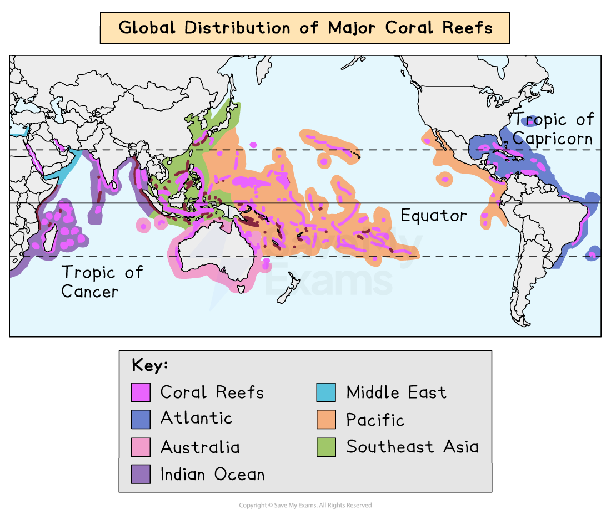
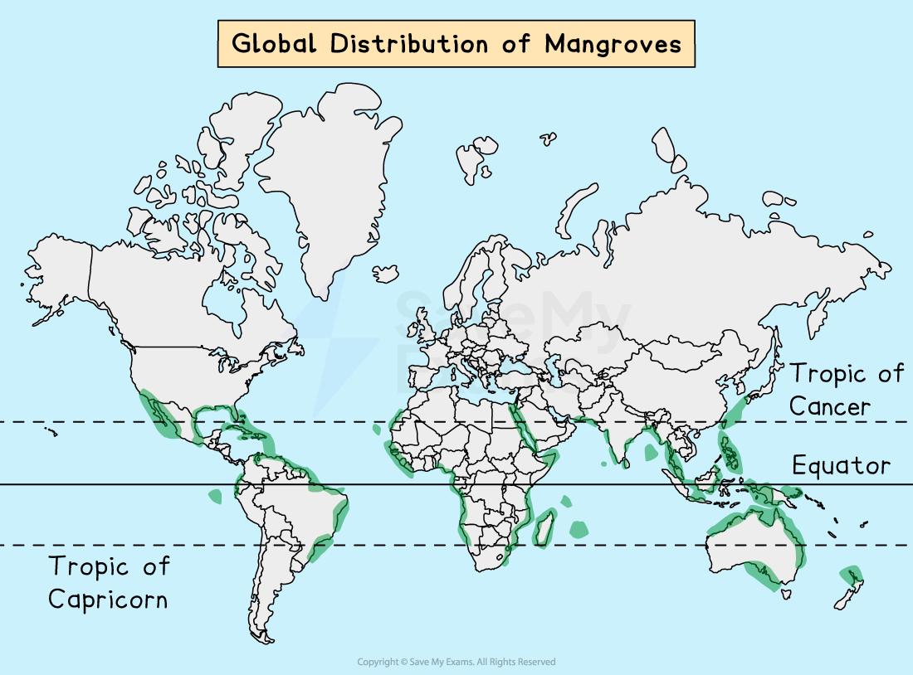
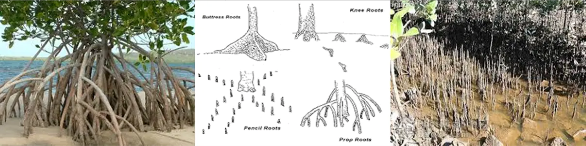

# Coral Reefs & Mangroves

## Specification link

This page covers section 2.3.6 of the [CIE IGCSE Geography specification](https://www.cambridgeinternational.org/Images/718150-2027-2029-syllabus.pdf).

- **2.3.6 **- The global distribution, importance of, threats to, and strategies and techniques used to protect and manage coral reefs and mangroves, including sustainable.

## Global distribution of coral reefs

> **Spec point** — `spcpt_S5nqXvqrmJrnCkNc` · The global distribution, importance of, threats to, and strategies and techniques used to protect and manage coral reefs and mangroves; including sustainable.

## Global distribution of coral reefs

- Coral reefs form through the build-up and compression of lime-secreting **polyp **skeletons
- **Only **the upper and outer parts of the coral reef contain living coral polyps
- When one generation dies, the next grows on top; their hard, ***calcareous*** skeletons form an upward and outward reef
- For corals to start growing, there needs to be a solid surface, which could be from a shipwreck or other debris
- Coral reefs run parallel to the coast, with breaks where river mouths exit
- Their extreme sensitivity means that coral reefs cannot grow anywhere

*Global distribution of coral reefs*

- Corals are found in the tropical and subtropical Western Atlantic and Indo-Pacific oceans between 30°N and 30°S of the Equator

  - Coral grow on rocky outcrops in some areas of the Gulf of California
  - **The Great Barrier Reef **in northern Australia is famous for its richness and size and can be viewed from space
- Four factors affect their distribution:

  - **temperature**
  - **light**
  - **water depth**
  - ***salinity***

### Global features of coral reefs

#### Temperature

- Corals cannot tolerate water temperatures below 18°C but grow best at 22°C – 25°C
- Some can stand temperatures as high as 40° C for short periods
- This is why coral reefs normally grow between 30° north and south of the equator within the Tropic of Capricorn and the Tropic of Cancer

#### Light

- Corals need light for photosynthesis due to the algae, called **zooxanthellae**, that live in their tissue

#### Water

- Corals are generally found at depths of less than 25 m where sunlight can penetrate
- The water must also be clear and clean to allow for photosynthesis to occur

#### Salinity

- Since corals are marine animals, they need salty water to survive, ranging from 32 to 42% saltwater

### Local features of coral reefs

#### Wave action

- Corals need well-oxygenated, clean water and wave action provides this

#### Exposure to air

- Although corals need oxygenated water, they cannot be exposed to air for too long, or they will die

#### Sediment

- All corals need clear, clean water
- By decreasing the amount of light available, sediment in the water will block regular feeding habits and interfere with the photosynthesis of the microscopic algae known as 'zooxanthellae' that live in polyp tissue
- The corals provide algae with a home and materials for photosynthesis
- In return, the algae produce food and oxygen and help with waste removal

### Types of coral reefs

#### Fringing reef

- These are low, narrow bands of coral running parallel to the coast and form around a landmass
- At high tide, narrow, shallow lagoons cover them
- Their outer edges slope steeply down into the sea beyond
- The landward side of the reef has a higher outer edge that rises to the high tide level
- **Example**: Coral Coast of Fiji

#### Barrier reef

- Wide, deep lagoons below at depths at which polyps can live separate these, which are between 500 m and several kilometres from the coast
- **Example: **The Great Barrier Reef has almost 3,000 reefs, separated by channels stretching more than 2,300 km

> **Exam Hint**
> The Great Barrier Reef in the Coral Sea, off the coast of Queensland, Australia, is a good example of a barrier reef.
> 
> It is the world's largest coral reef system, with over 2,900 individual reefs and 600 islands that stretch for 2,300 kilometres and can be seen from space.

### The value of coral reefs

- Coral reefs have a large range of biodiversity

  - For instance, the Great Barrier Reef in Australia has over 700 species of coral, 1,500 species of fish and 4,000 species of mollusc
- Coral reefs also protect a low lying coast from the impact of tropical storms
- Coral reefs have a rich fish stock that can supply basic food requirements to many LICs
- Coral reefs provide recreational opportunities, such as tourism, snorkelling, and scuba diving
- As a tourist destination, over 150 million people each year take holidays in areas with coral reefs

### Threats to coral reefs

#### Industrial threats

- Coral reefs are easily stressed by human action; if the stress persists, then the death of the reef soon follows
- Pollution, **overfishing** and quarrying of coral for building stone
- Industrialisation is responsible for the enhanced greenhouse effect

  - This leads to rising sea temperatures and sea-level rise putting coral reefs under threat
- Rising sea temperatures increase levels of **coral bleaching**

#### Agricultural practices

- Overfishing reduces the number of grazing fish that keep coral clear of algae
- Fishing using explosives damages coral reefs
- Commercial farming
- Fertiliser runoff
- Pesticide overspray

#### Tourism

- Tourism is the biggest threat globally and locally to coral reefs
- 58% of all coral reefs are at threat from human activity
- Any contact with the human body is likely to kill coral immediately around the point of contact
- Propellers and anchors directly damage corals from boat tours
- Pollution through diesel spills

#### Deforestation

- Clearance of coastal forests and mangroves disturbs natural flows of water and nutrients, leading to stress and coral bleaching
- Removal of coral reef for stone building or tourist sales
- Any destruction of coral reef leaves the coastline open to coastal flooding and storm surges

## Global distribution of mangroves

> **Spec point** — `spcpt_bSrXzw594D9zBtt6` · The global distribution, importance of, threats to, and strategies and techniques used to protect and manage coral reefs and mangroves; including sustainable.

## Global distribution of mangroves

### Distribution of mangroves

- Both mangroves and coral reefs are found in warm tropical waters; however, unlike the sensitive coral reefs, mangroves are highly adapted to changing conditions
- This has made them one of the most successful ecosystems on Earth

*Global distribution of mangroves*

- Mangroves originate from southeast Asia and have spread across the globe
- Mainly found in sheltered warm tropical waters and coastal swamps within 30° N and S of the equator, where the ideal temperature is around 27° C
- Some have adapted to cooler conditions and have colonised as far south as New Zealand's North Island
- They grow in the ***intertidal zone*** of the coast
- They need high levels of humidity (75–80%) and rainfall per year (1,500–3,000 mm) this can be gained from rainfall or moisture in the air, making tropical climates ideal
- South-East Asia's mangroves have the highest biodiversity in the world

### Characteristics of mangroves

- Mangroves are trees that live on the coastline

  - They sit in water between 0.5 and 2.5 metres high
  - They range in size from small shrubs to trees over 60 m high
  - They have numerous tangled roots that grow above ground and form dense ***thickets***
- Mangrove root systems are complex, with a filtration system to keep salt out
- Some have snorkel-like roots that stick out of the mud to help them take in air
- Others use 'prop' roots or 'buttresses' to keep their trunks upright in the soft sediment at the tidal edge

*Prop roots    -    mangrove root systems    -    snorkel roots*

- The roots that trap mud, sand and silt, which eventually builds up the intertidal zone into the new land
- At the same time, the mangrove colonises new intertidal areas
- The fruits and seedlings of mangroves can float and travel many kilometres on ocean currents
- As they drift with the incoming tide, they become lodged in the mud and begin to grow, colonising new areas

### The value of mangroves

- Mangroves serve as critical nursery grounds for many fish, shellfish, and shark species, supporting diverse and healthy ecosystems
- Mangroves provide a **habitat **for numerous land-based organisms, including birds, crocodiles, and other wildlife
- Mangroves' dense root systems **stabilise shorelines** and **prevent erosion**, acting as a buffer against storm surges, waves, and rising sea levels
- Mangroves offer food and timber resources, contribute to coastal communities' livelihoods, and help **maintain water quality** through nutrient cycling
- Mangroves are extremely efficient at **storing carbon** in their leaves, wood, roots, and sediments, helping to combat climate change
- Mangroves help filter runoff from the land, preventing excess sediment and pollutants from entering the sea, protecting coral reefs and seagrass beds

### Threats to mangroves

#### Industrial threats

- Pollution, overfishing and deforestation for aquaculture
- Clearance for land development particularly in developing countries

#### Agricultural practices

- Aquaculture – intense fish and shrimp farms
- Pesticide use
- Antibiotics used in aquaculture practices
- Clearance for farm development particularly in developing countries

#### Tourism

- Clearance of mangroves to build hotels and other tourist attractions
- Diversion of fresh water to hotels, etc.
- Disturbance of habitats
- Collection of souvenirs by tourist
- Tours in waterways and pollution through spills of boat fuel

#### Deforestation

- Removal of the trees leads to the collapse of the ecosystem
- This leaves the coast open to storms, flooding and coastal retreat
- Mangrove wood is used for timber and fuel
- Cleared to reduce malaria – there is unsupported evidence that this works

> **Worked Example**
> **Explain one physical factor that influences the distribution of mangrove ecosystems**
> 
> **[3 marks]**
> 
> ### Solution
> 
> Mangroves need high levels of humidity (75–80%) and rainfall per year (1,500–3,000 mm); these nutrients can be gained from rainfall or moisture in the air, making tropical climates the ideal areas for mangroves to grow** ****[3 marks]****.**
> 
> ### Marking guidance
> 
> - 1 mark for identifying a way
> - 2 marks for development and further explanation
> 
> **Alternative content**
> 
> - The answer above is just one example of a response to this question. The answer could also use the following information:
> 
>   - temperature
>   - light
>   - water depth
>   - salinity
>   - wind direction
>   - level of shelter

## Strategies used to protect coral reefs and mangroves

> **Spec point** — `spcpt_KMCDtYSh7mV4MS2B` · The global distribution, importance of, threats to, and strategies and techniques used to protect and manage coral reefs and mangroves; including sustainable.

## Strategies used to protect coral reefs and mangroves

- Maintaining mangroves and coral reefs requires a variety of techniques
- A priority is addressing climate change on a global scale, making improvements locally, and restoring ecosystems

### Coral reefs

- An important feature is the setting up of** Marine Protected Areas (MPAs)** to protect coral reefs from harmful activities such as fishing and destructive fishing methods

  - Preventing destructive fishing methods and allowing fish populations to recover, MPAs can improve the health of reefs
  
    - One of the largest protected areas in the world is the **Chagos Marine Reserve **in the Indian Ocean
    - The area is home to over 784 fish species, and is an important safe space for overfished species like manta rays, sharks, and tuna
- It is also necessary to encourage **sustainable behaviour**, such as

  - Preventing pollution such as using sun protection that is reef-friendly
  - Educating people about these habitats
  - Safe diving practices such as avoiding direct contact with the reefs, which can kill coral immediately at the point of contact

- **Greenhouse gas emissions** must be reduced to *mitigate ***ocean acidification** and rising sea temperatures which pose serious risks to coral reefs
- To **strengthen** coral reef **resilience**, requires improving water quality, lowering pollution from land-based sources, and managing fisheries responsibly

  - Reefs in **Kaneohe Bay, Hawaii** were severely overgrown with algae, obstructing sunlight and smothering corals
  - **NOAA Fisheries** (.gov) and the State of Hawaii used a combination of native sea urchins and the 'Super Sucker' vacuuming method to remove the algae, followed by measures to reduce land runoff to prevent future algal blooms
- **Reef ecosystems** can be **restored** through the creation of coral nurseries and transplanting corals to regions that have been damaged
- Maintaining healthy reef ecosystems requires **minimising runoff**, avoiding plastic pollution, and using less toxic chemicals
- **Educating **the public on the value of coral reefs and the effects of human activity can promote conservation efforts and responsible behaviour

### Mangroves

- To reduce the negative impacts of human activity on mangroves, it is important to plan and manage the coastal areas in a sustainable way
- **Mangrove restoration** is an important process that helps revive and protect these vital ecosystems from the effects of climate change, such as storms and sea level rise

  - Starting in 2011, the** Sundarbans Mangrove Reforestation Project** involved the planting of 16 million mangrove trees
  - This initiative provided flood protection for nearby settlements and enriched the region's biodiversity
- **Protecting mangrove habitats** is possible by creating special areas like national parks and **managing** activities like **logging and farming**

  - In 2015, Sri Lanka was the first nation to legally protect all its mangrove forests
  - In Bintuni Bay, Indonesia, a private forestry company harvests mangroves for woodchips, following a 30-year harvest rotation period since 1989
  
    - This means each area is harvested and then allowed to regrow before being logged again
- **Communities** can adapt to climate change by using mangroves for biodiversity conservation, carbon sequestration, and coastal protection

  - Projects like the '**Nna Samaa Mankolou**'** (Mangroves For Our Future)** in Sankandi, Gambia, focus on restoring degraded areas and replanting mangroves, particularly in areas vulnerable to climate change
- For the **long-term health** of mangroves, it is important to encourage **sustainable tourism,** fisheries, and other activities that reduce negative effects on mangroves

  - The Zoological Society of London (ZSL) has worked with communities in the Philippines to create community-run eco-parks, like** Ibajay Mangrove Forest**, providing opportunities for low-impact tourism and environmental education
